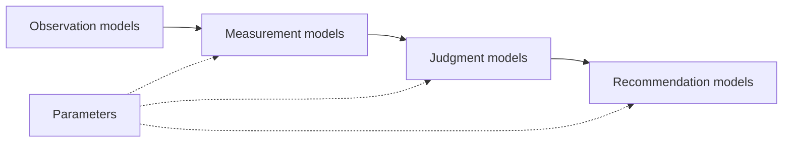
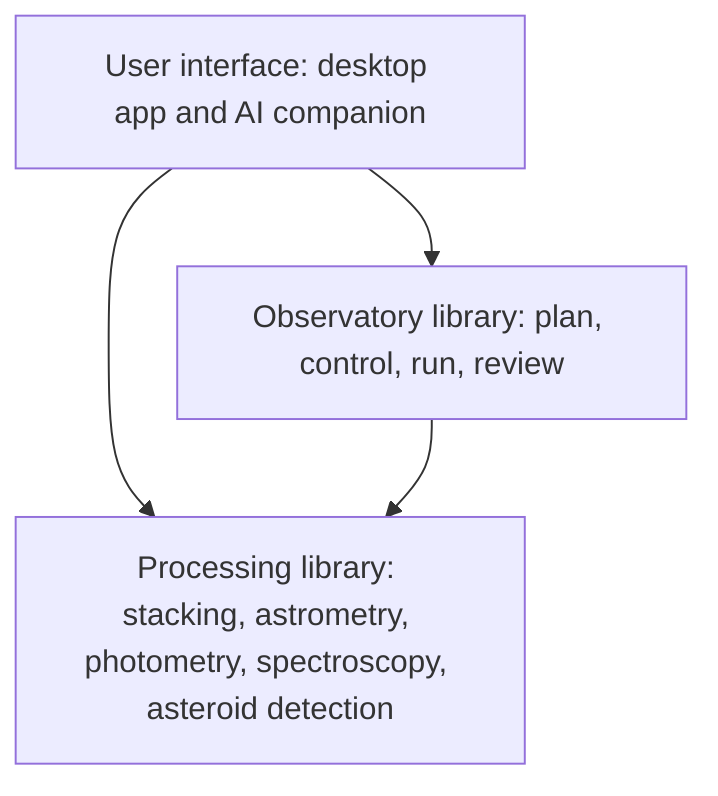

# Application Overview

*Version 2.0 · 2026-11-15 · Status: current*

This page gives the general approach of the application and how it is structured, before you read any one paper. It looks at the same system three ways: its data models, its algorithms and its workflows. Each view links to the documents that explain it in depth.

Terms are defined in the [glossary](Glossary.md).

## Data models

The data models are layered, and each layer is built from the one below it. *Observation models* describe what was observed and with what: targets, frames, stacks, catalog stars, equipment and sessions. *Measurement models* hold what is worked out from them, both the science results (light curves, spectra, plate solutions) and the quality metrics that say how good the data and results are. *Judgment models* compare a measurement with a limit, and *recommendation models* turn a judgment into advice for the observer. Beside every layer sit the *parameters*: the tuned values that shape the measurements and set the limits.



**Figure 1.** The data-model layers, with the parameters every layer reads.

[Wayfinding quality judgment](library_design/Wayfinding_Quality_Judgment.md) (Section 2) explains measurement, judgment and recommendation; the [validation register](library_design/validation/index.md) records each parameter and the evidence behind it.

## Algorithms

The code is two libraries and a thin user interface over them. The processing library turns frames into measurements: stacking, then astrometry, then photometry, spectroscopy and asteroid detection side by side, with quality measured at every step. The observatory library plans a night, controls the equipment, runs a planned night, and reviews the results to recommend what to image next; it uses the processing library but is never used by it. The desktop app and the AI companion servers only call the two libraries and show what they return.



**Figure 2.** The algorithm layers. Arrows point from a layer to the layer it uses.

**Table 1.** Which library owns which data-model layer.

| Data-model layer | Owned by |
| --- | --- |
| Observation models | Both libraries |
| Measurement models | The processing library |
| Judgment models | Both libraries |
| Recommendation models | The observatory library |
| Parameters | Each library for its own values |

[How the Astrometrics processing pipelines fit together](library_design/Astrometrics_Pipeline_Dataflow.md), the two library architecture papers and the [desktop app architecture](user_interface/technical_reference/User_Interface_Architecture.md) go into each layer.

## Workflows

The application serves a loop that repeats every clear night: plan the night, run it, process the frames, and review the results, which feeds the next plan.


**Figure 3.** The observing loop.

The [quality use cases](library_design/Wayfinding_Quality_Use_Cases.md) describe each step from the observer's side, and the [user manual](user_interface/user_guides/User_Manual.md) shows where each is done in the desktop app.

## Pages in this section

The library papers give the theory without naming code; their companion implementation papers, under [Reference](reference.md), name the code and give the tuned values.

- [How the Astrometrics processing pipelines fit together](library_design/Astrometrics_Pipeline_Dataflow.md): how raw telescope exposures flow through the five processing pipelines into scientific data products.
- [Pipeline review guides](library_design/pipelines/index.md): one page per processing pipeline, with its inputs, equations, tuned limits, fallbacks and quality gates.
- [Astrometrics library architecture](library_design/Astrometrics_Library_Architecture.md): the theory behind stacking, astrometry, photometry, spectroscopy and asteroid detection.
- [Wayfinding library architecture](library_design/Wayfinding_Library_Architecture.md): the theory behind observation planning and observatory control.
- [Wayfinding quality judgment](library_design/Wayfinding_Quality_Judgment.md): the theory of how the library judges quality and recommends the next observation: statements, efficiency, the loss account, the forecast check and tonight's ranking.
- [Wayfinding quality use cases](library_design/Wayfinding_Quality_Use_Cases.md): how the observer uses the quality displays, step by step, in fourteen use cases.
- [Desktop app architecture](user_interface/technical_reference/User_Interface_Architecture.md): how the desktop app is built and how it talks to the Python backend.

```{toctree}
:hidden:

library_design/Astrometrics_Pipeline_Dataflow
library_design/pipelines/index
library_design/Astrometrics_Library_Architecture
library_design/Wayfinding_Library_Architecture
library_design/Wayfinding_Quality_Judgment
library_design/Wayfinding_Quality_Use_Cases
user_interface/technical_reference/User_Interface_Architecture
```
