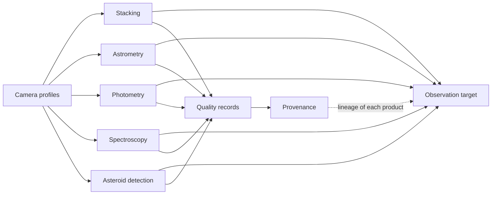

# Astrometrics library architecture

*Version 3.2 · 2026-10-15 · Status: current*

## Abstract

Cooled cameras and small telescopes let amateur astronomers and small observatories collect data of scientific value, but the software that reduces these data is split into separate tools. Each tool uses its own settings and gives no common record of how reliable its output is. This paper describes the architecture of the Astrometrics library, which reduces telescope data in five pipelines: stacking, astrometry, photometry, spectroscopy, and asteroid detection. The pipelines share one data model built around the observation target. They also share records of camera properties and data provenance, and they check their own work with recorded pass, fail, or not-checked gates before and after each run. The paper states the governing equations of each step. They cover calibration, sigma clipping with a cutoff that follows the number of frames, a plate-solution model with distortion terms, and a noise budget for aperture photometry. They also cover ensemble differential photometry, variability indices, grating-based wavelength calibration, and straight-line motion fitting. Tuned settings are not given here. Three kinds of evidence back them: synthetic data with known truth, real observing sessions, and surveys of every stored product. The paper also lists the assumptions and limits of its methods.

Terms are defined in the [glossary](../Glossary.md). This document also defines each term the first time it appears.

Symbols and their units are listed in the [notation appendix](#appendix-a-notation). The [implementation paper](Astrometrics_Library_Implementation.md) names the code behind each section and gives the tuned values.

## 1. Introduction

**Statement of need.** Cooled cameras and small telescopes let amateurs and small observatories collect data of scientific value: light curves of variable stars, spectra of bright stars, and positions of asteroids. The software that reduces these data is built one step at a time. Each program has its own conventions, and none carries a common description of the target or a record of how far its output can be trusted. This paper describes a library that covers five reductions on one data model.

**Approach.** One shared data model (Section 2) lets the five pipelines work on the same target and reuse each other's results. Each pipeline also checks its own input and output, and records each check as passed, failed, or not checked.

**Scope.** This paper explains the theory: what each step does and why. It gives no tuned settings. Those are listed in `Astrometrics_Library_Implementation.md`, which also maps each idea to code. The evidence behind each setting is in the validation register ([validation/index.md](validation/index.md)). The [API reference](../api/astrometricslib.rst) is generated from the source.

### 1.1 Related work

**Stacking.** Siril [1] and PixInsight [2] calibrate, register, and stack frames but do not pass their result on as part of a shared record of the target. The library uses Siril as its engine and adds a rejection cutoff that follows the number of frames (Section 3.2).

**Plate solving.** Astrometry.net [3] finds the sky position of an image without a position estimate, by matching four-star patterns against an index. The library uses it as its solver and adds a refit against Gaia stars (Section 4.2).

**Photometry.** AstroImageJ [4] and photutils [5] provide interactive and programmatic aperture photometry. The library automates the vetting of comparison stars and tests variability against the field's own scatter (Section 5.2).

**Spectroscopy.** The specutils package [6] and ISIS [7] provide spectral data structures and amateur spectrum reduction. The library classifies the spectra of many stars in one frame and checks each against a Gaia spectrum (Section 6.2).

**Moving objects and surveys.** Survey pipelines such as THOR [8] link detections from many nights into orbits, but a small observatory often has only a few hours on a target. The library fits straight lines within one night (Section 7). Large surveys, such as Rubin Observatory's [9] and Gaia [10], use fixed instruments with known properties, so the library stores a profile for each camera (Section 2.3).

## 2. Observational data models

The library organizes what it knows about the sky into four categories of information, all tied to one target. Figure 1 shows how the five pipelines feed the target and which records they share.

**Figure 1.** The five pipelines and the shared records. Provenance links each product to the run that made it.

Every image is stored as a FITS file (Flexible Image Transport System) [11], the standard format for astronomical data, with pixel data and a header of metadata.

### 2.1 Information types

1. **Observation target.** A region of sky, such as the galaxy M 81. It connects every raw frame, calibration frame (a frame that measures the camera's own errors), solved position, stacked image, detected star, and moving object found for it.
2. **Stellar object.** A single star, with its light curve, variability, and spectrum.
3. **Moving object candidate.** A possible asteroid or comet, with its path, speed, and any catalog match.
4. **Pipeline quality record.** A health report for one run, built from gates.

A gate is one recorded verdict on one quality condition of a run: passed, failed, or not checked. A gate that could not look at its data is recorded as not checked, never as passed.

In Table 1, $\alpha$ and $\delta$ are Right Ascension and Declination, the sky's longitude and latitude. The magnitude $V$ is brightness on a backward scale in the V band, a green-yellow band near 550 nm: lower is brighter, and 5 magnitudes is a factor of 100. An ephemeris is a table of predicted positions.

**Table 1.** Observational data models summary.

| Observational data model | Data attributes |
| --- | --- |
| **Observation target** | Coordinates $(\alpha_0, \delta_0)$, raw exposures, calibration masters, stacked FITS images |
| **Stellar object** | Coordinates $(\alpha, \delta)$, magnitude $V$, light curves $\hat{F}(t)$, 1D spectra $\Phi(\lambda)$ |
| **Moving object candidate** | Detection chain $(x_j, y_j, t_j)$, motion rates $(\dot{\alpha}, \dot{\delta})$, ephemeris match |
| **Pipeline quality record** | Frame survivor counts $N$, rejection cutoffs $z_{\text{low}}(N), z_{\text{high}}(N)$, FWHM ratio, gate results |

### 2.2 Data model progression across pipelines

Table 2 shows how each data model fills in as data moves through the pipelines.

**Table 2.** Observational data models across pipelines.

| Pipeline | Observation target | Stellar object | Moving object candidate |
| --- | --- | --- | --- |
| **Stacking** | Raw and calibration frames | N/A | The stack that fixes each raw frame's sky position (Section 7.1) |
| **Astrometry** | Matched coordinates | Stars linked to catalog positions | Sky positions |
| **Photometry** | Comparison stars | Light curves | N/A |
| **Spectroscopy** | Zero-order position (Section 6.1) | Calibrated spectra, types | N/A |
| **Asteroid detection** | Candidates that passed the filters (Section 7.2) | N/A | Direction, speed, names |

### 2.3 Shared records: camera profiles and provenance

- **Camera profile.** Facts about one camera model's sensor: its clipping level, gain in e⁻/ADU (electrons per step of the stored value), read noise, and quantum efficiency (the share of arriving light it records at each wavelength). Each number notes its source: a datasheet, a measurement, or an assumption. A camera with no profile gets a flagged generic stand-in. <!-- impl: astrometricslib.drivers.camera_profile_store.resolve_camera_profile --> <!-- impl: astrometricslib.pipelines.shared.applied_camera_profile.record_camera_profile -->
- **Provenance.** For each data product, a record of the run, software version, settings, and inputs that made it. It follows the IVOA Provenance Data Model [12], which builds on the W3C PROV data model [13]. A storage problem is logged and never fails a run. Lineage can be exported as PROV-XML. <!-- impl: astrometricslib.pipelines.shared.provenance_recording.record_pipeline_run --> <!-- impl: astrometricslib.drivers.provenance_store.ProvenanceStore --> <!-- impl: astrometricslib.drivers.provenance_store.export_target_lineage_as_prov_xml -->

---

## 3. Image stacking pipeline

The stacking pipeline combines many exposures into one image. Combining boosts the signal from stars and averages out noise and artifacts such as satellite streaks and cosmic ray hits. Evidence for its settings is in the [stacking register](validation/stacking.md).

### 3.1 Purpose and interfaces

- **Inputs.** Raw light exposures and three master calibration frames ($M_{\text{bias}}, M_{\text{dark}}, M_{\text{flat}}$).
- **Outputs.** A calibrated, stacked 2D image (broadband, or spectral, where each star is spread into a spectrum) and a quality record.

### 3.2 Major concepts and governing equations

Every raw exposure $I_{\text{raw}}$ holds an *additive* error from the camera electronics and sensor heat, and a *multiplicative* error from the optics. Three masters, each an average of many calibration frames, correct them: the bias $M_{\text{bias}}$ (the fixed electronic offset), the dark $M_{\text{dark}}$ (dark current, the signal from sensor heat, and hot pixels), and the flat $M_{\text{flat}}$ (vignetting, dust shadows, and pixel-to-pixel sensitivity). The flat, with its bias removed, is divided by its average $\langle \cdot \rangle$ so that it is 1 on average:

$$
I_{\text{calibrated}} = \frac{I_{\text{raw}} - M_{\text{dark}}}{\left(M_{\text{flat}} - M_{\text{bias}}\right) / \langle M_{\text{flat}} - M_{\text{bias}} \rangle} \tag{1}
$$

The numerator subtracts only the dark, which as a raw closed-shutter exposure already holds the bias. Subtracting the bias too would remove it twice and push the faint sky below zero. The bias master is used on the lights only when no dark exists. <!-- impl: astrometricslib.drivers.siril_interface.light_calibration_flags -->

The masters are only as good as the frames chosen for them. Calibration frames must match the lights' gain and offset, and a binning mismatch blocks a frame because binning merges pixels. Darks are sorted into temperature slots and never mixed, since dark current roughly doubles every few degrees. Every flat has its bias removed, even a master built from one flat. A master built from very few frames is flagged. <!-- impl: astrometricslib.drivers.calibration_library.calibration_setting_key --> <!-- impl: astrometricslib.drivers.calibration_library.CalibrationLibrary.select_dark_frames --> <!-- impl: astrometricslib.drivers.calibration_library.temperature_slot_c --> <!-- impl: astrometricslib.drivers.siril_interface.build_flat_master_commands --> <!-- impl: astrometricslib.drivers.siril_interface.build_single_light_commands --> <!-- impl: astrometricslib.drivers.siril_interface.calibration_count_flags -->

Averaging $N$ calibrated exposures lowers random noise by about $\sqrt{N}$. One very bright value, such as a satellite streak, would pull the mean off, so at each pixel any value too far from the median is rejected. This is sigma clipping when the distance is measured in standard deviations ($\sigma$). Rather than one fixed cutoff, the pipeline lets the cutoff follow $N$. It starts from Chauvenet's criterion [14], [15]: a value is an outlier when fewer than half of one such value is expected by chance among $N$ normal-noise samples:

$$
z(N) = \sqrt{2}\,\mathrm{erfc}^{-1}\!\left(\frac{1}{2N}\right) \tag{2}
$$

The cutoff loosens as $N$ grows, because the chance that some good value looks extreme grows with $N$. A fixed $3\sigma$ cutoff instead rejects the same share of good values (about 0.27%) at every $N$.

A real stacker estimates the spread from the same $N$ values, which is noisy for small stacks, so Equation (2) alone rejects too many good values there. Two changes follow. The upper cutoff never drops below a floor $z_{\text{floor}}$. The lower cutoff sits a margin $\Delta_z$ above it, because streaks, cosmic ray hits, and hot pixels are bright while low outliers are rare:

$$
z_{\text{high}}(N) = \max\!\big(z(N),\ z_{\text{floor}}\big), \qquad z_{\text{low}}(N) = z_{\text{high}}(N) + \Delta_z \tag{3}
$$

<!-- impl: astrometricslib.utilities.rejection_thresholds.rejection_bounds --> <!-- impl: astrometricslib.utilities.rejection_thresholds.chauvenet_sigma -->

:::{warning}
**The floor trades one risk for another.** A higher floor protects good values and lets more weak outliers through. <!-- impl: astrometricslib.scripts.rejection_small_n_check -->
:::

Frames of different exposure lengths cannot be clipped together, since a long and a short frame hold very different light in the same pixel. Each length is stacked alone, and the groups are put on one brightness scale and combined with inverse-variance weights (one over the noise variance). A group's scale is the median ratio of its stars' fluxes to those of the reference group, the one with the most weight. Stars are used because faint pixels are mostly sky, which changes between nights. A group that is not one scale factor of the reference is left out. <!-- impl: astrometricslib.pipelines.stacking.processing.exposure_groups.combine_exposure_group_images --> <!-- impl: astrometricslib.pipelines.stacking.processing.exposure_groups.measure_group_gains_with_stars --> <!-- impl: astrometricslib.pipelines.stacking.processing.exposure_groups.measure_star_flux_ratios --> <!-- impl: astrometricslib.pipelines.stacking.processing.exposure_groups.measure_group_gains -->

A second weighting acts on single frames. For sky-limited frames, a frame's squared signal-to-noise ratio grows with its exposure, so equal weights waste the longer frames. The noise penalty $P$ of equal weights follows from the exposure times $\tau_j$:

$$
P = \sqrt{\left(\frac{1}{N}\sum_{j=1}^{N}\frac{1}{\tau_j}\right)\left(\frac{1}{N}\sum_{j=1}^{N}\tau_j\right)} \tag{4}
$$

$P$ is 1 for equal lengths. When it passes a tuned factor a little above one, each frame is weighted by its own measured noise. Spectral stacks use the group handling above. <!-- impl: astrometricslib.pipelines.stacking.pre_processing.exposure_weighting.choose_stack_weight --> <!-- impl: astrometricslib.pipelines.stacking.pre_processing.exposure_weighting.equal_weight_noise_penalty -->

### 3.3 Pipeline theory of operations

Frames are calibrated before they are aligned. Alignment lines frames up so each star falls on the same pixel. Ordinary images use full alignment (shift, rotation, stretch), but spectral images may only shift, so the axis along which the spectrum spreads is not distorted. Table 3 lists the steps.

**Table 3.** Stacking pipeline execution sequence.

| Step | Pipeline phase | Description |
| --- | --- | --- |
| 1 | Frame screening | Set aside frames that break the session's pattern (Section 3.4.1). |
| 2 | Calibration | Match calibration frames to the lights and apply Equation (1). |
| 3 | Quality safeguard | Keep the sharpest, roundest frames, but never fewer than a minimum. |
| 4 | Alignment and outlier rejection | Align the frames and reject pixels with Equations (2) and (3). |
| 5 | Combine | Average the surviving pixels, with exposure groups handled as in Section 3.2. |

<!-- impl: astrometricslib.pipelines.stacking.pre_processing.frame_homogeneity.find_dominant_gain_subset -->

A stack request chooses the light frames, never mixing imaging and spectral frames or two cameras, and runs as a tracked job (a background task whose progress is recorded). When too few spectral frames register by star matching, the stack is retried with phase correlation [16], which finds the shift between two images from their overall patterns. Quarantined frames are moved, never deleted. A preview image is stretched because linear data looks almost black, and StarNet [17] lets the stars be stretched separately. <!-- impl: astrometricslib.pipelines.stacking.stack_request.choose_frames_to_stack --> <!-- impl: astrometricslib.pipelines.stacking.stack_request.run_stack --> <!-- impl: astrometricslib.pipelines.stacking.stage.stack_frames --> <!-- impl: astrometricslib.pipelines.tasks.stack_frames_with_timeout --> <!-- impl: astrometricslib.pipelines.stacking.stack_runner.run_stack --> <!-- impl: astrometricslib.pipelines.stacking.calibration_ingest.build_ingest_report --> <!-- impl: astrometricslib.pipelines.stacking.pre_processing.frame_quarantine.restore_quarantined_frames --> <!-- impl: astrometricslib.pipelines.stacking.post_processing.stack_preview.write_stack_preview --> <!-- impl: astrometricslib.pipelines.stacking.post_processing.starnet_stretch.blend_stars --> <!-- impl: astrometricslib.pipelines.stacking.post_processing.preview_remake.remake_stack_preview -->

### 3.4 Quality metrics and integration planning

#### 3.4.1 Before stacking: screening raw frames

Each frame is judged against its own session, a run of frames with the same camera, filter, and exposure and no long gap. Clouded frames (far fewer stars than the session median and a brighter sky) and trailed frames (low star roundness, the narrow width over the wide width) are moved aside. If too large a share of a session would be moved, nothing is moved and the check fails, because the session itself is the problem. Frames at a minority gain, and the minority side of a sudden jump in sky level (two sky conditions, such as clouds rolling in), are also set aside. A requested share of the sharpest, roundest frames is kept. The master flat's noise must stay below a limit, because dividing by it copies its noise into every light. <!-- impl: astrometricslib.pipelines.stacking.pre_processing.frame_quarantine.judge_batch --> <!-- impl: astrometricslib.pipelines.stacking.pre_processing.frame_quarantine.quarantine_gate --> <!-- impl: astrometricslib.pipelines.stacking.pre_processing.frame_homogeneity.gain_homogeneity_gate --> <!-- impl: astrometricslib.pipelines.stacking.pre_processing.background_homogeneity.detect_background_split --> <!-- impl: astrometricslib.pipelines.stacking.pre_processing.background_homogeneity.background_homogeneity_gate --> <!-- impl: astrometricslib.utilities.stack_filter_floor.resolve_filter_wfwhm_with_floor --> <!-- impl: astrometricslib.pipelines.stacking.pre_processing.flat_calibration.assess_flats --> <!-- impl: astrometricslib.pipelines.stacking.pre_processing.assess_input_quality.calibration_gates -->

#### 3.4.2 After stacking: checking the final image

Six checks run on the stacked image, and three more on stacks of several exposure lengths. The star sharpness ratio compares the star width in the stack with the width its frames predict. The width is the FWHM (full width at half maximum), the width of a star's image at half its peak. A stack's star is the average of its frames' stars. For round Gaussian stars the variances average, so the expected width is the root mean square of the input widths. A median would call the normal blur of nights with different seeing (air turbulence) a failure: <!-- impl: astrometricslib.pipelines.stacking.post_processing.assess_output_quality.output_quality_gates -->

$$
\rho_{\text{FWHM}} = \frac{\text{FWHM}_{\text{stack}}}{\text{FWHM}_{\text{expected}}}, \qquad \text{FWHM}_{\text{expected}} = \sqrt{\frac{1}{N}\sum_{j=1}^{N}\text{FWHM}_j^{\,2}} \tag{5}
$$

A value clearly above 1 fails, since small misalignments blurred the stack. The other checks cover the share of rejected, saturated, zero (for example, a bias removed twice), and negative pixels, and whether a spectral stack's zero-order image jumps between frames. For several exposure lengths, each group must be one scale factor of the reference, no group may be missing, and raw frames must not be clipped at zero by a low camera offset. <!-- impl: astrometricslib.pipelines.stacking.post_processing.stack_quality.expected_stack_fwhm --> <!-- impl: astrometricslib.pipelines.stacking.post_processing.stack_quality.zero_fraction_threshold --> <!-- impl: astrometricslib.pipelines.spectroscopy.utilities.registration_quality.evaluate_spectral_registration_quality --> <!-- impl: astrometricslib.pipelines.stacking.processing.exposure_groups.measure_exposure_group_gains --> <!-- impl: astrometricslib.pipelines.stacking.post_processing.exposure_group_report.exposure_group_linearity_gate --> <!-- impl: astrometricslib.pipelines.stacking.post_processing.exposure_group_report.exposure_groups_combined_gate --> <!-- impl: astrometricslib.pipelines.stacking.post_processing.exposure_group_report.raw_frame_clipping_gate --> The pipeline does not cross-check image quality against the telescope's reported state or measure the noise reduction against the $\sqrt{N}$ expectation (Section 9).

---

## 4. Astrometry pipeline

The astrometry pipeline finds exactly where a stacked image is pointed, a step called plate solving. It matches pixels to sky coordinates: Right Ascension $\alpha$ and Declination $\delta$, measured in degrees or arcseconds (1/3600 of a degree). The result is a World Coordinate System (WCS) [18], [19], a formula that converts any pixel position to a sky position and back. Evidence for its settings is in the [astrometry register](validation/astrometry.md).

### 4.1 Purpose and interfaces

- **Inputs.** A stacked image and a rough estimate of the field's coordinates and pixel scale (arcseconds of sky per pixel).
- **Outputs.** A WCS in the image's FITS header, a list of catalog-identified stars, and an astrometry quality record.

### 4.2 Major concepts and governing equations

Plate solving connects pixel coordinates $(x,y)$ to sky coordinates $(\alpha, \delta)$ in six steps:

1. **Star detection.** A matched-filter star finder (DAOFIND [20], through photutils [5]) slides a star-shaped template over the background-subtracted image and responds most where the image looks like a star. It keeps sources whose sharpness and roundness look stellar: a hot pixel is too sharp and a galaxy too flat. A Gaussian fit to bright stars measures the star width (FWHM), which sets the acceptable position error. <!-- impl: astrometricslib.pipelines.astrometry.pre_processing.source_detection.SourceDetector.detect --> <!-- impl: astrometricslib.pipelines.astrometry.pre_processing.fwhm.measure_image_fwhm -->
2. **Quad-star matching.** Nearby stars are grouped into four-star shapes ("quads") whose relative side lengths do not change under rotation, reflection, or scaling. Comparing them with a pre-built star index identifies the patch of sky, even if the telescope pointed somewhere unexpected. The Astrometry.net solver [3] does this, locally first and then online. <!-- impl: astrometricslib.drivers.astrometry_net_driver.AstrometryNetPlateSolveDriver.solve --> <!-- impl: astrometricslib.pipelines.astrometry.processing.star_identifier.MAXIMUM_PLATE_SOLVE_SOURCES -->
3. **Fitting the distortion map.** Pixel offsets $(u, v)$ from a reference pixel $(x_{\text{ref}}, y_{\text{ref}})$ become offsets $(\xi, \eta)$ on the tangent plane (a flat sky projection touching the sphere at the reference pixel). Four linear coefficients $K$ handle rotation, scale, and flips. Real optics also bend the map, mostly near the edges, so a Simple Imaging Polynomial (SIP) [21] first corrects the pixel offsets, with second-order and higher terms only, because $K$ holds the linear part:

   $$
   \begin{aligned}
   \begin{pmatrix} \xi \\ \eta \end{pmatrix} &= \begin{pmatrix} K_{11} & K_{12} \\ K_{21} & K_{22} \end{pmatrix} \begin{pmatrix} u + f(u,v) \\ v + g(u,v) \end{pmatrix}, \qquad u = x - x_{\text{ref}}, \quad v = y - y_{\text{ref}}, \\
   f(u,v) &= \sum_{a+b=2}^{n_{\text{SIP}}} A_{ab}\,u^{a}v^{b}, \qquad g(u,v) = \sum_{a+b=2}^{n_{\text{SIP}}} B_{ab}\,u^{a}v^{b}
   \end{aligned} \tag{6}
   $$

   The WCS is written into the FITS header with its SIP terms, so a later reader keeps the lens correction. <!-- impl: astrometricslib.pipelines.shared.session_identification.write_wcs_to_fits_header -->
4. **Naming the stars.** Each detected star is matched to the nearest entry in the SIMBAD database [22] or the Gaia catalog [23]. Gaia lists positions for one fixed date, the catalog epoch, with each star's proper motion (its yearly drift across the sky). Over a decade a fast star can drift a whole match radius, so each Gaia position is moved to the observation date first. <!-- impl: astrometricslib.pipelines.astrometry.processing.star_identifier.propagate_gaia_positions --> <!-- impl: astrometricslib.pipelines.astrometry.processing.star_identifier.StarIdentifier._move_gaia_coords_to_observation_epoch -->
5. **Judging the fit.** Two numbers come from the solve. The *fit residual* is the root mean square (RMS) distance, in arcseconds, between each matched star's position under the fitted WCS and its position in the solver's index. An online solve returns no match table, so it has none. The *catalog match separation* is the RMS distance from each detected star to its nearest catalog star within the match radius. <!-- impl: astrometricslib.drivers.astrometry_net_driver.read_corr_fit_statistics --> <!-- impl: astrometricslib.pipelines.astrometry.post_processing.run_gates.astrometry_run_gates --> <!-- impl: astrometricslib.pipelines.astrometry.processing.star_identifier.StarIdentifier.get_catalog_match_separation_rms_arcsec -->
6. **Refitting to Gaia.** The solver fits a few dozen bright stars of its own index, which carry the index's errors, so a solution can be a pixel off and still agree with itself. The pipeline therefore fits a new low-order SIP solution to the detected stars matched to Gaia stars at the observation date. It drops stars far from the fit (blends, double stars, wrong matches) and repeats until the set is stable. The new solution replaces the solver's only when it fits better. The residual against Gaia is recorded either way, and it does not depend on the solver. The quality check judges the first available of three numbers: the RMS against Gaia, the solver's fit residual, and the catalog match separation. <!-- impl: astrometricslib.pipelines.astrometry.post_processing.run_gates._residual_and_basis --> <!-- impl: astrometricslib.pipelines.astrometry.processing.wcs_refinement.refine_wcs_with_gaia --> <!-- impl: astrometricslib.pipelines.astrometry.processing.star_identifier.StarIdentifier._refine_wcs_against_gaia -->

### 4.3 Pipeline theory of operations

Table 4 lists the steps.

**Table 4.** Astrometry pipeline execution sequence.

| Step | Pipeline phase | Description |
| --- | --- | --- |
| 1 | Source detection | Find stars. |
| 2 | Quad pattern hashing | Turn each four-star shape into a numeric code (a hash) to look up in the index. |
| 3 | WCS and distortion fit | Fit Equation (6) and write it into the header. |
| 4 | Catalog cross-match | Refit to Gaia and name the stars. |
| 5 | Solution check | Judge the residual against the star width. |

### 4.4 Quality metrics and solution validation

#### 4.4.1 Before solving: checking the image

At least four stars are needed, since one quad needs four. Below a higher count the local solver is skipped, because it would spend its whole time limit on a near-certain failure. <!-- impl: astrometricslib.pipelines.astrometry.processing.star_identifier.StarIdentifier.process_image --> <!-- impl: astrometricslib.pipelines.astrometry.processing.star_identifier.StarIdentifier._calculate_scale_hints --> <!-- impl: astrometricslib.drivers.astrometry_net_driver.AstrometryNetPlateSolveDriver._solve_locally -->

#### 4.4.2 After solving: checking the result

The solver must find a WCS, and enough stars must match a catalog entry, or the residual is an average over too few stars. The residual of Section 4.2, step 6, must stay below a fixed fraction of the star width. The limit sits well above centroid noise (the small random error in finding a star's center), so a larger residual means a wrong match, a bad distortion model, or a wrong field. A network check fails when remote catalog lookups were paused or too many failed, which tells a sparse field from a network problem. <!-- impl: astrometricslib.models.quality.gate_result.unchecked_gate --> <!-- impl: astrometricslib.pipelines.astrometry.post_processing.run_gates.astrometry_run_gates -->

:::{warning}
**A pass is not a measure of position accuracy.** The residual limit catches a failed solve and does not rank good ones.
:::

---

## 5. Stellar photometry pipeline

The photometry pipeline tracks how a star's brightness changes across a sequence of unstacked frames. It builds light curves and flags stars that vary. Evidence for its settings is in the [photometry register](validation/photometry.md).

### 5.1 Purpose and interfaces

- **Inputs.** Calibrated, unstacked light frames, the stars found on the session's first frame, and a solved WCS.
- **Outputs.** Normalized light curves $\hat{F}_i(t)$ with a $1\sigma$ uncertainty and a mid-exposure time for every point, variable-star candidates, and a photometry quality record.

### 5.2 Major concepts and governing equations

1. **Tracking a star frame to frame.** Stars are found once, on the first frame of a session: the frames of one target on one night with the same gain and offset. On each later frame, the pipeline measures how the frame sits against the first from a few bright alignment stars. It moves each star by that alignment and re-centers it on its brightness-weighted centroid in a small box, unless the box looks unreliable. Brightness comes from aperture photometry: the pixel values inside a circle on the star are added up, and the sky, the median of a ring around it, is subtracted. The circle sits at the star's exact fractional position, because a circle a fraction of a pixel off loses light that changes as the field drifts. This tracking holds only within a session. <!-- impl: astrometricslib.pipelines.photometry.pre_processing.frame_photometry._process_single_frame_worker --> <!-- impl: astrometricslib.pipelines.photometry.pre_processing.frame_photometry.refine_star_centroid --> <!-- impl: astrometricslib.pipelines.photometry.pre_processing.frame_photometry.measure_aperture_photometry -->
2. **Uncertainty of each measurement.** Every brightness carries a $1\sigma$ uncertainty, so later steps can weight points by quality. It follows the CCD equation [24] in the form of Merline and Howell [25], in electrons, where independent noise variances add:

   $$
   \sigma_{\text{ap}}^2 = S_\star + n_{\text{pix}}\left(s_{\text{sky}} + \sigma_{\text{rd}}^2 + D\right) + \frac{n_{\text{pix}}^2}{n_{\text{sky}}}\left(s_{\text{sky}} + \sigma_{\text{rd}}^2 + D\right) \tag{7}
   $$

   The first term is the star's shot noise: a count of $S_\star$ electrons scatters by about $\sqrt{S_\star}$. The others are the noise of the sky, read-out, and dark counts under the circle, and of the sky level that the ring estimates from a limited number of pixels. The gain comes from the camera profile, else the frame header. Only then is one electron per ADU assumed, and the light curve says so, because the uncertainties then have the right shape but the wrong size. Dark current is taken as zero. <!-- impl: astrometricslib.pipelines.photometry.pre_processing.frame_photometry.aperture_flux_error_adu --> <!-- impl: astrometricslib.pipelines.photometry.pre_processing.detector_noise.resolve_detector_noise -->
3. **Times of observation.** Each point is stamped with the middle of its exposure as BJD$_{\text{TDB}}$ (Barycentric Julian Date in Barycentric Dynamical Time) [26]. This is the time the light would reach the solar system's center of mass, so an event's date does not depend on where Earth is in its orbit (a shift of up to about 8 minutes). A frame with no readable date is rejected and never given the current time. <!-- impl: astrometricslib.pipelines.photometry.pre_processing.observation_times.barycentric_julian_dates --> <!-- impl: astrometricslib.pipelines.photometry.pre_processing.frame_photometry.read_observation_time -->
4. **Ensemble differential photometry.** To cancel passing clouds, each star's raw brightness $F_i(t)$ is divided by a signal from a group (ensemble) of well-behaved comparison stars in the same field [27]. A thin cloud dims every star by the same fraction, so the ratio stays put. The group is chosen once per session from stars that are measured in every usable frame, never saturated, and not listed as variable in a catalog such as the International Variable Star Index [28]. The very brightest are skipped, and faint ones are dropped because they add more noise than they remove. Then the star that scatters most, relative to the scatter its uncertainties predict, is dropped, repeatedly, until none scatters more than allowed. Each frame's signal is the weighted mean of the comparison stars' brightness, each divided by its own session mean, with weights of one over the variance:

   $$
   \hat{F}_i(t) = \frac{F_i(t)}{L_{\text{ens}}(t)}, \qquad L_{\text{ens}}(t) = \bar{\mu}\,\frac{\sum_{c=1}^{N_c} w_c(t)\,F_c(t)/\mu_c}{\sum_{c=1}^{N_c} w_c(t)}, \qquad w_c(t) = \frac{1}{\epsilon_c(t)^2} \tag{8}
   $$

   Here $\mu_c$ is a comparison star's session mean, $\bar{\mu}$ the mean of those means, and $\epsilon_c(t)$ a star's fractional uncertainty. The noise of $N_c$ equal stars averages down as $1/\sqrt{N_c}$, which a median would not do. A comparison star is divided by the signal of the *other* members, so its own dip never lowers its own divisor. Frames with far fewer measured stars than usual or a clear outlier signal are left out. A star's isolated outlying points are clipped, but a run of neighboring points on one side is kept as a real change. The pipeline does not fit brightness against airmass (the amount of atmosphere the light crossed), because the ensemble already removes shared dimming. <!-- impl: astrometricslib.pipelines.photometry.processing.comparison_ensemble.select_comparison_set --> <!-- impl: astrometricslib.pipelines.photometry.processing.comparison_ensemble.build_ensemble_signal --> <!-- impl: astrometricslib.pipelines.photometry.processing.variability_analyzer.VariabilityAnalyzer._reject_outlier_frames --> <!-- impl: astrometricslib.pipelines.photometry.processing.variability_analyzer.VariabilityAnalyzer._reject_outlier_measurements_for_star --> <!-- impl: astrometricslib.pipelines.photometry.processing.variability_analyzer.VariabilityAnalyzer.detrend_light_curves_airmass -->

   :::{warning}
   **A synthetic session tests the method, not the field.** It cannot show whether the brightness band, the number of comparison stars, and the vetting limit suit a real field. <!-- impl: astrometricslib.pipelines.photometry.test.test_comparison_ensemble_injection -->
   :::
5. **Deciding which stars vary.** A star's scatter grows as it gets fainter, so ranking by scatter would flag faint stars. The pipeline asks instead whether a star scatters more than a constant star of the same brightness in this field. It fits a noise model of the field's own scatter against brightness and measures three indices per star [29]. *Excess scatter* is the measured scatter over the expected scatter. *Reduced chi-square* is the scatter of the points about the weighted mean in units of their uncertainties. Both are near 1 for a constant star:

   $$
   \chi^2_\nu = \frac{1}{n_{\text{pts}}-1}\sum_{j=1}^{n_{\text{pts}}}\left(\frac{\hat{F}_j - \bar{F}_w}{e_j}\right)^2 \tag{9}
   $$

   *Stetson J* multiplies the deviations of neighboring points [30]. White noise gives products of random sign and J near 0, a smooth change gives mostly positive products, and one bad point adds little. The thresholds on chi-square and J are $\zeta$ robust standard deviations above the field's median, where $\zeta$ is the one-sided normal point for a chosen false-alarm share. A robust standard deviation is 1.4826 times the median absolute deviation (MAD) [31], which a few true variables do not inflate. A candidate must pass all three indices and a false-discovery test: its chi-square becomes a false-alarm probability, and the Benjamini–Hochberg method [32] converts these into q-values that allow for testing every star at once. The coefficient of variation is a plain measure of scatter, so 0.01 means about 1% scatter: <!-- impl: astrometricslib.pipelines.photometry.processing.variability_indices.FALSE_DISCOVERY_LEVEL --> <!-- impl: astrometricslib.pipelines.photometry.processing.variability_indices.assess_variability --> <!-- impl: astrometricslib.pipelines.photometry.processing.variability_indices.fit_noise_model --> <!-- impl: astrometricslib.pipelines.photometry.processing.variability_indices.reduced_chi_square --> <!-- impl: astrometricslib.pipelines.photometry.processing.variability_indices.stetson_j --> <!-- impl: astrometricslib.pipelines.photometry.processing.variability_indices.calibrate_thresholds -->

   $$
   C_v = \frac{s_{\hat{F}}}{\langle \hat{F} \rangle} \tag{10}
   $$

   A field with too few stars for a noise model flags stars by an unusually high $C_v$ relative to the rest of the field. <!-- impl: astrometricslib.pipelines.photometry.processing.variability_analyzer.flag_variable_stars -->

   :::{warning}
   **The flag is only as good as the field's noise.** The area under the ROC curve (AUC) is the chance that a random variable scores above a random constant star: 1 is perfect and 0.5 is chance. A synthetic field tests the method on understood noise, not on the sky. A flag from $C_v$ alone is a reason to look, not evidence of a known kind of variable. <!-- impl: astrometricslib.pipelines.photometry.test.test_variability_injection --> <!-- impl: astrometricslib.scripts.measure_variability_cutoff -->
   :::
6. **Matching the same star across sessions.** Tracking holds only within a session, so stars from sessions weeks apart are matched by sky position into a single light curve. No session is rescaled, because that would remove the slow change sought. For a star seen in at least two sessions, the between-session amplitude is the ratio of the highest to the lowest session median, in magnitudes, and the significance is the difference of those medians over their combined expected error. A shift every star shares points to the comparison group. <!-- impl: astrometricslib.pipelines.photometry.batch._match_and_merge_across_sessions --> <!-- impl: astrometricslib.pipelines.photometry.batch._merge_light_curves --> <!-- impl: astrometricslib.pipelines.photometry.processing.variability_analyzer.identify_long_term_variable_candidates -->
7. **Identifying stars by catalog name (optional).** A session's reference frame can be matched to a star catalog as in Section 4.
8. **Searching for a repeating pattern.** The target's star and a set number of the brightest others are searched for a period. A Lomb–Scargle periodogram [33], [34], [35] fits sine waves of many trial periods to unevenly spaced data, and box least squares [36] finds a repeating flat-bottomed dip, such as an eclipse or a transit. A search finds a best period even in pure noise, so each result carries a verdict: *insufficient data*, *not detected*, *possible*, or *detected*. The false-alarm probability is the share of shuffled light curves that give a result at least as strong. The shuffle moves blocks of neighboring points [37], so slow drifts are not mistaken for a signal. "Detected" needs a stricter limit and a minimum number of repeats. A hold-out check (leave one night out and predict it) and an alias check (false echo periods from once-a-night sampling) can each lower a verdict. One run makes $N_s$ searches, so each probability is corrected by the Šidák method [38], the chance that at least one of $N_s$ independent searches does that well by luck:

   $$
   p_{\text{corr}} = 1 - (1 - p)^{N_s} \tag{11}
   $$

   A shuffle test with $N_{\text{sh}}$ shuffles cannot report a probability below $1/(N_{\text{sh}}+1)$, so searches that need it are repeated with more shuffles. <!-- impl: astrometricslib.pipelines.photometry.batch.search_periods_and_save --> <!-- impl: astrometricslib.pipelines.photometry.processing.periodicity_search.lomb_scargle_search --> <!-- impl: astrometricslib.pipelines.photometry.processing.periodicity_search.box_search --> <!-- impl: astrometricslib.pipelines.photometry.processing.periodicity_search.verdict_from_false_alarm --> <!-- impl: astrometricslib.pipelines.photometry.processing.periodicity_search.correlation_block_length --> <!-- impl: astrometricslib.pipelines.photometry.processing.period_checks.apply_verdict_checks --> <!-- impl: astrometricslib.pipelines.photometry.processing.family_wise_correction.apply_family_wise_correction -->

### 5.3 Pipeline theory of operations

Table 5 lists the steps.

**Table 5.** Photometry pipeline execution sequence.

| Step | Pipeline phase | Description |
| --- | --- | --- |
| 1 | Star tracking | Shift each star by the frame's drift and re-center it. |
| 2 | Aperture photometry | Sum the light, subtract the sky, and compute the uncertainty (Equation (7)). |
| 3 | Ensemble selection | Exclude saturated and variable stars, then vet the rest. |
| 4 | Differential normalization | Divide by the ensemble signal (Equation (8)). |
| 5 | Variability analysis | Compute three indices (Equation (9)) and flag stars above all thresholds. |
| 6 | Cross-session matching | Match stars by sky position. |
| 7 | Period search | Search, shuffle-test, and correct for the number of searches (Equation (11)). |

### 5.4 Quality metrics and photometric validation

Each run-level check is recorded as passed, failed, or not checked, as in Section 4.4. <!-- impl: astrometricslib.pipelines.photometry.post_processing.run_gates.photometry_run_gates -->

#### 5.4.1 Before measuring: screening the input

A star saturated in any frame is never a comparison star. A frame's drift is measured only with enough alignment stars, and a frame with no readable date is rejected.

#### 5.4.2 After measuring: checking the light curve

The comparison set must hold a minimum number of stars, the same in every frame, with scatter matching its uncertainties. Frames with a clear outlier signal are rejected, and the run is flagged when a large share is. Catalog-listed variables should score above other stars. The run states the smallest change it could see, and fails when most variable stars would be missed.

---

## 6. Stellar spectroscopy pipeline

The spectroscopy pipeline extracts, calibrates, and classifies a star's spectrum from images taken through a transmission grating (a plate ruled with fine parallel lines, here a Star Analyser 200) in front of the camera. The grating spreads each star's light into a spectrum without a slit (slitless spectroscopy). Each star leaves an undispersed point image, the zero order, and beside it the first-order spectrum, which the pipeline measures. Evidence for its settings is in the [spectroscopy register](validation/spectroscopy.md).

### 6.1 Purpose and interfaces

- **Inputs.** A stacked spectral image, the zero-order star position, the target's aperture size, the camera's quantum efficiency (QE) curve, the instrument response, and the airmass from the header.
- **Outputs.** A wavelength-calibrated 1D spectrum $\Phi(\lambda)$, detected hydrogen (Balmer) lines, the dispersion angle, the closest spectral type with a measure of how clearly it wins, and a quality record.

### 6.2 Major concepts and governing equations

1. **Finding the spectrum's angle.** The pipeline measures the dispersion angle $\theta_{\text{disp}}$, the direction in which the grating spreads the light relative to the pixel grid, anchored on the zero-order position $(x_0, y_0)$.
2. **Extracting the spectrum.** Each spectrum lies on the image as a short band, the trail. At each step along it, the pipeline sums the pixels across the trail inside a reading box and subtracts the sky, giving one point of the profile $T(\ell)$. Here $\ell$ is the distance along the trail from the zero-order star and $q$ is the pixel offset across it:

   $$
   T(\ell) = \sum_{q} m(q)\,\big[\,I(\ell, q) - b(\ell)\,\big] \tag{12}
   $$

   Here $I$ is the pixel intensity, $b(\ell)$ the sky level, and $m(q)$ the fraction of pixel $q$ inside the box. Edge pixels count in part, or the box would change size in whole-pixel jumps that show up as false steps in the spectrum. The sky is measured in two strips beside the box. Their mean is used when their medians agree within noise. Otherwise the brighter strip is treated as contaminated, since a neighbor's light can only add, and the cleaner strip is used alone. For a point-like star the box reaches a fixed multiple of the trail's fitted width to each side, smoothed first so a noisy fit does not make the spectrum jump. Extended objects such as nebulae and comets get a wider box sized from their cataloged angular size. <!-- impl: astrometricslib.pipelines.spectroscopy.pre_processing.spectrum_extractor.measure_sky --> <!-- impl: astrometricslib.pipelines.spectroscopy.pre_processing.spectrum_extractor.SpectrumExtractor._sum_aperture_minus_sky --> <!-- impl: astrometricslib.pipelines.spectroscopy.pre_processing.spectrum_extractor.box_pixel_weights --> <!-- impl: astrometricslib.pipelines.spectroscopy.pre_processing.spectrum_extractor.traced_aperture_half_widths_px --> <!-- impl: astrometricslib.pipelines.spectroscopy.pre_processing.spectrum_extractor.smooth_aperture_sigmas --> <!-- impl: astrometricslib.pipelines.astrometry.pipeline.AstrometryPipeline._derive_extraction_radius_px -->
3. **Converting pixels to wavelength.** The grating bends longer wavelengths through larger angles. The angle follows from the distance on the sensor and the grating-to-sensor distance $L_g$, and the grating equation turns it into a wavelength:

   $$
   \lambda(\ell) = d\,\sin\!\left(\arctan\frac{\ell_{\text{mm}}}{L_g}\right) \tag{13}
   $$

   Here $d$ is the groove spacing and $\ell_{\text{mm}}$ is $\ell$ in millimeters. The Star Analyser 200 has 200 grooves per millimeter, so $d = \frac{1}{200}\,\text{mm}$. $L_g$ is the one free parameter. A separate step fits it once on Vega, which has strong hydrogen lines, by matching its Balmer absorption dips to their known air wavelengths ($\mathrm{H}\beta = 4861.3\text{ Å}, \mathrm{H}\gamma = 4340.5\text{ Å}, \mathrm{H}\delta = 4101.7\text{ Å}$; 1 Å is $10^{-10}$ m, or 0.1 nm). It tries every group of three dips against the three lines and keeps the group with the smallest RMS wavelength error. <!-- impl: astrometricslib.pipelines.spectroscopy.utilities.calibration_tuner.SpectroscopyCalibrationTuner._fit_grating_distance -->
4. **Correcting for the instrument and the air.** Three effects of the equipment and sky, not the star, are removed. The flux is divided by the QE curve $\text{QE}(\lambda)$. The grating, coatings, and air also favor some colors. The instrument response $R_{\text{ins}}(\lambda)$ is measured by observing Vega, dividing by its reference spectrum (the A0V template of a library of observed spectra [39]), and smoothing. Air dims blue light more than red, and more at higher airmass (the amount of air the light crossed, 1.0 straight overhead). The response already holds the dimming at the standard star's airmass, so a target at another airmass is rescaled with an extinction curve $k_{\text{ext}}(\lambda)$, in magnitudes per airmass:

   $$
   \Phi_{\text{cal}}(\lambda) = \frac{T\big(\ell(\lambda)\big)}{\text{QE}(\lambda)\,R_{\text{ins}}(\lambda)}\;10^{\,0.4\,k_{\text{ext}}(\lambda)\,(X_{\text{target}} - X_{\text{ref}})} \tag{14}
   $$

   Here $X_{\text{target}}$ and $X_{\text{ref}}$ are the airmasses of the frame and the standard star, so the last factor is 1 when they are equal. The stored curve is the Kitt Peak mean curve distributed with IRAF [40]. Because only a difference of airmasses enters, another site's curve errs by a small fraction of the correction.

   All three curves depend on wavelength, so wavelengths are fixed first. Air bends blue light more than red, so a star's blue and red light enter the grating from slightly different directions (atmospheric differential refraction [41]), and each wavelength is shifted back. The wavelength zero point, the offset of the whole scale, is then measured from known absorption lines and removed when at least two significant lines agree. Dust between the star and Earth also reddens it. When Gaia Data Release 3 [42] gives the color excess $E(B-V)$ (how much redder dust has made the star), an average Galactic dust law [43] removes the reddening before classification. Last, the spectrum is compared with the star's Gaia XP spectrum [44], measured above the atmosphere. A straight tilt of the ratio points at the response or airmass correction, and a shift of the features at the wavelength scale. <!-- impl: astrometricslib.pipelines.spectroscopy.pre_processing.quantum_efficiency_correction.apply_quantum_efficiency_correction --> <!-- impl: astrometricslib.pipelines.spectroscopy.pre_processing.instrument_response.apply_instrument_response --> <!-- impl: astrometricslib.pipelines.spectroscopy.pre_processing.atmospheric_extinction.apply_extinction_correction --> <!-- impl: astrometricslib.pipelines.spectroscopy.pipeline.SpectroscopyPipeline._apply_result_to_stellar_object --> <!-- impl: astrometricslib.pipelines.spectroscopy.pre_processing.differential_refraction.correct_differential_refraction --> <!-- impl: astrometricslib.pipelines.spectroscopy.pre_processing.wavelength_zero_point.measure_wavelength_zero_point --> <!-- impl: astrometricslib.pipelines.spectroscopy.processing.star_reddening.look_up_star_reddening --> <!-- impl: astrometricslib.pipelines.spectroscopy.processing.interstellar_extinction.deredden_spectrum --> <!-- impl: astrometricslib.pipelines.spectroscopy.post_processing.compare_to_gaia_xp.compare_to_gaia_xp -->
5. **Classifying the spectrum.** A spectral type is a letter (O, B, A, F, G, K, M, from hottest to coolest), a subtype from 0 to 9, and a luminosity class numeral. V is a main-sequence star, so A0V is a hot main-sequence star like Vega. The corrected spectrum is compared with a library of reference spectra [39], each blurred to the instrument's resolution and scaled to the same overall brightness, with telluric bands (where Earth's air absorbs) left out. Each reference gets a score, the RMS difference as a fraction of the spectrum's mean brightness. The lowest score gives the likely type, and a score is not a probability. The pipeline reports how clearly the best reference wins as RMS gaps: to the runner-up (the subtype may be uncertain) and to the best reference of a different class (the class may be uncertain). A best match whose RMS is too high is a poor match, and a much worse one gets no type. <!-- impl: astrometricslib.pipelines.spectroscopy.processing.spectral_classifier.classify_spectral_type --> <!-- impl: astrometricslib.models.stellar_source.rms_gap_to_second_best --> <!-- impl: astrometricslib.models.stellar_source.rms_gap_to_next_class --> <!-- impl: astrometricslib.models.stellar_source.is_rms_gap_ambiguous -->

:::{warning}
**A low score is not a correct type.** A wrong reference can also score low. The poor-match limit is only as good as the sample of stars used to place it. The gap limit is the smallest RMS distance between two neighboring references, so a smaller gap means the spectrum cannot prefer one over its neighbor even in principle. <!-- impl: astrometricslib.models.stellar_source.NO_GOOD_MATCH_RMS --> <!-- impl: astrometricslib.models.stellar_source.AMBIGUOUS_RMS_GAP -->
:::

### 6.3 Pipeline theory of operations

Table 6 lists the steps.

**Table 6.** Spectroscopy pipeline execution sequence.

| Step | Pipeline phase | Description |
| --- | --- | --- |
| 1 | Zero-order anchoring | Locate the undispersed position as the dispersion origin. |
| 2 | Angle detection | Measure the dispersion tilt. |
| 3 | Trace extraction | Sum the box and subtract the sky (Equation (12)). |
| 4 | Wavelength calibration | Fit the grating equation (Equation (13)) with Balmer lines. |
| 5 | Instrument and airmass correction | Divide by QE and response and rescale the airmass (Equation (14)). |
| 6 | Classification | Remove reddening, score every reference, and compare with Gaia XP. |

### 6.4 Quality metrics and spectral validation

The pipeline keeps run gates, recorded as passed, failed, or not checked as in Section 4.4, and checkpoint metrics, numbers stored with each spectrum at four points of its processing. There are nine run gates. <!-- impl: astrometricslib.pipelines.spectroscopy.post_processing.run_gates.spectroscopy_run_gates -->

#### 6.4.1 Before extracting: checking the input

A gate fails when a star's zero-order image holds many saturated pixels, which makes the dispersion origin unreliable, or when no star produced a spectrum. A metric records how often a sky strip was dropped for a neighbor's light. <!-- impl: astrometricslib.pipelines.spectroscopy.pre_processing.spectrum_extractor.ExtractionDiagnostics.contaminated_sky_fraction -->

#### 6.4.2 After extracting: checking the spectrum

The leftover zero-point offsets across the run must scatter by less than about one pixel of wavelength. The median tilt of observed spectra over their Gaia XP spectra must stay below a limit, since a tilt shared by most stars points at the response or the airmass correction. The classification gate fails on a poor match or a gap to another class below the gap limit, but not on a tie between neighboring subtypes alone. Further gates compare the measured type with the catalog's, check line-feature probabilities and the measured resolution, and count spectra that fail a checkpoint metric. <!-- impl: astrometricslib.pipelines.spectroscopy.post_processing.wavelength_scale.wavelength_scale_gate --> <!-- impl: astrometricslib.pipelines.spectroscopy.post_processing.compare_to_gaia_xp.GAIA_XP_SLOPE_LIMIT_PERCENT_PER_1000_ANGSTROM --> <!-- impl: astrometricslib.pipelines.spectroscopy.post_processing.run_gates.spectroscopy_run_gates --> <!-- impl: astrometricslib.pipelines.spectroscopy.pre_processing.atmospheric_extinction.ExtinctionCorrection --> <!-- impl: astrometricslib.pipelines.spectroscopy.utilities.calibration_tuner.SpectroscopyCalibrationTuner._detect_absorption_dips -->

---

## 7. Asteroid detection pipeline

The asteroid detection pipeline finds, tracks, and identifies moving objects, meaning asteroids and comets, across unstacked frames. Stars stay fixed against each other, while a moving object shifts from frame to frame. Evidence for its settings is in the [asteroid detection register](validation/asteroid_detection.md).

### 7.1 Purpose and interfaces

- **Inputs.** Unstacked light frames, their times $t_j$, and a WCS for each. A raw frame has no solved WCS, so one is estimated from the mount's reported pointing and shifted so the frame's stars line up with the stack's. <!-- impl: astrometricslib.pipelines.asteroid_detection.frame_wcs_composer.estimate_frame_wcs_from_mount_pointing --> <!-- impl: astrometricslib.pipelines.asteroid_detection.pipeline._estimate_bulk_pointing_correction_deg -->
- **Outputs.** Straight-line tracks, each candidate's velocity $(\dot{\alpha}, \dot{\delta})$, ephemeris cross-matches (matches against predicted positions of known objects), and a quality record.

### 7.2 Major concepts and governing equations

Stacking averages moving objects away, so detection works on single frames, in five steps:

1. **Single-frame detection.** Bright point sources are found in each frame with the star finder of Section 4. The scatter left between a frame's stars and the stack's stars is the frame's position error. It is much larger than a plate solution's error, because the frame's position comes from the mount's pointing. A centroid error for faint dots is added in quadrature (the square root of the sum of squares). <!-- impl: astrometricslib.pipelines.asteroid_detection.pipeline._detect_sources_in_one_frame -->
2. **Chaining within one night.** The dots of each observing night are linked on their own. A track takes a new dot only within a match radius of its last dot: the fastest plausible rate times the time elapsed, capped so that a long gap cannot link unrelated stars. A chain needs detections in at least $n_{\min}$ frames, never fewer than three, the fewest that can test a straight line. This removes single-frame cosmic ray hits. A mover seen on two nights is two candidates, because joining them needs an orbit-style fit. Differences in Right Ascension are measured the short way around the circle, from 360° to 0°. <!-- impl: astrometricslib.pipelines.asteroid_detection.detection.MovingObjectDetector._chain_detections_by_persistence --> <!-- impl: astrometricslib.utilities.observing_night.observing_night_id --> <!-- impl: astrometricslib.pipelines.shared.angles.wrapped_ra_difference_deg -->
3. **Filtering out non-movers.** A chain whose position spread is implausibly small is discarded, whether in pixels (a stuck hot pixel) or on the sky (a stationary star). <!-- impl: astrometricslib.pipelines.asteroid_detection.detection.MovingObjectDetector._evaluate_reference_frame_test -->
4. **Fitting a straight-line path.** Over a few hours an asteroid moves at nearly constant speed, so its position against time is a straight line whose slope is its rate. Each chain is fit on each sky axis by ordinary least squares. The factor $\cos\delta$ turns a change in Right Ascension into a true angle, since lines of Right Ascension close together toward the poles:

   $$
   \Delta\alpha_j \cos\delta = \dot{\alpha}\,t_j + c_\alpha, \qquad \Delta\delta_j = \dot{\delta}\,t_j + c_\delta \tag{15}
   $$

   A track is judged by how far its dots miss the line, compared with the frame position error. Four conditions must all hold. The rate lies in the allowed range. The RMS miss on each axis is at most a small multiple of the position error. The line carries the object a few times farther than the position error between the first and last frame, or a star that only jitters would pass. Along the fitted motion the dots never move backward by more than their combined position error, which catches a star whose center flips between two points. The coefficient of determination $R^2$ is stored but decides nothing, because it is near 1 for any chain with a large displacement, even when the dots miss the line by many arcseconds. <!-- impl: astrometricslib.pipelines.asteroid_detection.detection.MovingObjectDetector._fit_rate_linearity --> <!-- impl: astrometricslib.pipelines.asteroid_detection.detection._reverses_direction -->
5. **Checking against known objects.** Each track is matched against SkyBoT [45], a service that predicts where known solar-system objects are at a given time. A known object matches only if it lies within a fixed radius of the track at both its first and last detection. A confirmed mover with no match deserves a manual look. Failed lookups are counted, so a failure is never mistaken for an empty field. <!-- impl: astrometricslib.pipelines.asteroid_detection.ephemeris.EphemerisCrossMatcher.cross_match_candidates -->

Two further tools exist for a confirmed track, but no pipeline step calls either: a report in the Minor Planet Center (MPC) format [46] or as ADES text [47], and a rotation-period search with the period search of Section 5.2. <!-- impl: astrometricslib.pipelines.asteroid_detection.mpc_report.mpc_lines_for_candidate --> <!-- impl: astrometricslib.pipelines.asteroid_detection.rotation_period.find_rotation_period -->

### 7.3 Pipeline theory of operations

Table 7 lists the steps.

**Table 7.** Asteroid detection pipeline execution sequence.

| Step | Pipeline phase | Description |
| --- | --- | --- |
| 1 | Single-frame detection | Detect point sources, each with a position error. |
| 2 | Per-night chaining | Link dots and keep chains seen in at least $n_{\min}$ frames. |
| 3 | Filtering non-movers | Discard chains with implausibly small spread. |
| 4 | Straight-line fitting | Fit Equation (15) and test rate, residuals, displacement, and direction. |
| 5 | Catalog cross-match | Check each track against known objects. |

### 7.4 Quality metrics and motion track validation

Each run-level check is recorded as passed, failed, or not checked, as in Section 4.4. A search that finds nothing says little unless it could have found something, so the first check records whether it could. <!-- impl: astrometricslib.pipelines.asteroid_detection.run_gates.asteroid_run_gates -->

#### 7.4.1 Before fitting: checking detections

Detection uses a fixed multiple of the background noise, so a candidate must show on one unstacked frame. The search is not checked when too few frames could be searched, and a frame without pointing entries fails.

#### 7.4.2 After fitting: checking the track

Each track's RMS residual is compared with its frames' position error, and the check fails when that error had to be assumed. The ephemeris check fails when the database could not be reached. A straight-line mover with no known match also fails, to flag the run for a person to look at it. It may be an unknown object or a false track.

:::{warning}
**What the detector can and cannot find.** A mover has to show on a single frame, so the faintest mover found is set by one frame's depth. A mover so slow that its motion stays within the stationary tolerance is rejected as a star. Synthetic frames test detection and chaining, not the position error of real frames. <!-- impl: astrometricslib.scripts.validate_asteroid_detection -->
:::

---

## 8. Validation

A pipeline can follow its theory and still give wrong answers on real data, because it also depends on tuned settings chosen for this observatory's telescope, camera, and sky. This paper states no tuned value, so it states no validation result. The evidence lives in the validation register ([validation/index.md](validation/index.md)). Each entry says what was checked, on what data, what came out, and how to repeat the check on another telescope's frames.

The register labels each tuned setting *measured* (real data chose or confirmed it), *partly measured* (the measurement is incomplete, such as synthetic data only, one target, or a small sample), or *design estimate* (chosen by reasoning, not measured).

Three kinds of evidence cover each other's weaknesses: synthetic data with known truth, real sessions, and library-wide surveys. A check that never fires has not been shown to work, so checks are tested on data they should pass and on data they should fail.

The warnings in Sections 3 to 7 mark limits with register evidence:

- The rejection cutoffs for small stacks (Section 3.2): [STK-08](validation/stacking.md#stk-08), partly measured.
- The residual limit of the astrometry check (Section 4.4.2): [AST-04](validation/astrometry.md#ast-04), partly measured.
- The comparison ensemble on synthetic sessions (Section 5.2): [PHO-01](validation/photometry.md#pho-01), partly measured.
- The variability flag (Section 5.2): [PHO-06](validation/photometry.md#pho-06), partly measured, and [PHO-10](validation/photometry.md#pho-10), measured.
- The poor-match and ambiguity limits of spectral classification (Section 6.2): [SPE-16](validation/spectroscopy.md#spe-16), partly measured, and [SPE-18](validation/spectroscopy.md#spe-18), measured.
- What the asteroid detector can find (Section 7.4.2): [MOV-01](validation/asteroid_detection.md#mov-01), [MOV-02](validation/asteroid_detection.md#mov-02), and [MOV-03](validation/asteroid_detection.md#mov-03), all partly measured.

## 9. Limitations and assumptions

The methods in Sections 3 to 7 rest on assumptions that real data meet only in part. Section 8 names the register entries that hold the measured side of each limit.

- **Gaussian noise.** Equations (2), (7), and (9) treat noise as normally distributed. Real frames have heavier tails from cosmic ray hits, hot pixels, and clouds.
- **Independent tests.** The Šidák correction (Equation (11)) and the Benjamini–Hochberg method assume independent tests, but the two searches on one star, and stars that share clouds, are not independent. The corrected probabilities are approximate.
- **Borrowed references.** The instrument response treats the A0V template as the true spectrum of Vega. The extinction curve comes from another site, and the dereddening law is a Galactic average.
- **Instrument model.** The stacker assumes a linear sensor between the sky floor and near full well. Photometry assumes one electron per ADU when no gain is recorded, and zero dark current. The wavelength calibration assumes a plain grating with light arriving perpendicular to it.
- **Moving objects.** Detection links dots within one night only and finds only objects that show on one frame.
- **Online services.** Names, Gaia data, reddening, variable-star flags, and known-object matches come from network services. When one is unreachable, the affected gates fail or are not checked.
- **Checks not made.** The stacking pipeline does not cross-check image quality against the telescope's reported state, measure the noise reduction against the $\sqrt{N}$ expectation, or use mount tracking or pier side to tell a meridian flip from a tracking error. Photometry stays in instrumental magnitudes.

## 10. Conclusion

This paper described the architecture of the Astrometrics library: five pipelines that reduce small-observatory data around one observation target. It makes four contributions:

1. A shared data model with camera profile and provenance records.
2. The governing equations and design reasons for each step.
3. Gates that record each quality condition as passed, failed, or not checked, and never as passed when the check could not look.
4. A validation register that ties every tuned setting to its evidence and status.

The main limits are the Gaussian and independence assumptions, borrowed reference data, one-night linking of moving objects, and dependence on online catalogs (Section 9). Future work includes cross-checks against the telescope's reported state, linking moving objects across nights, and measurements on more telescopes and skies.

---

## Acknowledgments

This design builds on open-source tools and public services. Siril [1] handles frame stacking and registration, and StarNet [17] separates stars from the rest of an image when a preview is made. Astropy [48], [49], [50] and its affiliated packages photutils [5] and specutils [6] handle FITS access, source detection, aperture photometry, and spectral data structures. NumPy [51] and SciPy [52] supply the array and numerical routines, and astroquery [53] reaches the online services. Astrometry.net [3] provides blind plate solving.

This research has made use of the SIMBAD database [22], operated at CDS, Strasbourg, France, and of the VizieR catalog access tool, CDS, Strasbourg, France [54]. This work has made use of data from the European Space Agency (ESA) mission Gaia (<https://www.cosmos.esa.int/gaia>), processed by the Gaia Data Processing and Analysis Consortium (DPAC, <https://www.cosmos.esa.int/web/gaia/dpac/consortium>). Funding for the DPAC has been provided by national institutions, in particular the institutions participating in the Gaia Multilateral Agreement. The Gaia mission is described in [10] and the data used here in [23]. Known-object matches use SkyBoT [45], a service provided by IMCCE (Observatoire de Paris).

---

## References

[1] C. Richard, V. Hourdin, C. Melis, and A. Knagg-Baugh, "Siril: An advanced tool for astronomical image processing," *J. Open Source Softw.*, vol. 9, no. 102, p. 7242, 2024, doi: 10.21105/joss.07242.

[2] Pleiades Astrophoto, S.L., "PixInsight." Accessed: Oct. 15, 2026. [Online]. Available: <https://pixinsight.com/>

[3] D. Lang, D. W. Hogg, K. Mierle, M. Blanton, and S. Roweis, "Astrometry.net: Blind astrometric calibration of arbitrary astronomical images," *Astron. J.*, vol. 139, no. 5, pp. 1782–1800, 2010, doi: 10.1088/0004-6256/139/5/1782.

[4] K. A. Collins et al., "AstroImageJ: Image processing and photometric extraction for ultra-precise astronomical light curves," *Astron. J.*, vol. 153, no. 2, p. 77, 2017, doi: 10.3847/1538-3881/153/2/77.

[5] L. Bradley et al., "Photutils," Zenodo software release (all versions), doi: 10.5281/zenodo.596036.

[6] N. Earl et al., "specutils," Zenodo software release (all versions), doi: 10.5281/zenodo.1421356.

[7] C. Buil, "ISIS software." Accessed: Oct. 15, 2026. [Online]. Available: <https://buil.astrosurf.com/isis-software.html>

[8] J. Moeyens et al., "THOR: An algorithm for cadence-independent asteroid discovery," *Astron. J.*, vol. 162, p. 143, 2021, doi: 10.3847/1538-3881/ac042b.

[9] Ž. Ivezić et al., "LSST: From science drivers to reference design and anticipated data products," *Astrophys. J.*, vol. 873, p. 111, 2019, doi: 10.3847/1538-4357/ab042c.

[10] Gaia Collaboration, T. Prusti et al., "The Gaia mission," *Astron. Astrophys.*, vol. 595, p. A1, 2016, doi: 10.1051/0004-6361/201629272.

[11] W. D. Pence, L. Chiappetti, C. G. Page, R. A. Shaw, and E. Stobie, "Definition of the Flexible Image Transport System (FITS), version 3.0," *Astron. Astrophys.*, vol. 524, p. A42, 2010, doi: 10.1051/0004-6361/201015362.

[12] M. Servillat et al., "IVOA Provenance Data Model, Version 1.0," International Virtual Observatory Alliance, IVOA Recommendation, Apr. 2020, doi: 10.5479/ADS/bib/2020ivoa.spec.0411S.

[13] L. Moreau and P. Missier, Eds., "PROV-DM: The PROV data model," World Wide Web Consortium, W3C Recommendation, Apr. 30, 2013. [Online]. Available: <https://www.w3.org/TR/2013/REC-prov-dm-20130430/>

[14] W. Chauvenet, *A Manual of Spherical and Practical Astronomy*. Philadelphia, PA, USA: J. B. Lippincott & Co., 1863.

[15] J. R. Taylor, *An Introduction to Error Analysis*. Sausalito, CA, USA: University Science Books, 1997.

[16] C. D. Kuglin and D. C. Hines, "The phase correlation image alignment method," in *Proc. IEEE Int. Conf. Cybernetics and Society*, 1975, pp. 163–165.

[17] StarNet Software, "StarNet." Accessed: Oct. 15, 2026. [Online]. Available: <https://www.starnetastro.com/>

[18] E. W. Greisen and M. R. Calabretta, "Representations of world coordinates in FITS," *Astron. Astrophys.*, vol. 395, no. 3, pp. 1061–1075, 2002, doi: 10.1051/0004-6361:20021326.

[19] M. R. Calabretta and E. W. Greisen, "Representations of celestial coordinates in FITS," *Astron. Astrophys.*, vol. 395, no. 3, pp. 1077–1122, 2002, doi: 10.1051/0004-6361:20021327.

[20] P. B. Stetson, "DAOPHOT: A computer program for crowded-field stellar photometry," *Publ. Astron. Soc. Pac.*, vol. 99, p. 191, 1987, doi: 10.1086/131977.

[21] D. L. Shupe et al., "The SIP convention for representing distortion in FITS image headers," in *Astronomical Data Analysis Software and Systems XIV*, ASP Conf. Ser., vol. 347, 2005, pp. 491–495, bibcode: 2005ASPC..347..491S.

[22] M. Wenger et al., "The SIMBAD astronomical database: The CDS reference database for astronomical objects," *Astron. Astrophys. Suppl. Ser.*, vol. 143, no. 1, pp. 9–22, 2000, doi: 10.1051/aas:2000332.

[23] Gaia Collaboration, A. Vallenari et al., "Gaia Data Release 3: Summary of the content and survey properties," *Astron. Astrophys.*, vol. 674, p. A1, 2023, doi: 10.1051/0004-6361/202243940.

[24] S. B. Howell, *Handbook of CCD Astronomy*, 2nd ed. Cambridge, U.K.: Cambridge Univ. Press, 2006, doi: 10.1017/CBO9780511807909.

[25] W. J. Merline and S. B. Howell, "A realistic model for point-sources imaged on array detectors: The model and initial results," *Exp. Astron.*, vol. 6, nos. 1–2, pp. 163–210, 1995, doi: 10.1007/BF00421131.

[26] J. Eastman, R. Siverd, and B. S. Gaudi, "Achieving better than 1 minute accuracy in the heliocentric and barycentric Julian dates," *Publ. Astron. Soc. Pac.*, vol. 122, no. 894, pp. 935–946, 2010, doi: 10.1086/655938.

[27] R. K. Honeycutt, "CCD ensemble photometry on an inhomogeneous set of exposures," *Publ. Astron. Soc. Pac.*, vol. 104, p. 435, 1992, doi: 10.1086/133015.

[28] C. L. Watson, A. A. Henden, and A. Price, "The International Variable Star Index (VSX)," *Soc. Astron. Sci. Annu. Symp.*, vol. 25, p. 47, 2006, bibcode: 2006SASS...25...47W.

[29] K. V. Sokolovsky et al., "Comparative performance of selected variability detection techniques in photometric time series data," *Mon. Not. R. Astron. Soc.*, vol. 464, no. 1, pp. 274–292, 2017, doi: 10.1093/mnras/stw2262.

[30] P. B. Stetson, "On the automatic determination of light-curve parameters for Cepheid variables," *Publ. Astron. Soc. Pac.*, vol. 108, p. 851, 1996, doi: 10.1086/133808.

[31] P. J. Rousseeuw and C. Croux, "Alternatives to the median absolute deviation," *J. Am. Stat. Assoc.*, vol. 88, no. 424, pp. 1273–1283, 1993, doi: 10.1080/01621459.1993.10476408.

[32] Y. Benjamini and Y. Hochberg, "Controlling the false discovery rate: A practical and powerful approach to multiple testing," *J. R. Stat. Soc. B*, vol. 57, no. 1, pp. 289–300, 1995, doi: 10.1111/j.2517-6161.1995.tb02031.x.

[33] N. R. Lomb, "Least-squares frequency analysis of unequally spaced data," *Astrophys. Space Sci.*, vol. 39, no. 2, pp. 447–462, 1976, doi: 10.1007/BF00648343.

[34] J. D. Scargle, "Studies in astronomical time series analysis. II. Statistical aspects of spectral analysis of unevenly spaced data," *Astrophys. J.*, vol. 263, p. 835, 1982, doi: 10.1086/160554.

[35] J. T. VanderPlas, "Understanding the Lomb–Scargle periodogram," *Astrophys. J. Suppl. Ser.*, vol. 236, no. 1, p. 16, 2018, doi: 10.3847/1538-4365/aab766.

[36] G. Kovács, S. Zucker, and T. Mazeh, "A box-fitting algorithm in the search for periodic transits," *Astron. Astrophys.*, vol. 391, no. 1, pp. 369–377, 2002, doi: 10.1051/0004-6361:20020802.

[37] H. R. Künsch, "The jackknife and the bootstrap for general stationary observations," *Ann. Statist.*, vol. 17, no. 3, pp. 1217–1241, 1989, doi: 10.1214/aos/1176347265.

[38] Z. Šidák, "Rectangular confidence regions for the means of multivariate normal distributions," *J. Am. Stat. Assoc.*, vol. 62, no. 318, pp. 626–633, 1967, doi: 10.1080/01621459.1967.10482935.

[39] A. J. Pickles, "A stellar spectral flux library: 1150–25000 Å," *Publ. Astron. Soc. Pac.*, vol. 110, no. 749, pp. 863–878, 1998, doi: 10.1086/316197.

[40] D. Tody, "The IRAF data reduction and analysis system," in *Proc. SPIE*, vol. 627, 1986, p. 733, doi: 10.1117/12.968154.

[41] A. V. Filippenko, "The importance of atmospheric differential refraction in spectrophotometry," *Publ. Astron. Soc. Pac.*, vol. 94, p. 715, 1982, doi: 10.1086/131052.

[42] R. Andrae et al., "Gaia Data Release 3: Analysis of the Gaia BP/RP spectra using the General Stellar Parameterizer from Photometry," *Astron. Astrophys.*, vol. 674, p. A27, 2023, doi: 10.1051/0004-6361/202243462.

[43] J. A. Cardelli, G. C. Clayton, and J. S. Mathis, "The relationship between infrared, optical, and ultraviolet extinction," *Astrophys. J.*, vol. 345, p. 245, 1989, doi: 10.1086/167900.

[44] F. De Angeli et al., "Gaia Data Release 3: Processing and validation of BP/RP low-resolution spectral data," *Astron. Astrophys.*, vol. 674, p. A2, 2023, doi: 10.1051/0004-6361/202243680.

[45] J. Berthier et al., "SkyBoT, a new VO service to identify Solar System objects," in *Astronomical Data Analysis Software and Systems XV*, ASP Conf. Ser., vol. 351, 2006, p. 367, bibcode: 2006ASPC..351..367B.

[46] Minor Planet Center, "Format for optical astrometric observations of comets, minor planets and natural satellites." Accessed: Oct. 15, 2026. [Online]. Available: [minorplanetcenter.net](https://www.minorplanetcenter.net/iau/info/OpticalObs.html)

[47] International Astronomical Union, "Astrometry Data Exchange Standard (ADES)." Accessed: Oct. 15, 2026. [Online]. Available: <https://github.com/IAU-ADES/ADES-Master>

[48] Astropy Collaboration, T. P. Robitaille et al., "Astropy: A community Python package for astronomy," *Astron. Astrophys.*, vol. 558, p. A33, 2013, doi: 10.1051/0004-6361/201322068.

[49] Astropy Collaboration, A. M. Price-Whelan et al., "The Astropy Project: Building an open-science project and status of the v2.0 core package," *Astron. J.*, vol. 156, no. 3, p. 123, 2018, doi: 10.3847/1538-3881/aabc4f.

[50] Astropy Collaboration, A. M. Price-Whelan et al., "The Astropy Project: Sustaining and growing a community-oriented open-source project and the latest major release (v5.0) of the core package," *Astrophys. J.*, vol. 935, no. 2, p. 167, 2022, doi: 10.3847/1538-4357/ac7c74.

[51] C. R. Harris et al., "Array programming with NumPy," *Nature*, vol. 585, pp. 357–362, 2020, doi: 10.1038/s41586-020-2649-2.

[52] P. Virtanen et al., "SciPy 1.0: Fundamental algorithms for scientific computing in Python," *Nat. Methods*, vol. 17, pp. 261–272, 2020, doi: 10.1038/s41592-019-0686-2.

[53] A. Ginsburg et al., "astroquery: An astronomical web-querying package in Python," *Astron. J.*, vol. 157, no. 3, p. 98, 2019, doi: 10.3847/1538-3881/aafc33.

<!-- vale Astrometrics.USSpelling = NO -->

[54] F. Ochsenbein, P. Bauer, and J. Marcout, "The VizieR database of astronomical catalogues," *Astron. Astrophys. Suppl. Ser.*, vol. 143, pp. 23–32, 2000, doi: 10.1051/aas:2000169.

<!-- vale Astrometrics.USSpelling = YES -->

---

## Appendix A. Notation

Each symbol has one meaning in this paper. The index symbols $i$, $c$, $j$, and $q$ run over stars, comparison stars, the items of a sequence, and pixels. Equations are numbered in order of appearance.

| Symbol | Meaning | Unit | Where used |
| --- | --- | --- | --- |
| $\alpha$, $\delta$ | Right Ascension and Declination of a sky position | ° | Table 1, Eq. (15) |
| $\alpha_0$, $\delta_0$ | Sky position of the target center | ° | Table 1 |
| $V$ | Magnitude in the V band | mag | Table 1 |
| $\lambda$ | Wavelength | Å | Eqs. (13), (14) |
| $\Phi(\lambda)$, $\Phi_{\text{cal}}(\lambda)$ | Spectral flux (raw and calibrated), a relative energy flux per unit wavelength | relative | Table 1, Eq. (14) |
| $N$ | Number of light frames in a stack | frames | Eqs. (2) to (5) |
| $z(N)$ | Chauvenet rejection cutoff for a stack of $N$ frames | $\sigma$ | Eq. (2) |
| $z_{\text{high}}(N)$, $z_{\text{low}}(N)$ | Upper and lower pixel-rejection cutoffs | $\sigma$ | Eq. (3), Table 1 |
| $z_{\text{floor}}$ | Lowest value allowed for the upper cutoff | $\sigma$ | Eq. (3) |
| $\Delta_z$ | Margin of the lower cutoff beyond the upper cutoff | $\sigma$ | Eq. (3) |
| $\sigma$ | One standard deviation, used as a unit of distance from the center of a distribution | none | Sections 3.2, 5.2 |
| $I_{\text{raw}}$, $I_{\text{calibrated}}$ | Raw and calibrated pixel value | ADU | Eq. (1) |
| $M_{\text{bias}}$, $M_{\text{dark}}$, $M_{\text{flat}}$ | Master bias, master dark, and master flat | ADU | Eq. (1) |
| $\langle \cdot \rangle$ | Mean over all pixels of the frame or over all points of a light curve | unit of its argument | Eqs. (1), (10) |
| $\tau_j$ | Exposure time of frame $j$ | s | Eq. (4) |
| $P$ | Noise penalty of equal weights | none | Eq. (4) |
| $\text{FWHM}_{\text{stack}}$, $\text{FWHM}_j$, $\text{FWHM}_{\text{expected}}$ | Star width in the stack, in frame $j$, and expected for the stack | px | Eq. (5) |
| $\rho_{\text{FWHM}}$ | FWHM ratio of a stack | none | Eq. (5), Table 1 |
| $(x, y)$ | Pixel column and row | px | Eq. (6), Section 4.2 |
| $(x_{\text{ref}}, y_{\text{ref}})$ | Reference pixel of the distortion model | px | Eq. (6) |
| $u$, $v$ | Pixel offsets from the reference pixel | px | Eq. (6) |
| $\xi$, $\eta$ | Offsets on the tangent plane | ° | Eq. (6) |
| $K_{11}$, $K_{12}$, $K_{21}$, $K_{22}$ | Linear coefficients of the pixel-to-sky map | °/px | Eq. (6) |
| $f(u,v)$, $g(u,v)$ | SIP polynomial corrections to the pixel offsets | px | Eq. (6) |
| $A_{ab}$, $B_{ab}$ | Coefficients of $f$ and $g$ for the term $u^a v^b$ | px to the power $1-a-b$ | Eq. (6) |
| $n_{\text{SIP}}$ | Order of the SIP polynomials | none | Eq. (6) |
| $\sigma_{\text{ap}}$ | Uncertainty of the sky-subtracted aperture sum | e⁻ | Eq. (7) |
| $S_\star$ | Net counts of the star in the aperture | e⁻ | Eq. (7) |
| $s_{\text{sky}}$ | Sky level per pixel | e⁻/px | Eq. (7) |
| $\sigma_{\text{rd}}$ | Read noise per pixel | e⁻/px | Eq. (7) |
| $D$ | Dark current collected per pixel | e⁻/px | Eq. (7) |
| $n_{\text{pix}}$, $n_{\text{sky}}$ | Number of pixels in the aperture and in the sky ring | px | Eq. (7) |
| $t$ | Mid-exposure time of a frame, on the BJD$_{\text{TDB}}$ scale | days | Eqs. (8), (9), (10) |
| $i$, $c$, $j$ | Index of a star, of a comparison star, and of an item in a sequence (a frame, a light-curve point, or a detection); $q$ indexes pixels (Eq. (12)) | none | Section 5.2, Eqs. (4), (8), (9), (15) |
| $F_i(t)$, $F_c(t)$ | Raw brightness of star $i$ and of comparison star $c$ | ADU/s | Eq. (8) |
| $\hat{F}_i(t)$, $\hat{F}_j$ | Normalized brightness (light curve) of a star | none | Eqs. (8), (9), (10) |
| $L_{\text{ens}}(t)$ | Ensemble signal built from the comparison stars | ADU/s | Eq. (8) |
| $N_c$ | Number of comparison stars | none | Eq. (8) |
| $\mu_c$, $\bar{\mu}$ | Session mean brightness of comparison star $c$, and the mean of those means | ADU/s | Eq. (8) |
| $\epsilon_c(t)$, $w_c(t)$ | Fractional uncertainty of comparison star $c$ in a frame, and its weight | none | Eq. (8) |
| $e_j$, $\bar{F}_w$, $n_{\text{pts}}$ | Uncertainty of point $j$, uncertainty-weighted mean of the points, and number of points | none | Eq. (9) |
| $\chi^2_\nu$ | Reduced chi-square | none | Eq. (9) |
| $\zeta$ | Threshold of an index, in robust standard deviations above the field median | none | Section 5.2 |
| $C_v$, $s_{\hat{F}}$ | Coefficient of variation, and the standard deviation of the normalized light curve | none | Eq. (10) |
| $p$, $p_{\text{corr}}$ | False-alarm probability of one search, and after the Šidák correction | none | Eq. (11) |
| $N_s$, $N_{\text{sh}}$ | Number of period searches in a run, and number of shuffles per search | none | Eq. (11) |
| $\ell$, $\ell_{\text{mm}}$ | Distance along the spectrum trail from the zero-order star | px, mm | Eqs. (12), (13) |
| $q$ | Pixel offset across the spectrum trail | px | Eq. (12) |
| $I(\ell, q)$, $b(\ell)$ | Pixel intensity, and sky level per pixel at distance $\ell$ | ADU | Eq. (12) |
| $m(q)$ | Fraction of pixel $q$ inside the reading box | none | Eq. (12) |
| $T(\ell)$ | Summed profile along the trail | ADU | Eqs. (12), (14) |
| $(x_0, y_0)$, $\theta_{\text{disp}}$ | Zero-order star position, and dispersion angle | px, ° | Section 6.2 |
| $d$ | Groove spacing of the grating | Å | Eq. (13) |
| $L_g$ | Grating-to-sensor distance | mm | Eq. (13) |
| $\text{QE}(\lambda)$ | Quantum efficiency of the sensor | none (0 to 1) | Eq. (14) |
| $R_{\text{ins}}(\lambda)$ | Instrument response | relative | Eq. (14) |
| $k_{\text{ext}}(\lambda)$ | Extinction curve | mag/airmass | Eq. (14) |
| $X_{\text{target}}$, $X_{\text{ref}}$ | Airmass of the frame and of the standard star | none | Eq. (14) |
| $E(B-V)$ | Color excess from interstellar dust | mag | Section 6.2 |
| $t_j$ | Time of detection $j$ of a chain, from a fixed reference time | h | Eq. (15) |
| $\Delta\alpha_j \cos\delta$, $\Delta\delta_j$ | Offsets of detection $j$ from the chain's mean position | arcsec | Eq. (15) |
| $\dot{\alpha}$, $\dot{\delta}$ | Rates of motion on the sky | arcsec/h | Eq. (15), Table 1 |
| $c_\alpha$, $c_\delta$ | Intercepts of the straight-line fit | arcsec | Eq. (15) |
| $n_{\min}$ | Fewest frames a chain needs | frames | Section 7.2 |
| $R^2$ | Coefficient of determination of the straight-line fit | none | Section 7.2 |
