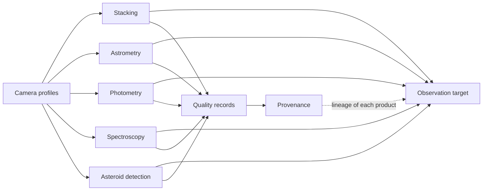
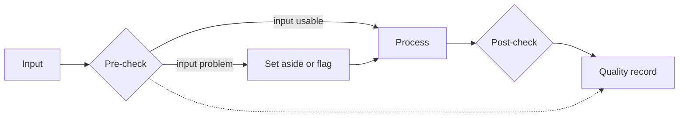

# Astrometrics Library: Architecture and Design

*Version 3.1 · 2026-10-15 · Status: current*

## Abstract

Cooled cameras and small telescopes let amateur astronomers and small observatories collect data of scientific value, but the software that reduces these data is split into separate tools. Each tool uses its own settings and gives no common record of how reliable its output is. This paper describes the architecture of the Astrometrics library, which reduces telescope data in five pipelines: stacking, astrometry, photometry, spectroscopy, and asteroid detection. The pipelines share one data model built around the observation target. They also share records of camera properties and data provenance, and they check their own work with recorded pass, fail, or not-checked gates before and after each run. The paper states the governing equations of each step. They cover calibration, sigma clipping with a cutoff that follows the number of frames, a plate-solution model with distortion terms, and a noise budget for aperture photometry. They also cover ensemble differential photometry, variability indices, grating-based wavelength calibration, and straight-line motion fitting. Tuned settings are not given here. Three kinds of evidence back them: synthetic data with known truth, real observing sessions, and surveys of every stored product. The paper also lists the assumptions and limits of its methods.

Terms are defined in the [glossary](Astrometrics_Library_Architecture.md#appendix-a-glossary). This document also defines each term the first time it appears.

## 1. Introduction

**Statement of need.** Cooled astronomy cameras and small telescopes now let amateur astronomers and small observatories collect data of scientific value, such as light curves of variable stars, spectra of bright stars, and positions of asteroids. The software that reduces these data is mostly built one step at a time. One program stacks frames, another solves the sky position, a third measures brightness, and a fourth extracts spectra. Each program has its own file conventions and settings. None of them carries a common description of the target or a record of how far its output can be trusted. A user who wants a trustworthy light curve must join the tools by hand and judge every intermediate product alone. This paper describes a library that covers the five reductions on one data model. Its intended users are operators of small observatories and hobbyists who want to do science with their own data, and the developers who extend the library.

**Approach.** Five pipelines work on the same telescope data: stacking, astrometry, photometry, spectroscopy, and asteroid detection. Without a shared way to describe a target, each pipeline would repeat the same work, such as finding the sky position, listing the frames, and tracking data quality. None of them could reuse another pipeline's results, such as a solved sky position or a finished stack. One shared data model (Section 2) lets the pipelines work on the same target without stepping on each other's data. Each pipeline also checks its own work twice. A check before processing catches bad input, and a check after processing catches bad output. Each check is recorded as passed, failed, or not checked.

**Scope.** This paper explains the theory: what each step does and why. It does not give the tuned settings the code uses, such as thresholds, limits and defaults. Those settings are listed in `Astrometrics_Library_Implementation.md`, which also maps each idea to the code that carries it out. The evidence behind each setting is in the validation register ([validation/index.md](validation/index.md)). The ideas apply in the same way whether a pipeline runs from a script or through the interactive tools, because both paths call the same underlying code. A reference for every public class and method is generated from the source code's own documentation (see the [API reference](../api/astrometricslib.rst)).

The rest of this document is organized as follows. Section 1.1 reviews related work. Section 2 introduces the four data models every pipeline shares, and two shared records: camera profiles and provenance. Sections 3 through 7 walk through the five pipelines in turn: stacking, astrometry, photometry, spectroscopy, and asteroid detection. Section 8 says how the pipelines are validated and where the evidence is kept. Section 9 lists the assumptions and limits of the methods, and Section 10 concludes. Appendix A is a glossary of the astronomy and statistics terms used here, and Appendix B lists every symbol with its meaning and unit.

### 1.1 Related work

Each class of tool below solves part of the problem well. The library reuses several of them and does not replace them. The last paragraph of this section states what the library adds.

**Stacking.** Siril [1] and PixInsight [2] calibrate, register, and stack frames. Siril is open source and scriptable. PixInsight is a commercial platform with a large set of image-processing tools. Both let the user choose the rejection method and its settings, and both produce an image. Neither is built to pass its result to later measurement steps as part of a shared record of the target. The library uses Siril as its stacking engine (Section 3.3) and adds a rejection cutoff that follows the number of frames (Section 3.2) and gates on the input and the output (Section 3.4).

**Plate solving.** Astrometry.net [3] finds the sky position of an image without a position estimate, by matching patterns of four stars against an index. It runs on a local computer or as a web service. The library uses it as its solver. It adds a refit against Gaia stars moved to the observation date, which gives a residual that does not depend on the solver's own index (Section 4.2).

**Photometry.** AstroImageJ [4] provides interactive aperture photometry and differential light curves, with tools for the user to choose and check comparison stars. The photutils package [5] provides star-detection and aperture-photometry functions for programs. The library automates the choice and vetting of comparison stars, carries a noise budget to every point, and tests variability against the scatter of the field itself (Section 5.2).

**Spectroscopy.** The specutils package [6] supplies data structures and analysis functions for spectra. ISIS [7] is a program used by amateurs to reduce slit and slitless spectra, including those from a Star Analyser grating. The library extracts, calibrates, and classifies the spectra of many stars in one frame, and compares each calibrated spectrum with an independent spectrum from Gaia (Section 6.2).

**Moving objects.** Survey pipelines link detections from many nights into orbits. THOR [8] is one such algorithm. It finds asteroids without assuming a regular observing cadence. A small observatory often has only a few hours of frames on a target. The library therefore fits straight lines within one night, checks each track against known objects, and leaves linking between nights outside its scope (Section 7).

**Large surveys.** The Legacy Survey of Space and Time at Rubin Observatory [9] and the Gaia mission [10] reduce data from fixed instruments with known properties at very large scale. A small observatory has one instrument whose properties are not known in advance. The library therefore stores a profile for each camera and records where every number in it came from (Section 2.3).

**What the library adds.** The tools above are not built around four things. These are a shared target model, gates that record whether a step could check its own work, a stack rejection cutoff that follows the number of frames, and a register that ties every tuned setting to its evidence. The library supplies these four things on top of the tools above.

## 2. Observational data models

This system organizes everything it knows about the sky into four categories of information, all connected to one target. They cover sky positions, brightness measurements, light curves, spectra, and quality checks. Figure 1 shows how the five pipelines feed the target and which records they share.

**Figure 1.** The five pipelines and the shared records. Every pipeline reads the camera profile, writes its products to the observation target, and produces a quality record. Provenance stores the quality record with the run that made it and links each product of the target to that run.

Every image referenced below is stored as a FITS file (Flexible Image Transport System) [11], the standard file format for astronomical data. It plays the same role for telescopes that JPEG or PNG plays for ordinary photos. A FITS file bundles the raw pixel data together with a header: a block of metadata recording things like exposure time, filter, and (once solved) sky position.

### 2.1 Information types

1. **Observation target.** A specific region of sky, such as M 81 or Vega. M 81 is object 81 in the Messier catalog, an 18th-century list of bright galaxies, star clusters and nebulae. NGC and IC numbers (NGC 2403, IC 1396) come from two larger catalogs named the same way. A target connects every raw frame, calibration frame (a frame taken to measure the camera's own errors, Section 3.2), solved sky position, stacked image, detected star, and moving object found for that target.
2. **Stellar object.** A single star identified in the sky. It stores the star's position, its brightness over time (a light curve), how much its brightness varies, and its extracted spectrum.
3. **Moving object candidate.** A possible solar-system object, such as an asteroid or comet. It records the object's path across frames, how fast it appears to move, how well that motion fits a straight line, and any match found in an asteroid catalog.
4. **Pipeline quality record.** A health report for one processing run. For example, it tells how many frames were thrown out, how sharp the stars look, how accurate the positioning was, and how much measurement noise remains. It is built from gates.

A gate is one recorded verdict on one quality condition of a run: passed, failed, or not checked. Figure 2 shows where gates sit in a run. A gate that could not look at its data is recorded as not checked and is never recorded as passed.

**Figure 2.** The gate flow of a pipeline run. The pre-check judges the input, and the post-check judges the output. Every gate of both checks enters the quality record as passed, failed, or not checked.

Table 1 summarizes the four data models: what each one covers, what data it stores, and what job it does. Its symbols mean the following:

- $\alpha$ and $\delta$ are Right Ascension and Declination, the sky's version of longitude and latitude.
- A *light curve* $\hat{F}(t)$ is a star's brightness over time, and a *1D spectrum* $\Phi(\lambda)$ is its brightness at each wavelength $\lambda$.
- An *ephemeris* is a table of where a solar-system object is predicted to be at each time.
- *FWHM* (full width at half maximum) is the width of a star's image at half its peak brightness. Smaller means sharper.
- *Calibration masters* are averages of many calibration frames (Section 3.2).
- $z_{\text{low}}(N)$ and $z_{\text{high}}(N)$ are the pixel-rejection cutoffs for a stack of $N$ frames, in standard deviations (Section 3.2, Equation (3)).
- The *FWHM ratio* $\rho_{\text{FWHM}}$ is a stack's star width divided by the width its input frames predict. Above 1 means the stack is blurrier than expected (Section 3.4.2, Equation (5)).

**Table 1.** Observational data models summary.

| Observational data model | Scope | Data attributes | Primary role |
| --- | --- | --- | --- |
| **Observation target** | One field of view or sky area | Coordinates $(\alpha_0, \delta_0)$, raw exposures, calibration masters, stacked FITS images | Connects all images and results for one part of the sky |
| **Stellar object** | Individual stars and catalogs | Coordinates $(\alpha, \delta)$, magnitude $V$, light curves $\hat{F}(t)$, 1D spectra $\Phi(\lambda)$ | Tracks one star's brightness history, spectrum, and variability |
| **Moving object candidate** | Solar-system objects passing through | Detection chain $(x_j, y_j, t_j)$, motion rates $(\dot{\alpha}, \dot{\delta})$, ephemeris match | Records an asteroid's motion path and any catalog match |
| **Pipeline quality record** | Health of each pipeline run | Frame survivor counts $N$, rejection cutoffs $z_{\text{low}}(N), z_{\text{high}}(N)$, FWHM ratio, gate results (passed, failed, or not checked) | Tracks whether a pipeline run succeeded, and how well |

:::{note}
**Theory.** A star's magnitude ($V$) is its brightness on a scale that runs backward and by powers of ten: lower numbers mean brighter stars, and each step of 5 magnitudes is a factor of 100 in brightness. The letter $V$ names the photometric band: the range of wavelengths a standard filter passes. $V$ (visual) is a green-yellow band near 550 nm. The scale is not used directly by any equation in this document. It appears in Table 1 because it is the standard unit for how bright a star's catalog entry says it is.
:::

### 2.2 Data model progression across pipelines

Table 2 shows how each data model gets filled in as data moves through the five pipelines, from raw frames at the top down to final measurements at the bottom.

**Table 2.** Overview matrix of observational data models across pipeline execution levels.

| Pipeline | Observation target | Stellar object | Moving object candidate | Quality record |
| --- | --- | --- | --- | --- |
| **Stacking** | Raw frames and calibration frames | N/A | The stack whose stars fix each raw frame's sky position (Section 7.1) | Removed bad pixels and overall image sharpness |
| **Astrometry** | Matched sky coordinates and target center | Star locations linked to catalog positions | Sky positions for moving candidates | Solve success status, fit residual, and catalog match counts |
| **Photometry** | Chosen comparison stars | Star brightness changes and light curves | N/A (the rotation-period tool of Section 7.2 could use a track's brightness, but no pipeline step calls it) | Ensemble outlier rejection and comparison-star composition |
| **Spectroscopy** | Zero-order star position (Section 6.1) and camera sensitivity | Calibrated spectra and spectral types | N/A | Zero-order saturation, wavelength-scale, and classification checks |
| **Asteroid detection** | The candidates that passed the self-consistency filters (Section 7.2) | N/A (chains that turn out to be stationary stars are discarded) | Path direction, speed, and catalog names | Detection counts and straight-line residuals against position error |

### 2.3 Shared records: camera profiles and provenance

Two more records sit beside the four data models and serve every pipeline.

- **Camera profile.** Facts about one camera model's sensor. They include the pixel value at which it clips, its gain in e⁻/ADU (how many electrons make one step of the stored pixel value), and its read noise (random noise added each time the sensor is read out). They also include how sensitive it is to each color, given by its quantum efficiency curve: the share of arriving light the sensor records at each wavelength. Keeping them in one place means no pipeline guesses a camera's properties from its name. Every number carries a note saying where it came from: a datasheet, a measurement on the observatory's own frames, or a plain assumption. A camera with no profile gets a generic stand-in instead of an error, and every pipeline's quality record names the profile it used and flags the stand-in. <!-- impl: astrometricslib.drivers.camera_profile_store.resolve_camera_profile --> <!-- impl: astrometricslib.pipelines.shared.applied_camera_profile.record_camera_profile -->
- **Provenance.** For each data product, a record of which processing run made it, with which software version, settings, and inputs. It follows the IVOA Provenance Data Model [12], which is based on the W3C PROV data model [13]. The International Virtual Observatory Alliance (IVOA) sets standards for sharing astronomical data, and the PROV model describes data lineage, that is, the record of where a data product came from. Every pipeline records its run through one shared step after its quality record is built. Recording fails softly: a storage problem is logged and never turns a successful run into a failure. A target's lineage can be exported as PROV-XML. <!-- impl: astrometricslib.pipelines.shared.provenance_recording.record_pipeline_run --> <!-- impl: astrometricslib.drivers.provenance_store.ProvenanceStore --> <!-- impl: astrometricslib.drivers.provenance_store.export_target_lineage_as_prov_xml -->

---

## 3. Image stacking pipeline

The stacking pipeline combines many individual exposures into one high-quality image. Combining frames boosts the real signal from stars while averaging out noise and one-off artifacts like satellite streaks and cosmic ray hits.

The tuned settings for this pipeline and the evidence behind them are listed in `Astrometrics_Library_Implementation.md` and the validation register ([validation/stacking.md](validation/stacking.md)).

### 3.1 Purpose and interfaces

- **Inputs.** Raw light exposures, plus three master calibration frames ($M_{\text{bias}}, M_{\text{dark}}, M_{\text{flat}}$, explained below).
- **Outputs.** A calibrated, stacked 2D image (broadband, meaning an ordinary image through a color filter, or spectral, meaning each star is spread into a spectrum), an updated FITS header, and a stack quality record.

### 3.2 Major concepts and governing equations

Every raw exposure contains two kinds of unwanted signal. One is an *additive* error from the camera's electronics and sensor heat. The other is a *multiplicative* error from the optics, where parts of the image come out dimmer for reasons unrelated to the sky. Before frames are aligned and combined, each raw exposure $I_{\text{raw}}$ is corrected using three calibration images:

- **Master bias ($M_{\text{bias}}$).** An average of many closed-shutter exposures as short as the camera allows (ideally zero length). It isolates the fixed voltage offset the camera's electronics add to every pixel, regardless of exposure time.
- **Master dark ($M_{\text{dark}}$).** An average of closed-shutter exposures taken with the same exposure time, gain, and sensor temperature as the light frames. It measures the extra signal ("dark current") produced by heat inside the sensor over time, plus any permanently defective ("hot") pixels.
- **Master flat ($M_{\text{flat}}$).** An average of exposures of an evenly lit surface (the twilight sky or a flat light panel). It measures how much dimmer some parts of the image are due to the optics — vignetting, dust specks on the sensor glass, and pixel-to-pixel sensitivity differences.

These two categories of error are corrected differently:

- **Additive errors (subtracted).** Extra pixel counts added regardless of how much starlight actually reached the sensor.
  - **Electronic bias.** A constant level the camera adds to every pixel. Its size is set by the camera's *offset* setting. It is there so that noise that dips below zero is still recorded instead of being cut off at zero.
  - **Thermal dark current.** Extra electrons that build up from heat inside the sensor, growing roughly in proportion to exposure time.
- **Multiplicative errors (divided out).** Factors that block or scale down a percentage of the real incoming starlight.
  - **Vignetting and dust shadows.** Obstructions in the optical path (lens edges, dust on the sensor glass) that dim parts of the image.
  - **Pixel sensitivity differences.** Manufacturing differences in each pixel's quantum efficiency (the share of arriving light it records).

Combining these corrections gives the true, calibrated brightness $I_{\text{calibrated}}$. First subtract the additive errors. Then divide out the multiplicative ones. The flat, with its own bias removed, is divided by its average value $\langle \cdot \rangle$, so it is 1 on average. A pixel the optics dim to 80% has a normalized flat value of 0.8, and dividing by 0.8 restores its full brightness:

$$
I_{\text{calibrated}} = \frac{I_{\text{raw}} - M_{\text{dark}}}{\left(M_{\text{flat}} - M_{\text{bias}}\right) / \langle M_{\text{flat}} - M_{\text{bias}} \rangle} \tag{1}
$$

The numerator subtracts only the master dark, not the master bias. A dark frame is a raw closed-shutter exposure, so it already holds the bias as well as the dark current. Subtracting a bias master too would remove the bias twice and push the faint sky below zero. The bias master is subtracted from the light frames only when no dark master exists. <!-- impl: astrometricslib.drivers.siril_interface.light_calibration_flags -->

The master frames are only as good as the calibration frames chosen for them. Four rules decide which frames are used and how much to trust them:

- **Match the camera settings.** Calibration frames are filed by the settings they were taken at. A frame taken at one gain setting (the camera's amplifier setting, a plain number recorded in the file header) or offset cannot calibrate lights taken at another. Binning merges neighboring pixels, so frames binned differently have different pixels. A binning mismatch therefore blocks that kind of calibration frame instead of applying a wrong one, and the stack is flagged. A mismatch in gain, offset, or temperature applies the nearest frames and flags the stack with a sentence saying which setting differed. <!-- impl: astrometricslib.drivers.calibration_library.calibration_setting_key --> <!-- impl: astrometricslib.drivers.calibration_library.CalibrationLibrary.select_dark_frames -->
- **Match darks by temperature.** Dark current roughly doubles every few degrees. Darks are therefore sorted into temperature slots a few degrees wide, and the slot nearest the lights is used. Darks from different slots are never averaged into one master. <!-- impl: astrometricslib.drivers.calibration_library.temperature_slot_c -->
- **Remove the bias from every flat.** A flat frame carries the bias offset on top of the light. If the offset stays in, the flat looks too uniform, the vignetting looks weaker than it is, and the lights come out under-corrected. The bias master is subtracted from every flat, including a master built from a single flat. A stack of one light frame is calibrated like any other. <!-- impl: astrometricslib.drivers.siril_interface.build_flat_master_commands --> <!-- impl: astrometricslib.drivers.siril_interface.build_single_light_commands -->
- **Flag thin masters.** Averaging and outlier rejection need several frames. A master built from one or two frames keeps their noise and any cosmic ray hit. Such a master is still built, because the library can legitimately hold one flat or one dark, but the stack is flagged so a reader knows the master is weak. The minimum number of frames is a tuned setting. <!-- impl: astrometricslib.drivers.siril_interface.calibration_count_flags -->

After calibration, the pipeline averages $N$ exposures together to raise the signal-to-noise ratio (SNR: the signal divided by its random noise; higher is cleaner). Averaging $N$ frames lowers the random noise by about $\sqrt{N}$.

Averaging has one weakness: a single very bright value, such as a satellite streak, pulls the mean far off. So, at each pixel position, any value far enough from the group's median is thrown out as an outlier (a satellite streak, a cosmic ray hit, an aircraft). This is called pixel rejection, or sigma clipping when the distance is measured in standard deviations ($\sigma$).

Rather than using one fixed cutoff for every stack — always rejecting anything past $3\sigma$, say — the pipeline adjusts the cutoff based on how many frames $N$ are being combined. It starts from Chauvenet's criterion [14], [15]. The criterion asks: how far out must a value be before fewer than half of one such value is expected by chance among $N$ normal-noise samples? A value past that point is more likely a real outlier than bad luck:

$$
z(N) = \sqrt{2}\,\mathrm{erfc}^{-1}\!\left(\frac{1}{2N}\right) \tag{2}
$$

**In words.**

- **$z(N)$ (rejection cutoff).** How many standard deviations ($\sigma$) from the group's median a pixel has to be before it is thrown out, for example $1.64\sigma$ at $N = 5$ and $2.81\sigma$ at $N = 100$.
- **$N$.** How many light frames are being combined.
- **$\mathrm{erfc}^{-1}$ (inverse complementary error function).** It finds the cutoff at which fewer than 0.5 false-positive pixel rejections are expected across all $N$ frames.

As $N$ grows, so does the chance that some value looks like an outlier by pure chance, so Equation (2) loosens the cutoff accordingly. A fixed $3\sigma$ cutoff instead throws out the same share of good values (about 0.27%) at every $N$, so the number of good values it loses grows with the stack. Equation (2) is stricter than $3\sigma$ below about 185 frames and looser above.

Equation (2) treats the spread of the values as known exactly. A real stacker estimates the spread from the same $N$ values it is judging, and with a handful of frames that estimate is noisy. The stacking engine estimates the spread in a Winsorized way: values beyond a limit are pulled in to the limit before the spread is computed, so that one wild value cannot inflate it. Even so, used as it stands, Equation (2) throws out good values from small stacks. The pipeline therefore applies two changes:

- **A floor on the high cutoff.** The upper cutoff never drops below a minimum, $z_{\text{floor}}$, in standard deviations.
- **A looser low cutoff.** The lower cutoff sits a fixed margin $\Delta_z$ above the upper one, also in standard deviations. Satellite streaks, cosmic ray hits, and hot pixels are brighter than the true value, so the upper cutoff has to catch them. Values far below the median are rare, so a looser lower cutoff removes fewer good values at little cost.

$$
z_{\text{high}}(N) = \max\!\big(z(N),\ z_{\text{floor}}\big), \qquad z_{\text{low}}(N) = z_{\text{high}}(N) + \Delta_z \tag{3}
$$

<!-- impl: astrometricslib.utilities.rejection_thresholds.rejection_bounds --> <!-- impl: astrometricslib.utilities.rejection_thresholds.chauvenet_sigma -->

Equation (3) therefore differs from Equation (2) only for small stacks. Once the stack is large enough that the Chauvenet value of Equation (2) passes the floor, the two agree. The floor and the margin are tuned settings.

:::{warning}
**The floor trades one risk for another.** The floor and the margin $\Delta_z$ throw out fewer good values from a small stack, and in exchange a weak outlier survives more often. Raising the floor protects more good values and lets more weak outliers through. The size of the trade depends on how far real noise departs from the Gaussian noise that Equation (2) assumes. <!-- impl: astrometricslib.scripts.rejection_small_n_check -->
:::

Frames taken with different exposure lengths cannot be clipped together, because a long and a short frame hold very different amounts of light in the same pixel, and clipping would discard the best frames' values as outliers. Each exposure length is therefore stacked on its own, and the group stacks are combined afterward. Each group stack is first converted to counts per second. That alone does not make the groups comparable: before clipping, the stacker rescales every frame to a common level (its normalization), so each group stack comes out on its own brightness scale. The groups are therefore put on one brightness scale. Finally they are combined with inverse-variance weights (weights of one over the noise variance), so quieter groups count for more. <!-- impl: astrometricslib.pipelines.stacking.processing.exposure_groups.combine_exposure_group_images -->

The reference group is the one that carries the most weight. The brightness scale of every other group is the median ratio of its stars' fluxes to the same stars' fluxes in the reference group. Only isolated, unsaturated stars well above the noise are used, each measured in a circle wide enough that a star a pixel wider in one group keeps the same share of its light. Stars are used rather than pixels because faint pixels are mostly sky, and the sky changes between nights while the stars do not. <!-- impl: astrometricslib.pipelines.stacking.processing.exposure_groups.measure_group_gains_with_stars --> <!-- impl: astrometricslib.pipelines.stacking.processing.exposure_groups.measure_star_flux_ratios -->

A group that shares too few such stars with the reference, such as a slitless spectrum with one star, falls back to pixels: the median ratio of its pixels to the reference's, over mid-range source pixels only. The reason for the mid-range is linearity. A sensor is linear (its reading is proportional to the light) between the sky floor and near full well (the most charge a pixel can hold). In that range two exposures of one scene differ by a single factor, and that factor is the scale. Close to full well the response flattens. At the faint end, a group whose raw frames were clipped at zero (a camera offset too low to record the negative side of the noise; Section 3.4.2, check 9) reads high. At those extremes the ratio measures the sensor's nonlinearity, not the scale. <!-- impl: astrometricslib.pipelines.stacking.processing.exposure_groups.measure_group_gains -->

As a check, the same ratio is taken over the faintest stars and over the brightest stars (on the pixel fallback, over the brightest pixels) and never applied. A group whose check ratio sits further from its scale than a tolerance is not one scale factor of the reference. It is marked nonlinear and left out of the combined image. A group whose sky is much brighter than the reference's is also left out, because a flooded sky means a different night whose frames break the assumptions of the scale.

A second, separate weighting acts on single frames inside each stack. For sky-limited frames, a frame's squared signal-to-noise ratio grows with its exposure, so equal weights waste the longer frames. The noise penalty $P$ of equal weights follows from the exposure times $\tau_j$ (in seconds) of the $N$ frames of an imaging stack:

$$
P = \sqrt{\left(\frac{1}{N}\sum_{j=1}^{N}\frac{1}{\tau_j}\right)\left(\frac{1}{N}\sum_{j=1}^{N}\tau_j\right)} \tag{4}
$$

The first factor is the mean of the reciprocal exposure times, and the second is the mean of the exposure times. $P$ is dimensionless and equals 1 when every frame has the same length. When $P$ passes a tuned factor a little above one, the stacker weights each frame by its own measured noise. $P$ is computed over the whole stack, before it is split into exposure groups, so it exceeds 1 whenever the stack holds more than one exposure length. Spectral stacks are left to the group handling above. <!-- impl: astrometricslib.pipelines.stacking.pre_processing.exposure_weighting.choose_stack_weight --> <!-- impl: astrometricslib.pipelines.stacking.pre_processing.exposure_weighting.equal_weight_noise_penalty -->

### 3.3 Pipeline theory of operations

Combining frames means three things happen together: calibrating each frame, aligning them to each other, and rejecting outlier pixels. Four design choices drive this process:

1. **Calibrate before aligning.** Each raw light frame is corrected using Equation (1) before it is aligned with the others. Dark subtraction removes the electronic offset and the heat buildup together (a separate bias subtraction is used only when there is no dark). Flat-field division removes optical dimming and dust shadows.
2. **Adjust the rejection cutoff automatically.** The pixel-rejection cutoffs scale with the number of frames $N$, via Equations (2) and (3), so nobody has to manually tune them per dataset. This keeps small stacks from losing good values and stops deep stacks from over-clipping real starlight.
3. **One quality check, two alignment modes.** The same frame-quality check applies to both ordinary (broadband) images and spectroscopic images. But spectroscopic images are only allowed to shift position (not rotate or stretch) when aligning, so the axis the spectrum is spread out along does not get distorted relative to the reference star. Aligning, also called registration, means lining frames up so each star falls on the same pixel. Ordinary images use full alignment (shifting, rotating, and stretching as needed) to make stars as sharp as possible.
4. **Keep different optical setups separate.** Frames taken with different focal lengths or cameras get stacked separately, never mixed together. Mixing them would break the assumption that one pixel always corresponds to the same patch of sky, and would corrupt sharpness measurements.

Before rejecting outliers, the pipeline also checks that enough frames survived the earlier quality filtering. Too few frames left would make the outlier statistics meaningless. Table 3 lays out the stacking pipeline step by step.

**Table 3.** Stacking pipeline execution sequence and operations.

| Step | Pipeline phase | Inputs and Outputs | Description |
| --- | --- | --- | --- |
| 1 | Frame screening | **In.** Raw light frames and their headers **Out.** Screened light frame list | Keep only the most common gain setting, move frames with clouds or trailed stars aside, and keep one side of a sudden sky-brightness jump (Section 3.4.1). |
| 2 | Calibration | **In.** Screened exposures, master bias, dark, flat **Out.** Calibrated light frame array | Subtract the master dark, which holds both the electronic bias and the thermal dark current (the bias master alone when there is no dark); divide out flat-field dimming via Eq. (1). Match calibration frames to the lights by camera settings and dark temperature. |
| 3 | Quality safeguard | **In.** Frame quality metrics, minimum-frame floor **Out.** Filtered light frame list | Keep the sharpest and roundest share of the frames, but never drop below a minimum survivor count. |
| 4 | Alignment and outlier rejection | **In.** Filtered light frames **Out.** Aligned arrays and outlier map | Align exposures to each other and reject outlier pixels using the adjustable, floored cutoffs of Eq. (2) and Eq. (3). |
| 5 | Combine into master stack | **In.** Surviving pixel arrays **Out.** Stacked 2D FITS image and quality record | Average the surviving pixels into one stacked image. When exposure lengths differ, stack each length separately, put the groups on one brightness scale, and combine them with inverse-variance weights. Record how the run went. |

<!-- impl: astrometricslib.pipelines.stacking.pre_processing.frame_homogeneity.find_dominant_gain_subset -->

A stack is requested in one place. The request first chooses the light frames: imaging and spectral frames are never mixed, and frames from two cameras are never stacked together. The caller may narrow the choice by filter, file name, time, or camera. The stacking step then runs as a tracked job, a background task whose progress, log and outcome are recorded so it can be watched and reviewed. It holds a stacking slot, a lock that only a set number of stacks may hold at once, while the engine works. Two heavy stacks therefore do not compete for the same machine. <!-- impl: astrometricslib.pipelines.stacking.stack_request.choose_frames_to_stack --> <!-- impl: astrometricslib.pipelines.stacking.stack_request.run_stack --> <!-- impl: astrometricslib.pipelines.stacking.stage.stack_frames -->

The engine (Siril [1], an open-source stacking program) is reached through a driver interface. The engine needs two of the pipeline's own steps in the middle of a run: the flat check and the fallback alignment for spectral frames. The driver may not depend on pipeline code (the layering rule in `Astrometrics_Library_Implementation.md`), so the pipeline hands these steps to the engine on every run. When too few spectral frames register by star matching, the stack is retried with a relaxed star detection and then with phase correlation [16] (finding the shift between two images by comparing their overall patterns, with no star list needed). The attempt that registered the most frames is kept. <!-- impl: astrometricslib.pipelines.stacking.stack_runner.run_stack -->

The many-target batch run reaches the same stacking step through a wrapper that adds a hard time limit, scaled by the number of frames. <!-- impl: astrometricslib.pipelines.tasks.stack_frames_with_timeout -->

Three supporting tasks sit around the stack itself:

- **Calibration ingest.** A rescan of the calibration library reports which groups of bias, dark, and flat frames were added, changed, or removed, and measures each new set of flats with the same check the stacker runs. <!-- impl: astrometricslib.pipelines.stacking.calibration_ingest.build_ingest_report -->
- **Quarantine and restore.** Frames moved aside for clouds or trailed stars are moved, never deleted. A record next to them says where each came from and why, and a restore step moves them back. <!-- impl: astrometricslib.pipelines.stacking.pre_processing.frame_quarantine.restore_quarantined_frames -->
- **Preview images.** A stacked FITS file holds linear data that looks almost black on screen. A preview image is made next to each stack: optional gradient removal, color balancing from the stack's own stars, a stretch (a brightness curve that lifts faint detail) whose sky level depends on the target, and optional noise removal. StarNet [17] is a program that separates stars from the rest of an image. When it is configured, the stars and the rest of the image are stretched separately and blended back, so a strong stretch of a faint nebula does not bloat the stars. A preview can be remade from the stack without restacking. <!-- impl: astrometricslib.pipelines.stacking.post_processing.stack_preview.write_stack_preview --> <!-- impl: astrometricslib.pipelines.stacking.post_processing.starnet_stretch.blend_stars --> <!-- impl: astrometricslib.pipelines.stacking.post_processing.preview_remake.remake_stack_preview -->

### 3.4 Quality metrics and integration planning

The stacking pipeline checks its own work in two rounds: before stacking (screening out bad raw frames) and after stacking (checking the final image). Each check is recorded as passed, failed, or not checked, and a check that could not look is never recorded as passed.

#### 3.4.1 Before stacking: screening raw frames

- **Clouds and trailed stars.** A session here means frames with the same camera, filter, and exposure, with no long gap between them. Each frame is judged against the other frames of its own session, so the limits are shares of the session's own median rather than fixed counts. A frame whose star count falls far below the session's median is moved aside, and it is called clouded when its sky is also brighter than usual. Roundness here is a star's narrow width divided by its wide width (0 to 1, 1 for a circle). A frame whose median roundness is both low in absolute terms and clearly below the session's median is moved aside as trailed (its stars are smeared into short lines). Requiring both keeps a session of slightly oval stars from losing its frames. A session with too few frames is not judged, because its median is too uncertain to judge against. If more than a set share of a session would be moved, nothing is moved and the check fails, because the session itself, not a few frames, is then the problem. <!-- impl: astrometricslib.pipelines.stacking.pre_processing.frame_quarantine.judge_batch --> <!-- impl: astrometricslib.pipelines.stacking.pre_processing.frame_quarantine.quarantine_gate -->
- **Gain homogeneity.** Frames taken at a minority gain setting are set aside. Setting them aside corrects the stack, so the check does not fail. It is recorded as not checked when no frame records its gain. <!-- impl: astrometricslib.pipelines.stacking.pre_processing.frame_homogeneity.gain_homogeneity_gate -->
- **Background homogeneity.** For each exposure length, the frames' sky brightness levels are sorted and the largest gap between neighbors is compared with the normal spread on either side. A gap much larger than that spread means the session mixes two sky conditions, such as clouds rolling in. Slow changes, such as a rising moon, leave no such gap. The minority side is left out and the check fails, so the split is visible. <!-- impl: astrometricslib.pipelines.stacking.pre_processing.background_homogeneity.detect_background_split --> <!-- impl: astrometricslib.pipelines.stacking.pre_processing.background_homogeneity.background_homogeneity_gate -->
- **Sharpness and roundness filter.** The stacker keeps a requested share of the sharpest and roundest frames. This is a relative cut, measured in pixels, so no conversion to arcseconds (1/3600 of a degree) is needed. On a small batch the share is loosened step by step, down to no filter, so that a minimum number of frames survives. <!-- impl: astrometricslib.utilities.stack_filter_floor.resolve_filter_wfwhm_with_floor -->
- **Flat level and flat noise.** The flat frames must be neither too faint nor too bright, and the master flat's own noise must stay below a limit, since dividing by the flat copies its noise into every light frame as a fixed pattern. A noisy master flat from a monochrome (single-color) sensor is lightly blurred while it is built, enough to bring its noise to the limit. A color sensor's flat is measured but not blurred, because blurring would mix its red, green, and blue pixels. Both checks are recorded as not checked when the stack used no flats. <!-- impl: astrometricslib.pipelines.stacking.pre_processing.flat_calibration.assess_flats -->
- **Calibration frame checks.** Confirms that the calibration frames match the lights' camera settings (gain, offset, binning, and, for darks, temperature) and that each master was built from enough frames. A mismatch or a thin master flags the stack rather than passing silently. <!-- impl: astrometricslib.pipelines.stacking.pre_processing.assess_input_quality.calibration_gates -->

The pipeline does not cross-check image quality against the telescope's reported state (airmass, meaning how much atmosphere the light crossed, 1.0 straight overhead; mount position; focuser position; or sensor temperature). That cross-check is not part of the pipeline (Section 9).

#### 3.4.2 After stacking: checking the final image

Once stacking finishes, six checks are made on the stacked image, and three more on stacks built from several exposure lengths: <!-- impl: astrometricslib.pipelines.stacking.post_processing.assess_output_quality.output_quality_gates -->

1. **Rejected pixel fraction.** The share of pixels the outlier rejection threw out. The flag is set above the share that normal sessions reach, to leave headroom. A much larger share means many frames disagreed with each other, for example through clouds or poor alignment.
2. **Star sharpness ratio ($\rho_{\text{FWHM}}$, Equation (5)).** Compares how sharp stars look in the final stacked image ($\text{FWHM}_{\text{stack}}$) to how sharp the input frames predict a stack to be ($\text{FWHM}_{\text{expected}}$). If frames are misaligned, the stack's stars come out wider than its frames' stars, and the ratio rises above 1.

   The expected width needs care. A stack's star is the average of the stars in its frames. For round Gaussian stars, that average has a variance equal to the mean of the individual variances, so the expected width is the root mean square of the input widths. A median would call the normal blur of a stack made on nights of different seeing (the blurring of stars by air turbulence) a failure.

   $$
   \rho_{\text{FWHM}} = \frac{\text{FWHM}_{\text{stack}}}{\text{FWHM}_{\text{expected}}}, \qquad \text{FWHM}_{\text{expected}} = \sqrt{\frac{1}{N}\sum_{j=1}^{N}\text{FWHM}_j^{\,2}} \tag{5}
   $$

   - **What it means.** A value near 1 means the frames lined up almost perfectly. A value clearly above 1 fails the check: it is a warning sign that small misalignments between frames blurred the final image. The limit sits a little above the ratio that well-aligned stacks reach, so ordinary seeing changes do not trip it. The check does not apply to a spectral stack, whose stars are spectrum trails. <!-- impl: astrometricslib.pipelines.stacking.post_processing.stack_quality.expected_stack_fwhm -->
3. **Spectral registration.** For a spectral stack (a stack of frames in which each star is spread into a spectrum; Section 6), the zero-order star image (the undispersed point image of the star) is followed from frame to frame. A frame where it jumps or fades is flagged, since such a frame may have been aligned wrongly. <!-- impl: astrometricslib.pipelines.spectroscopy.utilities.registration_quality.evaluate_spectral_registration_quality -->
4. **Saturated pixel fraction.** The share of pixels at the camera's saturation level.
5. **Zero pixel fraction.** The share of pixels that read exactly zero. A stack that is mostly zero had more subtracted than the sky it held, for example a bias removed twice. Clean spectral stacks have almost no zero pixels, so they get a much stricter limit than imaging stacks. <!-- impl: astrometricslib.pipelines.stacking.post_processing.stack_quality.zero_fraction_threshold -->
6. **Negative pixels.** Fails when the stacker reports that most of a frame went negative after calibration, which points to over-subtraction by a wrong dark or bias frame.

7. **Exposure group linearity.** Each group's brightness must be one scale factor of the reference group's (Section 3.2). A group that fails is left out of the combined image. <!-- impl: astrometricslib.pipelines.stacking.processing.exposure_groups.measure_exposure_group_gains --> <!-- impl: astrometricslib.pipelines.stacking.post_processing.exposure_group_report.exposure_group_linearity_gate -->
8. **Exposure groups combined.** Fails when a group that had frames is missing from the combined stack, because it failed to stack, to line up, or the linearity check. Without this check, a full-looking stack could hold only part of the data. <!-- impl: astrometricslib.pipelines.stacking.post_processing.exposure_group_report.exposure_groups_combined_gate -->
9. **Raw frame clipping.** A frame taken at a camera offset (Section 3.2) below its read noise cannot record the negative side of the noise, so some pixels read exactly zero and the faint sky reads too high. A few raw frames of each group are sampled for this. <!-- impl: astrometricslib.pipelines.stacking.post_processing.exposure_group_report.raw_frame_clipping_gate -->

The time the stack took and whether it hit its time limit are recorded with the stack, but they are not judged. The pipeline does not measure the noise reduction against the $\sqrt{N}$ expectation. It also does not measure mount tracking. It does not use the pier side, the side of the mount's central pier on which the telescope sits, to separate a meridian flip from a tracking error. A meridian flip is the mount turning the telescope over as the target crosses due south. Those checks are not part of the pipeline (Section 9).

---

## 4. Astrometry pipeline

The astrometry pipeline figures out exactly where a stacked image is pointed. It matches camera pixels to real sky coordinates: Right Ascension $\alpha$ and Declination $\delta$, the sky's version of longitude and latitude. This step is called plate solving. Positions on the sky are angles, measured in degrees or in arcseconds (1/3600 of a degree). The result is a World Coordinate System (WCS) [18], [19]: a mathematical formula that converts any pixel position in the image into a real sky position, and back.

The tuned settings for this pipeline and the evidence behind them are listed in `Astrometrics_Library_Implementation.md` and the validation register ([validation/astrometry.md](validation/astrometry.md)).

### 4.1 Purpose and interfaces

- **Inputs.** A calibrated, stacked image, plus a rough estimate of the field's coordinates and pixel scale (pixel scale: how many arcseconds of sky one pixel covers).
- **Outputs.** A WCS transformation saved into the image's FITS header, a list of catalog-identified stars, and an astrometry quality record.

### 4.2 Major concepts and governing equations

Plate solving connects pixel coordinates $(x,y)$ to sky coordinates $(\alpha, \delta)$ in six steps:

1. **Star detection.** Finds star-like points of light with a matched-filter star finder (the DAOFIND method [20], through the photutils package [5]). A matched filter slides a star-shaped template over the image and responds most strongly where the image looks like a star. The finder works on a background-subtracted image. It keeps only sources whose sharpness and roundness look like a star. Sharpness is how sharply peaked a source is: a hot pixel is too sharp, and a galaxy is too flat. Roundness is how symmetric a source is, on the finder's scale of about −1 to 1, where 0 is round. The star finder's own center for each source is the position the rest of the pipeline uses. <!-- impl: astrometricslib.pipelines.astrometry.pre_processing.source_detection.SourceDetector.detect -->

   A separate step fits a 2D Gaussian (bell-shaped) profile to bright stars. That fit measures the star width (FWHM), which the pipeline uses to judge how large a position error is acceptable. It does not set any star position. <!-- impl: astrometricslib.pipelines.astrometry.pre_processing.fwhm.measure_image_fwhm -->
2. **Quad-star matching.** Groups nearby stars into four-star shapes ("quads") whose relative side lengths are invariant under rotation, reflection, and scaling. These shapes are compared against a pre-built star index to identify which patch of sky the image shows, even if the telescope was pointed somewhere unexpected. The Astrometry.net solver [3] does this work. It can run on this computer (the local solver) or as a web service (the online solver), and the pipeline tries them in that order. The local solver reads the image file and finds its own stars. The pipeline's own star list decides whether a local attempt is worth making. When the local attempt fails or is skipped, only the brightest stars of that list are sent to the online solver, since a short list of bright stars is enough to find the quads and is quick to send. Only if that also fails is the whole image uploaded. <!-- impl: astrometricslib.drivers.astrometry_net_driver.AstrometryNetPlateSolveDriver.solve --> <!-- impl: astrometricslib.pipelines.astrometry.processing.star_identifier.MAXIMUM_PLATE_SOLVE_SOURCES -->
3. **Fitting the distortion map.** Converts pixel offsets from a reference pixel $(x_{\text{ref}}, y_{\text{ref}})$ into sky-coordinate offsets $(\xi, \eta)$ on the tangent plane (a flat projection of the sky that touches the sphere at the sky position of the reference pixel). The conversion uses four linear coefficients and a polynomial correction for lens and mirror distortion, called the Simple Imaging Polynomial (SIP) [21]. The polynomial corrects the pixel offsets first, and the linear coefficients then map the corrected offsets to the sky (Equation (6)).

   **In words.** A perfect lens would map pixels to sky by a rotation, a scale, and perhaps a mirror flip, which is the linear part. Real optics bend the map a little, mostly near the edges, and the SIP terms correct the pixel offsets for that bend before the linear part is applied:

   $$
   \begin{aligned}
   \begin{pmatrix} \xi \\ \eta \end{pmatrix} &= \begin{pmatrix} K_{11} & K_{12} \\ K_{21} & K_{22} \end{pmatrix} \begin{pmatrix} u + f(u,v) \\ v + g(u,v) \end{pmatrix}, \qquad u = x - x_{\text{ref}}, \quad v = y - y_{\text{ref}}, \\
   f(u,v) &= \sum_{a+b=2}^{n_{\text{SIP}}} A_{ab}\,u^{a}v^{b}, \qquad g(u,v) = \sum_{a+b=2}^{n_{\text{SIP}}} B_{ab}\,u^{a}v^{b}
   \end{aligned} \tag{6}
   $$

   - **What each piece means.**
     - $(x, y)$ is a pixel position (column and row, in pixels). $(x_{\text{ref}}, y_{\text{ref}})$ is the reference pixel, where the tangent plane touches the sky, and $u$ and $v$ are the pixel offsets from it, in pixels.
     - $\xi$ and $\eta$ are the offsets on the tangent plane, in degrees.
     - $K_{11}$, $K_{12}$, $K_{21}$, and $K_{22}$ are the four linear coefficients. Together they handle the image's rotation, scale, and any left-right flip. Their unit is degrees per pixel.
     - $f(u,v)$ and $g(u,v)$ are polynomials of order $n_{\text{SIP}}$ (a tuned setting) that correct for lens or mirror distortion, in pixels. They are more noticeable toward the edges of a wide field of view. Only terms of second order and higher appear, because the linear part is already in $K$. The fitted coefficients $A_{ab}$ and $B_{ab}$ have units of pixels raised to the power $1-a-b$.

   The solved WCS is written back into the image's FITS header (the block of named entries stored with the pixels), so the next program to open the file does not solve it again. The write keeps the SIP terms and the "-SIP" ending of the coordinate-type entries, which tells a reader that the terms are there. Without them, a reader of the file would lose the lens correction near the image edges. Old sky-map keywords are deleted first, so a re-solve leaves no contradictory entries. <!-- impl: astrometricslib.pipelines.shared.session_identification.write_wcs_to_fits_header -->
4. **Naming the stars.** With the WCS known, each detected star is matched to the nearest entry in the SIMBAD star database [22] or the Gaia catalog [23] to attach a real name and ID. SIMBAD is an online database of named objects. Gaia is a space telescope that measured precise positions for over a billion stars.

   Gaia lists each star's position for one fixed date, the catalog's epoch (the date a catalog position refers to), together with its proper motion: how far the star drifts across the sky each year. Over a decade, a fast-moving star can drift as far as the whole match radius. Each Gaia position is therefore moved to the date of the observation before matching. When the catalog rows carry no proper motion, or the image has no readable observation date, the positions stay at the catalog epoch and the run records a flag saying so. A single star with no proper motion value stays where it is. <!-- impl: astrometricslib.pipelines.astrometry.processing.star_identifier.propagate_gaia_positions --> <!-- impl: astrometricslib.pipelines.astrometry.processing.star_identifier.StarIdentifier._move_gaia_coords_to_observation_epoch -->
5. **Judging the fit.** Two numbers come from the solve itself and describe how well the solved WCS agrees with the stars. The pipeline keeps them apart. A third, more independent number comes from the refit of step 6.
   - **Fit residual.** The solver matches stars in the image to stars in its own reference index. For each matched star, the residual (the misfit left after fitting) is the distance between the star's position under the fitted WCS and the reference star's position. The root mean square (RMS) of these distances, in arcseconds, is the fit residual. <!-- impl: astrometricslib.drivers.astrometry_net_driver.read_corr_fit_statistics --> <!-- impl: astrometricslib.pipelines.astrometry.post_processing.run_gates.astrometry_run_gates -->
   - **Catalog match separation.** The RMS of the distance from each detected star to its nearest SIMBAD or Gaia star, counting only stars inside the match radius. Wrong matches and SIMBAD's uneven position precision raise it, and the match radius caps it. It is a rough check, not a measure of the fit. <!-- impl: astrometricslib.pipelines.astrometry.processing.star_identifier.StarIdentifier.get_catalog_match_separation_rms_arcsec -->

   The online solver returns no match table, so for an online solve the fit residual is unknown.
6. **Refitting the solution to Gaia.** The solver fits its solution to the few dozen bright stars of its own index, whose positions carry the index's errors. A solution can therefore sit a pixel or more from the truth and still agree well with itself.

   After solving, the pipeline matches the detected stars to Gaia stars moved to the observation date and fits a new solution with low-order SIP distortion to those matches. It drops stars that sit far from the fit (blends, double stars, wrong matches). It repeats until the set of matched stars stops changing.

   The new solution replaces the solver's only when it fits the Gaia stars better and does not move the field by more than a set amount. Either way, the residual against Gaia is recorded, which gives a measure of the fit that does not depend on the solver. Too few matched stars, or no Gaia stars for the field, keep the solver's solution, and the run records a flag saying the refit was skipped.

   **Which number the quality check judges.** The check takes the first of three numbers that the run measured: the RMS against Gaia from the refit, then the solver's fit residual, then the catalog match separation. It names the one it used in its detail. <!-- impl: astrometricslib.pipelines.astrometry.post_processing.run_gates._residual_and_basis --> <!-- impl: astrometricslib.pipelines.astrometry.processing.wcs_refinement.refine_wcs_with_gaia --> <!-- impl: astrometricslib.pipelines.astrometry.processing.star_identifier.StarIdentifier._refine_wcs_against_gaia -->

### 4.3 Pipeline theory of operations

Table 4 lays out the astrometry pipeline step by step.

**Table 4.** Astrometry pipeline execution sequence and operations.

| Step | Pipeline phase | Inputs and Outputs | Description |
| --- | --- | --- | --- |
| 1 | Source detection | **In.** Stacked FITS image **Out.** Star center list $(x_i, y_i)$ | Find stars with a matched-filter star finder, and keep sources that are sharp and round enough to be stars. |
| 2 | Quad pattern hashing | **In.** Star list or image **Out.** Geometric quad shapes | Group stars into four-star shapes that stay recognizable under rotation and scaling, and turn each shape into a short numeric code (a hash) that can be looked up in the index. |
| 3 | WCS and distortion fit | **In.** Matched star pairs **Out.** WCS header values ($K_{ab}$, SIP polynomial) | Fit the pixel-to-sky transformation via Eq. (6), and write it, SIP terms included, into the FITS header. |
| 4 | Catalog cross-match | **In.** Solved field, SIMBAD and Gaia catalogs, observation date **Out.** Matched catalog stars $(\alpha_i, \delta_i)$ | Move Gaia positions to the observation date, refit the solution to the Gaia stars when that fits better, then match each detected star to a catalog entry to attach its identity. |
| 5 | Solution check | **In.** WCS, Gaia refit RMS, fit residual, catalog match separation, match counts **Out.** Astrometry quality record | Judge the residual (the Gaia refit RMS, else the solver's fit residual, else the catalog match separation) against the star width, and record how many stars matched. |

### 4.4 Quality metrics and solution validation

Each check below is recorded as passed, failed, or not checked. A check that could not look is never recorded as passed. <!-- impl: astrometricslib.models.gate_result.unchecked_gate -->

#### 4.4.1 Before solving: checking the image

- **Minimum star count.** At least four stars must be detected before a plate-solve is even attempted, since one quad needs four stars. Below a second, higher count, the local solver is skipped and the pipeline goes straight to the online solver, because a local attempt would spend its whole time limit on a near-certain failure. <!-- impl: astrometricslib.pipelines.astrometry.processing.star_identifier.StarIdentifier.process_image -->
- **Shape filtering.** Detected sources are filtered by sharpness and roundness before solving, to screen out non-star detections and badly distorted blobs. <!-- impl: astrometricslib.pipelines.astrometry.pre_processing.source_detection.SourceDetector.detect -->
- **Scale hints and fallback.** The pipeline computes the expected pixel scale from the pixel size, binning, and focal length, and starts with a narrow window around it. The solver widens that window a little further on each side. If the solve still fails quickly, it retries with no scale or position assumption at all. If the hinted solve instead used nearly its whole time limit, the retry is skipped, because an unconstrained search is unlikely to succeed in the same budget. <!-- impl: astrometricslib.pipelines.astrometry.processing.star_identifier.StarIdentifier._calculate_scale_hints --> <!-- impl: astrometricslib.drivers.astrometry_net_driver.AstrometryNetPlateSolveDriver._solve_locally -->

#### 4.4.2 After solving: checking the result

- **Solve success flag.** Whether the solver found a WCS at all; if not, the pipeline stops for that target.
- **Matched-star count.** The number of detected stars matched to a catalog entry must reach a minimum. With few matches, the residual is an average over too few stars to mean much. <!-- impl: astrometricslib.pipelines.astrometry.post_processing.run_gates.astrometry_run_gates -->
- **Fit residual.** The residual chosen in Section 4.2, step 6 (the Gaia refit RMS when there is one) must stay below a fixed fraction of the star width. The limit is set well above centroid noise (the small random error in finding each star's center). A residual that large means something other than centroid noise dominates the fit: a wrong match, a bad distortion model, or a wrong field. Scaling the limit by the star width lets one rule serve sharp and soft images alike. <!-- impl: astrometricslib.pipelines.astrometry.post_processing.run_gates.astrometry_run_gates -->
- **Network health tracking.** Tracks how often lookups to remote star catalogs succeed, fail, or get temporarily paused after repeated failures. The check fails when the pause tripped or too large a share of the lookups failed. A run that attempted no lookup is recorded as not checked. This distinguishes a genuinely sparse star field from a network problem. <!-- impl: astrometricslib.pipelines.astrometry.post_processing.run_gates.astrometry_run_gates -->

:::{warning}
**A pass is not a measure of position accuracy.** The residual limit is there to catch a failed solve, not to rank good ones. A fit residual is normally smaller than a catalog match separation, so a limit that suits separations is lenient for the fit residual and the Gaia refit RMS that the check prefers. A good solve and a merely passing one can differ by a large share of the limit.
:::

---

## 5. Stellar photometry pipeline

The photometry pipeline tracks how a star's brightness changes across a sequence of individual (unstacked) frames, building a light curve and flagging stars whose brightness varies.

The tuned settings for this pipeline and the evidence behind them are listed in `Astrometrics_Library_Implementation.md` and the validation register ([validation/photometry.md](validation/photometry.md)).

### 5.1 Purpose and interfaces

- **Inputs.** A sequence of calibrated, unstacked light frames, the stars found on the session's first frame, and a solved WCS.
- **Outputs.** Normalized light curves $\hat{F}_i(t)$ with an uncertainty of one standard deviation ($1\sigma$) and a mid-exposure time for every point, brightness statistics, a list of variable-star candidates, and a photometry quality record.

### 5.2 Major concepts and governing equations

1. **Tracking a star frame to frame.** The pipeline finds the stars once, on the first frame of an observing session. A session here means the frames of one target taken on one night (counted noon to noon) with the same gain setting and offset. On every later frame, it measures how the frame sits against the first one (a shift, plus a small rotation and change of scale when enough well-spread reference stars are found) from a handful of bright alignment stars. If too few of them are found, it assumes no shift rather than guessing.

   It starts each star at its first-frame position moved by that alignment. Then it re-centers the star on its own brightness-weighted centroid (the average pixel position, weighted by brightness) in a small box. A star's true offset differs slightly from the frame's fitted alignment, so this step keeps the measuring circle on the star. The re-centered position is refused, and the shifted position kept, when the box holds a saturated pixel, holds no light above the sky, reaches past the frame edge, or the centroid moved too far to be the same star. <!-- impl: astrometricslib.pipelines.photometry.pre_processing.frame_photometry._process_single_frame_worker --> <!-- impl: astrometricslib.pipelines.photometry.pre_processing.frame_photometry.refine_star_centroid -->

   The brightness is measured by aperture photometry: add up the pixel values inside a circle on the star (the aperture), and subtract the sky level, measured as the median of a ring of pixels around it (the sky annulus). The measuring circle and its sky ring sit at the star's exact position, including the fraction of a pixel. A pixel on the circle's edge counts for the fraction of it inside the circle. The position is never rounded to a whole pixel. A circle that sits a fraction of a pixel off a star loses part of the star's light, and that loss changes as the field drifts. The loss is the same size as the small brightness changes the pipeline searches for. <!-- impl: astrometricslib.pipelines.photometry.pre_processing.frame_photometry.measure_aperture_photometry -->

   Finding the stars once and following them by the frame's alignment only works within one observing session, since framing and pointing stay consistent only while the telescope is not repositioned. The pipeline therefore tracks stars session by session, not across a target's entire observation history.
2. **Uncertainty of each measurement.** Every brightness comes with an uncertainty of one standard deviation ($1\sigma$), so later steps can weight a point by how well it was measured. The uncertainty follows the CCD equation (the noise budget of a camera sensor) [24], in the form of Merline and Howell [25] (Equation (7)). It works in electrons, because the random scatter of a count follows the number of electrons collected.

   The equation adds the variances of independent noise sources. A bright star is limited by its own shot noise; a faint star is limited by the sky and the sensor:

   $$
   \sigma_{\text{ap}}^2 = S_\star + n_{\text{pix}}\left(s_{\text{sky}} + \sigma_{\text{rd}}^2 + D\right) + \frac{n_{\text{pix}}^2}{n_{\text{sky}}}\left(s_{\text{sky}} + \sigma_{\text{rd}}^2 + D\right) \tag{7}
   $$

   - **What each piece means.** $\sigma_{\text{ap}}$ is the uncertainty of the sky-subtracted aperture sum. $S_\star$ is the star's net counts, so the first term is the star's own shot noise (the random scatter of a count: a count of $S_\star$ scatters by about $\sqrt{S_\star}$). $s_{\text{sky}}$ is the sky level per pixel, $\sigma_{\text{rd}}$ the read noise per pixel, and $D$ the dark current collected per pixel. $n_{\text{pix}}$ is the number of pixels in the circle and $n_{\text{sky}}$ the number of pixels in the sky ring. The second term is the noise of the sky, read-out, and dark counts under the circle. The third is the noise in the sky level itself, which the ring measures from a limited number of pixels. The ring measures sky and dark current together, so the third term includes both. All of these quantities are in electrons (electrons per pixel for $s_{\text{sky}}$, $\sigma_{\text{rd}}$, and $D$).

   The gain in e⁻/ADU (electrons per ADU, the step of the stored pixel value; not the camera's gain setting) comes from the camera's profile. If the profile has none, it comes from the frame's header. Only then does the pipeline assume one electron per ADU and no read noise. When the gain is assumed, the uncertainties have the right dependence on brightness but the wrong size, and the light curve says so. The dark current is taken as zero because no source records it. The equation assumes the bias offset has been removed from the frame. <!-- impl: astrometricslib.pipelines.photometry.pre_processing.frame_photometry.aperture_flux_error_adu --> <!-- impl: astrometricslib.pipelines.photometry.pre_processing.detector_noise.resolve_detector_noise -->
3. **Times of observation.** Each point is stamped with the middle of its exposure as a Julian date, a continuous count of days that lets times subtract simply. The scale is BJD$_{\text{TDB}}$ (Barycentric Julian Date in Barycentric Dynamical Time, an even-running time scale for the solar system that sits about a minute ahead of UTC) [26]. This is the time the light would reach the center of mass of the solar system (the barycenter), so the date of an event does not depend on where Earth is in its orbit. The shift is up to about 8 minutes, the time light takes to cross the distance from Earth to the Sun. Using the middle of the exposure matters too: a long exposure shifts the mid-time by half its length. A frame with a missing or unreadable observation date is rejected from every light curve. It is never given the current time. When the target's position or the observatory's location is unknown, the light curve records which weaker time basis was used. <!-- impl: astrometricslib.pipelines.photometry.pre_processing.observation_times.barycentric_julian_dates --> <!-- impl: astrometricslib.pipelines.photometry.pre_processing.frame_photometry.read_observation_time -->
4. **Ensemble differential photometry.** To cancel out passing clouds or changing atmospheric transparency, each star's raw brightness $F_i(t)$ is divided by a signal built from a group ("ensemble") of well-behaved comparison stars in the same field (ensemble photometry [27]). A thin cloud dims every star in the frame by the same fraction, so the ratio stays the same. Measuring a star relative to others in the same image is called differential photometry. The group is chosen once per session and is the same in every frame. The choice has three steps:
   - **Candidates.** A star qualifies only if it has a positive brightness in every usable frame, is never saturated, and no variable-star catalog lists it as variable (such as the International Variable Star Index [28]). Saturated stars are excluded because brightness stops tracking light near full well (the most charge a pixel can hold).
   - **Brightness band.** The candidates are ranked by median brightness. The very brightest are skipped because they come closest to saturation. The band runs down to a fixed share of the candidates, because faint stars add more noise than they remove, and at most a fixed number of stars enter the next step. A star outside this band is not a comparison star.
   - **Vetting.** Each candidate is compared with an ensemble built from the other candidates. The star that scatters most, relative to the scatter its uncertainties predict, is dropped. The step repeats until no star scatters more than its uncertainties allow, or until a minimum number remain. If more than a cap remain, the stars with the smallest uncertainties are kept.

   The signal in each frame is the weighted mean of the comparison stars' brightness, each divided by its own session mean so that bright and faint stars count on the same scale. Noisier stars get less weight: each weight is one over the star's variance (inverse-variance weighting), which gives the average with the smallest noise. If the sky dims every star by the same fraction in one frame, $L_{\text{ens}}(t)$ drops by that fraction and the ratio $\hat{F}$ does not change:

   $$
   \hat{F}_i(t) = \frac{F_i(t)}{L_{\text{ens}}(t)}, \qquad L_{\text{ens}}(t) = \bar{\mu}\,\frac{\sum_{c=1}^{N_c} w_c(t)\,F_c(t)/\mu_c}{\sum_{c=1}^{N_c} w_c(t)}, \qquad w_c(t) = \frac{1}{\epsilon_c(t)^2} \tag{8}
   $$

   - **What each piece means.** $F_i(t)$ is the raw brightness of star $i$ at time $t$, in ADU per second, and $\hat{F}_i(t)$ is its normalized brightness, a ratio near 1 without a unit. The index $c$ counts the $N_c$ comparison stars, and $F_c(t)$ is the raw brightness of comparison star $c$. $\mu_c$ is comparison star $c$'s mean brightness over the session, and $\bar{\mu}$ is the mean of those means, both in ADU per second. $\epsilon_c(t)$ is the fractional uncertainty of star $c$ in that frame, without a unit. $\bar{\mu}$ puts $L_{\text{ens}}(t)$ back in brightness units (ADU per second), so a star as bright as the average comparison star has $\hat{F}$ near 1. The noise of $N_c$ equal stars averages down as $1/\sqrt{N_c}$. A median would not: for stars of different brightness, the median of their raw fluxes is set by whichever star sits in the middle, so it carries that one star's noise. Throughout this paper, stars are indexed by $i$, comparison stars by $c$, and frames (or points of a light curve) by $j$.

   **Notation in the photometry review guide.** The [photometry review guide](pipelines/photometry.md) indexes comparison stars by $j$ and frames by $k$, which differs from this paper (comparison stars $c$, frames $j$). Its dimensionless level $L_k$ is the weighted mean of the ratios $F_c(t)/\mu_c$ above, and its level in ADU per second, $N_k = \bar{F}\,L_k$, is the $L_{\text{ens}}(t)$ of Equation (8), with its $\bar{F}$ equal to $\bar{\mu}$.

   A comparison star is divided by the signal built from the *other* members (a leave-one-out signal), so that its own noise and changes never enter its own divisor. Without this, a member's own dip would also lower its divisor. Its weight in the divisor is about $1/N_c$, so the dip would look about $1/N_c$ of its depth shallower than it is.

   Frames in which far fewer stars than usual were measured are left out of the session, as are frames whose signal is a clear outlier compared with the rest (a passing cloud, say). A star's own isolated outlying points (a cosmic ray, a bad centroid) are clipped, but a run of neighboring points on the same side is kept as a real change, such as a dip. A cosmic ray hits one frame; a real dip lasts for several. <!-- impl: astrometricslib.pipelines.photometry.processing.comparison_ensemble.select_comparison_set --> <!-- impl: astrometricslib.pipelines.photometry.processing.comparison_ensemble.build_ensemble_signal --> <!-- impl: astrometricslib.pipelines.photometry.processing.variability_analyzer.VariabilityAnalyzer._reject_outlier_frames --> <!-- impl: astrometricslib.pipelines.photometry.processing.variability_analyzer.VariabilityAnalyzer._reject_outlier_measurements_for_star -->

   The pipeline does not fit a star's own brightness against airmass (how much atmosphere the light crossed). Dividing by the ensemble already removes the dimming every star shares. A fit to one star would also remove part of a transit or half a pulsation cycle, because airmass changes steadily over a night.

   An optional correction, off by default, uses the frames' airmass in another way. It fits a straight line of brightness against airmass to each comparison star's normalized light curve and removes the comparison stars' median slope from every star. This removes the airmass dependence the comparison stars share beyond what their weighted mean absorbs, for example when most of them have a color that differs from the average. It is off by default because it cannot tell a star's own color term from its variability. <!-- impl: astrometricslib.pipelines.photometry.processing.variability_analyzer.VariabilityAnalyzer.detrend_light_curves_airmass -->

   :::{warning}
   **A synthetic session tests the method, not the field.** On synthetic sessions with known truth the method keeps a star's own dip, turns away a varying comparison star, and removes a transparency change that all stars share. Such a session cannot show whether the brightness band, the number of comparison stars, the vetting limit and the usable-frame rule suit a real field. A crowded field, a sparse field and a field full of variable stars can each call for different settings. <!-- impl: astrometricslib.pipelines.photometry.test.test_comparison_ensemble_injection -->

   :::

5. **Deciding which stars vary.** A star's scatter grows as it gets fainter, because its measurements are noisier. A rule that flags the stars with the most scatter would fill up with faint stars. The pipeline asks a different question: does this star scatter more than a constant star of the same brightness scatters in this field? It fits a noise model of the field: the measured scatter of the field's own stars against their brightness, which gives the expected scatter of a constant star at each brightness. (The scatter the CCD equation predicts for one star, Equation (7), is a different thing, its predicted noise.) Then it measures three indices for every star, all of kinds compared by Sokolovsky et al. [29]:
   - **Excess scatter.** The star's measured scatter divided by the model's expected scatter. A constant star is near 1.
   - **Reduced chi-square.** How far the points sit from the star's weighted mean, in units of each point's uncertainty (Equation (9)). A constant star with correct uncertainties is near 1. A value of 4 means the points scatter about twice as far as their uncertainties predict.

   $$
   \chi^2_\nu = \frac{1}{n_{\text{pts}}-1}\sum_{j=1}^{n_{\text{pts}}}\left(\frac{\hat{F}_j - \bar{F}_w}{e_j}\right)^2 \tag{9}
   $$

   - **What each piece means.** $\hat{F}_j$ is point $j$ of one star's normalized light curve, in flux units (ratios near 1), not magnitudes. $e_j$ is its uncertainty, $\bar{F}_w$ the uncertainty-weighted mean of the points, and $n_{\text{pts}}$ the number of points. The propagated uncertainties leave out centroid jitter and flat-field error, so they are raised to the noise model's level when that level is higher.
   - **Stetson J.** Multiplies the deviations of neighboring points [30]. White noise gives products of random sign, so J stays near 0. A smooth change gives mostly positive products. One bad point gives two products of opposite sign and adds little.

   The noise model and the excess scatter work in magnitudes; chi-square and J work on the flux values.

   The thresholds on chi-square and J are set from the field itself, at $\zeta$ robust standard deviations above the field's median. Here $\zeta$ is the one-sided point of a normal distribution for a chosen false-alarm share, a tuned setting: if the index were normally distributed among constant stars, that share of them would pass it by chance. A robust standard deviation is 1.4826 times the median absolute deviation (MAD) [31], which equals the ordinary standard deviation for normally distributed values but is not inflated by a few true variables. Setting the thresholds from the field means a field whose uncertainties are all mis-scaled (an assumed gain, for example) raises its own thresholds. The threshold on excess scatter is fixed. A star is a variable-star candidate only when all three indices exceed their thresholds and the star also passes a false-discovery test. For that test, its chi-square value is turned into a false-alarm probability (the chance a constant star would score this high). The Benjamini–Hochberg method [32] then converts those probabilities into q-values, which allow for testing every star in the field at once. The q-value must be below a chosen false-discovery level. <!-- impl: astrometricslib.pipelines.photometry.processing.variability_indices.FALSE_DISCOVERY_LEVEL --> Stetson J acts as a veto: it keeps isolated bad points from creating candidates. <!-- impl: astrometricslib.pipelines.photometry.processing.variability_indices.assess_variability --> <!-- impl: astrometricslib.pipelines.photometry.processing.variability_indices.fit_noise_model --> <!-- impl: astrometricslib.pipelines.photometry.processing.variability_indices.reduced_chi_square --> <!-- impl: astrometricslib.pipelines.photometry.processing.variability_indices.stetson_j --> <!-- impl: astrometricslib.pipelines.photometry.processing.variability_indices.calibrate_thresholds -->

   The coefficient of variation $C_v$ stays on every light curve as a plain measure of scatter (Equation (10)). It is the standard deviation $s_{\hat{F}}$ of the normalized light curve divided by its mean $\langle \hat{F} \rangle$, so 0.01 means the brightness scatters by about 1%:

   $$
   C_v = \frac{s_{\hat{F}}}{\langle \hat{F} \rangle} \tag{10}
   $$

   When a field has too few stars to fit a noise model, the pipeline falls back to flagging stars whose $C_v$ is unusually high relative to the other stars in the same field. It does not use one fixed threshold for every field. This follows the idea of judging an index against the other stars of the same field, a practice discussed by Sokolovsky et al. [29]. <!-- impl: astrometricslib.pipelines.photometry.processing.variability_analyzer.flag_variable_stars -->

   :::{warning}
   **The flag is only as good as the field's noise.** How well a score separates variables from constant stars is measured by the area under the ROC curve (AUC). A ROC (receiver operating characteristic) curve plots the share of true variables flagged against the share of constant stars flagged as the cutoff is swept from strict to loose. The AUC is the chance that a randomly chosen variable scores above a randomly chosen constant star: 1 is perfect and 0.5 is chance. A synthetic field with known variables tests the method on noise that is understood, not on the sky. <!-- impl: astrometricslib.pipelines.photometry.test.test_variability_injection --> A flag from $C_v$ alone is weaker still. Scatter alone cannot tell a variable star from a constant star with an unusual noise source, so such a flag is a reason to look, not evidence of a known kind of variable. <!-- impl: astrometricslib.scripts.measure_variability_cutoff -->

   :::

6. **Matching the same star across sessions.** Since tracking (concept 1) only holds within one session, the pipeline needs another way to identify the same star across sessions taken weeks or months apart. It does that using each star's sky position. Every session's tracked stars are placed on the same sky-coordinate frame and matched against stars already found in earlier sessions. This folds one physical star's measurements across sessions into a single, continuous light curve. The merge does not rescale any session. Each session keeps its brightness level as measured, because rescaling one session to match another would remove the very slow change the next step looks for. <!-- impl: astrometricslib.pipelines.photometry.batch._match_and_merge_across_sessions --> <!-- impl: astrometricslib.pipelines.photometry.batch._merge_light_curves -->

   For each star seen in at least two sessions (the fewest that can differ), the pipeline compares the sessions' median normalized brightness. The between-session amplitude is the ratio of the highest to the lowest median, in magnitudes (the astronomer's logarithmic brightness scale; 0.01 magnitude is about a 1% change). The significance is the difference of those two medians divided by their combined expected error. A star is flagged when both are large enough. A flag means the star's level differs between sessions by more than its own scatter explains. It does not rule out the comparison stars as the cause, because each session picks its own comparison group. A shift that every star in the field shares points to the comparison group, not to the star. <!-- impl: astrometricslib.pipelines.photometry.processing.variability_analyzer.identify_long_term_variable_candidates -->
7. **Identifying stars by catalog name (optional).** Each session's reference frame can optionally be run through the same star-catalog matching used by the astrometry pipeline (Section 4), reusing an existing WCS when one is already available instead of solving again. This gives every star a real catalog name instead of a synthetic per-run label, and also improves the cross-session matching described in concept 6.
8. **Searching for a repeating pattern.** After the light curves are saved, the pipeline searches the target's own star and a set number of the brightest other stars for a period. Two searches run on each star. A Lomb–Scargle periodogram [33], [34], [35] fits sine waves of many trial periods to the unevenly spaced measurements and looks for a smooth up-and-down cycle. A box-fitting search (box least squares [36]) looks for a repeating flat-bottomed dip, the shape of an eclipse or a planet transit. Each measurement is weighted by its uncertainty. <!-- impl: astrometricslib.pipelines.photometry.batch.search_periods_and_save --> <!-- impl: astrometricslib.pipelines.photometry.processing.periodicity_search.lomb_scargle_search --> <!-- impl: astrometricslib.pipelines.photometry.processing.periodicity_search.box_search -->

   A search always finds a best period, even in pure noise, so the period alone means nothing. Each result therefore carries a verdict. From lowest to highest the verdicts are: *insufficient data* (the data cover fewer than two full cycles, so the pattern is never seen to repeat and no period is reported), *not detected*, *possible*, and *detected*. A result is at least "possible" when its false-alarm probability is at most a looser limit, and "detected" when it is at most a stricter limit and the pattern was observed a minimum number of times (for a dip search, as separate dips). A result can also be marked *unconfirmed*, a label beside the verdict, not a level. The false-alarm probability is the chance that noise alone would give a result at least as strong. It is measured as the share of shuffled light curves (the same values in a random order, so any real period is destroyed) that give a result at least as strong. The shuffle moves blocks of neighboring measurements, as in block resampling [37], so slow drifts from clouds or airmass are not mistaken for a signal. A pattern seen fewer than the minimum number of times is at most "possible", however strong it is, because a few cycles can line up by chance. <!-- impl: astrometricslib.pipelines.photometry.processing.periodicity_search.verdict_from_false_alarm --> <!-- impl: astrometricslib.pipelines.photometry.processing.periodicity_search.correlation_block_length -->

   Two further checks can lower a verdict:

   - **Hold-out.** A hold-out check leaves one night out, finds the period from the other nights, and tests whether it predicts the night left out.
   - **Alias.** Observing once a night creates false echo periods (aliases) beside the real one. An alias check asks whether such an echo is nearly as strong as the best peak.

   Each failed check lowers the verdict one level, for example from "detected" to "possible". A check that could not run leaves the verdict as it is and marks the result unconfirmed.

   Finally, one run makes $N_s$ searches (two per star), so the chance that one of them passes by luck is far larger than the per-search limit. Each false-alarm probability is corrected for the number of searches. This is the Šidák correction [38], which tightens each search's limit so that the chance of any false alarm across all $N_s$ searches stays at the chosen level. After the correction, a per-search probability $p$ becomes

   $$
   p_{\text{corr}} = 1 - (1 - p)^{N_s} \tag{11}
   $$

   This is the chance that at least one of $N_s$ independent searches does that well by luck (Equation (11)). Searches that need more shuffles to reach the corrected limit are repeated. The repeat is needed because a shuffle test with $N_{\text{sh}}$ shuffles cannot report a probability smaller than $1/(N_{\text{sh}}+1)$. With few shuffles and many searches, even that smallest probability can land above the limit after the correction, so no verdict could survive without more shuffles. <!-- impl: astrometricslib.pipelines.photometry.processing.period_checks.apply_verdict_checks --> <!-- impl: astrometricslib.pipelines.photometry.processing.family_wise_correction.apply_family_wise_correction -->

### 5.3 Pipeline theory of operations

Table 5 lays out the photometry pipeline step by step.

**Table 5.** Photometry pipeline execution sequence and operations.

| Step | Pipeline phase | Inputs and Outputs | Description |
| --- | --- | --- | --- |
| 1 | Star tracking | **In.** Light frame sequence and first-frame star positions **Out.** Tracked position $(x_{i,j}, y_{i,j})$ of star $i$ in frame $j$ | Shift each star by the frame's drift, then re-center it on its own brightness-weighted centroid. |
| 2 | Aperture photometry | **In.** Calibrated frames, aperture radius, gain and read noise, exposure start times **Out.** Brightness $F(t)$, its uncertainty via Eq. (7), sky background, BJD$_{\text{TDB}}$ mid-exposure time | Sum pixel ADU within a circle at the exact star position, subtract the surrounding sky background, and compute the uncertainty and the time. |
| 3 | Ensemble selection | **In.** Brightness of every star in the field **Out.** Fixed, vetted comparison-star set | Exclude saturated and cataloged variable stars, take a brightness band of the remaining stars, and drop candidates that scatter more than their uncertainties allow. |
| 4 | Differential normalization | **In.** Raw brightness and comparison set **Out.** Normalized light curves $\hat{F}(t)$ with uncertainties | Divide each star's raw brightness by the comparison ensemble's weighted-mean signal, via Eq. (8). |
| 5 | Variability analysis | **In.** Normalized light curves $\hat{F}(t)$ **Out.** Variable-star candidates and photometry quality record | Fit the field's noise model, compute excess scatter, reduced chi-square (Eq. (9)), and Stetson J, and flag stars that exceed all three thresholds. |
| 6 | Cross-session matching | **In.** Per-session tracked stars and sky coordinates **Out.** Continuous multi-session light curves and between-session amplitude | Match the same star across sessions by sky position, join its measurements without rescaling, and measure how its level differs between sessions. |
| 7 | Period search | **In.** Light curves of the target and the brightest other stars **Out.** Best period, false-alarm probability, and verdict per search | Run a periodogram and a box-fitting search, judge each against shuffled light curves, apply the hold-out and alias checks, and correct for the number of searches via Eq. (11). |

### 5.4 Quality metrics and photometric validation

Each run-level check below is recorded as passed, failed, or not checked, as in Section 4.4. A check that could not look is never recorded as passed. <!-- impl: astrometricslib.pipelines.photometry.post_processing.run_gates.photometry_run_gates -->

#### 5.4.1 Before measuring: screening the input

- **Saturation ceiling.** A star that is saturated in any frame is never used as a comparison star, since a saturated star's brightness reading cannot be trusted.
- **Alignment confidence floor.** The frame's drift is measured only when a minimum number of alignment stars are re-located; if too few are found, the pipeline assumes no shift rather than guessing at one it is not confident about.
- **Capture times.** A frame with no readable observation date is rejected, and each rejection reason is recorded in the run's quality summary.

#### 5.4.2 After measuring: checking the light curve

- **Comparison set.** A session's comparison set must hold at least a minimum number of stars, and the number must be the same in every frame. The check also reports the comparison stars' scatter in magnitudes next to the scatter their uncertainties predict. A value near the prediction means the set is constant at the level of its noise.
- **Ensemble outlier rejection.** Frames whose comparison signal is a clear outlier are rejected before being folded into the light curve. The run is flagged when a large share of the frames is rejected, because the light curve then rests on too few frames to trust.
- **Per-star outlier rejection.** Individual normalized flux points are clipped per star to suppress single-frame artifacts in the light curve, except for runs of neighboring points that look like a real change.
- **Discrimination check.** Among the field's stars, those that catalogs list as variable should score above the others in the variability score, with an AUC of at least a minimum. The check is not made without enough cataloged variables and unlisted stars to compare.
- **Detectable amplitude.** The run states the smallest change its variability cutoff could see (peak to peak, in magnitudes). A change smaller than that is invisible to the flag, however real it is. The check fails when that smallest visible change is larger than a set limit, because the run is then blind to most variable stars.
- **Uncertainty provenance.** The run reports the median per-point uncertainty in magnitudes and whether the gain was assumed.

---

## 6. Stellar spectroscopy pipeline

The spectroscopy pipeline extracts, calibrates, and analyzes a star's spectrum from images taken through a transmission grating (a clear plate ruled with many fine parallel lines, here a Star Analyser 200) placed in front of the camera. The grating spreads every star's light into a rainbow (a spectrum) without needing a narrow slit, which is called slitless spectroscopy. Each star leaves its undispersed point image, the zero order, and beside it a first-order spectrum: the first and brightest of the spread-out copies, which the pipeline measures.

The tuned settings for this pipeline and the evidence behind them are listed in `Astrometrics_Library_Implementation.md` and the validation register ([validation/spectroscopy.md](validation/spectroscopy.md)).

### 6.1 Purpose and interfaces

- **Inputs.** A stacked spectral image, the position of the "zero-order" star image (the star's normal, undispersed position, used as a fixed reference point), the target's aperture size (different for point-like stars vs. extended objects), the camera's quantum efficiency (QE) curve (the share of arriving light the sensor records at each wavelength), the instrument response (explained below), and the airmass from the frame's header.
- **Outputs.** A wavelength-calibrated 1D spectrum $\Phi(\lambda)$ (brightness at each wavelength $\lambda$), any detected hydrogen (Balmer) absorption or emission features (dark or bright lines at hydrogen's known wavelengths), the automatically measured dispersion angle, a record of whether the airmass correction was applied, the closest spectral type (Section 6.2, concept 5) with a measure of how clearly it beats its neighbors, and a spectroscopy quality record.

### 6.2 Major concepts and governing equations

1. **Finding the spectrum's angle.** Automatically measures the dispersion angle $\theta_{\text{disp}}$ (the direction in which the grating spreads the light) relative to the sensor's pixel grid, along with orientation (horizontal or vertical, and direction), using the zero-order star position $(x_0, y_0)$ as the anchor point.
2. **Extracting the spectrum.** Each star's spectrum lies on the image as a short band of light, the spectrum trail (called the trail below; a streak is a different thing, the line a satellite or meteor leaves). At each step along the trail, the pipeline sums pixel intensity across it, inside a reading box, and subtracts the sky background. Each step becomes one point of the 1D profile $T(\ell)$, which later steps convert to a spectrum:

   $$
   T(\ell) = \sum_{q} m(q)\,\big[\,I(\ell, q) - b(\ell)\,\big] \tag{12}
   $$

   - **What each piece means.** $\ell$ is the distance along the trail from the zero-order star, in pixels, and $q$ is the pixel offset across the trail. $I(\ell, q)$ is the pixel intensity in ADU, $b(\ell)$ the sky level per pixel at that step in ADU, and $m(q)$ the fraction of pixel $q$ that lies inside the reading box, from 0 to 1 without a unit. $T(\ell)$ is the summed profile in ADU. Pixels at the box edge count in part, and the box center keeps its fractional position. Without this, the box would change size in whole-pixel jumps, and each jump would show up in the spectrum as a step the star did not cause.

   The sky level is measured in two strips, one on each side of the box. A gap separates each strip from the box, so the star's faint outer glow is not counted as sky.

   Each strip is cleaned of outlier pixels (hot pixels, cosmic rays, the edge of a passing satellite streak) and its median is taken. If the two medians agree to within noise, the sky level is their mean. If they differ by more than noise explains, the brighter strip is treated as contaminated, since a neighbor's light can only add to a strip, and the cleaner strip is used alone. If only one strip lies on the image, that strip is used. Without sky subtraction, the faint stars of a crowded field read too red and are classed too cool, because the sky adds the same light at every wavelength while a faint star's own blue light is weak.

   Taking the lower of the two medians every time would read low, because the smaller of two noisy numbers sits below their true value, and it would leave sky light in a faint star's total. The extractor counts how often each case occurred. <!-- impl: astrometricslib.pipelines.spectroscopy.pre_processing.spectrum_extractor.measure_sky --> <!-- impl: astrometricslib.pipelines.spectroscopy.pre_processing.spectrum_extractor.SpectrumExtractor._sum_aperture_minus_sky --> <!-- impl: astrometricslib.pipelines.spectroscopy.pre_processing.spectrum_extractor.box_pixel_weights -->
   - **Point sources vs. extended objects.** For a point-like star, the box reaches a fixed multiple of the trail's width to each side of its center. The width comes from a Gaussian fitted to the trail's cross-section at each step. That fit is noisy from step to step, so the width is smoothed with a running median before it sizes the box. A box that followed every fit directly would change size at each step, and the spectrum would jump for reasons that have nothing to do with the star. Where the width cannot be fitted, a fixed radius is used. Extended objects like nebulae or comets get a wider box, whose radius comes from the object's cataloged angular size. <!-- impl: astrometricslib.pipelines.spectroscopy.pre_processing.spectrum_extractor.traced_aperture_half_widths_px --> <!-- impl: astrometricslib.pipelines.spectroscopy.pre_processing.spectrum_extractor.smooth_aperture_sigmas --> <!-- impl: astrometricslib.pipelines.astrometry.pipeline.AstrometryPipeline._derive_extraction_radius_px -->
3. **Converting pixels to wavelength.** Converts the distance $\ell$ from the zero-order center, measured along the trail, into a wavelength $\lambda$, via the grating equation (Equation (13)). The equation has one free parameter, the grating-to-sensor distance $L_g$. It is fitted once, by a separate calibration step run on a reference star with strong hydrogen lines (Vega), and the fitted value is then used for every spectrum.

   **In words.** The grating bends longer wavelengths through larger angles. The angle is found from the distance on the sensor and the distance $L_g$ to the grating, and the grating equation turns that angle into a wavelength:

   $$
   \lambda(\ell) = d\,\sin\!\left(\arctan\frac{\ell_{\text{mm}}}{L_g}\right) \tag{13}
   $$

   Here $d$ is the grating's groove spacing (the reciprocal of its groove density), $\ell_{\text{mm}}$ is the distance $\ell$ converted to millimeters via the sensor's pixel pitch (the physical size of one pixel), and $L_g$ is also in millimeters. The equation holds for the first order (the first spread-out copy of the star's light) and for light that arrives perpendicular to the grating. The wavelength $\lambda$ has the same length unit as $d$, here ångströms. The Star Analyser 200 has 200 grooves per millimeter, so $d = \frac{1}{200}\,\text{mm}$.
   - **Distance along the trail.** A tilted trail is longer than the number of columns it covers, so the pipeline records, for every sample it keeps, the distance from the zero-order star measured along the trail. Samples that fall off the image or below the camera's shortest wavelength are dropped, so a sample's index is not its distance. The calibration step locates each absorption dip by this recorded distance and never by counting samples from the start. Counting would shift every dip by the number of dropped samples and bias the fitted $L_g$. <!-- impl: astrometricslib.pipelines.spectroscopy.utilities.calibration_tuner.SpectroscopyCalibrationTuner._fit_grating_distance -->
   - **Reference lines.** $L_g$ is calibrated using the Balmer series (hydrogen absorption lines) at their air wavelengths (measured in air, not in vacuum), given in ångströms (Å; 1 Å is $10^{-10}$ m, or 0.1 nm): ($\mathrm{H}\beta = 4861.3\text{ Å}, \mathrm{H}\gamma = 4340.5\text{ Å}, \mathrm{H}\delta = 4101.7\text{ Å}$), whose wavelengths are already known precisely. The calibration step tries every group of three dips against the three lines and keeps the group with the smallest RMS wavelength error. If no group fits within a coarse tolerance, the fit is rejected with an error and the stored $L_g$ is left unchanged. <!-- impl: astrometricslib.pipelines.spectroscopy.utilities.calibration_tuner.SpectroscopyCalibrationTuner._fit_grating_distance -->
4. **Correcting for the instrument and the air.** Three effects that belong to the equipment and the sky, not to the star, are removed from the extracted flux:
   - **Sensor color sensitivity.** The flux is divided by the sensor's QE curve, $\text{QE}(\lambda)$.
   - **Instrument tilt.** The grating, the telescope's coatings, and the air each favor some colors. Their combined effect is larger than the real differences between stellar types. It is measured by observing a star whose true spectrum is known (Vega), dividing the observation by the reference spectrum (the A0V template of a library of observed stellar spectra [39]), and smoothing the result. This smooth curve is the instrument response, $R_{\text{ins}}(\lambda)$. Dividing any other star's spectrum by it removes the tilt. The response is derived from QE-corrected spectra, so it is only applied to one.
   - **Airmass.** Air dims blue light more than red, and dims both more at higher airmass (how much air the light crossed: 1.0 straight overhead). The response already contains the dimming at the airmass of the standard star. A target observed at another airmass would keep a leftover blue-to-red tilt, so the spectrum is rescaled using an extinction curve $k_{\text{ext}}(\lambda)$ in magnitudes per airmass (how many magnitudes of dimming each extra airmass causes at each wavelength).

   Together, Equation (14) divides out the sensor and the instrument, then multiplies back the extra dimming of the target's air compared with the standard star's. When the two airmasses are equal, the last factor is 1:

   $$
   \Phi_{\text{cal}}(\lambda) = \frac{T\big(\ell(\lambda)\big)}{\text{QE}(\lambda)\,R_{\text{ins}}(\lambda)}\;10^{\,0.4\,k_{\text{ext}}(\lambda)\,(X_{\text{target}} - X_{\text{ref}})} \tag{14}
   $$

   Here $\Phi_{\text{cal}}(\lambda)$ is the calibrated spectrum, a relative flux per unit wavelength. $\text{QE}(\lambda)$ is a fraction between 0 and 1, $R_{\text{ins}}(\lambda)$ is the instrument response, and $T\big(\ell(\lambda)\big)$ is the extracted profile read at the distance that Equation (13) assigns to wavelength $\lambda$. $X_{\text{target}}$ is the airmass of the frame and $X_{\text{ref}}$ the airmass of the standard star, both without a unit. The correction is skipped, and the reason recorded, when the header has no usable airmass or the response records no reference airmass. Without a QE curve, neither the response nor the airmass step is applied.

   The stored extinction curve is the mean curve for Kitt Peak National Observatory, as distributed with the IRAF reduction package [40]. It describes a dry, high-altitude site. A site at lower altitude has somewhat more extinction in the blue, but the correction depends only on the difference between two airmasses, so the error from using another site's curve is a small fraction of the correction. <!-- impl: astrometricslib.pipelines.spectroscopy.pre_processing.quantum_efficiency_correction.apply_quantum_efficiency_correction --> <!-- impl: astrometricslib.pipelines.spectroscopy.pre_processing.instrument_response.apply_instrument_response --> <!-- impl: astrometricslib.pipelines.spectroscopy.pre_processing.atmospheric_extinction.apply_extinction_correction -->

   **The order of the corrections.** The QE curve, the response, and the extinction curve all depend on wavelength, so the wavelengths are fixed first, in two steps.

   - **Refraction.** The air bends blue light more than red, so the star's blue and red light enter the grating from slightly different directions (atmospheric differential refraction [41]). When the observatory site, the sky solution, and the exposure time are known, each wavelength is shifted back for this.
   - **Wavelength zero point.** The wavelength zero point (the offset of the whole wavelength scale; not the magnitude zero point of brightness calibration) is then measured from known absorption lines: if the zero-order image's center is off by a few pixels, every wavelength shifts by the same amount, and the shift is removed when at least two significant lines agree. One line alone could be a noise dip or a misidentified feature; two that agree on the same shift are hard to explain any other way.

   Only then are the QE, response, and extinction corrections applied, in that order. The extraction errors pass through the same corrections. <!-- impl: astrometricslib.pipelines.spectroscopy.pipeline.SpectroscopyPipeline._apply_result_to_stellar_object --> <!-- impl: astrometricslib.pipelines.spectroscopy.pre_processing.differential_refraction.correct_differential_refraction --> <!-- impl: astrometricslib.pipelines.spectroscopy.pre_processing.wavelength_zero_point.measure_wavelength_zero_point -->

   **Interstellar reddening.** Dust between the star and Earth also dims blue light more than red. When a catalog gives the star's color excess $E(B-V)$, the reddening is removed from the spectrum before it is classified (dereddening). The color excess is looked up by the star's Gaia identifier. Gaia Data Release 3 estimates the dust in front of many stars from their colors and parallaxes [42]. The removal uses an average dust law for the Galaxy [43]. The color excess measures how much redder dust has made the star, as the change in the difference between its blue (B) and visual (V) magnitudes. A star with no Gaia identifier is classified on its observed spectrum. <!-- impl: astrometricslib.pipelines.spectroscopy.processing.star_reddening.look_up_star_reddening --> <!-- impl: astrometricslib.pipelines.spectroscopy.processing.interstellar_extinction.deredden_spectrum -->

   **An independent check against Gaia.** The Gaia satellite measured a low-resolution spectrum (the XP spectrum [44]) for millions of stars, calibrated by a different instrument above the atmosphere. When a star has one, the corrected spectrum is compared with it. A straight tilt of the ratio points at the response or the airmass correction, and a shift of the features points at the wavelength scale. <!-- impl: astrometricslib.pipelines.spectroscopy.post_processing.compare_to_gaia_xp.compare_to_gaia_xp -->
5. **Classifying the spectrum.** A star's spectral type (a letter and number such as A0 or G2 that sorts stars by surface temperature; the number is the subtype) shows in the shape of its spectrum. The letters run O, B, A, F, G, K, M from hottest to coolest, and each letter class has ten subtypes, 0 to 9. A trailing Roman numeral is the luminosity class, which separates stars of the same temperature by size: V is a main-sequence (dwarf) star like the Sun, III a giant. So A0V is a hot main-sequence star like Vega. The corrected spectrum is compared with a library of reference spectra [39], each blurred to the instrument's resolution and scaled to the same overall brightness. Regions where Earth's atmosphere absorbs light (telluric bands) are left out of the comparison, because they belong to the air, not the star.

   Each reference gets one score: the root-mean-square (RMS) difference as a fraction of the spectrum's average brightness. Lower is closer, and the best-scoring reference gives the likely spectral type. A score is not a probability.

   The pipeline reports how clearly the best reference wins as a gap in RMS: the second-best reference's RMS minus the best one's. A small gap means the data cannot choose between the two. Two gaps are kept. One is to the runner-up, which is usually a neighboring subtype and says the subtype is uncertain. The other is to the best reference of a different spectral class, which says the class itself is uncertain.

   A best match whose own RMS is too high is called a poor match, and a much worse one gets no type at all. <!-- impl: astrometricslib.pipelines.spectroscopy.processing.spectral_classifier.classify_spectral_type --> <!-- impl: astrometricslib.models.stellar_source.rms_gap_to_second_best --> <!-- impl: astrometricslib.models.stellar_source.rms_gap_to_next_class --> <!-- impl: astrometricslib.models.stellar_source.is_rms_gap_ambiguous -->
6. **An alternative path for unstacked frames.** Alongside the single-stacked-image approach above, a second path works directly on a target's raw, unstacked frames, grouped into observing sessions the same way the photometry pipeline is (Section 5.2, concept 1). Each session's stars are identified once against a real catalog, reusing an existing WCS from the frame's own file when available (Section 4), and every frame in that session extracts a spectrum for those same identified stars. This gives each extracted spectrum a stable, real star identity shared across the session, rather than each frame's own disconnected, unidentified detection.

:::{warning}
**A low score is not a correct type.** A low score means the reference is close to the spectrum, not that the type is right: a wrong reference can also score low. The poor-match limit is placed between the scores of stars matched close to their catalog type and stars matched to a wrong type, so it can only be as good as the sample of stars used for placing it. The gap limit is the smallest RMS distance between two neighboring references in the library, so a gap below it means the spectrum cannot prefer one reference over its neighbor even in principle. <!-- impl: astrometricslib.models.stellar_source.NO_GOOD_MATCH_RMS --> <!-- impl: astrometricslib.models.stellar_source.AMBIGUOUS_RMS_GAP -->
:::

### 6.3 Pipeline theory of operations

Table 6 lays out the spectroscopy pipeline step by step.

**Table 6.** Spectroscopy pipeline execution sequence and operations.

| Step | Pipeline phase | Inputs and Outputs | Description |
| --- | --- | --- | --- |
| 1 | Zero-order anchoring | **In.** Spectral image and star positions **Out.** Zero-order centroid $(x_0, y_0)$ | Locate the star's normal (undispersed) position to serve as the dispersion origin. |
| 2 | Angle detection | **In.** Spectral image and zero-order origin **Out.** Dispersion angle $\theta_{\text{disp}}$ and direction | Measure the physical dispersion tilt to align the extraction axis. |
| 3 | Trace extraction | **In.** Image, angle $\theta_{\text{disp}}$, aperture rule **Out.** 1D flux profile $T(\ell)$, sky-measurement record | Sum pixels inside the reading box along the trace and subtract the sky at every step via Eq. (12). The box follows the smoothed trail width. |
| 4 | Wavelength calibration | **In.** 1D profile $T(\ell)$, recorded distances along the trail and known Balmer lines **Out.** Wavelength map $\lambda(\ell)$ | Fit the grating equation (Eq. (13)) using the known Balmer absorption lines, locating each dip by its recorded distance. |
| 5 | Instrument and airmass correction | **In.** Wavelength map $\lambda(\ell)$, QE curve, instrument response, frame airmass **Out.** Calibrated spectrum $\Phi_{\text{cal}}(\lambda)$, extinction record | Shift the wavelengths for differential refraction and the measured zero point, divide raw spectral flux by the QE curve and the instrument response, then rescale to the standard star's airmass via Eq. (14). |
| 6 | Classification | **In.** Calibrated spectrum, reference library **Out.** Spectral type, RMS gaps | Remove catalog reddening when known, score every reference by relative RMS, and report the best match with its gap to the runner-up and to the next class. Compare with the star's Gaia XP spectrum when it has one. |

### 6.4 Quality metrics and spectral validation

The spectroscopy pipeline keeps two kinds of record. The first kind is the *run gate*, which is recorded as passed, failed, or not checked, as in Section 4.4. A failed gate flags the run.

The second kind is the *checkpoint metric*. Checkpoint metrics are numbers stored with each spectrum at four points of its processing (the raw frame, extraction and calibration, classification and line features, and the final checks). A metric with a limit can fail, and the processing-quality gate below counts those failures. A metric without a limit is only recorded. There are nine run gates. <!-- impl: astrometricslib.pipelines.spectroscopy.post_processing.run_gates.spectroscopy_run_gates -->

#### 6.4.1 Before extracting: checking the input

- **Zero-order saturation (gate).** A star's zero-order center must not approach full-well capacity, or the dispersion origin $(x_0, y_0)$ is unreliable. The gate fails when any star's zero-order image holds a significant share of saturated pixels.
- **Spectra extracted (gate).** Fails when no star produced a spectrum.
- **Sky contamination (checkpoint metric, no limit).** The extractor records the share of readings where one sky strip was dropped because a neighbor's light lay beside the trail. A large share means the spectrum deserves a closer look. The share, the dominant sky mode, and the count of each mode travel with the star's saved result. <!-- impl: astrometricslib.pipelines.spectroscopy.pre_processing.spectrum_extractor.ExtractionDiagnostics.contaminated_sky_fraction -->

#### 6.4.2 After extracting: checking the spectrum

- **Wavelength scale (gate).** After the wavelength zero point of each spectrum is corrected, the leftover offsets across the run must scatter by less than about the wavelength span of a single pixel. A scatter that large means the corrections disagree by more than the image can resolve. Not checked with too few spectra. <!-- impl: astrometricslib.pipelines.spectroscopy.post_processing.wavelength_scale.wavelength_scale_gate -->
- **Gaia XP agreement (gate).** Fails when the median tilt of the observed spectra divided by their Gaia XP spectra is above a limit. A tilt shared by most stars points at the instrument response or the airmass correction rather than at any one star. Not checked with too few compared stars. <!-- impl: astrometricslib.pipelines.spectroscopy.post_processing.compare_to_gaia_xp.GAIA_XP_SLOPE_LIMIT_PERCENT_PER_1000_ANGSTROM -->
- **Classification ambiguity (gate).** The classification gate fails when the best match is a poor match, or when its gap to the best reference of another spectral class is below the gap limit. A tie between neighboring subtypes alone does not fail the gate, and the number of such ties is reported. <!-- impl: astrometricslib.pipelines.spectroscopy.post_processing.run_gates.spectroscopy_run_gates -->
- **Catalog agreement (gate).** Fails when a measured spectral type is more than a set number of subtype steps from the type a catalog lists for the star.
- **Feature significance (gate).** Fails when a star's line-feature probabilities could not be calibrated against stretches of its own spectrum used as a noise reference.
- **Resolution measured (gate).** Not checked when no spectrum had its resolution measured.
- **Processing quality (gate).** Fails when more than a set share of the classified spectra fail a metric of the classification-and-features checkpoint.
- **Extinction record (stored with each spectrum, not a gate).** Each spectrum carries a record saying whether the airmass correction was applied, the two airmasses, the curve used, and the reason if it was skipped. When it was skipped, a tilt of roughly the size of the gap between neighboring spectral types can remain, so a classification made without the correction is less certain. <!-- impl: astrometricslib.pipelines.spectroscopy.pre_processing.atmospheric_extinction.ExtinctionCorrection -->

The wavelength-calibration fit of Section 6.2, concept 3, is not a run gate. It runs in the separate calibration step on a reference star. When fewer than three absorption dips are found, the step first relaxes its dip-detection depth and then flattens the continuum before searching again. If the best group of dips still leaves an RMS error above a coarse tolerance, the fit is refused with an error. <!-- impl: astrometricslib.pipelines.spectroscopy.utilities.calibration_tuner.SpectroscopyCalibrationTuner._detect_absorption_dips -->

---

## 7. Asteroid detection pipeline

The asteroid detection pipeline finds, tracks, and identifies moving objects, meaning solar-system bodies such as asteroids and comets, across a sequence of individual (unstacked) frames. Stars stay fixed against each other, while a moving object shifts a little from one frame to the next.

The tuned settings for this pipeline and the evidence behind them are listed in `Astrometrics_Library_Implementation.md` and the validation register ([validation/asteroid_detection.md](validation/asteroid_detection.md)).

### 7.1 Purpose and interfaces

- **Inputs.** A sequence of unstacked light frames, their observation timestamps $t_j$, and a WCS for each frame. A raw frame usually has no solved WCS of its own, so the pipeline estimates one from the mount's reported pointing and then shifts it so the frame's stars line up with the stack's stars. <!-- impl: astrometricslib.pipelines.asteroid_detection.frame_wcs_composer.estimate_frame_wcs_from_mount_pointing --> <!-- impl: astrometricslib.pipelines.asteroid_detection.pipeline._estimate_bulk_pointing_correction_deg -->
- **Outputs.** Straight-line motion tracks, each candidate's velocity $(\dot{\alpha}, \dot{\delta})$, ephemeris cross-matches (matches against predicted positions of known objects), and an asteroid detection quality record.

### 7.2 Major concepts and governing equations

Stacking averages moving objects away, since they land in a different spot in every frame. Detection has to work on individual, unstacked frames instead, in five steps:

1. **Single-frame detection.** Locates every bright point source in each raw exposure, with the same star finder the astrometry pipeline uses. After the pointing correction, the scatter that remains between a frame's stars and the stack's stars, in arcseconds, is that frame's position error: how far a measured position may sit from the truth. It is much larger than the error of a plate solution, because the frame's sky position comes from the mount's pointing shifted onto the stack, not from a solve of its own. A faint dot's center is less certain than a bright star's, so a further centroid error is added in quadrature (the square root of the sum of squares). <!-- impl: astrometricslib.pipelines.asteroid_detection.pipeline._detect_sources_in_one_frame -->
2. **Chaining within one observing night.** Detections are grouped by observing night, and the dots in each night are linked on their own. A track may take a new dot only if the dot lies within a match radius of the track's last dot. The radius is the fastest plausible rate times the time elapsed, capped at a few arcminutes (an arcminute is 1/60 of a degree, or 60 arcseconds). Without the cap, a gap of hours or weeks grows the radius to a whole field of view, and two unrelated stars seen far apart in time link into a false mover. Each dot goes to the nearest open track. A chain needs detections in at least $n_{\min}$ frames, which eliminates single-frame cosmic ray hits. $n_{\min}$ is a tuned setting that is never below three, the fewest points that can test a straight line, since any two points lie on one. A mover seen on two nights comes out as two separate candidates, because joining them needs an orbit-style fit over days. Right Ascension wraps from 360° to 0°, so every difference in it is measured the short way around the circle. <!-- impl: astrometricslib.pipelines.asteroid_detection.detection.MovingObjectDetector._chain_detections_by_persistence --> <!-- impl: astrometricslib.utilities.observing_night.observing_night_id --> <!-- impl: astrometricslib.pipelines.shared.angles.wrapped_ra_difference_deg -->
3. **Filtering out obvious non-movers.** Discards any chain whose position spread is implausibly small, either in pixels (a stuck hot pixel) or in sky coordinates (a stationary star an earlier step missed). This filtering requires no external star catalog. <!-- impl: astrometricslib.pipelines.asteroid_detection.detection.MovingObjectDetector._evaluate_reference_frame_test -->
4. **Fitting a straight-line path and judging it by its residuals.** Over a few hours, an asteroid moves across the sky at a nearly constant speed, so its position against time is a straight line whose slope is its rate. The pipeline fits each surviving chain independently on each sky axis, by ordinary least-squares regression (choosing the line that minimizes the sum of squared misses). The factor $\cos\delta$ turns a change in Right Ascension into a true angle on the sky, since lines of Right Ascension close together toward the poles:

   $$
   \Delta\alpha_j \cos\delta = \dot{\alpha}\,t_j + c_\alpha, \qquad \Delta\delta_j = \dot{\delta}\,t_j + c_\delta \tag{15}
   $$

   Here $j$ numbers the detections of one chain. $\Delta\alpha_j \cos\delta$ and $\Delta\delta_j$ are the offsets of detection $j$ from the chain's mean position on a local tangent plane, in arcseconds. $t_j$ is the time of detection $j$ measured from a fixed reference time, in hours. A different reference time changes only the intercepts $c_\alpha$ and $c_\delta$, which hold the offsets at the reference time, in arcseconds. The fitted slopes $\dot{\alpha}$ and $\dot{\delta}$ are the rates of motion, in arcseconds per hour.

   The track is judged by how far its dots miss the fitted line, in arcseconds, compared with the position error of one frame. Four conditions must all hold:
   - **Rate.** The total rate lies inside the allowed range.
   - **Residuals.** On each axis, the RMS distance of the dots from the line is at most a small multiple of the position error.
   - **Displacement.** The fitted line carries the object, between the first and last frame, a few times farther than the position error. Without this, a star whose measured position only jitters would pass, because a flat scatter fits a line with small residuals.
   - **Direction.** Projected onto the direction of the fitted motion, the dots never move backward by more than the combined position error of the two dots compared (the square root of the sum of their squared errors). A real mover only goes forward. This catches a star whose measured center flips between two points, which fits a line well but alternates along it.

   The coefficient of determination, $R^2$ (the share of the position change that the line explains), is still computed and stored. It decides nothing, because it is close to 1 for any chain with a large displacement, even when the dots miss the line by many arcseconds. <!-- impl: astrometricslib.pipelines.asteroid_detection.detection.MovingObjectDetector._fit_rate_linearity --> <!-- impl: astrometricslib.pipelines.asteroid_detection.detection._reverses_direction -->
5. **Checking against known objects.** Matches each surviving track against SkyBoT [45], a solar-system ephemeris service that predicts where known objects are at a given time. It asks which known minor planets lie near the track's first detection at that detection's time, and again near its last detection at that detection's time. A known object matches only if it lies within a fixed radius of the track at both moments.

   A match confirms the object's identity. A confirmed mover with no match is a track that is not identified as a known body. That is worth a manual look, and it is not by itself a discovery. The matcher counts its queries and its failed queries, so a failed lookup is never mistaken for a field with no known asteroids. <!-- impl: astrometricslib.pipelines.asteroid_detection.ephemeris.EphemerisCrossMatcher.cross_match_candidates -->

Two further tools exist for a confirmed track. No pipeline step calls either of them, so neither runs during a search:

- **Minor Planet Center (MPC) report.** The MPC is the international clearing house for asteroid and comet positions. A track can be written in the MPC's classic fixed-width observation format [46] or as ADES text [47] (the newer Astrometry Data Exchange Standard): designation, UTC date, position, and observatory code. The time written is the middle of the exposure. The detections carry an instrumental brightness, not a calibrated magnitude, so the magnitude column is left blank. Nothing submits a report. <!-- impl: astrometricslib.pipelines.asteroid_detection.mpc_report.mpc_lines_for_candidate -->
- **Rotation period.** Many asteroids tumble, so their brightness rises and falls as they spin. The track's brightness over time can be fed to the same period search the photometry pipeline uses (Section 5.2, concept 8). <!-- impl: astrometricslib.pipelines.asteroid_detection.rotation_period.find_rotation_period -->

### 7.3 Pipeline theory of operations

Table 7 lays out the asteroid detection pipeline step by step.

**Table 7.** Asteroid detection pipeline execution sequence and operations.

| Step | Pipeline phase | Inputs and Outputs | Description |
| --- | --- | --- | --- |
| 1 | Single-frame detection | **In.** Unstacked frames with estimated WCS **Out.** Raw point-source positions $(x, y)$ with a position error each | Detect point sources on each individual exposure. |
| 2 | Per-night chaining and persistence | **In.** Detections grouped by observing night, with timestamps $t_j$ **Out.** Multi-frame detection chains | Link dots within each night using a capped match radius, and keep only chains detected in at least $n_{\min}$ frames, to reject cosmic ray hits. |
| 3 | Filtering non-movers | **In.** Detection chains **Out.** Likely moving candidate list | Discard chains whose position spread is implausibly small, in pixels or sky coordinates, to isolate real moving candidates. |
| 4 | Straight-line fitting | **In.** Candidate chains **Out.** Velocity $(\dot{\alpha}, \dot{\delta})$, residual RMS per axis and $R^2$ | Fit a straight-line path via Eq. (15) on each axis. Reject tracks whose residuals, displacement, rate, or direction fail. |
| 5 | Catalog cross-match | **In.** Motion paths and SkyBoT database **Out.** Asteroid matches and asteroid detection quality record | Check each motion path against known solar-system object positions at its first and last detection to confirm its identity. |

### 7.4 Quality metrics and motion track validation

Each run-level check is recorded as passed, failed, or not checked, as in Section 4.4. A search that finds nothing says little unless it could have found something, so the first check records whether it could. <!-- impl: astrometricslib.pipelines.asteroid_detection.run_gates.asteroid_run_gates -->

#### 7.4.1 Before fitting: checking detections

- **Single-frame detection threshold.** Point-source detection uses a fixed multiple of the background noise level, so a candidate must be bright enough to appear on a single unstacked frame. Detected sources are also screened by sharpness and roundness on the star finder's scale (about −1 to 1, 0 for round), not the 0 to 1 roundness of stacking.
- **Enough frames.** The search is not checked when fewer frames could be searched than a track needs, because no mover could have been found.
- **Pointing metadata.** A frame that lacks pointing or image-size entries in its header cannot be given a WCS and fails the check.

#### 7.4.2 After fitting: checking the track

- **Straight-line residuals.** Each track's RMS residual is compared with the position error of its frames. When a frame has no measured position error, an assumed value stands in, the track is marked as using it, and the check fails so the result is not taken at face value.
- **Ephemeris cross-match.** A track is accepted as a SkyBoT match only if a known object lies within a fixed angular radius at both its first and last detection. The check fails when the database could not be reached.
- **Unmatched movers.** A mover that moved in a straight line but matched no known asteroid fails this check. The failure is not a verdict on the data. It flags the run so a person looks at the mover, which may be an unknown object or a false track such as a satellite, a hot pixel, or an artifact.

:::{warning}
**What the detector can and cannot find.** A mover has to show on single, unstacked frames, so the faintest mover it can find is set by one frame's depth, not the stack's. A slow mover is not found at any brightness: when its whole motion over the sequence keeps every dot within the stationary tolerance of the track's mean position, it is rejected as a star, so a short sequence cannot find slow movers. Synthetic frames that share one pointing test detection and chaining, but not the position error of real frames, whose sky positions come from the mount's pointing. <!-- impl: astrometricslib.scripts.validate_asteroid_detection -->
:::

---

## 8. Validation

A pipeline can follow its theory exactly and still give wrong answers on real data. The reason is that every pipeline also depends on tuned settings: thresholds, limits and defaults chosen for this observatory's telescope, camera and sky. Validation asks whether those settings, and the methods behind them, do their job. This paper states no tuned value, so it states no validation result either. The evidence lives in a separate validation register ([validation/index.md](validation/index.md)), with one file per pipeline. Each entry there says what was checked, on what kind of data, with which library calls, what came out, and how to repeat the check on another telescope's frames. The register keeps the record of the observing sessions used.

The register labels each tuned setting by how far it has been checked. *Measured* means a measurement on real data chose or confirmed the setting. *Partly measured* means the measurement is incomplete, for example synthetic data only, one target, or a small sample. *Design estimate* means the setting was chosen by reasoning and has not been measured. Most register entries are partly measured, and a smaller number are measured. Each register file lists its design estimates in a table at the end.

Three kinds of evidence are used, because each covers a weakness of the others:

- **Synthetic data with known truth.** Frames or light curves are generated with a known answer, such as an injected dip or a moving dot, and the pipeline is asked to find it. This tests the method on noise that is fully understood, and it is the only way to know the right answer exactly. It cannot show how the method behaves on real noise.
- **Real sessions.** Frames from the observatory's own library are run through the pipelines and through each pipeline's own quality checks. Real data bring the effects a simulation leaves out: changing seeing, clouds, tracking errors, and the quirks of one camera. They have no known answer, so they show whether a result is plausible, not whether it is exact.
- **Library-wide surveys.** One measurement is repeated over every stored stack or light curve, such as the share of blank pixels in every stack or the variability flag over every star. A survey shows where a limit sits against the normal spread of the data, which is how most limits are placed: just outside what good data do.

A quality check that never fires has not been shown to work. Where possible, a check is therefore tested both ways: on data it should pass and on data it should fail. A limit that has only been seen to pass good data is reported as such in the register.

The warnings in Sections 3 to 7 mark limits whose evidence is in the register:

- The rejection cutoffs for small stacks (Section 3.2): [STK-08](validation/stacking.md#stk-08), partly measured.
- The residual limit of the astrometry check (Section 4.4.2): [AST-04](validation/astrometry.md#ast-04), partly measured.
- The comparison ensemble on synthetic sessions (Section 5.2): [PHO-01](validation/photometry.md#pho-01), partly measured.
- The variability flag (Section 5.2): [PHO-06](validation/photometry.md#pho-06), partly measured, and [PHO-10](validation/photometry.md#pho-10), measured.
- The poor-match and ambiguity limits of spectral classification (Section 6.2): [SPE-16](validation/spectroscopy.md#spe-16), partly measured, and [SPE-18](validation/spectroscopy.md#spe-18), measured.
- What the asteroid detector can find (Section 7.4.2): [MOV-01](validation/asteroid_detection.md#mov-01), [MOV-02](validation/asteroid_detection.md#mov-02), and [MOV-03](validation/asteroid_detection.md#mov-03), all partly measured.

## 9. Limitations and assumptions

The methods in Sections 3 to 7 rest on assumptions that real data meet only in part. This section collects them. Section 8 names the register entries that hold the measured side of each limit.

- **Gaussian noise.** Chauvenet's criterion (Equation (2)), the noise budget of aperture photometry (Equation (7)), and the reduced chi-square (Equation (9)) treat noise as normally distributed. Real frames have heavier tails from cosmic ray hits, hot pixels, and passing cloud. For small stacks, the estimate of the spread is itself noisy, which is the reason for the floor on the rejection cutoff (Section 3.2).
- **Independent tests.** The Šidák correction (Equation (11)) and the Benjamini–Hochberg procedure assume that the tests are independent. The two searches on one star, and the stars of one field that share clouds and comparison stars, are not independent. The corrected probabilities are therefore approximate (Section 5.2).
- **Borrowed references.** The instrument response treats the A0V template of a spectral library as the true spectrum of Vega, so any difference between Vega and that average star passes into every spectrum (Section 6.2). The extinction curve is the mean curve of another site, and the dereddening law is an average for the Galaxy. Single sight lines differ from both. Camera profile values may be datasheet values or assumptions, and the profile says which (Section 2.3).
- **Instrument model.** The stacker assumes that the sensor responds linearly between the sky floor and near full well, and it leaves out exposure groups that break this assumption (Section 3.2). Photometry assumes a gain of one electron per ADU when no gain is recorded and takes the dark current as zero, which gives uncertainties of the right shape but the wrong size (Section 5.2). The wavelength calibration treats the grating as a plain grating with light arriving perpendicular to it (Section 6.2).
- **Moving objects.** Detection links dots within one night only. A moving object seen on two nights becomes two candidates, because joining them needs an orbit fit. A slow moving object is rejected as a star, and the faintest object found is set by the depth of one frame (Section 7.2 and Section 7.4.2).
- **Dependence on online services.** Star names, Gaia positions, reddening, Gaia XP spectra, variable-star flags, and known-object matches come from services reached over a network. When a service cannot be reached, the affected gates fail or are recorded as not checked, and some steps use weaker data (Sections 4.4.2 and 7.4.2). Catalog contents also change between releases, so a rerun can give different names and flags.
- **Checks that are not made.** The stacking pipeline does not cross-check image quality against the telescope's reported state, does not measure the noise reduction against the $\sqrt{N}$ expectation, and does not use mount tracking or pier side to tell a meridian flip from a tracking error (Section 3.4). The optional airmass correction in photometry cannot tell a star's own color term from its variability, so it is off by default (Section 5.2). Photometry stays in instrumental magnitudes, and no step calibrates them to catalog magnitudes.
- **Evidence.** Most tuned settings are partly measured or design estimates, from one telescope, one camera, and one sky. Synthetic tests check a method on noise that is understood, not on the sky. The status label of each setting, and the measurements behind it, are in the validation register (Section 8).

## 10. Conclusion

This paper described the architecture of the Astrometrics library: five pipelines that reduce small-observatory data around one observation target. Its contributions are four:

1. A shared data model with camera profile and provenance records, so that each pipeline reads and writes the same target.
2. The governing equations and design reasons for each step. They include a rejection cutoff that follows the number of frames and a plate-solution check against Gaia. They also include a noise budget and a vetted comparison ensemble for photometry, and a calibrated slitless spectrum with an independent check against Gaia. Straight-line fitting of moving objects uses residual, displacement, and direction tests.
3. Gates that record each quality condition as passed, failed, or not checked. A check that could not look is never recorded as passed.
4. A validation register that ties every tuned setting to its evidence and status.

The main limits are the Gaussian and independence assumptions and the borrowed reference spectra and extinction curve. Linking of moving objects is restricted to one night, and some steps depend on online catalogs (Section 9). Most tuned settings are partly measured on one telescope, one camera, and one sky. Future work follows from these limits. It includes the cross-checks against the telescope's reported state, the measurement of noise reduction against the $\sqrt{N}$ expectation, linking of moving objects across nights, and measurements on more telescopes and skies. The register is the place to record those measurements.

---

## Acknowledgments

This design builds on open-source tools and public services. Siril [1] handles frame stacking and registration, and StarNet [17] separates stars from the rest of an image when a preview is made. Astropy [48], [49], [50] and its affiliated packages photutils [5] and specutils [6] handle FITS access, source detection, aperture photometry, and spectral data structures. NumPy [51] and SciPy [52] supply the array and numerical routines, and astroquery [53] reaches the online services. Astrometry.net [3] provides blind plate solving.

This research has made use of the SIMBAD database [22], operated at CDS, Strasbourg, France, and of the VizieR catalog access tool, CDS, Strasbourg, France [54]. This work has made use of data from the European Space Agency (ESA) mission Gaia (<https://www.cosmos.esa.int/gaia>), processed by the Gaia Data Processing and Analysis Consortium (DPAC, <https://www.cosmos.esa.int/web/gaia/dpac/consortium>). Funding for the DPAC has been provided by national institutions, in particular the institutions participating in the Gaia Multilateral Agreement. The Gaia mission is described in [10] and the data used here in [23]. Known-object matches use SkyBoT [45], a service provided by IMCCE (Observatoire de Paris).

---

## References

[1] C. Richard, V. Hourdin, C. Melis, and A. Knagg-Baugh, "Siril: An advanced tool for astronomical image processing," *J. Open Source Softw.*, vol. 9, no. 102, p. 7242, 2024, doi: 10.21105/joss.07242.

[2] Pleiades Astrophoto, S.L., "PixInsight." Accessed: Oct. 15, 2026. [Online]. Available: <https://pixinsight.com/>

[3] D. Lang, D. W. Hogg, K. Mierle, M. Blanton, and S. Roweis, "Astrometry.net: Blind astrometric calibration of arbitrary astronomical images," *Astron. J.*, vol. 139, no. 5, pp. 1782–1800, 2010, doi: 10.1088/0004-6256/139/5/1782.

[4] K. A. Collins et al., "AstroImageJ: Image processing and photometric extraction for ultra-precise astronomical light curves," *Astron. J.*, vol. 153, no. 2, p. 77, 2017, doi: 10.3847/1538-3881/153/2/77.

[5] L. Bradley et al., "Photutils," Zenodo software release (all versions), doi: 10.5281/zenodo.596036.

[6] N. Earl et al., "specutils," Zenodo software release (all versions), doi: 10.5281/zenodo.1421356.

[7] C. Buil, "ISIS software." Accessed: Oct. 15, 2026. [Online]. Available: <https://buil.astrosurf.com/isis-software.html>

[8] J. Moeyens et al., "THOR: An algorithm for cadence-independent asteroid discovery," *Astron. J.*, vol. 162, p. 143, 2021, doi: 10.3847/1538-3881/ac042b.

[9] Ž. Ivezić et al., "LSST: From science drivers to reference design and anticipated data products," *Astrophys. J.*, vol. 873, p. 111, 2019, doi: 10.3847/1538-4357/ab042c.

[10] Gaia Collaboration, T. Prusti et al., "The Gaia mission," *Astron. Astrophys.*, vol. 595, p. A1, 2016, doi: 10.1051/0004-6361/201629272.

[11] W. D. Pence, L. Chiappetti, C. G. Page, R. A. Shaw, and E. Stobie, "Definition of the Flexible Image Transport System (FITS), version 3.0," *Astron. Astrophys.*, vol. 524, p. A42, 2010, doi: 10.1051/0004-6361/201015362.

[12] M. Servillat et al., "IVOA Provenance Data Model, Version 1.0," International Virtual Observatory Alliance, IVOA Recommendation, Apr. 2020, doi: 10.5479/ADS/bib/2020ivoa.spec.0411S.

[13] L. Moreau and P. Missier, Eds., "PROV-DM: The PROV data model," World Wide Web Consortium, W3C Recommendation, Apr. 30, 2013. [Online]. Available: <https://www.w3.org/TR/2013/REC-prov-dm-20130430/>

[14] W. Chauvenet, *A Manual of Spherical and Practical Astronomy*. Philadelphia, PA, USA: J. B. Lippincott & Co., 1863.

[15] J. R. Taylor, *An Introduction to Error Analysis*. Sausalito, CA, USA: University Science Books, 1997.

[16] C. D. Kuglin and D. C. Hines, "The phase correlation image alignment method," in *Proc. IEEE Int. Conf. Cybernetics and Society*, 1975, pp. 163–165.

[17] StarNet Software, "StarNet." Accessed: Oct. 15, 2026. [Online]. Available: <https://www.starnetastro.com/>

[18] E. W. Greisen and M. R. Calabretta, "Representations of world coordinates in FITS," *Astron. Astrophys.*, vol. 395, no. 3, pp. 1061–1075, 2002, doi: 10.1051/0004-6361:20021326.

[19] M. R. Calabretta and E. W. Greisen, "Representations of celestial coordinates in FITS," *Astron. Astrophys.*, vol. 395, no. 3, pp. 1077–1122, 2002, doi: 10.1051/0004-6361:20021327.

[20] P. B. Stetson, "DAOPHOT: A computer program for crowded-field stellar photometry," *Publ. Astron. Soc. Pac.*, vol. 99, p. 191, 1987, doi: 10.1086/131977.

[21] D. L. Shupe et al., "The SIP convention for representing distortion in FITS image headers," in *Astronomical Data Analysis Software and Systems XIV*, ASP Conf. Ser., vol. 347, 2005, pp. 491–495, bibcode: 2005ASPC..347..491S.

[22] M. Wenger et al., "The SIMBAD astronomical database: The CDS reference database for astronomical objects," *Astron. Astrophys. Suppl. Ser.*, vol. 143, no. 1, pp. 9–22, 2000, doi: 10.1051/aas:2000332.

[23] Gaia Collaboration, A. Vallenari et al., "Gaia Data Release 3: Summary of the content and survey properties," *Astron. Astrophys.*, vol. 674, p. A1, 2023, doi: 10.1051/0004-6361/202243940.

[24] S. B. Howell, *Handbook of CCD Astronomy*, 2nd ed. Cambridge, U.K.: Cambridge Univ. Press, 2006, doi: 10.1017/CBO9780511807909.

[25] W. J. Merline and S. B. Howell, "A realistic model for point-sources imaged on array detectors: The model and initial results," *Exp. Astron.*, vol. 6, nos. 1–2, pp. 163–210, 1995, doi: 10.1007/BF00421131.

[26] J. Eastman, R. Siverd, and B. S. Gaudi, "Achieving better than 1 minute accuracy in the heliocentric and barycentric Julian dates," *Publ. Astron. Soc. Pac.*, vol. 122, no. 894, pp. 935–946, 2010, doi: 10.1086/655938.

[27] R. K. Honeycutt, "CCD ensemble photometry on an inhomogeneous set of exposures," *Publ. Astron. Soc. Pac.*, vol. 104, p. 435, 1992, doi: 10.1086/133015.

[28] C. L. Watson, A. A. Henden, and A. Price, "The International Variable Star Index (VSX)," *Soc. Astron. Sci. Annu. Symp.*, vol. 25, p. 47, 2006, bibcode: 2006SASS...25...47W.

[29] K. V. Sokolovsky et al., "Comparative performance of selected variability detection techniques in photometric time series data," *Mon. Not. R. Astron. Soc.*, vol. 464, no. 1, pp. 274–292, 2017, doi: 10.1093/mnras/stw2262.

[30] P. B. Stetson, "On the automatic determination of light-curve parameters for Cepheid variables," *Publ. Astron. Soc. Pac.*, vol. 108, p. 851, 1996, doi: 10.1086/133808.

[31] P. J. Rousseeuw and C. Croux, "Alternatives to the median absolute deviation," *J. Am. Stat. Assoc.*, vol. 88, no. 424, pp. 1273–1283, 1993, doi: 10.1080/01621459.1993.10476408.

[32] Y. Benjamini and Y. Hochberg, "Controlling the false discovery rate: A practical and powerful approach to multiple testing," *J. R. Stat. Soc. B*, vol. 57, no. 1, pp. 289–300, 1995, doi: 10.1111/j.2517-6161.1995.tb02031.x.

[33] N. R. Lomb, "Least-squares frequency analysis of unequally spaced data," *Astrophys. Space Sci.*, vol. 39, no. 2, pp. 447–462, 1976, doi: 10.1007/BF00648343.

[34] J. D. Scargle, "Studies in astronomical time series analysis. II. Statistical aspects of spectral analysis of unevenly spaced data," *Astrophys. J.*, vol. 263, p. 835, 1982, doi: 10.1086/160554.

[35] J. T. VanderPlas, "Understanding the Lomb–Scargle periodogram," *Astrophys. J. Suppl. Ser.*, vol. 236, no. 1, p. 16, 2018, doi: 10.3847/1538-4365/aab766.

[36] G. Kovács, S. Zucker, and T. Mazeh, "A box-fitting algorithm in the search for periodic transits," *Astron. Astrophys.*, vol. 391, no. 1, pp. 369–377, 2002, doi: 10.1051/0004-6361:20020802.

[37] H. R. Künsch, "The jackknife and the bootstrap for general stationary observations," *Ann. Statist.*, vol. 17, no. 3, pp. 1217–1241, 1989, doi: 10.1214/aos/1176347265.

[38] Z. Šidák, "Rectangular confidence regions for the means of multivariate normal distributions," *J. Am. Stat. Assoc.*, vol. 62, no. 318, pp. 626–633, 1967, doi: 10.1080/01621459.1967.10482935.

[39] A. J. Pickles, "A stellar spectral flux library: 1150–25000 Å," *Publ. Astron. Soc. Pac.*, vol. 110, no. 749, pp. 863–878, 1998, doi: 10.1086/316197.

[40] D. Tody, "The IRAF data reduction and analysis system," in *Proc. SPIE*, vol. 627, 1986, p. 733, doi: 10.1117/12.968154.

[41] A. V. Filippenko, "The importance of atmospheric differential refraction in spectrophotometry," *Publ. Astron. Soc. Pac.*, vol. 94, p. 715, 1982, doi: 10.1086/131052.

[42] R. Andrae et al., "Gaia Data Release 3: Analysis of the Gaia BP/RP spectra using the General Stellar Parameterizer from Photometry," *Astron. Astrophys.*, vol. 674, p. A27, 2023, doi: 10.1051/0004-6361/202243462.

[43] J. A. Cardelli, G. C. Clayton, and J. S. Mathis, "The relationship between infrared, optical, and ultraviolet extinction," *Astrophys. J.*, vol. 345, p. 245, 1989, doi: 10.1086/167900.

[44] F. De Angeli et al., "Gaia Data Release 3: Processing and validation of BP/RP low-resolution spectral data," *Astron. Astrophys.*, vol. 674, p. A2, 2023, doi: 10.1051/0004-6361/202243680.

[45] J. Berthier et al., "SkyBoT, a new VO service to identify Solar System objects," in *Astronomical Data Analysis Software and Systems XV*, ASP Conf. Ser., vol. 351, 2006, p. 367, bibcode: 2006ASPC..351..367B.

[46] Minor Planet Center, "Format for optical astrometric observations of comets, minor planets and natural satellites." Accessed: Oct. 15, 2026. [Online]. Available: [minorplanetcenter.net](https://www.minorplanetcenter.net/iau/info/OpticalObs.html)

[47] International Astronomical Union, "Astrometry Data Exchange Standard (ADES)." Accessed: Oct. 15, 2026. [Online]. Available: <https://github.com/IAU-ADES/ADES-Master>

[48] Astropy Collaboration, T. P. Robitaille et al., "Astropy: A community Python package for astronomy," *Astron. Astrophys.*, vol. 558, p. A33, 2013, doi: 10.1051/0004-6361/201322068.

[49] Astropy Collaboration, A. M. Price-Whelan et al., "The Astropy Project: Building an open-science project and status of the v2.0 core package," *Astron. J.*, vol. 156, no. 3, p. 123, 2018, doi: 10.3847/1538-3881/aabc4f.

[50] Astropy Collaboration, A. M. Price-Whelan et al., "The Astropy Project: Sustaining and growing a community-oriented open-source project and the latest major release (v5.0) of the core package," *Astrophys. J.*, vol. 935, no. 2, p. 167, 2022, doi: 10.3847/1538-4357/ac7c74.

[51] C. R. Harris et al., "Array programming with NumPy," *Nature*, vol. 585, pp. 357–362, 2020, doi: 10.1038/s41586-020-2649-2.

[52] P. Virtanen et al., "SciPy 1.0: Fundamental algorithms for scientific computing in Python," *Nat. Methods*, vol. 17, pp. 261–272, 2020, doi: 10.1038/s41592-019-0686-2.

[53] A. Ginsburg et al., "astroquery: An astronomical web-querying package in Python," *Astron. J.*, vol. 157, no. 3, p. 98, 2019, doi: 10.3847/1538-3881/aafc33.

<!-- vale Astrometrics.USSpelling = NO -->

[54] F. Ochsenbein, P. Bauer, and J. Marcout, "The VizieR database of astronomical catalogues," *Astron. Astrophys. Suppl. Ser.*, vol. 143, pp. 23–32, 2000, doi: 10.1051/aas:2000169.

<!-- vale Astrometrics.USSpelling = YES -->

---

## Appendix A. Glossary

Terms used across the Astrometrics library documents, in alphabetical order.

| Term | Definition |
| --- | --- |
| Absorption line / emission line | A narrow dark dip (absorption) or bright peak (emission) in a spectrum at a wavelength set by one kind of atom. Cool gas in front of a hot source absorbs; hot thin gas emits. |
| ADU (analog-to-digital unit) | The unit of a raw pixel value as the camera stores it. The gain converts ADU to electrons. |
| Airmass | How much atmosphere the light passed through, relative to looking straight up. It is 1.0 overhead and about 2 at 30° above the horizon. |
| Alias | A false period that appears beside the real one because of the gaps in the sampling, for example from observing once a night. |
| Ångström (Å) | A unit of wavelength: $10^{-10}$ m, or 0.1 nm. Visible light runs from about 4000 Å (violet) to 7000 Å (red). |
| Annulus (sky) | A ring of pixels around a star's measuring circle. Its median sets the sky level that is subtracted from the star. |
| Aperture photometry | Measuring a star's brightness by adding up the pixel values inside a circle on the star and subtracting the sky. |
| Arcminute | An angle of 1/60 of a degree, or 60 arcseconds. |
| Arcsecond | An angle of 1/3600 of a degree. Star positions and star widths on the sky are usually given in arcseconds. |
| Asteroid detection | The fifth pipeline. It finds moving objects in a sequence of unstacked frames. |
| Astrometry | Measuring the positions of objects on the sky. In this library, it means finding the sky position of every pixel in an image. |
| AUC (area under the ROC curve) | A score from 0 to 1 for how well a number separates two groups. 1 means every member of one group scores above every member of the other; 0.5 is chance. |
| B, V, BP, RP, G bands / B−V | Standard photometric bands. B (blue, near 440 nm) and V (visual, green-yellow, near 550 nm) are the classic filter bands. G, BP (blue), and RP (red) are the Gaia satellite's own wide bands. B−V is a color: the B magnitude minus the V magnitude, a difference of two magnitudes (so a ratio of fluxes). A larger B−V means a redder, cooler star. |
| Balmer lines | Absorption or emission lines of hydrogen at known wavelengths. Measured in air, H$\beta$ is at $4861.3\text{ Å}$, H$\gamma$ at $4340.5\text{ Å}$, and H$\delta$ at $4101.7\text{ Å}$. They serve as a wavelength ruler. |
| Barycentric correction / BJD$_{\text{TDB}}$ | Barycentric Julian Date in Barycentric Dynamical Time: the time the light would have reached the center of mass of the solar system. It removes the up to 8-minute shift caused by Earth's position in its orbit. |
| Benjamini–Hochberg / false discovery rate / q-value | A way to test many stars at once. The false discovery rate is the expected share of flagged stars that are false alarms. A star's q-value is the smallest false discovery rate at which it would still be flagged. |
| Bias frame | A closed-shutter exposure as short as the camera allows. It records the offset the camera electronics add to every pixel. |
| Binning | Adding neighboring pixels together on the sensor, so that a 2×2 bin makes one larger pixel from four. |
| Blend | Two or more stars so close in an image that their light overlaps and they are measured as one source. |
| Box least squares | A period search that fits a repeating flat-bottomed dip, the shape of an eclipse or a planet transit, to a light curve. |
| Camera profile | The stored facts about one camera model's sensor (clipping level, gain, read noise, quantum efficiency), each with a note saying where it came from. |
| CCD equation | The noise budget of a camera measurement: star shot noise, sky noise, read noise, and dark current noise, added in quadrature. |
| Centroid | The brightness-weighted average position of a star's pixels; the star's center. |
| Chauvenet's criterion | A rule for rejecting outliers: throw out a value when fewer than half a value that extreme is expected among $N$ samples from a normal distribution. |
| Checkpoint | A per-spectrum quality record in spectroscopy: a set of numbers stored with a spectrum at one point of its processing. A checkpoint metric with a limit can fail, but it is not a gate. |
| Chi-square (reduced) | The average squared distance of data points from a model, each in units of its own uncertainty. A value near 1 means the scatter matches the uncertainties; a much larger value means extra variation. |
| CMOS | The type of image sensor in most current astronomy cameras (complementary metal-oxide-semiconductor). Each pixel has its own amplifier, unlike the older CCD. |
| Coefficient of variation | The standard deviation divided by the mean: the scatter as a fraction of the average level. |
| Comparison ensemble | A group of steady stars in the same field, combined into one reference signal. Dividing a star's brightness by it cancels changes that every star shares, such as thin cloud. |
| Dark frame | A closed-shutter exposure with the same length and temperature as the light frames. It records dark current (signal made by heat in the sensor) and hot pixels. |
| Declination / Right Ascension | The sky's latitude and longitude. Declination (Dec, $\delta$) runs from −90° at the south celestial pole to +90° at the north. Right Ascension (RA, $\alpha$) runs around the sky from 0° to 360°, often written in hours (24 h = 360°). |
| Dereddening / reddening / extinction | Extinction is the dimming of starlight by air or dust. Dust dims blue light more than red, so it makes a star look redder (reddening). Dereddening removes that effect from a spectrum. |
| Differential photometry | Measuring a star's brightness relative to other stars in the same image, so that changes in the sky affect both and cancel. |
| Dispersion | Spreading light out by wavelength into a spectrum. The dispersion angle is the direction of that spread on the sensor. |
| E(B−V) (color excess) | How much redder interstellar dust has made a star: its observed B−V minus the B−V it would have without dust, in magnitudes. |
| Ephemeris | A table of where a solar-system object is predicted to be at given times. |
| Epoch | The date a catalog position refers to. Gaia positions are for one fixed epoch and are moved to the observation date using proper motion. |
| False-alarm probability | The chance that noise alone would give a result at least as strong as the one found. |
| Family-wise correction | A correction for running several tests at once, so that the chance of any false alarm across the whole set (the family) stays at the chosen level. The Šidák correction is one. |
| Filter | A colored glass placed in front of the sensor that passes only one band of wavelengths. A luminance filter passes all visible light. |
| FITS / FITS header | The standard file format for astronomical images. The header is a block of named text entries (exposure time, filter, sky solution) stored before the pixel data. |
| Flag | A soft warning, written as a short sentence and recorded with a result. It marks a result that deserves a closer look but is not a gate verdict. |
| Flat frame | An exposure of an evenly lit surface. It records how much each part of the image is dimmed by the optics, dust, and pixel-to-pixel differences. |
| Frame | One exposure from the camera, stored as one file. A light frame is a frame of the sky. Bias, dark, and flat frames are calibration frames. |
| Full well | The largest charge a pixel can hold. Near full well the pixel stops responding in proportion to the light (saturation). |
| FWHM (full width at half maximum) | The width of a star's image measured at half its peak brightness. Smaller means sharper. |
| Gaia / Gaia XP | Gaia is a European space telescope that measured precise positions, motions, and brightnesses for over a billion stars. Gaia XP are its low-resolution spectra, calibrated above the atmosphere. |
| Gain (e⁻/ADU) | The number of electrons that make one ADU, in electrons per ADU. It converts stored pixel values to collected light. Not the same as the gain setting. |
| Gain setting | The camera's amplifier setting: a plain number (no unit) recorded in the FITS header. Raising it makes each electron count for more ADU, which lowers the gain in e⁻/ADU. On a DSLR camera the ISO setting plays this role. |
| Gate (quality gate) | A recorded pass, fail, or not-checked verdict on one quality condition of a pipeline run. |
| Golden test | A software test that compares a program's output with a saved reference output and fails on any difference. |
| Header card | One named entry of a FITS header, such as the exposure time. Each card is one fixed-width line of text in the file. |
| Instrumental magnitude | A magnitude computed from the camera's own counts, $-2.5\log_{10}$ of the flux in ADU per second, with no magnitude zero point applied. It compares stars in one field but does not say how bright a star is in catalog terms. |
| Inverse-variance weighting | Averaging values with weights of one over each value's variance, so more precise values count for more. |
| IVOA / PROV | The International Virtual Observatory Alliance (IVOA) sets standards for sharing astronomical data. PROV is a standard model, from the World Wide Web Consortium, for describing where data came from. The IVOA provenance model is based on it. |
| Leave-one-out | Judging one member of a group against a result built from all the other members, so that the member cannot influence its own reference. |
| Light curve | A star's brightness plotted against time. |
| Light frame | An exposure of the sky target itself, as opposed to a calibration frame (bias, dark, or flat). |
| Line spread | How wide the instrument smears a single, infinitely narrow wavelength. It limits how fine a detail a spectrum can show. |
| Lomb–Scargle periodogram | A period search that fits sine waves of many periods to unevenly spaced measurements and reports how strongly each period fits. |
| Luminance frame | A light frame taken through a luminance (clear) filter, which passes all visible light. |
| MAD (median absolute deviation) | The median distance of values from their median. A spread measure that a few outliers cannot inflate. |
| Magnitude | A backwards, logarithmic brightness scale. Lower is brighter, and 5 magnitudes is a factor of 100 in brightness. It is always measured in a named photometric band, such as V. |
| Master frame | The average of many calibration frames of one kind (a master bias, master dark, or master flat), which has much less noise than any single frame. |
| Messier, NGC, and IC catalogs | Catalogs of galaxies, star clusters, and nebulae. Messier (M) numbers come from an 18th-century list of about 110 bright objects (M 13, M 81). NGC (New General Catalog) and IC (Index Catalog) are larger lists (NGC 2403, IC 1396). |
| Moving object | A solar-system body, such as an asteroid or comet, that shifts against the stars from frame to frame. The asteroid detection pipeline finds moving objects. |
| MPC (Minor Planet Center) | The international clearing house that collects position reports of asteroids and comets. It defines the classic fixed-width and the ADES report formats. |
| Noise model / predicted noise | In photometry, the noise model is the field's measured scatter against brightness, which gives the scatter of a constant star at each brightness. The predicted noise is what the CCD equation gives for one measurement from its counts, sky, and read noise. |
| Observation target | One field of sky and everything the pipelines hold for it: raw frames, calibration masters, stacks, the sky solution, stars, and moving objects (Section 2.1). |
| Observing session | Frames taken in one continuous run with the same setup. Each pipeline groups frames into sessions a little differently and says so where the term first appears (for example, photometry uses one night with one gain setting and offset). |
| Offset | A constant level the camera adds to every pixel so that noise below zero is still recorded instead of being cut off at zero. It is set on the camera; the bias frame records it. |
| Period verdict | The label a period search gives its best period, from lowest to highest: insufficient data (fewer than two cycles covered), not detected, possible, detected. A failed hold-out or alias check lowers it one level. Unconfirmed is a separate label meaning a check could not run. |
| Phase / folded light curve | For a trial period, the phase of a measurement is the fraction of a cycle that has elapsed since the cycle began, from 0 to 1. A folded light curve plots brightness against phase, so all cycles lie on top of each other. |
| Phase correlation | A way to find the shift between two images by comparing their overall patterns in the frequency domain, with no star list needed. |
| Photometric band | A fixed range of wavelengths that a standard filter passes. A magnitude is always measured in a named band, such as V. |
| Pixel scale | How much sky one pixel covers, in arcseconds per pixel. It follows from the pixel size and the telescope's focal length. |
| Plate solving | Finding exactly where an image points on the sky by matching its star patterns to a catalog. The result is a WCS. |
| Proper motion | The slow drift of a star across the sky, in arcseconds (or milliarcseconds) per year. |
| Provenance | A record of which processing run made a data product, with which software version, settings, and inputs. |
| PSF (point spread function) | The shape a single point of light takes in the image, set by the optics and the air. A star's image is its PSF. |
| Quality record | The gates and metrics that describe one pipeline run (Section 2.1). |
| Quantum efficiency (QE) | The share of arriving photons a sensor turns into electrons, as a function of wavelength. |
| Ratchet test | A software test that keeps a list of known exceptions to a rule. The list may only shrink: a new exception, or a listed one that has been removed from the code, fails the test, so the code can only move toward the rule. |
| Read noise | Random noise added each time the sensor is read out, in electrons. It does not depend on exposure length. |
| Reference pixel | The pixel of an image at which the tangent plane touches the sky in a WCS. The offsets of the distortion model are measured from it. |
| Reference star | A star used as a reference; the documents say which kind. Alignment stars line frames up with each other. Comparison stars form the photometry ensemble. A spectroscopic standard star (Vega here) has a known spectrum and calibrates the instrument response. |
| Registration | Aligning images so that the same star falls on the same pixel in each one. |
| Rejection (pixel) / sigma clipping / Winsorized | Pixel rejection throws out values that disagree with the rest of a stack. Sigma clipping rejects values more than a set number of standard deviations from the center. A Winsorized version first pulls extreme values in to a limit, so they do not inflate the spread used for the cut. |
| Residual | The misfit left after fitting a model: a data point minus the model's value at that point. |
| RMS (root mean square) | The square root of the mean of the squared values. For residuals, a typical size of the misfit. |
| ROC curve (receiver operating characteristic) | A plot of the share of true cases a score flags against the share of false cases it flags, as the cutoff is swept from strict to loose. Its area is the AUC. |
| Roundness | How round a star image is. Two scales are used. Stacking uses the narrow width over the wide width, 0 to 1, where 1 is a circle. The DAOFIND star finder (astrometry, moving objects) uses a symmetry measure from about −1 to 1, where 0 is round. |
| Saturation | A pixel that reached its largest value. Its true brightness is unknown. |
| Šidák correction | A correction for running many tests. It tightens each test's false-alarm limit so that the chance of any false alarm in the whole set stays at the chosen level. |
| SIMBAD | An online database of named astronomical objects, run by the Strasbourg astronomical data center (CDS). |
| SIP (Simple Imaging Polynomial) | Extra polynomial terms in a WCS that describe lens or mirror distortion. |
| SkyBoT | An online service that lists which known asteroids and comets lie in a given patch of sky at a given time. |
| Slitless spectroscopy / zero order / first order | Spectroscopy without a slit: every star in the field makes its own spectrum. The zero order is the undispersed point image of a star, used as a fixed reference. The first order is the first and brightest spread-out copy of the star's light beside it, the spectrum the pipeline measures. |
| SNR (signal-to-noise ratio) | The signal divided by its noise. Higher means a cleaner measurement. |
| Spectral flux $\Phi(\lambda)$ | Flux per unit wavelength: how much light energy arrives in each small slice of wavelength. |
| Spectral type / luminosity class | A star's spectral type is a letter and a number that sort stars by surface temperature: O, B, A, F, G, K, M from hottest to coolest, each split into ten subtypes 0 to 9 (A0, G2). Early types are the hot end (O, B, A), late types the cool end (K, M); "late K" means K5 to K9. A trailing Roman numeral is the luminosity class: V is a main-sequence (dwarf) star such as the Sun, which is burning hydrogen in its core; III is a giant. A0V is a hot main-sequence star like Vega. |
| Spectrum trail | The band of light a star's first-order spectrum makes on the image in slitless spectroscopy. Called the trail in the spectroscopy documents. |
| Stacking | Aligning and averaging many exposures into one image, which raises the signal-to-noise ratio and removes one-off artifacts. |
| Standard star | A star whose true spectrum or brightness is known well, observed to calibrate the instrument. Vega is the spectroscopic standard here. |
| Status labels | Labels that say how far a tuned setting has been checked against data. The [validation register](validation/index.md) uses three. *Measured* means a measurement on real data chose or confirmed the setting. *Partly measured* means the measurement is incomplete, for example synthetic data only, one target, or a small sample. *Design estimate* means a reasoned choice not yet measured. |
| Stetson J | A variability index that multiplies the deviations of neighboring points. Random noise keeps it near 0; a smooth, real change makes it positive. |
| Streak | A straight line of light in an image left by a satellite, meteor, or aircraft, or by a star smeared when the mount drifted (a trailed star). Not a spectrum trail. |
| Stretch | A brightness curve applied to an image for display that lifts faint detail. Stacked data are linear and look almost black on screen until stretched. |
| Subtype | The number after the letter of a spectral type (the 2 in G2). One subtype is one step on the spectral-type ladder; ten steps make one letter class. |
| Tangent plane | A flat plane that touches the sky's sphere at the image center. Positions near the center are projected onto it so they can be measured as flat x, y offsets. |
| Telluric bands | Wavelength ranges where Earth's own atmosphere (oxygen, water) absorbs light. They are not part of the star's spectrum. |
| Transmission grating | A clear plate ruled with many fine parallel lines, placed in front of the camera, that spreads each star's light into a short spectrum. The Star Analyser 200 used here is one. |
| WCS (World Coordinate System) | The set of FITS header entries that convert a pixel position into a sky position, and back. |
| Zero point (magnitude / wavelength) | Two different offsets share this name. The magnitude zero point converts instrumental magnitudes to catalog magnitudes. The wavelength zero point is the shift of a spectrum's whole wavelength scale. |

## Appendix B. Notation

Each symbol has one meaning in this paper. The index symbols $i$, $c$, and $j$ run over stars, comparison stars, and the items of a sequence. Equations are numbered in order of appearance.

| Symbol | Meaning | Unit | Where used |
| --- | --- | --- | --- |
| $\alpha$, $\delta$ | Right Ascension and Declination of a sky position | ° | Table 1, Eq. (15) |
| $\alpha_0$, $\delta_0$ | Sky position of the target center | ° | Table 1 |
| $V$ | Magnitude in the V band | mag | Table 1 |
| $\lambda$ | Wavelength | Å | Eqs. (13), (14) |
| $\Phi(\lambda)$, $\Phi_{\text{cal}}(\lambda)$ | Spectral flux (raw and calibrated), a relative energy flux per unit wavelength | relative | Table 1, Eq. (14) |
| $N$ | Number of light frames in a stack | frames | Eqs. (2) to (5) |
| $z(N)$ | Chauvenet rejection cutoff for a stack of $N$ frames | $\sigma$ | Eq. (2) |
| $z_{\text{high}}(N)$, $z_{\text{low}}(N)$ | Upper and lower pixel-rejection cutoffs | $\sigma$ | Eq. (3), Table 1 |
| $z_{\text{floor}}$ | Lowest value allowed for the upper cutoff | $\sigma$ | Eq. (3) |
| $\Delta_z$ | Margin of the lower cutoff beyond the upper cutoff | $\sigma$ | Eq. (3) |
| $\sigma$ | One standard deviation, used as a unit of distance from the center of a distribution | none | Sections 3.2, 5.2 |
| $I_{\text{raw}}$, $I_{\text{calibrated}}$ | Raw and calibrated pixel value | ADU | Eq. (1) |
| $M_{\text{bias}}$, $M_{\text{dark}}$, $M_{\text{flat}}$ | Master bias, master dark, and master flat | ADU | Eq. (1) |
| $\langle \cdot \rangle$ | Mean over all pixels of the frame or over all points of a light curve | unit of its argument | Eqs. (1), (10) |
| $\tau_j$ | Exposure time of frame $j$ | s | Eq. (4) |
| $P$ | Noise penalty of equal weights | none | Eq. (4) |
| $\text{FWHM}_{\text{stack}}$, $\text{FWHM}_j$, $\text{FWHM}_{\text{expected}}$ | Star width in the stack, in frame $j$, and expected for the stack | px | Eq. (5) |
| $\rho_{\text{FWHM}}$ | FWHM ratio of a stack | none | Eq. (5), Table 1 |
| $(x, y)$ | Pixel column and row | px | Eq. (6), Section 4.2 |
| $(x_{\text{ref}}, y_{\text{ref}})$ | Reference pixel of the distortion model | px | Eq. (6) |
| $u$, $v$ | Pixel offsets from the reference pixel | px | Eq. (6) |
| $\xi$, $\eta$ | Offsets on the tangent plane | ° | Eq. (6) |
| $K_{11}$, $K_{12}$, $K_{21}$, $K_{22}$ | Linear coefficients of the pixel-to-sky map | °/px | Eq. (6) |
| $f(u,v)$, $g(u,v)$ | SIP polynomial corrections to the pixel offsets | px | Eq. (6) |
| $A_{ab}$, $B_{ab}$ | Coefficients of $f$ and $g$ for the term $u^a v^b$ | px to the power $1-a-b$ | Eq. (6) |
| $n_{\text{SIP}}$ | Order of the SIP polynomials | none | Eq. (6) |
| $\sigma_{\text{ap}}$ | Uncertainty of the sky-subtracted aperture sum | e⁻ | Eq. (7) |
| $S_\star$ | Net counts of the star in the aperture | e⁻ | Eq. (7) |
| $s_{\text{sky}}$ | Sky level per pixel | e⁻/px | Eq. (7) |
| $\sigma_{\text{rd}}$ | Read noise per pixel | e⁻/px | Eq. (7) |
| $D$ | Dark current collected per pixel | e⁻/px | Eq. (7) |
| $n_{\text{pix}}$, $n_{\text{sky}}$ | Number of pixels in the aperture and in the sky ring | px | Eq. (7) |
| $t$ | Mid-exposure time of a frame, on the BJD$_{\text{TDB}}$ scale | days | Eqs. (8), (9), (10) |
| $i$, $c$, $j$ | Index of a star, of a comparison star, and of an item in a sequence (a frame, a light-curve point, or a detection) | none | Section 5.2, Eqs. (4), (8), (9), (15) |
| $F_i(t)$, $F_c(t)$ | Raw brightness of star $i$ and of comparison star $c$ | ADU/s | Eq. (8) |
| $\hat{F}_i(t)$, $\hat{F}_j$ | Normalized brightness (light curve) of a star | none | Eqs. (8), (9), (10) |
| $L_{\text{ens}}(t)$ | Ensemble signal built from the comparison stars | ADU/s | Eq. (8) |
| $N_c$ | Number of comparison stars | none | Eq. (8) |
| $\mu_c$, $\bar{\mu}$ | Session mean brightness of comparison star $c$, and the mean of those means | ADU/s | Eq. (8) |
| $\epsilon_c(t)$, $w_c(t)$ | Fractional uncertainty of comparison star $c$ in a frame, and its weight | none | Eq. (8) |
| $e_j$, $\bar{F}_w$, $n_{\text{pts}}$ | Uncertainty of point $j$, uncertainty-weighted mean of the points, and number of points | none | Eq. (9) |
| $\chi^2_\nu$ | Reduced chi-square | none | Eq. (9) |
| $\zeta$ | Threshold of an index, in robust standard deviations above the field median | none | Section 5.2 |
| $C_v$, $s_{\hat{F}}$ | Coefficient of variation, and the standard deviation of the normalized light curve | none | Eq. (10) |
| $p$, $p_{\text{corr}}$ | False-alarm probability of one search, and after the Šidák correction | none | Eq. (11) |
| $N_s$, $N_{\text{sh}}$ | Number of period searches in a run, and number of shuffles per search | none | Eq. (11) |
| $\ell$, $\ell_{\text{mm}}$ | Distance along the spectrum trail from the zero-order star | px, mm | Eqs. (12), (13) |
| $q$ | Pixel offset across the spectrum trail | px | Eq. (12) |
| $I(\ell, q)$, $b(\ell)$ | Pixel intensity, and sky level per pixel at distance $\ell$ | ADU | Eq. (12) |
| $m(q)$ | Fraction of pixel $q$ inside the reading box | none | Eq. (12) |
| $T(\ell)$ | Summed profile along the trail | ADU | Eqs. (12), (14) |
| $(x_0, y_0)$, $\theta_{\text{disp}}$ | Zero-order star position, and dispersion angle | px, ° | Section 6.2 |
| $d$ | Groove spacing of the grating | Å | Eq. (13) |
| $L_g$ | Grating-to-sensor distance | mm | Eq. (13) |
| $\text{QE}(\lambda)$ | Quantum efficiency of the sensor | none (0 to 1) | Eq. (14) |
| $R_{\text{ins}}(\lambda)$ | Instrument response | relative | Eq. (14) |
| $k_{\text{ext}}(\lambda)$ | Extinction curve | mag/airmass | Eq. (14) |
| $X_{\text{target}}$, $X_{\text{ref}}$ | Airmass of the frame and of the standard star | none | Eq. (14) |
| $E(B-V)$ | Color excess from interstellar dust | mag | Section 6.2 |
| $t_j$ | Time of detection $j$ of a chain, from a fixed reference time | h | Eq. (15) |
| $\Delta\alpha_j \cos\delta$, $\Delta\delta_j$ | Offsets of detection $j$ from the chain's mean position | arcsec | Eq. (15) |
| $\dot{\alpha}$, $\dot{\delta}$ | Rates of motion on the sky | arcsec/h | Eq. (15), Table 1 |
| $c_\alpha$, $c_\delta$ | Intercepts of the straight-line fit | arcsec | Eq. (15) |
| $n_{\min}$ | Fewest frames a chain needs | frames | Section 7.2 |
| $R^2$ | Coefficient of determination of the straight-line fit | none | Section 7.2 |
