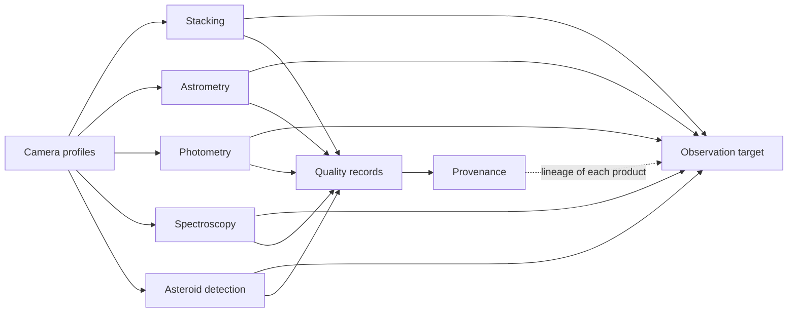

# Astrometrics library architecture

*Version 3.4 · 2026-11-25 · Status: current*

## Abstract

Cooled cameras and small telescopes let amateurs collect scientific data, but their reduction software is split into tools with their own settings and no common record of reliability. This paper describes the Astrometrics library, which reduces telescope data in five pipelines: stacking, astrometry, photometry, spectroscopy, and asteroid detection. The pipelines share one data model built around the observation target and records of camera properties and data provenance, and check their own work with recorded pass, fail, or not-checked gates before and after each run. The paper states the governing equations of each step: calibration, sigma clipping with a cutoff that follows the frame count, plate-solution distortion, the noise budget of aperture photometry, ensemble differential photometry, variability indices, grating-based wavelength calibration, and straight-line motion fitting. Tuned settings are not given here; synthetic data with known truth, real observing sessions, and surveys of every stored product back them.

Terms are defined in the [glossary](../Glossary.md) and at first use; symbols and units are in the [notation appendix](#appendix-a-notation). The [implementation paper](Astrometrics_Library_Implementation.md) names the code and tuned values.

## 1. Introduction

**Statement of need.** Small observatories can collect light curves, spectra and asteroid positions, but their reduction software has its own conventions and no common description of the target or record of its reliability.

**Scope.** This paper explains what each step does and why; the validation register ([validation/index.md](validation/index.md)) holds the evidence for each tuned setting. The [API reference](../api/astrometricslib.rst) is generated from the source.

### 1.1 Related work

**Stacking.** Siril [1] and PixInsight [2] calibrate, register, and stack frames but keep no shared record of the target. The library uses Siril as its engine, adding a rejection cutoff that follows the frame count (Section 3.2).

**Plate solving.** Astrometry.net [3] finds an image's sky position with no estimate, by matching four-star patterns against an index. The library uses it as its solver, adding a refit against Gaia stars (Section 4.2).

**Photometry.** AstroImageJ [4] and photutils [5] give interactive and programmatic aperture photometry. The library automates comparison-star vetting and tests variability against the field's scatter (Section 5.2).

**Spectroscopy.** The specutils package [6] and ISIS [7] give spectral data structures and amateur spectrum reduction. The library classifies the spectra of many stars in one frame and checks each against a Gaia spectrum (Section 6.2).

**Moving objects and surveys.** Survey pipelines such as THOR [8] link detections from many nights into orbits, but a small observatory often has hours on a target, so the library fits straight lines within one night (Section 7). Large surveys, such as Rubin Observatory's [9] and Gaia [10], use fixed instruments with known properties; the library stores a profile for each camera (Section 2.3).

## 2. Observational data models

The library holds what it knows in four information types, all tied to one target (Figure 1).

**Figure 1.** The five pipelines and the shared records. Provenance links each product to the run that made it.

Every image is a FITS file (Flexible Image Transport System) [11], the standard astronomical format, with pixel data and a header.

### 2.1 Information types

1. **Observation target.** A region of sky, such as the galaxy M 81. It connects every raw frame, calibration frame (one that measures the camera's own errors), solved position, stacked image, detected star, and moving object found for it.
2. **Stellar object.** A single star, with its light curve, variability, and spectrum.
3. **Moving object candidate.** A possible asteroid or comet, with its path, speed, and any catalog match.
4. **Pipeline quality record.** A health report for one run, built from gates.

A gate is one recorded verdict on one quality condition of a run: passed, failed, or not checked. A gate that could not see its data is never recorded as passed.

In Table 1, $\alpha$ and $\delta$ are Right Ascension and Declination, the sky's longitude and latitude. The magnitude $V$ is brightness on a backward scale in the V band (green-yellow, near 550 nm): lower is brighter, and 5 magnitudes is a factor of 100.

**Table 1.** Observational data models summary.

| Observational data model | Data attributes |
| --- | --- |
| **Observation target** | Coordinates $(\alpha_0, \delta_0)$, raw exposures, calibration masters, stacked FITS images |
| **Stellar object** | Coordinates $(\alpha, \delta)$, magnitude $V$, light curves $\hat{F}(t)$, 1D spectra $\Phi(\lambda)$ |
| **Moving object candidate** | Detection chain $(x_j, y_j, t_j)$, motion rates $(\dot{\alpha}, \dot{\delta})$, ephemeris match |
| **Pipeline quality record** | Frame survivor counts $N$, rejection cutoffs $z_{\text{low}}(N), z_{\text{high}}(N)$, FWHM ratio, gate results |

### 2.2 Data model progression across pipelines

Table 2 follows each data model across the pipelines.

**Table 2.** Observational data models across pipelines.

| Pipeline | Observation target | Stellar object | Moving object candidate |
| --- | --- | --- | --- |
| **Stacking** | Raw and calibration frames | N/A | The stack that fixes each raw frame's sky position (Section 7.1) |
| **Astrometry** | Matched coordinates | Stars linked to catalog positions | Sky positions |
| **Photometry** | Comparison stars | Light curves | N/A |
| **Spectroscopy** | Zero-order position (Section 6.1) | Calibrated spectra, types | N/A |
| **Asteroid detection** | Candidates that passed the filters (Section 7.2) | N/A | Direction, speed, names |

### 2.3 Shared records: camera profiles and provenance

- **Camera profile.** Facts about one camera model's sensor: its clipping level, gain in e⁻/ADU (electrons per step of the stored value), read noise, and quantum efficiency (the share of arriving light it records at each wavelength). Each number notes its source (datasheet, measurement, or assumption). A camera with no profile gets a flagged generic stand-in. <!-- impl: astrometricslib._internal.drivers.camera_profile_store.resolve_camera_profile --> <!-- impl: astrometricslib.pipelines.shared.applied_camera_profile.record_camera_profile -->
- An analysis runs on the camera and optic that made its stack; frames of any other are left out and listed in the run's warnings. Equipment values (grating dispersion, spectral resolution, field of view) are read for that pair.
- **Provenance.** For each data product, the run, software version, settings, and inputs that made it. It follows the IVOA Provenance Data Model [12], built on the W3C PROV model [13]. A storage problem is logged and never fails a run; lineage exports as PROV-XML. <!-- impl: astrometricslib.pipelines.shared.provenance_recording.record_pipeline_run --> <!-- impl: astrometricslib._internal.drivers.provenance_store.ProvenanceStore --> <!-- impl: astrometricslib._internal.drivers.provenance_store.export_target_lineage_as_prov_xml -->

---

## 3. Image stacking pipeline

**In plain words.** This pipeline takes dozens of short, noisy photos, discards blurry frames and satellite streaks, and blends the rest into one deep, clean picture.

Evidence for its settings: [stacking register](validation/stacking.md). Step-by-step review: [Stacking review guide](pipelines/stacking.md).

### 3.1 Inputs and outputs

- **Inputs.** Raw light exposures and three master calibration frames ($M_{\text{bias}}, M_{\text{dark}}, M_{\text{flat}}$).
- **Outputs.** A calibrated, stacked 2D image (broadband, or spectral, where each star is spread into a spectrum) and a quality record.

### 3.2 Major concepts and governing equations

Every raw exposure $I_{\text{raw}}$ holds an *additive* error from the camera electronics and sensor heat and a *multiplicative* error from the optics. Three masters, each averaged from many calibration frames, correct them: the bias $M_{\text{bias}}$ (the fixed electronic offset), the dark $M_{\text{dark}}$ (dark current, the signal from sensor heat, and hot pixels), and the flat $M_{\text{flat}}$ (vignetting, dust shadows, and pixel sensitivity). The flat, bias removed, is divided by its average $\langle \cdot \rangle$ so that it averages 1:

$$
I_{\text{calibrated}} = \frac{I_{\text{raw}} - M_{\text{dark}}}{\left(M_{\text{flat}} - M_{\text{bias}}\right) / \langle M_{\text{flat}} - M_{\text{bias}} \rangle} \tag{1}
$$

The numerator subtracts only the dark, a closed-shutter exposure that already holds the bias; subtracting the bias too would remove it twice, pushing faint sky below zero. The bias master corrects lights only when no dark exists.<!-- impl: astrometricslib._internal.drivers.siril.stacking.light_calibration_flags -->

Calibration frames must match the lights' gain, offset and binning. Darks are sorted into temperature slots and never mixed, since dark current doubles every few degrees. Every flat has its bias removed, at the flats' own gain and offset. A master from few frames is flagged. A median master ignores any single frame, at about 1.25 times the mean's noise. <!-- impl: astrometricslib._internal.drivers.calibration_library.calibration_setting_key --> <!-- impl: astrometricslib._internal.drivers.calibration_library.CalibrationLibrary.select_dark_frames --> <!-- impl: astrometricslib._internal.drivers.calibration_library.temperature_slot_c --> <!-- impl: astrometricslib._internal.drivers.siril.stacking.build_flat_master_commands --> <!-- impl: astrometricslib._internal.drivers.siril.stacking.build_single_light_commands --> <!-- impl: astrometricslib._internal.drivers.siril.stacking.calibration_count_flags -->

Photon transfer gives the camera's conversion gain and read noise from the same frames.

Averaging $N$ calibrated exposures lowers random noise by about $\sqrt{N}$. A bright value, such as a satellite streak, pulls the mean, so values far from the pixel's median are rejected. Measuring the distance in standard deviations ($\sigma$) makes this sigma clipping. The cutoff follows $N$, starting from Chauvenet's criterion [14], [15]: a value is an outlier when fewer than half of one such value is expected by chance among $N$ normal-noise samples:

$$
z(N) = \sqrt{2}\,\mathrm{erfc}^{-1}\!\left(\frac{1}{2N}\right) \tag{2}
$$

The cutoff loosens as $N$ grows, since good values look extreme more often among many.

A real stacker estimates the spread from the same $N$ values, noisy for small stacks, so Equation (2) alone rejects good values. The upper cutoff never drops below a floor $z_{\text{floor}}$. The lower cutoff sits a margin $\Delta_z$ above it, because streaks, cosmic ray hits, and hot pixels are bright while low outliers are rare:

$$
z_{\text{high}}(N) = \max\!\big(z(N),\ z_{\text{floor}}\big), \qquad z_{\text{low}}(N) = z_{\text{high}}(N) + \Delta_z \tag{3}
$$

<!-- impl: astrometricslib.utilities.rejection_thresholds.rejection_bounds --> <!-- impl: astrometricslib.utilities.rejection_thresholds.chauvenet_sigma -->

:::{warning}
**The floor trades one risk for another.** A higher floor protects good values but passes more weak outliers.<!-- impl: astrometricslib.scripts.rejection_small_n_check -->
:::

Exposures of different lengths cannot be clipped together, because long ones accumulate more light per pixel. Each exposure length is stacked separately, scaled to a reference brightness, and combined by inverse variance. The scale factor is the median flux ratio of each group's stars to the reference group's. Stars are used, not sky, whose brightness varies across nights. A group that deviates from one linear scale factor is discarded; if the reference group's bright end is clipped, it is kept and reported as not judged ([STK-20](validation/stacking.md#stk-20)). A short exposure length with too few frames folds into the nearest group only within a limited ratio; otherwise it is left out and listed with its reason ([STK-11](validation/stacking.md#stk-11), STK-D79). Sky brightness is compared only between frames of one exposure length ([STK-04](validation/stacking.md#stk-04)). <!-- impl: astrometricslib.pipelines.stacking.processing.group_combination.combine_exposure_group_images --> <!-- impl: astrometricslib.pipelines.stacking.processing.group_star_gains.measure_group_gains_with_stars --> <!-- impl: astrometricslib.pipelines.stacking.processing.group_star_gains.measure_star_flux_ratios --> <!-- impl: astrometricslib.pipelines.stacking.processing.group_gains.measure_group_gains -->

A second weighting acts on single frames: for sky-limited frames the squared signal-to-noise ratio grows with exposure, so equal weights waste the longer ones. The noise penalty $P$ of equal weights follows from the exposure times $\tau_j$:

$$
P = \sqrt{\left(\frac{1}{N}\sum_{j=1}^{N}\frac{1}{\tau_j}\right)\left(\frac{1}{N}\sum_{j=1}^{N}\tau_j\right)} \tag{4}
$$

$P$ is 1 for equal lengths. Above a tuned factor, each frame is weighted by its own measured noise. Spectral stacks use the group handling above. <!-- impl: astrometricslib.pipelines.stacking.pre_processing.exposure_weighting.choose_stack_weight --> <!-- impl: astrometricslib.pipelines.stacking.pre_processing.exposure_weighting.equal_weight_noise_penalty -->

### 3.3 Stacking procedure

The stacker calibrates raw lights, then aligns them so every star sits at one pixel; imaging frames are resampled with unclamped Lanczos interpolation, which keeps stars narrow. Broad-band frames get full alignment (shift, rotation, and stretch, plus a quadratic lens-distortion correction between exposure groups when needed); spectral frames get shifts only, avoiding distortion along the dispersion axis. Table 3 lists the steps. A decide-only mode runs the same checks and calibration choice, moves nothing, and shows what would be set aside and chosen.

**Table 3.** Stacking sequence.

| Step | Stage | Description |
| --- | --- | --- |
| 1 | Frame screening | Set aside frames that deviate from the session baseline (§3.4.1). |
| 2 | Calibration | Apply dark, flat, and bias corrections using Equation (1). |
| 3 | Frame selection | Keep the sharpest, roundest stars, above a minimum frame count. |
| 4 | Alignment & rejection | Align frames and reject outlier pixels using Equations (2) and (3). |
| 5 | Stacking | Average surviving pixels and combine exposure groups (§3.2). |

<!-- impl: astrometricslib.pipelines.stacking.pre_processing.frame_homogeneity.find_dominant_gain_subset -->

Each stack uses light frames of one camera, focal length and optical mode (broadband or spectral). If star registration fails on spectral frames, the stacker uses phase correlation [16], which finds the shift between two images from their overall patterns. Rejected frames move to a separate folder; raw files are never deleted. The stacker stretches the linear data for display, using StarNet [17] to stretch stars apart from the background. A small bright smooth object, such as a ring nebula, gets a second stretch so it does not become a flat white disc; the user can pick it or turn it off. The extra stretch compresses only values above a set brightness, as one increasing curve over every connected pixel above it, so no brighter pixel comes out darker than a dimmer one. <!-- impl: astrometricslib.pipelines.stacking.stack_request.choose_frames_to_stack --> <!-- impl: astrometricslib.pipelines.stacking.stack_request.run_stack --> <!-- impl: astrometricslib.pipelines.stacking.stage.stack_frames --> <!-- impl: astrometricslib.pipelines.tasks.stack_frames_with_timeout --> <!-- impl: astrometricslib.pipelines.stacking.stack_runner.run_stack --> <!-- impl: astrometricslib.pipelines.stacking.calibration_ingest.build_ingest_report --> <!-- impl: astrometricslib.pipelines.stacking.pre_processing.frame_quarantine.restore_quarantined_frames --> <!-- impl: astrometricslib.pipelines.stacking.post_processing.stack_preview.write_stack_preview --> <!-- impl: astrometricslib.pipelines.stacking.post_processing.starnet_stretch.blend_stars --> <!-- impl: astrometricslib.pipelines.stacking.post_processing.preview_remake.remake_stack_preview -->

#### 3.3.1 Color from another stack

A monochrome stack is sharp and deep but colorless; a color stack from another camera or optic has color, wider stars and more noise. The LRGB method (L for luminance) makes a second picture from the first's brightness and the second's color. <!-- impl: astrometricslib.pipelines.stacking.post_processing.color_from_other_stack.make_color_preview_for_target --> <!-- impl: astrometricslib.pipelines.stacking.post_processing.color_from_other_stack.choose_color_stack -->

**Alignment.** The plate solutions guess each star's partner, a vote finds their shift, and a similarity transform with a quadratic distortion term moves the color stack onto the monochrome grid. A poor fit or coverage skips the step. <!-- impl: astrometricslib.pipelines.stacking.post_processing.other_stack_alignment.align_with_stars -->

**Extended light.** Color from the starless color picture goes under the monochrome lightness in a color space separating lightness from color. It fades in with the color stack's signal-to-noise ratio, so faint sky stays gray. The sky tint, measured on true sky only (both pictures near their sky level) and smoothed, is removed everywhere, as it also lies in an object's light. <!-- impl: astrometricslib.pipelines.stacking.post_processing.color_from_other_stack.extended_color --> <!-- impl: astrometricslib.pipelines.stacking.post_processing.color_from_other_stack.neutralize_sky -->

**Stars.** Each color channel's stars are wider than the monochrome ones, by their own amount, so pixel color would ring each star with color. Instead each star's color is measured by aperture photometry on the linear color stack, white-balanced on Sun-colored Gaia stars [32], and painted only inside the monochrome star. A saturated star uses its wing, or its catalog color (else white) when red stars are wider; a faint or blended one, its Gaia color. <!-- impl: astrometricslib.pipelines.stacking.post_processing.star_color_measurement.measure_star_colors -->

**Limits.** A stock DSLR records little hydrogen-alpha light, so emission nebulae look weak; shallow color data leave faint light gray. Partly measured ([STK-62](validation/stacking.md#stk-62)).

### 3.4 Quality metrics and integration planning

#### 3.4.1 Before stacking: screening raw frames

A cloud and target alignment check judges each frame against its own session (same camera, optic, filter, exposure, gain, no long gap), moving aside clouded or trailed frames and frames off the target. Roundness is a star's long width over its short width (1 for a circle). A large share moved warns. Frames at a minority gain, or one side of a sudden sky jump, are set aside. The sharpest, roundest requested share is kept. A flat frame clipped in any color channel is left out of the master flat, judged per frame and per channel ([STK-05](validation/stacking.md#stk-05)). The master flat's noise must stay below a limit, since dividing copies it into every light. Dark and bias frames are screened too: cut off at zero, struck by light, off the camera's level or noise, or too few different frames. A dark with a track across the whole frame, or far more bright pixels than its set, is left out; a track inside the frame warns, as do the other checks. <!-- impl: astrometricslib.pipelines.shared.quality.star_profile_fitting.measure_single_star_shape --> <!-- impl: astrometricslib.pipelines.stacking.pre_processing.frame_quarantine.judge_batch --> <!-- impl: astrometricslib.pipelines.stacking.pre_processing.frame_quarantine.quarantine_gate --> <!-- impl: astrometricslib.pipelines.stacking.pre_processing.frame_homogeneity.gain_homogeneity_gate --> <!-- impl: astrometricslib.pipelines.stacking.pre_processing.background_homogeneity.detect_background_split --> <!-- impl: astrometricslib.pipelines.stacking.pre_processing.background_homogeneity.background_homogeneity_gate --> <!-- impl: astrometricslib.utilities.stack_filter_floor.resolve_filter_wfwhm_with_floor --> <!-- impl: astrometricslib.pipelines.stacking.pre_processing.flat_calibration.assess_flats --> <!-- impl: astrometricslib.pipelines.stacking.pre_processing.assess_input_quality.calibration_gates -->

#### 3.4.2 After stacking: checking the final image

Six checks run on the stacked image, and three more on multi-length stacks. The sharpness ratio compares the stack's star width (FWHM, full width at half maximum) with the width its frames predict. A stack's star is the weighted average of its frames' stars; for round Gaussian stars the variances average, so the expected width is the weighted root mean square of the $N$ frame widths, $a_j$ being frame $j$'s stack weight. A median would call the normal blur of mixed seeing (air turbulence) a failure: <!-- impl: astrometricslib.pipelines.stacking.post_processing.assess_output_quality.output_quality_gates --> <!-- impl: astrometricslib.pipelines.stacking.fwhm_sampling.measure_fwhm_degradation -->

$$
\rho_{\text{FWHM}} = \frac{\text{FWHM}_{\text{stack}}}{\text{FWHM}_{\text{expected}}}, \qquad \text{FWHM}_{\text{expected}} = \sqrt{\frac{\sum_{j=1}^{N} a_j\,\text{FWHM}_j^{\,2}}{\sum_{j=1}^{N} a_j}} \tag{5}
$$

A value clearly above 1 fails: misalignment blurred it. Other checks cover the shares of rejected, saturated, zero (such as a bias removed twice) and negative pixels, and zero-order jumps in spectral stacks. With several exposure lengths, each group must be one scale factor of the reference, none may be missing, and no raw frame may be clipped at zero by a low offset. <!-- impl: astrometricslib.pipelines.stacking.post_processing.stack_quality.expected_stack_fwhm --> <!-- impl: astrometricslib.pipelines.stacking.post_processing.stack_quality.zero_fraction_threshold --> <!-- impl: astrometricslib.pipelines.spectroscopy.utilities.registration_quality.evaluate_spectral_registration_quality --> <!-- impl: astrometricslib.pipelines.stacking.processing.group_combination.measure_exposure_group_gains --> <!-- impl: astrometricslib.pipelines.stacking.post_processing.exposure_group_report.exposure_group_linearity_gate --> <!-- impl: astrometricslib.pipelines.stacking.post_processing.exposure_group_report.exposure_groups_combined_gate --> <!-- impl: astrometricslib.pipelines.stacking.post_processing.exposure_group_report.raw_frame_clipping_gate -->
The pipelines store continuous measurements (aperture statistics, star shapes, field rotation, empty-sky noise).

#### 3.4.3 Noise in empty sky

The noise of empty sky tells how deep a stack is and whether more frames help. It is the scatter of the summed sky in small apertures free of stars and faint sources, scaled to the flux of reference stars. Table 4 lists its parts.

**Table 4.** Components of a stack's empty-sky noise.

| Component | Term | Over many frames | Source | How the library gets it |
| --- | --- | --- | --- | --- |
| Sky pedestal | $I_{\text{sky}}$ | Constant; subtracted | Sky glow, airglow, and light pollution | The background level of each frame<!-- impl: astrometricslib.pipelines.stacking.post_processing.expected_noise.expected_exposure_group_noise --> |
| Sky photon noise | $\sigma_{\text{sky}}$ | Averages down as $1/\sqrt{N}$ | Random arrival of sky photons | Predicted from each frame's sky rate and the camera gain<!-- impl: astrometricslib.pipelines.stacking.post_processing.expected_noise.expected_exposure_group_noise --> |
| Read noise | $\sigma_{\text{read}}$ | Averages down | Camera electronics | Predicted from the camera profile<!-- impl: astrometricslib.pipelines.stacking.post_processing.expected_noise.expected_exposure_group_noise --> |
| Dark-current noise | $\sigma_{\text{dark}}$ | Averages down | Thermal electrons | Predicted from the dark frames and the sensor temperature<!-- impl: astrometricslib.pipelines.stacking.post_processing.expected_noise.expected_master_dark_noise --> |
| Fixed-pattern noise | $\sigma_{\text{fixed}}$ | Does not shrink | Faint sky structure, unresolved objects, flat-field residuals, gradients, and the noise of the master calibration frames | The measured noise squared minus the random part<!-- impl: astrometricslib.pipelines.stacking.post_processing.flat_noise_contribution.smoothed_noise_factor --> |

The components add in quadrature:

$$
\sigma_{\text{measured}}^{2} = \sigma_{\text{sky}}^{2} + \sigma_{\text{read}}^{2} + \sigma_{\text{dark}}^{2} + \sigma_{\text{fixed}}^{2} \tag{6}
$$

The first three terms are the random part, $\sigma_{\text{random}}^{2}$, which shrinks with more frames. The fixed-pattern term does not, so it limits what more frames give. It is predicted from each frame's sky, the camera profile, and the stacking weights. The *measured-to-predicted noise ratio*, $\sigma_{\text{measured}}/\sigma_{\text{random}}$, is near 1 for a stack as quiet as photon and read noise allow. A larger ratio means unpredicted noise.<!-- impl: astrometricslib.pipelines.stacking.post_processing.record_science.noise_ratio_measurements -->

**The odd–even difference.** This direct measure of the random part stacks the odd and even frames, in time order, as two halves. What the halves share, including fixed-pattern noise, cancels in their difference; the independent random noise stays. Scaled to the stack, it gives $\sigma_{\text{random}}$ without a noise model, and Equation (6) then gives $\sigma_{\text{fixed}}$. The Planck mission measured noise this way with half-ring difference maps [18] and found the estimate low by about one percent, because the halves are correlated and outlier rejection clips the noise's positive tail [19], [20]. Its bias is tested by stacking simulated noise through the same steps. At each aperture the halves' sum holds both parts and their difference only the random part, so comparing them places the fixed pattern (`Wayfinding_Quality_Judgment.md`, Section 6).<!-- impl: astrometricslib.pipelines.stacking.odd_even_difference_run.run_odd_even_difference_noise --><!-- impl: astrometricslib.pipelines.stacking.odd_even_bias.measure_odd_even_bias -->

**Aperture size.** Resampling during registration correlates neighboring pixels, and fixed patterns add noise on large scales, so the noise over $n$ pixels grows faster than for independent pixels. Hubble deep-field work found this in drizzled images [21] and measures it with empty apertures [22], [23], [24]. The library measures four aperture sizes and fits a power law:

$$
\sigma(n) = \sigma_{1}\, n^{\beta} \tag{7}
$$

Here $\sigma_{1}$ is the noise of one pixel and $\beta$ is $1/2$ for independent and $1$ for fully correlated pixels. The exponent is reported; the prediction is unchanged.<!-- impl: astrometricslib.pipelines.stacking.post_processing.aperture_size_noise.measure_aperture_size_noise -->

**Depth.** Like space missions, the library states depth in magnitudes. The zero point $Z$, the offset between counts and magnitudes, comes from the stack's reference stars' Gaia magnitudes. The point-source depth is the magnitude of a star detected at $5\sigma$ in an aperture one star width in radius, as stated for Hubble deep fields [25]:

$$
m_{5\sigma} = Z - 2.5\log_{10}\!\left(5\,\sigma_{\text{star}}\right) \tag{8}
$$

The surface-brightness limit is the faintest level detected at $3\sigma$ over a $10'' \times 10''$ box of area $A_{\text{box}}$, as Euclid states it [26]:

$$
\mu_{3\sigma} = Z - 2.5\log_{10}\!\left(\frac{3\,\sigma_{\text{box}}}{A_{\text{box}}}\right) \tag{9}
$$

Both noises, $\sigma_{\text{star}}$ and $\sigma_{\text{box}}$, come from Equation (7) at the nearest measured aperture area. Without a measured exponent, independent pixels are assumed, which flatters the depth. The zero point is in Gaia's G band, near but not equal to the luminance filter, with no color term. The aperture misses a little starlight, so the point-source depth reads shallow.<!-- impl: astrometricslib.pipelines.stacking.post_processing.depth_limits.measure_depth_limits -->

#### 3.4.4 Sky background gradient

The background is measured as a tilt and a round term, as fractions of sky level. A tilt suggests a sky gradient, a round term a flat-field error. A small tilt gets a plane, which cannot ring a nebula; a larger one, an AI model.<!-- impl: astrometricslib.pipelines.stacking.post_processing.background_gradient.measure_background_model --> <!-- impl: astrometricslib.pipelines.stacking.post_processing.sky_plane.choose_background_method -->

---

## 4. Astrometry pipeline

**In plain words.** This pipeline compares your photo's star patterns with a catalog to find where the telescope pointed.

The pipeline finds where a stacked image points (plate solving). The result is a World Coordinate System (WCS) [27], [28], a formula converting pixel positions to sky positions and back. Evidence for its settings: [astrometry register](validation/astrometry.md). Step-by-step review: [Astrometry review guide](pipelines/astrometry.md).

### 4.1 Inputs and outputs

- **Inputs.** A stacked image and a rough estimate of the field's coordinates and pixel scale (arcseconds of sky per pixel).
- **Outputs.** A WCS in the image's FITS header, a list of catalog-identified stars, and an astrometry quality record.

### 4.2 Major concepts and governing equations

Plate solving connects pixel coordinates $(x,y)$ to sky coordinates $(\alpha, \delta)$ in six steps:

1. **Star detection.** A matched-filter star finder (DAOFIND [29], through photutils [5]) slides a star-shaped template over the background-subtracted image. A Gaussian fit to bright stars measures the star width (FWHM), which sets the acceptable position error. <!-- impl: astrometricslib.pipelines.astrometry.pre_processing.source_detection.SourceDetector.detect --> <!-- impl: astrometricslib.pipelines.astrometry.pre_processing.fwhm.measure_image_fwhm -->
2. **Quad-star matching.** Nearby stars form four-star shapes ("quads") whose relative side lengths survive rotation, reflection and scaling. Matching them to a pre-built index identifies the sky patch. The Astrometry.net solver [3] does this, locally then online. <!-- impl: astrometricslib._internal.drivers.astrometry_net_driver.AstrometryNetPlateSolveDriver.solve --> <!-- impl: astrometricslib.pipelines.astrometry.processing.star_identifier.MAXIMUM_PLATE_SOLVE_SOURCES -->
3. **Fitting the distortion map.** Pixel offsets $(u, v)$ from a reference pixel $(x_{\text{ref}}, y_{\text{ref}})$ become offsets $(\xi, \eta)$ on the tangent plane (a flat sky projection touching the sphere at the reference pixel). Four linear coefficients $K$ handle rotation, scale and flips. Real optics bend the map, mostly near the edges, so a Simple Imaging Polynomial (SIP) [30] first corrects the pixel offsets with second-order and higher terms ($K$ holds the linear part):

   $$
   \begin{aligned}
   \begin{pmatrix} \xi \\ \eta \end{pmatrix} &= \begin{pmatrix} K_{11} & K_{12} \\ K_{21} & K_{22} \end{pmatrix} \begin{pmatrix} u + f(u,v) \\ v + g(u,v) \end{pmatrix}, \qquad u = x - x_{\text{ref}}, \quad v = y - y_{\text{ref}}, \\
   f(u,v) &= \sum_{a+b=2}^{n_{\text{SIP}}} A_{ab}\,u^{a}v^{b}, \qquad g(u,v) = \sum_{a+b=2}^{n_{\text{SIP}}} B_{ab}\,u^{a}v^{b}
   \end{aligned} \tag{10}
   $$

   The WCS is written to the FITS header with its SIP terms. <!-- impl: astrometricslib.pipelines.shared.session_identification.write_wcs_to_fits_header -->
4. **Naming the stars.** Each detected star is matched to the nearest entry in the SIMBAD database [31] or the Gaia catalog [32]. Gaia lists positions for one fixed date, the catalog epoch, with each star's proper motion (its yearly drift across the sky). A fast star can drift a match radius in a decade, so Gaia positions are first moved to the observation date. An extended target (galaxy, nebula, cluster) is located by its catalog position and size, never matched to a star; with the catalog service unreachable, the library's own target record supplies them ([AST-09](validation/astrometry.md#ast-09)). <!-- impl: astrometricslib.pipelines.astrometry.processing.gaia_field_matching.propagate_gaia_positions --> <!-- impl: astrometricslib.pipelines.astrometry.processing.gaia_field_matching.GaiaFieldMatching._move_gaia_coords_to_observation_epoch -->
5. **Judging the fit.** The *fit residual* is the root mean square (RMS) distance, in arcseconds, between each matched star's position under the fitted WCS and its position in the solver's index. The *catalog match separation* is the RMS distance from each detected star to its nearest catalog star within the match radius. <!-- impl: astrometricslib._internal.drivers.astrometry_net_driver.read_corr_fit_statistics --> <!-- impl: astrometricslib.pipelines.astrometry.post_processing.record_quality.astrometry_run_gates --> <!-- impl: astrometricslib.pipelines.astrometry.processing.star_identifier.StarIdentifier.get_catalog_match_separation_rms_arcsec -->
6. **Refitting to Gaia.** The solver fits a few dozen bright index stars that carry the index's errors, so a solution can be a pixel off yet agree with itself. The pipeline refits a low-order SIP solution to the detections matched to Gaia at the observation date, dropping outliers (blends, doubles, wrong matches) until stable. The new solution replaces the solver's only if it fits better. The residual against Gaia is recorded either way, independent of the solver. <!-- impl: astrometricslib.pipelines.astrometry.post_processing.record_quality._residual_and_basis --> <!-- impl: astrometricslib.pipelines.astrometry.processing.wcs_refinement.refine_wcs_with_gaia --> <!-- impl: astrometricslib.pipelines.astrometry.processing.plate_solution_steps.PlateSolutionSteps._refine_wcs_against_gaia -->

### 4.3 Astrometry procedure

Table 5 lists the steps.

**Table 5.** Astrometry sequence.

| Step | Stage | Description |
| --- | --- | --- |
| 1 | Source detection | Find stars. |
| 2 | Quad pattern hashing | Turn each four-star shape into a numeric code (a hash) for index lookup. |
| 3 | WCS and distortion fit | Fit Equation (10) and write it into the header. |
| 4 | Catalog cross-match | Fill the Gaia tiles, refit to Gaia, name the stars. |
| 5 | Solution check | Judge the residual against the star width. |

Before naming, every Gaia sky tile under the image is filled to a depth predicted from equipment and exposure. Stars are matched only in complete tiles, since a tile missing faint stars could give a detection a neighbor's name; missing tiles are counted. Each tile is asked once and kept with its fetch time; a fresh one needs no network call. A paused catalog is answered from stored results, with a warning of their age, and only a field never stored stays unverified.

### 4.4 Quality metrics and solution validation

#### 4.4.1 Before solving: checking the image

At least four stars are needed, since one quad needs four. Below a higher count the local solver is skipped rather than spend its whole time limit on near-certain failure. <!-- impl: astrometricslib.pipelines.astrometry.processing.star_identifier.StarIdentifier.process_image --> <!-- impl: astrometricslib.pipelines.astrometry.processing.plate_solution_steps.PlateSolutionSteps._calculate_scale_hints --> <!-- impl: astrometricslib._internal.drivers.astrometry_net_driver.AstrometryNetPlateSolveDriver._solve_locally -->

#### 4.4.2 After solving: checking the result

The solver must find a WCS with enough catalog-matched stars to average the residual over. The residual (Section 4.2, step 6) must stay below a fixed fraction of the star width; a larger one means a wrong match, a bad distortion model, or a wrong field. A network check fails when lookups were paused or too many failed, telling a sparse field from a network problem. Stars also check a map: under a wrong map, each star's nearest catalog entry is a chance neighbor, so of those within a wider circle $W$ the share inside match radius $R$ follows catalog density ($(R/W)^2$ if sparse); clearly more is needed. <!-- impl: astrometricslib.models.quality.gate_result.unchecked_gate --> <!-- impl: astrometricslib.pipelines.astrometry.post_processing.record_quality.astrometry_run_gates --> <!-- impl: astrometricslib.pipelines.shared.session_identification.plate_solution_problem -->

:::{warning}
**A pass is not a measure of position accuracy.** The residual limit catches a failed solve and does not rank good ones.
:::

---

## 5. Stellar photometry pipeline

**In plain words.** This pipeline measures a star's brightness changes against steady neighbors, revealing flares, pulsations, or orbiting exoplanets.

The pipeline tracks each star's brightness across unstacked frames, builds light curves and flags variable stars. Evidence for its settings: [photometry register](validation/photometry.md). Step-by-step review: [Photometry review guide](pipelines/photometry.md).

### 5.1 Inputs and outputs

- **Inputs.** Calibrated, unstacked light frames, stars found on the session's first frame, and a solved stack WCS.
- **Outputs.** Normalized light curves $\hat{F}_i(t)$ with a $1\sigma$ uncertainty and a mid-exposure time for every point, variable-star candidates, and a photometry quality record.

### 5.2 Major concepts and governing equations

1. **Tracking a star frame to frame.** Stars are found once, on the first frame of a session (one target, night, gain and offset). On each later frame, the pipeline measures the frame's offset from the first using a few bright stars, moves each star by it, and re-centers it on its brightness-weighted centroid in a small box unless the box looks unreliable. Brightness is the pixel sum in a circle on the star, less the sky from a ring around it. The circle sits at the star's exact fractional position, since one a pixel fraction off loses light that changes as the field drifts. <!-- impl: astrometricslib.pipelines.photometry.pre_processing.frame_photometry._process_single_frame_worker --> <!-- impl: astrometricslib.pipelines.photometry.pre_processing.frame_photometry.refine_star_centroid --> <!-- impl: astrometricslib.pipelines.photometry.pre_processing.frame_photometry.measure_aperture_photometry -->
2. **Uncertainty of each measurement.** Every brightness carries a $1\sigma$ uncertainty. It follows the CCD equation [33] in the form of Merline and Howell [34], in electrons, where independent noise variances add:

   $$
   \sigma_{\text{ap}}^2 = S_\star + n_{\text{pix}}\left(s_{\text{sky}} + \sigma_{\text{rd}}^2 + D\right) + \frac{n_{\text{pix}}^2}{n_{\text{sky}}}\left(s_{\text{sky}} + \sigma_{\text{rd}}^2 + D\right) \tag{11}
   $$

   The first term is the star's shot noise: a count of $S_\star$ electrons scatters by about $\sqrt{S_\star}$. The others are the sky, read-out and dark noise under the circle, and the error of the ring's sky estimate. The gain comes from the camera profile, else the frame header, else one electron per ADU is assumed and the light curve says so (uncertainties then have the right shape, the wrong size). Each point's error carries a scintillation term (twinkling in the air) that the camera noise budget lacks. It is Young's prediction for the frame times a coefficient measured from the session's own comparison stars, kept within a plausible range. The published factor of 1.5 serves when the session has too few stars or frames. The term is added in quadrature before the comparison stars are weighted. <!-- impl: astrometricslib.pipelines.photometry.processing.scintillation_term.build_scintillation_term --> <!-- impl: astrometricslib.pipelines.photometry.processing.scintillation_term.add_scintillation_in_quadrature --> <!-- impl: astrometricslib.pipelines.photometry.pre_processing.frame_photometry.aperture_flux_error_adu --> <!-- impl: astrometricslib.pipelines.photometry.pre_processing.detector_noise.resolve_detector_noise -->
3. **Times of observation.** Each point is stamped with its exposure midpoint as BJD$_{\text{TDB}}$ (Barycentric Julian Date in Barycentric Dynamical Time) [35]. This is when the light would reach the solar system's center of mass, so an event's date does not depend on Earth's orbital position (up to about 8 minutes). A frame with no readable date is rejected, never given the current time. <!-- impl: astrometricslib.pipelines.photometry.pre_processing.observation_times.barycentric_julian_dates --> <!-- impl: astrometricslib.pipelines.photometry.pre_processing.frame_photometry.read_observation_time -->
4. **Ensemble differential photometry.** To cancel passing clouds, each star's raw brightness $F_i(t)$ is divided by a signal from a group (ensemble) of well-behaved comparison stars in the same field [36]. A thin cloud dims every star equally, so the ratio holds. The group is chosen once per session from stars that are never saturated, have a high median signal-to-noise in the usable frames (so they add little noise) and a flux in nearly all of those frames, and are not listed as variable in a catalog such as the International Variable Star Index [37]. Then the star scattering most beyond what its uncertainties predict is dropped, repeatedly, until none scatters more than allowed. A measured flux at or below zero is kept with its error; magnitudes exist only for positive fluxes. Each frame's signal is the weighted mean of the comparison stars' brightness, each divided by its session mean, with inverse-variance weights:

   $$
   \hat{F}_i(t) = \frac{F_i(t)}{L_{\text{ens}}(t)}, \qquad L_{\text{ens}}(t) = \bar{\mu}\,\frac{\sum_{c=1}^{N_c} w_c(t)\,F_c(t)/\mu_c}{\sum_{c=1}^{N_c} w_c(t)}, \qquad w_c(t) = \frac{1}{\epsilon_c(t)^2} \tag{12}
   $$

   Here $\mu_c$ is a comparison star's session mean, $\bar{\mu}$ the mean of those means, and $\epsilon_c(t)$ a star's fractional uncertainty. The noise of $N_c$ equal stars averages down as $1/\sqrt{N_c}$, unlike a median's. A comparison star is divided by the signal of the *other* members, so its own dip never lowers its divisor. Frames with far fewer measured stars than usual, or an outlier signal, are left out. Isolated outlying points are clipped, but a run of neighboring points on one side is kept as a real change. <!-- impl: astrometricslib.pipelines.photometry.processing.comparison_ensemble.select_comparison_set --> <!-- impl: astrometricslib.pipelines.photometry.processing.comparison_ensemble.build_ensemble_signal --> <!-- impl: astrometricslib.pipelines.photometry.processing.variability_analyzer.VariabilityAnalyzer._reject_outlier_frames --> <!-- impl: astrometricslib.pipelines.photometry.processing.variability_analyzer.VariabilityAnalyzer._reject_outlier_measurements_for_star --> <!-- impl: astrometricslib.pipelines.photometry.processing.variability_analyzer.VariabilityAnalyzer.detrend_light_curves_airmass -->

   :::{warning}
   **A synthetic session tests the method, not the field.** It cannot show whether the brightness band, comparison count, and vetting limit suit a real field. <!-- impl: astrometricslib.pipelines.photometry.test.test_comparison_ensemble_injection -->
   :::
5. **Deciding which stars vary.** Scatter grows as a star gets fainter, so the pipeline asks whether a star scatters more than a constant star of its brightness in this field. It fits the field's own scatter against brightness and measures three indices per star [38]. *Excess scatter* is the measured over the expected scatter. *Reduced chi-square* is the scatter of the points about the weighted mean in units of their uncertainties. Both are near 1 for a constant star:

   $$
   \chi^2_\nu = \frac{1}{n_{\text{pts}}-1}\sum_{j=1}^{n_{\text{pts}}}\left(\frac{\hat{F}_j - \bar{F}_w}{e_j}\right)^2 \tag{13}
   $$

   *Stetson J* multiplies the deviations of neighboring points [39]. The thresholds on chi-square and J are $\zeta$ robust standard deviations above the field's median, where $\zeta$ is the one-sided normal point for a chosen false-alarm share. A robust standard deviation is 1.4826 times the median absolute deviation (MAD) [40], which a few variables cannot inflate. A candidate must pass all three indices and a false-discovery test: its chi-square becomes a false-alarm probability, which the Benjamini–Hochberg method [41] converts into q-values that allow for testing every star at once. The coefficient of variation measures scatter; 0.01 means about 1%: <!-- impl: astrometricslib.pipelines.photometry.processing.variability_indices.FALSE_DISCOVERY_LEVEL --> <!-- impl: astrometricslib.pipelines.photometry.processing.variability_indices.assess_variability --> <!-- impl: astrometricslib.pipelines.photometry.processing.variability_indices.fit_noise_model --> <!-- impl: astrometricslib.pipelines.photometry.processing.variability_indices.reduced_chi_square --> <!-- impl: astrometricslib.pipelines.photometry.processing.variability_indices.stetson_j --> <!-- impl: astrometricslib.pipelines.photometry.processing.variability_indices.calibrate_thresholds -->

   $$
   C_v = \frac{s_{\hat{F}}}{\langle \hat{F} \rangle} \tag{14}
   $$

   A field with too few stars for a noise model flags stars whose $C_v$ is unusually high for the field. <!-- impl: astrometricslib.pipelines.photometry.processing.variability_analyzer.flag_variable_stars -->

   :::{warning}
   **The flag is only as good as the field's noise.** The area under the ROC curve (AUC) is the chance that a random variable scores above a random constant star (1 is perfect, 0.5 chance). A synthetic field tests the method on known noise, not the sky. A flag from $C_v$ alone is a reason to look, not evidence of a known kind of variable. <!-- impl: astrometricslib.pipelines.photometry.test.test_variability_injection --> <!-- impl: astrometricslib.scripts.measure_variability_cutoff -->
   :::
6. **Matching the same star across sessions.** Tracking holds only within a session, so stars from sessions weeks apart are matched by sky position into one light curve. Each session divides by its own comparison ensemble, so sessions sharing no comparison star place every constant star at a different level, by one common factor. Before joining, each later session is multiplied by the clipped median of the ratios of the stars both sessions measured, which removes the shared offset and keeps one star's own change, since one star cannot move a median of many. A session sharing too few stars with the reference is left as measured and reports no change between sessions. For a star in at least two sessions, the between-session amplitude is the highest over the lowest session median, in magnitudes, and the significance is that difference over its expected error. <!-- impl: astrometricslib.pipelines.photometry.session_tie.measure_session_tie --> <!-- impl: astrometricslib.pipelines.photometry.batch._tie_sessions_to_the_field --> <!-- impl: astrometricslib.pipelines.photometry.batch._match_and_merge_across_sessions --> <!-- impl: astrometricslib.pipelines.photometry.batch._merge_light_curves --> <!-- impl: astrometricslib.pipelines.photometry.processing.variability_analyzer.identify_long_term_variable_candidates -->
7. **Identifying stars by catalog name (optional).** A session's reference frame can be matched to a star catalog as in Section 4.
8. **Searching for a repeating pattern.** The target's star and the brightest others are searched for a period. A Lomb–Scargle periodogram [42], [43], [44] fits sine waves of many trial periods to unevenly spaced data, and box least squares [45] finds a repeating flat-bottomed dip, such as an eclipse or a transit. A search finds a best period even in pure noise, so each result gets a verdict: *insufficient data*, *not detected*, *possible*, or *detected*. The false-alarm probability is the share of shuffled light curves with a result at least as strong. The shuffle moves blocks of neighboring points [46], so slow drifts are not mistaken for a signal. "Detected" needs a stricter limit and a minimum number of repeats. A hold-out check (leave one night out and predict it) and an alias check (false echo periods from nightly sampling) can each lower a verdict. One run makes $N_s$ searches, so each probability is corrected by the Šidák method [47], the chance that at least one of $N_s$ independent searches does that well by luck:

   $$
   p_{\text{corr}} = 1 - (1 - p)^{N_s} \tag{15}
   $$

   A shuffle test with $N_{\text{sh}}$ shuffles cannot report a probability below $1/(N_{\text{sh}}+1)$, so searches needing one are repeated with more shuffles. <!-- impl: astrometricslib.pipelines.photometry.batch.search_periods_and_save --> <!-- impl: astrometricslib.pipelines.photometry.processing.periodicity_search.lomb_scargle_search --> <!-- impl: astrometricslib.pipelines.photometry.processing.periodicity_search.box_search --> <!-- impl: astrometricslib.pipelines.photometry.processing.periodicity_search.verdict_from_false_alarm --> <!-- impl: astrometricslib.pipelines.photometry.processing.periodicity_search.correlation_block_length --> <!-- impl: astrometricslib.pipelines.photometry.processing.period_checks.apply_verdict_checks --> <!-- impl: astrometricslib.pipelines.photometry.processing.family_wise_correction.apply_family_wise_correction -->
9. **Catalog zero point of each frame.** Each frame gets a catalog zero point, the offset between catalog and instrumental magnitudes, lowered by extinction.

### 5.3 Photometry procedure

Table 6 lists the steps.

**Table 6.** Photometry sequence.

| Step | Stage | Description |
| --- | --- | --- |
| 1 | Star tracking | Shift each star by the frame's drift and re-center it. |
| 2 | Aperture photometry | Sum the light, subtract the sky, and compute the uncertainty (Equation (11)). |
| 3 | Ensemble selection | Exclude saturated and variable stars, then vet the rest. |
| 4 | Differential normalization | Divide by the ensemble signal (Equation (12)). |
| 5 | Variability analysis | Compute three indices (Equation (13)) and flag stars above all thresholds. |
| 6 | Cross-session matching | Match stars by sky position. |
| 7 | Period search | Search, shuffle-test, and correct for the number of searches (Equation (15)). |

### 5.4 Quality metrics and photometric validation

Run-level checks are recorded as in Section 4.4. <!-- impl: astrometricslib.pipelines.photometry.post_processing.record_quality.photometry_run_gates -->

#### 5.4.1 Before measuring: screening the input

A star saturated in any frame is never a comparison star. A star whose brightness steps when the field moves, that saturated in over a tenth of its frames, or that lies near the frame edge is not judged; it keeps its light curve and the reason is recorded. A frame's drift is measured only with enough alignment stars.

#### 5.4.2 After measuring: checking the light curve

The comparison set must hold a minimum number of stars, the same in every frame, with scatter matching its uncertainties. A large share of frames rejected for an outlier signal flags the run. Catalog-listed variables should score above other stars. Variable-star catalogs are asked once per field, and stars are matched locally. A star no catalog could be asked about is labeled Unverified. The run states the smallest change it could see, and fails when most variable stars would be missed.

---

## 6. Stellar spectroscopy pipeline

**In plain words.** This pipeline spreads starlight into a rainbow to measure a star's surface temperature, chemical elements, and motion.

The pipeline extracts, calibrates, and classifies a star's spectrum from images taken through a transmission grating (a plate ruled with fine lines, here a Star Analyser 200) in front of the camera. The grating spreads each star's light into a spectrum without a slit (slitless spectroscopy), leaving a point image, the zero order, beside the first-order spectrum. An optional step follows stars across raw frames. Evidence: [spectroscopy register](validation/spectroscopy.md). Step-by-step review: [Spectroscopy review guide](pipelines/spectroscopy.md).

### 6.1 Inputs and outputs

- **Inputs.** A stacked spectral image, the zero-order star position, the target's aperture size, the camera's quantum efficiency (QE) curve, the instrument response, and the airmass from the header.
- **Outputs.** A wavelength-calibrated 1D spectrum $\Phi(\lambda)$, detected hydrogen (Balmer) lines, the dispersion angle, the closest spectral type with a measure of how clearly it wins, and a quality record.

### 6.2 Major concepts and governing equations

1. **Finding the spectrum's angle.** The pipeline measures the dispersion angle $\theta_{\text{disp}}$, the direction the grating spreads the light relative to the pixel grid, anchored on the zero-order position $(x_0, y_0)$.
2. **Extracting the spectrum.** Each spectrum lies on the image as a short band, the trail. At each step along it the pipeline sums the pixels across the trail inside a reading box and subtracts the sky, giving one point of the profile $T(\ell)$. Here $\ell$ is the distance along the trail from the zero-order star and $q$ is the pixel offset across it:

   $$
   T(\ell) = \sum_{q} m(q)\,\big[\,I(\ell, q) - b(\ell)\,\big] \tag{16}
   $$

   Here $I$ is the pixel intensity, $b(\ell)$ the sky level, and $m(q)$ the fraction of pixel $q$ inside the box. Edge pixels count in part, so the box does not jump in size and show false steps. The sky is measured in two strips beside the box. Their mean is used when their medians agree within noise; otherwise the brighter strip is contaminated (a neighbor's light only adds) and the cleaner one is used alone. For a point-like star the box reaches a fixed multiple of the trail's fitted width to each side, smoothed first so a noisy fit does not make the spectrum jump. Extended objects such as nebulae and comets get a wider box sized from their cataloged angle. <!-- impl: astrometricslib.pipelines.spectroscopy.pre_processing.spectrum_extractor.measure_sky --> <!-- impl: astrometricslib.pipelines.spectroscopy.pre_processing.spectrum_extractor.SpectrumExtractor._sum_aperture_minus_sky --> <!-- impl: astrometricslib.pipelines.spectroscopy.pre_processing.spectrum_extractor.box_pixel_weights --> <!-- impl: astrometricslib.pipelines.spectroscopy.pre_processing.spectrum_extractor.traced_aperture_half_widths_px --> <!-- impl: astrometricslib.pipelines.spectroscopy.pre_processing.spectrum_extractor.smooth_aperture_sigmas --> <!-- impl: astrometricslib.pipelines.astrometry.pipeline.AstrometryPipeline._derive_extraction_radius_px -->
3. **Converting pixels to wavelength.** The grating bends longer wavelengths through larger angles. The angle follows from the distance on the sensor and the grating-to-sensor distance $L_g$; the grating equation turns it into a wavelength:

   $$
   \lambda(\ell) = d\,\sin\!\left(\arctan\frac{\ell_{\text{mm}}}{L_g}\right) \tag{17}
   $$

   Here $d$ is the groove spacing and $\ell_{\text{mm}}$ is $\ell$ in millimeters. The Star Analyser 200 has 200 grooves per millimeter, so $d = \frac{1}{200}\,\text{mm}$. The one free parameter, $L_g$, is fitted once on Vega, strong in hydrogen lines, by matching its Balmer absorption dips to their known air wavelengths ($\mathrm{H}\beta = 4861.3\text{ Å}, \mathrm{H}\gamma = 4340.5\text{ Å}, \mathrm{H}\delta = 4101.7\text{ Å}$; 1 Å is 0.1 nm). Every group of three dips is tried against the three lines, keeping the one with the smallest RMS wavelength error. <!-- impl: astrometricslib.pipelines.spectroscopy.utilities.calibration_tuner.SpectroscopyCalibrationTuner._fit_grating_distance -->
4. **Correcting for the instrument and the air.** Three effects of the equipment and sky, not the star, are removed. The flux is divided by the QE curve $\text{QE}(\lambda)$. The grating, coatings and air favor some colors. The instrument response $R_{\text{ins}}(\lambda)$ is measured by observing Vega, dividing by its reference spectrum (the A0V template of a library of observed spectra [48]), and smoothing. Air dims blue light more than red, and more at higher airmass (the amount of air the light crossed, 1.0 straight overhead). The response already holds the dimming at the standard star's airmass, so another airmass is rescaled with an extinction curve $k_{\text{ext}}(\lambda)$, in magnitudes per airmass:

   $$
   \Phi_{\text{cal}}(\lambda) = \frac{T\big(\ell(\lambda)\big)}{\text{QE}(\lambda)\,R_{\text{ins}}(\lambda)}\;10^{\,0.4\,k_{\text{ext}}(\lambda)\,(X_{\text{target}} - X_{\text{ref}})} \tag{18}
   $$

   Here $X_{\text{target}}$ and $X_{\text{ref}}$ are the airmasses of the frame and the standard star, so the last factor is 1 when they match. The stored curve is the Kitt Peak mean curve distributed with IRAF [49]; only an airmass difference enters, so another site's curve errs by a small fraction of the correction.

   All three curves depend on wavelength, so wavelengths are fixed first. Air bends blue light more than red, so the colors enter the grating from slightly different directions (atmospheric differential refraction [50]); each wavelength is shifted back. The wavelength zero point, the offset of the whole scale, is then measured from known absorption lines and removed when at least two significant lines agree. Dust between the star and Earth reddens it. When Gaia Data Release 3 [51] gives the color excess $E(B-V)$ (how much redder dust has made the star), an average Galactic dust law [52] removes the reddening before classification. Last, the spectrum is compared with the star's Gaia XP spectrum [53], measured above the atmosphere. A straight tilt of the ratio points at the response or airmass correction; a shift of the features, at the wavelength scale. <!-- impl: astrometricslib.pipelines.spectroscopy.pre_processing.quantum_efficiency_correction.apply_quantum_efficiency_correction --> <!-- impl: astrometricslib.pipelines.spectroscopy.pre_processing.instrument_response.apply_instrument_response --> <!-- impl: astrometricslib.pipelines.spectroscopy.pre_processing.atmospheric_extinction.apply_extinction_correction --> <!-- impl: astrometricslib.pipelines.spectroscopy.pipeline.SpectroscopyPipeline._apply_result_to_stellar_object --> <!-- impl: astrometricslib.pipelines.spectroscopy.pre_processing.differential_refraction.correct_differential_refraction --> <!-- impl: astrometricslib.pipelines.spectroscopy.pre_processing.wavelength_zero_point.measure_wavelength_zero_point --> <!-- impl: astrometricslib.pipelines.spectroscopy.processing.star_reddening.look_up_star_reddening --> <!-- impl: astrometricslib.pipelines.spectroscopy.processing.interstellar_extinction.deredden_spectrum --> <!-- impl: astrometricslib.pipelines.spectroscopy.post_processing.compare_to_gaia_xp.compare_to_gaia_xp -->
5. **Classifying the spectrum.** A spectral type is a letter (O, B, A, F, G, K, M, from hottest to coolest), a subtype from 0 to 9, and a luminosity class numeral, so A0V is a hot main-sequence star like Vega. The corrected spectrum is compared with a library of reference spectra [48], each blurred to the instrument's resolution and scaled to the same brightness, with telluric bands (where Earth's air absorbs) left out. Each reference gets a score, the RMS difference as a fraction of the spectrum's mean brightness. The lowest score gives the likely type, not a probability. The pipeline reports how clearly the best reference wins, as RMS gaps: to the runner-up (the subtype may be uncertain) and to the best reference of a different class (the class may be uncertain). A best match with too high an RMS is poor, and a much worse one gets no type. <!-- impl: astrometricslib.pipelines.spectroscopy.processing.spectral_classifier.classify_spectral_type --> <!-- impl: astrometricslib.models.stellar_source.rms_gap_to_second_best --> <!-- impl: astrometricslib.models.stellar_source.rms_gap_to_next_class --> <!-- impl: astrometricslib.models.stellar_source.is_rms_gap_ambiguous -->

:::{warning}
**A low score is not a correct type.** A wrong reference can score low, and the poor-match limit is only as good as the stars that placed it. The gap limit is the smallest RMS distance between two neighboring references; a smaller gap means the spectrum cannot prefer one. <!-- impl: astrometricslib.models.stellar_source.NO_GOOD_MATCH_RMS --> <!-- impl: astrometricslib.models.stellar_source.AMBIGUOUS_RMS_GAP -->
:::

### 6.3 Spectroscopy procedure

Table 7 lists the steps.

**Table 7.** Spectroscopy sequence.

| Step | Stage | Description |
| --- | --- | --- |
| 1 | Zero-order anchoring | Locate the undispersed position as the dispersion origin. |
| 2 | Angle detection | Measure the dispersion tilt. |
| 3 | Trace extraction | Sum the box and subtract the sky (Equation (16)). |
| 4 | Wavelength calibration | Fit the grating equation (Equation (17)) with Balmer lines. |
| 5 | Instrument and airmass correction | Divide by QE and response and rescale the airmass (Equation (18)). |
| 6 | Classification | Remove reddening, score every reference, and compare with Gaia XP. |

Trail width, dispersion and spectral resolution are measured and recorded before the steps that use them ([SPE-05](validation/spectroscopy.md#spe-05)).

### 6.4 Quality metrics and spectral validation

The pipeline keeps nine run gates, recorded as in Section 4.4, and checkpoint metrics, numbers stored with each spectrum at four points of its processing. <!-- impl: astrometricslib.pipelines.spectroscopy.post_processing.record_quality.spectroscopy_run_gates -->

#### 6.4.1 Before extracting: checking the input

A gate fails when a star's zero-order image holds many saturated pixels, which makes the dispersion origin unreliable, or when no star produced a spectrum. A metric records how often a sky strip was dropped for a neighbor's light. <!-- impl: astrometricslib.pipelines.spectroscopy.pre_processing.spectrum_extractor.ExtractionDiagnostics.contaminated_sky_fraction -->

#### 6.4.2 After extracting: checking the spectrum

The leftover zero-point offsets across the run must scatter by less than about one pixel of wavelength. The median tilt of observed spectra over their Gaia XP spectra must stay below a limit, since a tilt shared by most stars points at the response or the airmass correction. The classification gate fails on a poor match or a gap to another class below the gap limit, but not on a tie between neighboring subtypes alone. <!-- impl: astrometricslib.pipelines.spectroscopy.post_processing.wavelength_scale.wavelength_scale_gate --> <!-- impl: astrometricslib.pipelines.spectroscopy.post_processing.compare_to_gaia_xp.GAIA_XP_SLOPE_LIMIT_PERCENT_PER_1000_ANGSTROM --> <!-- impl: astrometricslib.pipelines.spectroscopy.post_processing.record_quality.spectroscopy_run_gates --> <!-- impl: astrometricslib.pipelines.spectroscopy.pre_processing.atmospheric_extinction.ExtinctionCorrection --> <!-- impl: astrometricslib.pipelines.spectroscopy.utilities.calibration_tuner.SpectroscopyCalibrationTuner._detect_absorption_dips -->

---

## 7. Asteroid detection pipeline

**In plain words.** This pipeline compares a night's photos to find dots of light that moved while the stars stayed still.

The pipeline finds, tracks, and identifies moving objects (asteroids and comets) in unstacked frames. Evidence for its settings: [asteroid detection register](validation/asteroid_detection.md). Step-by-step review: [Asteroid detection review guide](pipelines/asteroid_detection.md).

### 7.1 Inputs and outputs

- **Inputs.** Unstacked light frames, their times $t_j$, and a WCS for each. A raw frame has no solved WCS, so one is estimated from the mount's pointing and shifted to match the stack's stars. <!-- impl: astrometricslib.pipelines.asteroid_detection.frame_wcs_composer.estimate_frame_wcs_from_mount_pointing --> <!-- impl: astrometricslib.pipelines.asteroid_detection.pipeline._estimate_bulk_pointing_correction_deg -->
- **Outputs.** Straight-line tracks, each candidate's velocity $(\dot{\alpha}, \dot{\delta})$, ephemeris cross-matches (matches against predicted positions of known objects), and a quality record.

### 7.2 Major concepts and governing equations

Stacking averages moving objects away, so detection uses single frames in five steps:

1. **Single-frame detection.** The star finder of Section 4 finds bright point sources in each frame. The scatter left between a frame's stars and the stack's stars is the frame's position error. It is much larger than a plate solution's. A centroid error for faint dots is added in quadrature (the square root of the sum of squares). <!-- impl: astrometricslib.pipelines.asteroid_detection.pipeline._detect_sources_in_one_frame -->
2. **Chaining within one night.** Each night is linked on its own. A track takes a new dot only within a match radius of its last: the fastest plausible rate times the time elapsed, capped so a long gap cannot link unrelated stars. A chain needs detections in at least $n_{\min}$ frames, never fewer than three, the fewest that can test a straight line. This removes single-frame cosmic ray hits. A mover seen on two nights is two candidates, since joining them needs an orbit-style fit. <!-- impl: astrometricslib.pipelines.asteroid_detection.detection.MovingObjectDetector._chain_detections_by_persistence --> <!-- impl: astrometricslib.utilities.observing_night.observing_night_id --> <!-- impl: astrometricslib.pipelines.shared.angles.wrapped_ra_difference_deg -->
3. **Filtering out non-movers.** A chain whose position spread is implausibly small is discarded, in pixels (a stuck hot pixel) or on the sky (a stationary star). <!-- impl: astrometricslib.pipelines.asteroid_detection.detection.MovingObjectDetector._evaluate_reference_frame_test -->
4. **Fitting a straight-line path.** Over a few hours an asteroid moves at nearly constant speed, so its position against time is a line whose slope is its rate. Each chain is fit on each sky axis by ordinary least squares. The factor $\cos\delta$ turns a change in Right Ascension into a true angle, since lines of Right Ascension close together toward the poles:

   $$
   \Delta\alpha_j \cos\delta = \dot{\alpha}\,t_j + c_\alpha, \qquad \Delta\delta_j = \dot{\delta}\,t_j + c_\delta \tag{19}
   $$

   A track is judged by how far its dots miss the line, against the frame position error. Four conditions must hold. The rate lies in the allowed range. The RMS miss on each axis is at most a small multiple of the position error. The line carries the object a few times farther than the position error between first and last frame, or a jittering star would pass. Along the fitted motion the dots never move backward by more than their combined position error, which catches a star whose center flips between two points. <!-- impl: astrometricslib.pipelines.asteroid_detection.detection.MovingObjectDetector._fit_rate_linearity --> <!-- impl: astrometricslib.pipelines.asteroid_detection.detection._reverses_direction -->
5. **Checking against known objects.** Each track is matched against SkyBoT [54], a service that predicts where known solar-system objects are. A known object matches only within a fixed radius of the track at both its first and last detection. <!-- impl: astrometricslib.pipelines.asteroid_detection.ephemeris.EphemerisCrossMatcher.cross_match_candidates -->

Two further tools exist for a confirmed track, but no pipeline step calls either: a report in the Minor Planet Center (MPC) format [55] or as ADES text [56], and a rotation-period search with the period search of Section 5.2. <!-- impl: astrometricslib.pipelines.asteroid_detection.mpc_report.mpc_lines_for_candidate --> <!-- impl: astrometricslib.pipelines.asteroid_detection.rotation_period.find_rotation_period -->

### 7.3 Asteroid detection procedure

Table 8 lists the steps.

**Table 8.** Asteroid detection sequence.

| Step | Stage | Description |
| --- | --- | --- |
| 1 | Single-frame detection | Detect point sources, each with a position error. |
| 2 | Per-night chaining | Link dots and keep chains seen in at least $n_{\min}$ frames. |
| 3 | Filtering non-movers | Discard chains with implausibly small spread. |
| 4 | Straight-line fitting | Fit Equation (19) and test rate, residuals, displacement, and direction. |
| 5 | Catalog cross-match | Check each track against known objects. |

### 7.4 Quality metrics and motion track validation

Run-level checks are recorded as in Section 4.4. A search that finds nothing says little unless it could have found something, so the first check records that. <!-- impl: astrometricslib.pipelines.asteroid_detection.record_quality.asteroid_run_gates -->

#### 7.4.1 Before fitting: checking detections

Detection uses a fixed multiple of the background noise, so a candidate must show on one unstacked frame. The search is not checked when too few frames could be searched, and a frame without pointing entries fails.

#### 7.4.2 After fitting: checking the track

Each track's RMS residual is compared with its frames' position error, and the check fails when that error had to be assumed. The ephemeris check fails when the database could not be reached. A straight-line mover with no known match fails, so a person checks whether it is unknown or false.

:::{warning}
**What the detector can and cannot find.** A mover must show on a single frame, so the faintest mover found is set by one frame's depth. A mover so slow that its motion stays within the stationary tolerance is rejected as a star. Synthetic frames test detection and chaining, not real frames' position error. <!-- impl: astrometricslib.scripts.validate_asteroid_detection -->
:::

---

## 8. Validation

A pipeline can follow its theory and still give wrong answers, since its settings are tuned to this observatory's telescope, camera, and sky. The evidence is in the validation register ([validation/index.md](validation/index.md)).

The register labels each tuned setting *measured*, *partly measured*, or *design estimate* (chosen by reasoning, not measured).

Three kinds of evidence cover each other's weaknesses: synthetic data with known truth, real sessions, and library-wide surveys. A check that never fires is unproven, so each is tested on data it should pass and fail.

Register evidence for the warnings in Sections 3 to 7: [STK-08](validation/stacking.md#stk-08) (small-stack cutoffs), [AST-04](validation/astrometry.md#ast-04) (astrometry residual limit), [PHO-01](validation/photometry.md#pho-01), [PHO-06](validation/photometry.md#pho-06) and [PHO-10](validation/photometry.md#pho-10) (ensemble and variability flag), [SPE-16](validation/spectroscopy.md#spe-16) and [SPE-18](validation/spectroscopy.md#spe-18) (spectral classification limits), and [MOV-01](validation/asteroid_detection.md#mov-01), [MOV-02](validation/asteroid_detection.md#mov-02) and [MOV-03](validation/asteroid_detection.md#mov-03) (what the detector can find).

## 9. Limitations and assumptions

The methods in Sections 3 to 7 assume things real data meet only in part (register entries: Section 8).

- **Gaussian noise.** Equations (2), (11), and (13) treat noise as normally distributed. Real frames have heavier tails from cosmic rays, hot pixels, and clouds.
- **Independent tests.** The Šidák correction (Equation (15)) and the Benjamini–Hochberg method assume independent tests, but the two searches on one star, and stars under shared clouds, are not independent, so corrected probabilities are approximate.
- **Borrowed references.** The instrument response treats the A0V template as Vega's true spectrum. The extinction curve comes from another site, and the dereddening law is a Galactic average.
- **Instrument model.** The stacker assumes a linear sensor between the sky floor and near full well. Photometry assumes one electron per ADU when no gain is recorded, and zero dark current. Wavelength calibration assumes a plain grating with light arriving perpendicular to it.
- **Moving objects.** Detection links dots within one night and finds only objects that show on one frame.
- **Online services.** They supply names, Gaia data, reddening, variable-star flags and known objects. When one is unreachable with nothing stored, the affected gates fail or are not checked.
- **Checks not made.** Stacking does not cross-check image quality against the telescope's reported state or use mount tracking or pier side to tell a meridian flip from a tracking error. Photometry stays in instrumental magnitudes.

## 10. Conclusion

The paper gives a shared data model, the equations and reasons for each step, pass, fail or not-checked gates, and a validation register tying each setting to its evidence.

Future work: telescope-state cross-checks, multi-night moving-object links, and tests on more telescopes and skies.

---

## Acknowledgments

Siril [1] handles frame stacking and registration, and StarNet [17] separates a preview's stars. Astropy [57], [58], [59] and its affiliated packages photutils [5] and specutils [6] handle FITS access, source detection, aperture photometry, and spectral data structures. NumPy [60] and SciPy [61] supply array and numerical routines, and astroquery [62] reaches the online services. Astrometry.net [3] provides blind plate solving.

This research has made use of the SIMBAD database [31], operated at CDS, Strasbourg, France, and of the VizieR catalog access tool, CDS, Strasbourg, France [63]. This work has made use of data from the European Space Agency (ESA) mission Gaia (<https://www.cosmos.esa.int/gaia>), processed by the Gaia Data Processing and Analysis Consortium (DPAC, <https://www.cosmos.esa.int/web/gaia/dpac/consortium>). Funding for the DPAC has been provided by national institutions, in particular the institutions participating in the Gaia Multilateral Agreement. The Gaia mission is described in [10], the data used here in [32]. Known-object matches use SkyBoT [54], a service provided by IMCCE (Observatoire de Paris).

---

## References

[1] C. Richard, V. Hourdin, C. Melis, and A. Knagg-Baugh, "Siril: An advanced tool for astronomical image processing," *J. Open Source Softw.*, vol. 9, no. 102, p. 7242, 2024, doi: 10.21105/joss.07242.

[2] Pleiades Astrophoto, S.L., "PixInsight." Accessed: Oct. 15, 2026. [Online]. Available: <https://pixinsight.com/>

[3] D. Lang, D. W. Hogg, K. Mierle, M. Blanton, and S. Roweis, "Astrometry.net: Blind astrometric calibration of arbitrary astronomical images," *Astron. J.*, vol. 139, no. 5, pp. 1782–1800, 2010, doi: 10.1088/0004-6256/139/5/1782.

[4] K. A. Collins et al., "AstroImageJ: Image processing and photometric extraction for ultra-precise astronomical light curves," *Astron. J.*, vol. 153, no. 2, p. 77, 2017, doi: 10.3847/1538-3881/153/2/77.

[5] L. Bradley et al., "Photutils," Zenodo software release (all versions), doi: 10.5281/zenodo.596036.

[6] N. Earl et al., "specutils," Zenodo software release (all versions), doi: 10.5281/zenodo.1421356.

[7] C. Buil, "ISIS software." Accessed: Oct. 15, 2026. [Online]. Available: <https://buil.astrosurf.com/isis-software.html>

[8] J. Moeyens et al., "THOR: An algorithm for cadence-independent asteroid discovery," *Astron. J.*, vol. 162, p. 143, 2021, doi: 10.3847/1538-3881/ac042b.

[9] Ž. Ivezić et al., "LSST: From science drivers to reference design and anticipated data products," *Astrophys. J.*, vol. 873, p. 111, 2019, doi: 10.3847/1538-4357/ab042c.

[10] Gaia Collaboration, T. Prusti et al., "The Gaia mission," *Astron. Astrophys.*, vol. 595, p. A1, 2016, doi: 10.1051/0004-6361/201629272.

[11] W. D. Pence, L. Chiappetti, C. G. Page, R. A. Shaw, and E. Stobie, "Definition of the Flexible Image Transport System (FITS), version 3.0," *Astron. Astrophys.*, vol. 524, p. A42, 2010, doi: 10.1051/0004-6361/201015362.

[12] M. Servillat et al., "IVOA Provenance Data Model, Version 1.0," International Virtual Observatory Alliance, IVOA Recommendation, Apr. 2020, doi: 10.5479/ADS/bib/2020ivoa.spec.0411S.

[13] L. Moreau and P. Missier, Eds., "PROV-DM: The PROV data model," World Wide Web Consortium, W3C Recommendation, Apr. 30, 2013. [Online]. Available: <https://www.w3.org/TR/2013/REC-prov-dm-20130430/>

[14] W. Chauvenet, *A Manual of Spherical and Practical Astronomy*. Philadelphia, PA, USA: J. B. Lippincott & Co., 1863.

[15] J. R. Taylor, *An Introduction to Error Analysis*. Sausalito, CA, USA: University Science Books, 1997.

[16] C. D. Kuglin and D. C. Hines, "The phase correlation image alignment method," in *Proc. IEEE Int. Conf. Cybernetics and Society*, 1975, pp. 163–165.

[17] StarNet Software, "StarNet." Accessed: Oct. 15, 2026. [Online]. Available: <https://www.starnetastro.com/>

[18] Planck Collaboration, P. A. R. Ade et al., "Planck 2013 results. VI. High Frequency Instrument data processing," *Astron. Astrophys.*, vol. 571, p. A6, 2014, doi: 10.1051/0004-6361/201321570.

[19] Planck Collaboration, N. Aghanim et al., "Planck 2015 results. XI. CMB power spectra, likelihoods, and robustness of parameters," *Astron. Astrophys.*, vol. 594, p. A11, 2016, doi: 10.1051/0004-6361/201526926.

[20] Planck Collaboration, "Planck 2018 results. V. CMB power spectra and likelihoods," *Astron. Astrophys.*, vol. 641, p. A5, 2020, doi: 10.1051/0004-6361/201936386.

[21] S. Casertano et al., "WFPC2 observations of the Hubble Deep Field-South," *Astron. J.*, vol. 120, pp. 2747–2824, 2000, doi: 10.1086/316851.

[22] G. A. Blanc et al., "The Multiwavelength Survey by Yale-Chile (MUSYC): Wide K-band imaging, photometric catalogs, clustering and physical properties of galaxies at z~2," *Astrophys. J.*, vol. 681, pp. 1099–1115, 2008, doi: 10.1086/588018.

[23] R. E. Skelton et al., "3D-HST WFC3-selected photometric catalogs in the five CANDELS/3D-HST fields: Photometry, photometric redshifts, and stellar masses," *Astrophys. J. Suppl. Ser.*, vol. 214, no. 2, p. 24, 2014, doi: 10.1088/0067-0049/214/2/24.

[24] L. A. Mowla et al., "3D-DASH: The widest near-infrared Hubble Space Telescope survey," *Astrophys. J.*, 2022, doi: 10.3847/1538-4357/ac71af.

[25] S. V. W. Beckwith et al., "The Hubble Ultra Deep Field," *Astron. J.*, vol. 132, pp. 1729–1755, 2006, doi: 10.1086/507302.

[26] A. S. Borlaff et al., "Euclid preparation XVI. Exploring the ultra low-surface brightness Universe with Euclid/VIS," *Astron. Astrophys.*, vol. 657, p. A92, 2022, doi: 10.1051/0004-6361/202141935.

[27] E. W. Greisen and M. R. Calabretta, "Representations of world coordinates in FITS," *Astron. Astrophys.*, vol. 395, no. 3, pp. 1061–1075, 2002, doi: 10.1051/0004-6361:20021326.

[28] M. R. Calabretta and E. W. Greisen, "Representations of celestial coordinates in FITS," *Astron. Astrophys.*, vol. 395, no. 3, pp. 1077–1122, 2002, doi: 10.1051/0004-6361:20021327.

[29] P. B. Stetson, "DAOPHOT: A computer program for crowded-field stellar photometry," *Publ. Astron. Soc. Pac.*, vol. 99, p. 191, 1987, doi: 10.1086/131977.

[30] D. L. Shupe et al., "The SIP convention for representing distortion in FITS image headers," in *Astronomical Data Analysis Software and Systems XIV*, ASP Conf. Ser., vol. 347, 2005, pp. 491–495, bibcode: 2005ASPC..347..491S.

[31] M. Wenger et al., "The SIMBAD astronomical database: The CDS reference database for astronomical objects," *Astron. Astrophys. Suppl. Ser.*, vol. 143, no. 1, pp. 9–22, 2000, doi: 10.1051/aas:2000332.

[32] Gaia Collaboration, A. Vallenari et al., "Gaia Data Release 3: Summary of the content and survey properties," *Astron. Astrophys.*, vol. 674, p. A1, 2023, doi: 10.1051/0004-6361/202243940.

[33] S. B. Howell, *Handbook of CCD Astronomy*, 2nd ed. Cambridge, U.K.: Cambridge Univ. Press, 2006, doi: 10.1017/CBO9780511807909.

[34] W. J. Merline and S. B. Howell, "A realistic model for point-sources imaged on array detectors: The model and initial results," *Exp. Astron.*, vol. 6, nos. 1–2, pp. 163–210, 1995, doi: 10.1007/BF00421131.

[35] J. Eastman, R. Siverd, and B. S. Gaudi, "Achieving better than 1 minute accuracy in the heliocentric and barycentric Julian dates," *Publ. Astron. Soc. Pac.*, vol. 122, no. 894, pp. 935–946, 2010, doi: 10.1086/655938.

[36] R. K. Honeycutt, "CCD ensemble photometry on an inhomogeneous set of exposures," *Publ. Astron. Soc. Pac.*, vol. 104, p. 435, 1992, doi: 10.1086/133015.

[37] C. L. Watson, A. A. Henden, and A. Price, "The International Variable Star Index (VSX)," *Soc. Astron. Sci. Annu. Symp.*, vol. 25, p. 47, 2006, bibcode: 2006SASS...25...47W.

[38] K. V. Sokolovsky et al., "Comparative performance of selected variability detection techniques in photometric time series data," *Mon. Not. R. Astron. Soc.*, vol. 464, no. 1, pp. 274–292, 2017, doi: 10.1093/mnras/stw2262.

[39] P. B. Stetson, "On the automatic determination of light-curve parameters for Cepheid variables," *Publ. Astron. Soc. Pac.*, vol. 108, p. 851, 1996, doi: 10.1086/133808.

[40] P. J. Rousseeuw and C. Croux, "Alternatives to the median absolute deviation," *J. Am. Stat. Assoc.*, vol. 88, no. 424, pp. 1273–1283, 1993, doi: 10.1080/01621459.1993.10476408.

[41] Y. Benjamini and Y. Hochberg, "Controlling the false discovery rate: A practical and powerful approach to multiple testing," *J. R. Stat. Soc. B*, vol. 57, no. 1, pp. 289–300, 1995, doi: 10.1111/j.2517-6161.1995.tb02031.x.

[42] N. R. Lomb, "Least-squares frequency analysis of unequally spaced data," *Astrophys. Space Sci.*, vol. 39, no. 2, pp. 447–462, 1976, doi: 10.1007/BF00648343.

[43] J. D. Scargle, "Studies in astronomical time series analysis. II. Statistical aspects of spectral analysis of unevenly spaced data," *Astrophys. J.*, vol. 263, p. 835, 1982, doi: 10.1086/160554.

[44] J. T. VanderPlas, "Understanding the Lomb–Scargle periodogram," *Astrophys. J. Suppl. Ser.*, vol. 236, no. 1, p. 16, 2018, doi: 10.3847/1538-4365/aab766.

[45] G. Kovács, S. Zucker, and T. Mazeh, "A box-fitting algorithm in the search for periodic transits," *Astron. Astrophys.*, vol. 391, no. 1, pp. 369–377, 2002, doi: 10.1051/0004-6361:20020802.

[46] H. R. Künsch, "The jackknife and the bootstrap for general stationary observations," *Ann. Statist.*, vol. 17, no. 3, pp. 1217–1241, 1989, doi: 10.1214/aos/1176347265.

[47] Z. Šidák, "Rectangular confidence regions for the means of multivariate normal distributions," *J. Am. Stat. Assoc.*, vol. 62, no. 318, pp. 626–633, 1967, doi: 10.1080/01621459.1967.10482935.

[48] A. J. Pickles, "A stellar spectral flux library: 1150–25000 Å," *Publ. Astron. Soc. Pac.*, vol. 110, no. 749, pp. 863–878, 1998, doi: 10.1086/316197.

[49] D. Tody, "The IRAF data reduction and analysis system," in *Proc. SPIE*, vol. 627, 1986, p. 733, doi: 10.1117/12.968154.

[50] A. V. Filippenko, "The importance of atmospheric differential refraction in spectrophotometry," *Publ. Astron. Soc. Pac.*, vol. 94, p. 715, 1982, doi: 10.1086/131052.

[51] R. Andrae et al., "Gaia Data Release 3: Analysis of the Gaia BP/RP spectra using the General Stellar Parameterizer from Photometry," *Astron. Astrophys.*, vol. 674, p. A27, 2023, doi: 10.1051/0004-6361/202243462.

[52] J. A. Cardelli, G. C. Clayton, and J. S. Mathis, "The relationship between infrared, optical, and ultraviolet extinction," *Astrophys. J.*, vol. 345, p. 245, 1989, doi: 10.1086/167900.

[53] F. De Angeli et al., "Gaia Data Release 3: Processing and validation of BP/RP low-resolution spectral data," *Astron. Astrophys.*, vol. 674, p. A2, 2023, doi: 10.1051/0004-6361/202243680.

[54] J. Berthier et al., "SkyBoT, a new VO service to identify Solar System objects," in *Astronomical Data Analysis Software and Systems XV*, ASP Conf. Ser., vol. 351, 2006, p. 367, bibcode: 2006ASPC..351..367B.

[55] Minor Planet Center, "Format for optical astrometric observations of comets, minor planets and natural satellites." Accessed: Oct. 15, 2026. [Online]. Available: [minorplanetcenter.net](https://www.minorplanetcenter.net/iau/info/OpticalObs.html)

[56] International Astronomical Union, "Astrometry Data Exchange Standard (ADES)." Accessed: Oct. 15, 2026. [Online]. Available: <https://github.com/IAU-ADES/ADES-Master>

[57] Astropy Collaboration, T. P. Robitaille et al., "Astropy: A community Python package for astronomy," *Astron. Astrophys.*, vol. 558, p. A33, 2013, doi: 10.1051/0004-6361/201322068.

[58] Astropy Collaboration, A. M. Price-Whelan et al., "The Astropy Project: Building an open-science project and status of the v2.0 core package," *Astron. J.*, vol. 156, no. 3, p. 123, 2018, doi: 10.3847/1538-3881/aabc4f.

[59] Astropy Collaboration, A. M. Price-Whelan et al., "The Astropy Project: Sustaining and growing a community-oriented open-source project and the latest major release (v5.0) of the core package," *Astrophys. J.*, vol. 935, no. 2, p. 167, 2022, doi: 10.3847/1538-4357/ac7c74.

[60] C. R. Harris et al., "Array programming with NumPy," *Nature*, vol. 585, pp. 357–362, 2020, doi: 10.1038/s41586-020-2649-2.

[61] P. Virtanen et al., "SciPy 1.0: Fundamental algorithms for scientific computing in Python," *Nat. Methods*, vol. 17, pp. 261–272, 2020, doi: 10.1038/s41592-019-0686-2.

[62] A. Ginsburg et al., "astroquery: An astronomical web-querying package in Python," *Astron. J.*, vol. 157, no. 3, p. 98, 2019, doi: 10.3847/1538-3881/aafc33.

<!-- vale Astrometrics.USSpelling = NO -->

[63] F. Ochsenbein, P. Bauer, and J. Marcout, "The VizieR database of astronomical catalogues," *Astron. Astrophys. Suppl. Ser.*, vol. 143, pp. 23–32, 2000, doi: 10.1051/aas:2000169.

<!-- vale Astrometrics.USSpelling = YES -->

---

## Appendix A. Notation

Each symbol has one meaning. The index symbols $i$, $c$, $j$, and $q$ run over stars, comparison stars, the items of a sequence, and pixels. Equations are numbered in order of appearance.

| Symbol | Meaning | Unit |
| --- | --- | --- |
| $\alpha$, $\delta$ | Right Ascension and Declination of a sky position | ° |
| $\alpha_0$, $\delta_0$ | Sky position of the target center | ° |
| $V$ | Magnitude in the V band | mag |
| $\lambda$ | Wavelength | Å |
| $\Phi(\lambda)$, $\Phi_{\text{cal}}(\lambda)$ | Spectral flux (raw and calibrated), a relative energy flux per unit wavelength | relative |
| $N$ | Number of light frames in a stack | frames |
| $a_j$ | Weight of frame $j$ in a stack | none |
| $z(N)$ | Chauvenet rejection cutoff for a stack of $N$ frames | $\sigma$ |
| $z_{\text{high}}(N)$, $z_{\text{low}}(N)$ | Upper and lower pixel-rejection cutoffs | $\sigma$ |
| $z_{\text{floor}}$ | Lowest value allowed for the upper cutoff | $\sigma$ |
| $\Delta_z$ | Margin of the lower cutoff beyond the upper cutoff | $\sigma$ |
| $\sigma$ | One standard deviation, used as a unit of distance from the center of a distribution | none |
| $I_{\text{raw}}$, $I_{\text{calibrated}}$ | Raw and calibrated pixel value | ADU |
| $M_{\text{bias}}$, $M_{\text{dark}}$, $M_{\text{flat}}$ | Master bias, master dark, and master flat | ADU |
| $\langle \cdot \rangle$ | Mean over all pixels of the frame or over all points of a light curve | unit of its argument |
| $\tau_j$ | Exposure time of frame $j$ | s |
| $P$ | Noise penalty of equal weights | none |
| $\text{FWHM}_{\text{stack}}$, $\text{FWHM}_j$, $\text{FWHM}_{\text{expected}}$ | Star width in the stack, in frame $j$, and expected for the stack | px |
| $\rho_{\text{FWHM}}$ | FWHM ratio of a stack | none |
| $I_{\text{sky}}$ | Sky pedestal of a frame | ADU |
| $\sigma_{\text{sky}}$, $\sigma_{\text{read}}$, $\sigma_{\text{dark}}$ | Stack noise from sky photons, read-out, and dark current | stack units |
| $\sigma_{\text{fixed}}$, $\sigma_{\text{random}}$, $\sigma_{\text{measured}}$ | Fixed-pattern, random, and measured empty-sky noise of a stack | stack units |
| $n$, $\sigma(n)$, $\sigma_{1}$, $\beta$ | Pixels in an aperture, the noise over them, the noise of one pixel, and the size exponent | px, stack units, stack units, none |
| $Z$, $m_{5\sigma}$, $\mu_{3\sigma}$ | Zero point, point-source depth, and surface-brightness limit | mag, mag, mag/arcsec² |
| $\sigma_{\text{star}}$, $\sigma_{\text{box}}$, $A_{\text{box}}$ | Noise in a star-sized aperture and in the box, and the box area | stack units, stack units, arcsec² |
| $(x, y)$ | Pixel column and row | px |
| $(x_{\text{ref}}, y_{\text{ref}})$ | Reference pixel of the distortion model | px |
| $u$, $v$ | Pixel offsets from the reference pixel | px |
| $\xi$, $\eta$ | Offsets on the tangent plane | ° |
| $K_{11}$, $K_{12}$, $K_{21}$, $K_{22}$ | Linear coefficients of the pixel-to-sky map | °/px |
| $f(u,v)$, $g(u,v)$ | SIP polynomial corrections to the pixel offsets | px |
| $A_{ab}$, $B_{ab}$ | Coefficients of $f$ and $g$ for the term $u^a v^b$ | px to the power $1-a-b$ |
| $n_{\text{SIP}}$ | Order of the SIP polynomials | none |
| $\sigma_{\text{ap}}$ | Uncertainty of the sky-subtracted aperture sum | e⁻ |
| $S_\star$ | Net counts of the star in the aperture | e⁻ |
| $s_{\text{sky}}$ | Sky level per pixel | e⁻/px |
| $\sigma_{\text{rd}}$ | Read noise per pixel | e⁻/px |
| $D$ | Dark current collected per pixel | e⁻/px |
| $n_{\text{pix}}$, $n_{\text{sky}}$ | Number of pixels in the aperture and in the sky ring | px |
| $t$ | Mid-exposure time of a frame, on the BJD$_{\text{TDB}}$ scale | days |
| $i$, $c$, $j$ | Index of a star, of a comparison star, and of an item in a sequence (a frame, a light-curve point, or a detection); $q$ indexes pixels (Eq. (16)) | none |
| $F_i(t)$, $F_c(t)$ | Raw brightness of star $i$ and of comparison star $c$ | ADU/s |
| $\hat{F}_i(t)$, $\hat{F}_j$ | Normalized brightness (light curve) of a star | none |
| $L_{\text{ens}}(t)$ | Ensemble signal built from the comparison stars | ADU/s |
| $N_c$ | Number of comparison stars | none |
| $\mu_c$, $\bar{\mu}$ | Session mean brightness of comparison star $c$, and the mean of those means | ADU/s |
| $\epsilon_c(t)$, $w_c(t)$ | Fractional uncertainty of comparison star $c$ in a frame, and its weight | none |
| $e_j$, $\bar{F}_w$, $n_{\text{pts}}$ | Uncertainty of point $j$, uncertainty-weighted mean of the points, and number of points | none |
| $\chi^2_\nu$ | Reduced chi-square | none |
| $\zeta$ | Threshold of an index, in robust standard deviations above the field median | none |
| $C_v$, $s_{\hat{F}}$ | Coefficient of variation, and the standard deviation of the normalized light curve | none |
| $p$, $p_{\text{corr}}$ | False-alarm probability of one search, and after the Šidák correction | none |
| $N_s$, $N_{\text{sh}}$ | Number of period searches in a run, and number of shuffles per search | none |
| $\ell$, $\ell_{\text{mm}}$ | Distance along the spectrum trail from the zero-order star | px, mm |
| $q$ | Pixel offset across the spectrum trail | px |
| $I(\ell, q)$, $b(\ell)$ | Pixel intensity, and sky level per pixel at distance $\ell$ | ADU |
| $m(q)$ | Fraction of pixel $q$ inside the reading box | none |
| $T(\ell)$ | Summed profile along the trail | ADU |
| $(x_0, y_0)$, $\theta_{\text{disp}}$ | Zero-order star position, and dispersion angle | px, ° |
| $d$ | Groove spacing of the grating | Å |
| $L_g$ | Grating-to-sensor distance | mm |
| $\text{QE}(\lambda)$ | Quantum efficiency of the sensor | none (0 to 1) |
| $R_{\text{ins}}(\lambda)$ | Instrument response | relative |
| $k_{\text{ext}}(\lambda)$ | Extinction curve | mag/airmass |
| $X_{\text{target}}$, $X_{\text{ref}}$ | Airmass of the frame and of the standard star | none |
| $E(B-V)$ | Color excess from interstellar dust | mag |
| $t_j$ | Time of detection $j$ of a chain, from a fixed reference time | h |
| $\Delta\alpha_j \cos\delta$, $\Delta\delta_j$ | Offsets of detection $j$ from the chain's mean position | arcsec |
| $\dot{\alpha}$, $\dot{\delta}$ | Rates of motion on the sky | arcsec/h |
| $c_\alpha$, $c_\delta$ | Intercepts of the straight-line fit | arcsec |
| $n_{\min}$ | Fewest frames a chain needs | frames |
| $R^2$ | Coefficient of determination of the straight-line fit | none |
