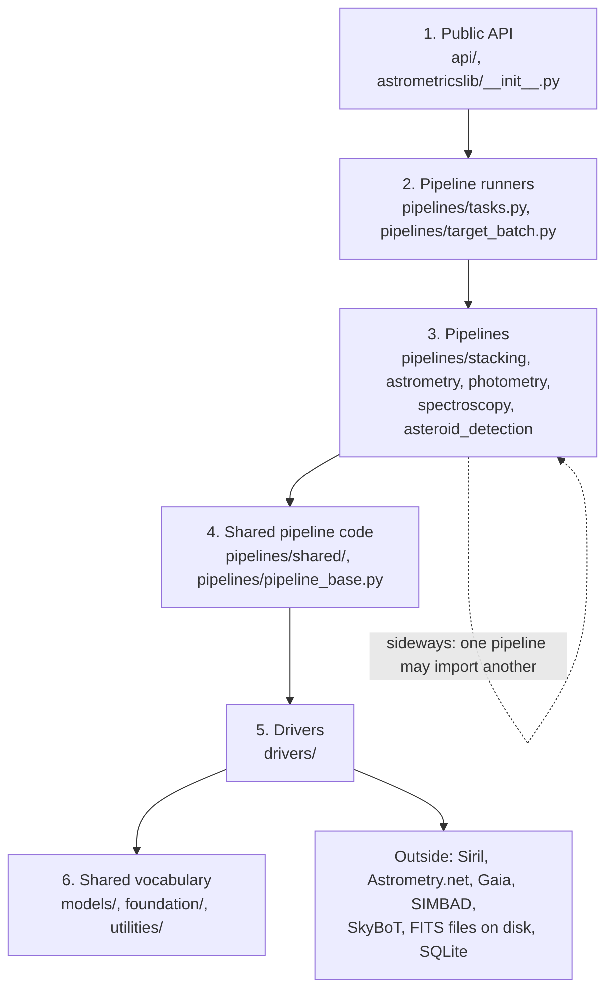

# Astrometrics library implementation

*Version 1.6 · 2026-10-15 · Status: current*

## Abstract

This paper maps the design in `Astrometrics_Library_Architecture.md` to the Python source in `astrometricslib/`. It names the layers of the package and the rule that keeps them apart, the model classes that hold each kind of observational record, and the modules that carry out each of the five pipelines. It lists the tuned values each pipeline uses, with the status label of each value and a link to the validation register entry that holds its evidence. It also names the scripts and tests that check the code. The paper states no evidence itself. It is written for developers who review or change the algorithms.

Terms are defined in the [glossary](./Astrometrics_Library_Architecture.md#appendix-a-glossary). This document also defines each term the first time it appears.

## 1. Scope

**Statement of need.** A reviewer who reads a method in the architecture paper needs to find the code behind it, and a developer who changes the code needs to know which method and which tuned values it touches. This paper is that index. Theory stays in [Astrometrics_Library_Architecture.md](./Astrometrics_Library_Architecture.md). Evidence stays in the validation register, [validation/index.md](./validation/index.md). Module paths in this paper are relative to `astrometricslib/` unless a path starts with another folder name.

The library is not meant to be imported module by module, so its internal modules are hidden from the public API reference. The one supported entry point is the package root: the names listed in `astrometricslib.__all__`, imported as `from astrometricslib import Astrometrics` (and the other names there). The root re-exports (imports and passes on under its own name) four kinds of things:

- The facade from `api/`: the `Astrometrics` object, a single front door that hides the many modules behind it.
- The driver interfaces: the abstract classes each external program or service must implement (see Section 4.7).
- The job framework: a job is one recorded unit of work, such as a stack or an analysis run, with a status and a log that can be watched while it runs and read afterwards (see Section 4.9).
- The error types and a few constants.

The package builds on Astropy [1]. Three other parts of the repository use the library:

- `wayfindinglib`, the companion library for telescope control (mount, focuser, guiding, and observation planning).
- The backend, the local server program that the desktop application talks to.
- The MCP servers, adapters that let an AI agent call the libraries' tools through the Model Context Protocol [2].

The architecture paper states no tuned values. The settings each pipeline uses are listed in Section 5, with their status and the evidence behind them.

## 2. Package layering

The package has six layers. Each layer may import only from the layers below it, so a lower layer never has to know that a higher one exists. A lower layer can then be tested, reused or replaced without touching anything above it. Figure 1 shows the layers and the direction of calls.

**Figure 1.** Layers of `astrometricslib/`, from the public API (top) to the shared vocabulary (bottom). An arrow means "calls into". Layers 1 to 3 may also call layers further down than the next one; Table 1 lists what each layer calls.

**Table 1.** The six layers.

| Layer | Holds | Calls into | Key modules |
| --- | --- | --- | --- |
| 1. Public API | The `Astrometrics` facade and the root exports | Layers 2 to 5 | `api/processing.py`, `astrometricslib/__init__.py` |
| 2. Pipeline runners | The dispatcher that ties the pipelines together and the many-target batch runner | Layer 3 | `pipelines/tasks.py`, `pipelines/target_batch.py` |
| 3. Pipelines | The five pipelines: stacking, astrometry, photometry, spectroscopy, asteroid detection | Layers 4 to 6; sideways between pipelines | `pipelines/<name>/` |
| 4. Shared pipeline code | Code every stellar or moving-object pipeline reuses: frame scanning and grouping, target-record CRUD (create, read, update and delete), image format conversion, frame-quality and statistics primitives, provenance and camera-profile recording, and the common pipeline contract | Layers 5 and 6; imports no specific pipeline | `pipelines/shared/`, `pipelines/pipeline_base.py` |
| 5. Drivers | Wrappers for every external tool and service, plus the pipeline-agnostic primitives: FITS access, the shared image container, the SQLite-backed target, star, catalog-cache, calibration and provenance stores, and the camera profiles | Layer 6 | `drivers/` |
| 6. Shared vocabulary | Data shapes, small generic helpers, configuration, logging, the job framework and the generic storage layer | No layer | `models/`, `foundation/`, `utilities/` |

`visualization/` (the plotting helpers) sits outside the layers. Table 9 in Appendix A gives its import rule.

**Table 2.** Public entry point and outside services of each pipeline.

| Pipeline | Public call | Outside services |
| --- | --- | --- |
| Stacking | `ProcessingPipelines.stack` goes straight to layer 3; `pipelines.tasks.stack_frames_with_timeout` is used by the batch run only | Siril (headless) |
| Astrometry | `ProcessingPipelines.process_target` with `stages=["astrometry"]` | Astrometry.net [3]; Gaia through VizieR [4] or the ESA archive, queried with astroquery [5]; SIMBAD [6] |
| Photometry | `ProcessingPipelines.process_target` with `stages=["photometry"]` | None of its own; star identification comes from astrometry |
| Spectroscopy | `ProcessingPipelines.process_target` with `stages=["spectroscopy"]` | Gaia XP spectra and Gaia DR3 reddening |
| Asteroid detection | `ProcessingPipelines.process_target` with `stages=["asteroids"]` | IMCCE SkyBoT, reached through astroquery from `ephemeris.py`, not through a driver |

All pipelines read FITS files and SQLite databases on disk. When a lower layer needs work that belongs to a higher one, the higher layer passes it in. For example, the stacking pipeline hands its flat check and spectral frame alignment to the stacking driver as a `PipelineSteps` (`drivers/interfaces/stacking_driver.py`).

:::{note}
**Shared vocabulary.** `models/`, `foundation/` and `utilities/` may be imported by any module in the library. They are not all free of I/O: `foundation/config.py` reads the configuration file, `foundation/storage/` and `foundation/jobs/` read and write SQLite, and `models/moving_object_config.py` can load its settings from the configuration. The rule they follow is the layer rule only: they import nothing from `drivers/`, `pipelines/`, `api/` or `visualization/`.
:::

:::{note}
**One entry point for four pipelines.** `ProcessingPipelines.process_target` (`api/processing.py`) is the single layer 1 entry point for astrometry, photometry, spectroscopy and asteroid detection. For one target it runs the chosen stages in a fixed order, astrometry, photometry, spectroscopy, asteroids (the first three by default), through `pipelines.tasks.run_target_stages`. Photometry's result is handed to the spectroscopy stage as one of its options, but the spectroscopy stage does not read it. Each stage takes its own options dictionary, and a caller that wants one stage passes only that stage. For a list of targets, `process_target` instead runs the full stack-solve-photometry-spectroscopy sequence for each target in its own worker process (`pipelines.target_batch.process_targets_in_parallel`).
:::

A ratchet test enforces the layer rule. Appendix A lists its exact rules and the other ratchets.

## 3. Data models

The model classes are pydantic classes (pydantic is a Python package for classes with typed, validated fields) in `models/`. They hold fields and validation and do no calculation. Table 3 maps each record of Architecture §2 to its classes. The root re-exports the names it lists in `astrometricslib.__all__`.

**Table 3.** Records of the architecture paper and the classes that hold them.

| Architecture record | Classes | Module |
| --- | --- | --- |
| Observation target (§2.1) | `Target` (the target), `FrameRecord` (one raw frame of it), `ImageType` | `models/target.py` |
| Stellar object (§2.1) | `StellarObject`, with nested per-domain results `PhotometryResult`, `PeriodogramResult`, `TransitCandidate`, `SessionPhotometrySummary` and `StellarSessionMatch`, and the spectroscopy result `SpectroscopyResult` | `models/stellar_source.py`, `models/spectral_cross_checks.py` |
| Moving object candidate (§2.1) | `AsteroidDetectionCandidate`, built from `FrameDetection`, `MovingObjectTrack` and `EphemerisMatch`; `CascadeStage` names the check that rejected a candidate | `models/moving_object.py` |
| Quality record (§2.1) | `PipelineQualitySummaryBase` and one subclass per pipeline: `StackQualitySummary`, `AstrometryQualitySummary`, `PhotometryQualitySummary`, `SpectroscopyQualitySummary` and `AsteroidDetectionQualitySummary`; each keeps its gates as `GateResult` records with a `GateStatus` (`passed`, `failed` or `not_checked`) | `models/quality_summary.py`, `models/gate_result.py` |
| Camera profile (§2.3) | `CameraProfile`, with `ProvenancedValue` and `QuantumEfficiencyRecord`; the run's use of it is recorded as `AppliedCameraProfile` | `models/camera_profile.py`, `models/quality_summary.py` |
| Provenance (§2.3) | The IVOA Provenance Data Model [7] classes `Agent`, `Entity`, `Collection`, `Used`, `WasGeneratedBy`, `WasAssociatedWith` and `WasAttributedTo`, among others | `models/provenance.py` |

Other code that works with these records:

- **Camera profiles.** `drivers/camera_profile_store.py` loads the profiles from the configuration file. `resolve_camera_profile` returns the generic stand-in profile for a camera with no entry. `pipelines/shared/applied_camera_profile.py` (`record_camera_profile`) puts the profile used on each run's quality summary.
- **Provenance.** `pipelines/shared/provenance_recording.py` (`record_pipeline_run`) records each run after its quality summary is built. `drivers/provenance_store.py` (`ProvenanceStore`) keeps the records in `astrometrics_log.db` and `export_target_lineage_as_prov_xml` exports a target's lineage.
- **Target and star storage.** `drivers/catalog_access.py` (`CatalogAccess`) is the front door every other layer uses to read and write targets and stars. Section 4.7 describes it.

`models/README.md` lists every file in `models/`.

## 4. Pipelines

Each subsection names the section of the architecture paper that it implements and lists the modules in the order of that section's subsections. Folder names are relative to the pipeline's own folder unless a path starts with `astrometricslib/`.

### 4.1 Stacking (Architecture §3)

*Located in:* `astrometricslib/pipelines/stacking/`

- **Interfaces (§3.1).** `stack_request.py` (`choose_frames_to_stack` picks the light frames, one camera and one kind at a time; `run_stack` runs the stacking stage as a tracked job inside a stacking slot) is the public entry. `stage.py` (`stack_frames`) holds the pre-checks, the run, the quality summary with its gates, and the provenance record. `stack_runner.py` runs the engine: spectral registration fallback, stacking one exposure length at a time, and handing `PIPELINE_STEPS` to the `StackingDriver`.
- **Dispatch for the batch run (§3.1).** `astrometricslib/pipelines/tasks.py` (`stack_frames_with_timeout` runs the stacking stage as a tracked job with a hard timeout; `analyze_target` picks which analysis pipeline runs by name; `run_full_pipeline` runs a target's full stack-solve-photometry-spectroscopy sequence) and `astrometricslib/pipelines/target_batch.py` (runs many targets through that sequence in parallel).
- **Calibration frames (§3.2).** `calibration_ingest.py` (the report of what a calibration-library rescan found), on top of `astrometricslib/drivers/calibration_library.py`. `pre_processing/flat_calibration.py` handles flat level and noise, and smoothing of a noisy master flat.
- **Pixel rejection and integration (§3.2).** `astrometricslib/utilities/rejection_thresholds.py` holds the floored Chauvenet cutoffs, and `stage.py` applies them.
- **Frame-count-adaptive filtering (§3.2).** `astrometricslib/utilities/stack_filter_floor.py` loosens Siril's sharpness filter so enough frames survive.
- **Exposure groups and weights (§3.2).** `processing/exposure_groups.py`, `processing/group_alignment.py`, `processing/group_derotation.py`, `processing/star_pattern_candidates.py` and `processing/spectral_frame_alignment.py`. `pre_processing/exposure_weighting.py` sets the weights for mixed exposure lengths.
- **Stacking sequence (§3.3).** `stage.py` and `stack_runner.py`, as above. `pre_processing/stack_inputs.py` skips a restack whose inputs did not change, and `post_processing/previous_stack.py`, `post_processing/stack_comparison.py` and `post_processing/interrupted_jobs.py` handle restacks.
- **Previews (§3.3).** Screen pictures stretched from the stack's linear data: `post_processing/stack_preview.py`, `post_processing/colour_calibration.py`, `post_processing/starnet_stretch.py`, `post_processing/sky_level.py`, `post_processing/star_tone.py`, `post_processing/bright_object.py`, `post_processing/stack_crop.py` and `post_processing/preview_remake.py`.
- **Screening raw frames (§3.4.1).** `pre_processing/frame_quarantine.py` moves clouded or trailed frames to `_excluded`, and restores them. `pre_processing/frame_homogeneity.py` checks gain, `pre_processing/background_homogeneity.py` checks sky-level splits, and `pre_processing/camera_selection.py` keeps one camera per stack. `pre_processing/assess_input_quality.py` holds the flat and calibration gates, checked before stacking.
- **Checking the final image (§3.4.2).** `post_processing/assess_output_quality.py` (the six output gates), `post_processing/stack_quality.py` (the limits behind them), `post_processing/exposure_group_report.py` (the three exposure-group gates) and `post_processing/stack_quality_report.py` (the stack reports the API returns).

### 4.2 Astrometry (Architecture §4)

*Located in:* `astrometricslib/pipelines/astrometry/`

- **Interfaces (§4.1).** `pipeline.py` orchestrates the pipeline. `runner.py` is the `AnalysisPipeline` adapter: a small class that wraps a pipeline's own algorithm class and reshapes its calls into the four steps every analysis pipeline shares (check the input, do the work, check the output, return a result), defined in `pipelines/pipeline_base.py`.
- **Star detection and centroiding (§4.2).** `processing/star_identifier.py` and `pre_processing/source_detection.py`. `pre_processing/fwhm.py` measures star width.
- **Plate solving (§4.2).** `astrometricslib/drivers/astrometry_net_driver.py`.
- **Gaia catalog (§4.2).** `astrometricslib/drivers/gaia_cone_driver.py` (cone downloads) and `astrometricslib/drivers/catalog_store.py` (the local cache). `utilities/catalog_seeding.py` fills the cache.
- **Refitting the solution to Gaia (§4.2).** `processing/wcs_refinement.py`, called from `processing/star_identifier.py`.
- **Writing the WCS into the FITS header (§4.3).** `astrometricslib/pipelines/shared/session_identification.py` (`write_wcs_to_fits_header`), called from `runner.py`.
- **Checks (§4.4).** `post_processing/run_gates.py` and `post_processing/assess_match_quality.py`.

### 4.3 Photometry (Architecture §5)

*Located in:* `astrometricslib/pipelines/photometry/`

- **Interfaces (§5.1).** `runner.py` is the `AnalysisPipeline` adapter. `batch.py` runs one run per observing session, matches and merges stars across sessions, and runs the period search.
- **Aperture photometry (§5.2).** `pre_processing/frame_photometry.py`, with `pre_processing/detector_noise.py` (gain and read noise) and `pre_processing/observation_times.py` (BJD_TDB times).
- **Comparison stars and light curves (§5.2).** `processing/comparison_ensemble.py` and `processing/variability_analyzer.py`.
- **Variability indices (§5.2).** `processing/variability_indices.py`.
- **Period search (§5.2).** `processing/periodicity_search.py` (Lomb–Scargle and box search, with false-alarm probabilities), `processing/period_checks.py` (hold-out and alias checks) and `processing/family_wise_correction.py` (correction for the number of searches).
- **Checks (§5.4).** `pre_processing/assess_input_quality.py` runs before measuring. `post_processing/run_gates.py`, `post_processing/variability_skill.py`, `post_processing/known_variability_labels.py` and `post_processing/assess_output_quality.py` run after.

### 4.4 Spectroscopy (Architecture §6)

*Located in:* `astrometricslib/pipelines/spectroscopy/`

- **Interfaces (§6.1).** `pipeline.py` (`SpectroscopyPipeline`; `_apply_result_to_stellar_object` sets the order of the calibration chain), `runner.py` (the `AnalysisPipeline` adapter) and `record_and_flag_spectroscopy_stars.py`. `frame_analysis.py` and `batch.py` do the per-frame and per-session processing.
- **Star identification (§6.2).** `pre_processing/spectral_star_registration.py` copies star names from a normal image when the plate solution cannot.
- **Spectrum extraction (§6.2).** `pre_processing/spectrum_extractor.py` and `pre_processing/_extractor_c.c`, with `pre_processing/neighbor_trail_deblending.py` and `pre_processing/neighbor_wing_correction.py` for crowded fields.
- **Wavelength calibration (§6.2).** `pre_processing/spectrum_calibrator.py`, `pre_processing/optics_physics.py` and `utilities/calibration_tuner.py`. The corrections are `pre_processing/differential_refraction.py`, `pre_processing/atmospheric_refraction.py` and `pre_processing/wavelength_zero_point.py`.
- **Flux calibration (§6.2).** `pre_processing/quantum_efficiency_correction.py`, `pre_processing/instrument_response.py` and `pre_processing/atmospheric_extinction.py`.
- **Resolution (§6.2).** `pre_processing/measured_line_spread.py` and `pre_processing/spectral_resolution.py`.
- **Classification and features (§6.2).** `processing/spectral_classifier.py`, `processing/spectrum_analysis.py`, `processing/star_reddening.py` with `processing/interstellar_extinction.py`, and the feature and line modules in `processing/`.
- **Registration quality of spectral stacks (§6.3).** `utilities/registration_quality.py`, called by the stacking stage and by the processing API.
- **Checks after extraction (§6.4).** `post_processing/run_gates.py`, `post_processing/compare_to_gaia_xp.py`, `post_processing/compare_to_catalog.py` and `post_processing/wavelength_scale.py`.

### 4.5 Asteroid detection (Architecture §7)

*Located in:* `astrometricslib/pipelines/asteroid_detection/`

- **Interfaces (§7.1).** `pipeline.py`; `runner.py` is the `AnalysisPipeline` adapter.
- **Blink analysis and tracking (§7.2).** `detection.py`.
- **Per-frame WCS from the mount's pointing (§7.2).** `frame_wcs_composer.py`.
- **Known-object matching (§7.2).** `ephemeris.py` queries IMCCE SkyBoT.
- **Checks (§7.4).** `run_gates.py`.
- **Not called by any pipeline step.** `mpc_report.py` writes MPC 80-column and ADES text for a track (the report formats of the Minor Planet Center [8]), and `rotation_period.py` runs the photometry period search on a track's brightness. Both are tested, and no run uses them.

### 4.6 Shared pipeline code

*Located in:* `astrometricslib/pipelines/shared/`, unless noted otherwise.

This is where the plain, non-analysis reads and writes the public API calls directly (scanning a folder for FITS files, target CRUD, converting a FITS file to a PNG) live alongside the frame-quality primitives every stellar pipeline shares.

- **Frame selection and grouping by camera and optic.** `frame_grouping.py` and `quality/frame_selection.py`.
- **Filesystem frame scanning.** `frame_scanning.py`.
- **Target catalog CRUD.** `target_records.py`.
- **Image format conversion for display.** `image_conversions.py`. `image_scaling.py` holds the scaling math shared with the visualization overlay.
- **Star recording shared by all three stellar pipelines.** `star_recording.py`.
- **Rules for when two catalog names are one star.** `catalog_star_identity.py` holds the position tolerance, the same-catalog check and the HD/BD/Gaia name preference, shared by `star_recording.py` and `scripts/merge_duplicate_catalog_stars.py`.
- **Observing-session grouping.** `target_sessions.py`.
- **Plate solving a session's frame, reusing a WCS already in the file, and writing a WCS to a FITS header.** `session_identification.py`.
- **Per-image analysis state.** `analysis_context.py`.
- **Provenance and camera-profile recording on each run's quality summary.** `provenance_recording.py` and `applied_camera_profile.py`.
- **Saturation checks and image and hardware quality telemetry.** `quality/saturation.py` and `quality/quality_metrics.py`.
- **Frame statistics and background level measurement.** `quality/frame_statistics.py` and `quality/background_measurement.py`.
- **Per-frame cloud and trail measurements.** `quality/raw_frame_check.py`.

### 4.7 Drivers and pixel-level primitives

*Located in:* `astrometricslib/drivers/`. The drivers wrap every external tool the pipelines depend on, plus the database access layer everything above them reaches through.

- **Driver interfaces.** `interfaces/` holds one abstract base class per outside program or service: `StackingDriver`, `PlateSolveDriver`, `SimbadDriver`, `GaiaXpDriver` and `ReddeningDriver`. It also holds the plain data types that cross those interfaces: `StackSettings`, `StackRunResult`, `PipelineSteps` (the stacking pipeline's own steps, handed to the stacking driver), `PlateSolveHeader` and `ReddeningEstimate`. The pipelines depend on these, and each concrete driver below implements one.
- **Choosing the drivers for a run.** `driver_set.py` (`Drivers`, which builds the built-in driver for any slot the caller left empty).
- **Siril stacking and registration.** `siril_stacking_driver.py` (`SirilStackingDriver`), on top of the Siril session class `ImageProcessing` in `siril_interface.py` and the log parsing in `siril_output_parsing.py`.
- **Astrometry.net plate solving.** `astrometry_net_driver.py` (`AstrometryNetPlateSolveDriver`).
- **Gaia DR3 cone downloads (VizieR or the ESA archive).** `gaia_cone_driver.py`.
- **Local Gaia catalog cache.** `catalog_store.py`.
- **Gaia DR3 XP spectra, cached on disk.** `gaia_xp_driver.py` (`AstroqueryGaiaXpDriver`).
- **Gaia DR3 interstellar reddening.** `astroquery_gaia_reddening_driver.py` (`AstroqueryGaiaReddeningDriver`).
- **SIMBAD star lookups.** `astroquery_simbad_driver.py` (`AstroquerySimbadDriver`).
- **Calibration frame library (darks, bias, flats).** `calibration_library.py`.
- **Camera profiles, read from the configuration file.** `camera_profile_store.py`.
- **Provenance records in `astrometrics_log.db`.** `provenance_store.py` (`ProvenanceStore`).
- **Target reads and writes, and database backups, for `astrometrics.db`.** `local_database.py`.
- **Target and stellar-catalog repository (`CatalogAccess`), the front door every other layer reaches for the database through.** `catalog_access.py`.
- **FITS HDU0/HDU1 access.** `fits_access.py`.
- **The `AstrometricsImage` data container.** `image.py`.
- **Filter-type detection from FITS headers.** `filter_detection.py`.
- **Reading frames ahead into a network drive's local cache (optional).** `frame_prefetch.py`.

`catalog_access.py` does not execute SQL itself. Most of its reads and writes go through a generic, keyed-record SQLite store that it shares with wayfindinglib. The store is called the Butler, after the data butler of the Rubin Observatory software whose get, put and exists shape it copies [9] (see Section 4.8). Two paths do not use it: reading the target catalog goes through `local_database.load_targets`, which owns the targets table's read path, and raw frames and stacked images are resolved to file paths on disk rather than stored in the database.

### 4.8 Shared storage backend

*Located in:* `astrometricslib/foundation/storage/`

- **Generic keyed-model storage (get, put, exists, merge; one table per dataset type).** `butler.py`.
- **SQLite connection setup and JSON encoding.** `local_database.py`.
- **Cross-process file locking for shared hardware and storage resources.** `process_locks.py`.
- **Refusing to write under a frames mount point when no drive is mounted there.** `mount.py`.

### 4.9 Job framework

*Located in:* `astrometricslib/foundation/jobs/`. Shared by both libraries, the backend and the MCP servers.

- **Job list and job log lines in `astrometrics_log.db`.** `store.py` (`JobStore`, `DbLogHandler`).
- **Recording a job and collecting its log through the job log router.** `runner.py` (`registered_job`, `capture_job_logs`, `background_job`, `run_as_background_job`, `close_interrupted_jobs`).
- **Job records.** `models.py` (`ProcessingJob`).
- **Telling whether the program that owns a job still runs.** `process_identity.py`.

## 5. Tuned parameters and validation status

`Astrometrics_Library_Architecture.md` explains each pipeline's method without its tuned values. This section lists those values: the thresholds, limits and defaults the pipelines use. Tables 4 to 8 give one table per pipeline. Each row names the setting, its default, its status label, and the section of the architecture paper that explains what the setting does.

Each value carries one of three status labels. *Measured* means a measurement on real data chose or confirmed the value. *Partly measured* means the measurement is incomplete, for example synthetic data only or a single target. *Design estimate* means the value is a reasoned choice that has not been measured. Each label links to the validation register ([validation/index.md](./validation/index.md)): to the entry that holds the evidence, or to the pipeline's table of design estimates, which says how the value could be measured. Some values are configuration settings and others are fixed in the code; the register entry says which. A hidden link after each table names the code that holds each value, and a test checks that each named object still exists.

### 5.1 Stacking settings

**Table 4.** Tuned settings of the stacking pipeline and their validation status.

| Parameter | Default | Status | Architecture section |
| --- | --- | --- | --- |
| Floor on the high rejection cutoff | 2.5σ | Partly measured ([STK-08](validation/stacking.md#stk-08)); simulation only | §3.2 |
| Margin of the low cutoff above the high one | 0.5σ | Partly measured ([STK-08](validation/stacking.md#stk-08)); simulation only | §3.2 |
| Minimum frames per master calibration frame | 3 | Design estimate ([stacking table](validation/stacking.md#design-estimates)) | §3.2 |
| Frame screening: session gap | 4 h | Design estimate ([stacking table](validation/stacking.md#design-estimates)) | §3.4.1 |
| Frame screening: fewest frames to judge | 8 | Partly measured ([STK-01](validation/stacking.md#stk-01)) | §3.4.1 |
| Frame screening: star count for a clouded frame; roundness for a trailed frame (0 to 1 scale) | below 0.5 of the session median; below 0.80 and at least 0.15 under the session median | Partly measured ([STK-01](validation/stacking.md#stk-01)) | §3.4.1 |
| Frame screening: roundness drop for a color camera | at least 0.20 under the session median | Measured ([STK-02](validation/stacking.md#stk-02)) | §3.4.1 |
| Largest share of a session moved aside | 25% | Partly measured ([STK-03](validation/stacking.md#stk-03)) | §3.4.1 |
| Dark temperature slot width | 3 °C | Partly measured ([STK-06](validation/stacking.md#stk-06)) | §3.2 |
| Minimum frames kept after quality filtering | 5 | Partly measured ([STK-10](validation/stacking.md#stk-10)) | §3.3 (Architecture Table 3, step 3) and §3.4.1 |
| Brightness scale: fewest shared stars before the pixel fallback | 16 | Measured ([STK-19](validation/stacking.md#stk-19)) | §3.2 |
| Brightness scale, pixel fallback: pixels between percentiles; bright-end fraction | 20th to 80th; 1% of pixels | Design estimate ([stacking table](validation/stacking.md#design-estimates)) | §3.2 |
| Linearity tolerance between exposure groups | 5% | Partly measured ([STK-20](validation/stacking.md#stk-20)) | §3.2 |
| Brightest sky allowed for an exposure group, relative to the reference | 3 times | Partly measured ([STK-21](validation/stacking.md#stk-21)) | §3.2 |
| Noise penalty of equal weights above which frames are noise-weighted | 1.05 | Design estimate ([stacking table](validation/stacking.md#design-estimates)); the benefit of weighting is in [STK-07](validation/stacking.md#stk-07) | §3.2 |
| Share of spectral frames that must register before the alignment fallback | 0.9 | Design estimate ([stacking table](validation/stacking.md#design-estimates)); registration counts are in [STK-12](validation/stacking.md#stk-12) | §3.3 |
| Rejected pixel share that flags a stack | 15% | Partly measured ([STK-24](validation/stacking.md#stk-24)) | §3.4.2 |
| Star sharpness warning ratio (fails above) | 1.2 | Partly measured ([STK-25](validation/stacking.md#stk-25)) | §3.4.2 |

<!-- impl: astrometricslib.utilities.rejection_thresholds.rejection_bounds -->
<!-- impl: astrometricslib.drivers.calibration_library.DEFAULT_DARK_TEMPERATURE_TOLERANCE_C -->
<!-- impl: astrometricslib.utilities.stack_filter_floor.DEFAULT_MINIMUM_SURVIVING_FRAMES -->
<!-- impl: astrometricslib.pipelines.stacking.processing.exposure_groups.GAIN_MID_RANGE_PERCENTILES -->
<!-- impl: astrometricslib.pipelines.stacking.processing.exposure_groups.GAIN_BRIGHTEST_FRACTION -->
<!-- impl: astrometricslib.pipelines.stacking.processing.exposure_groups.DEFAULT_GAIN_DISAGREEMENT_TOLERANCE -->
<!-- impl: astrometricslib.pipelines.stacking.post_processing.stack_quality.DEFAULT_FWHM_DEGRADATION_RATIO -->
<!-- impl: astrometricslib.pipelines.stacking.pre_processing.frame_quarantine.SESSION_GAP_SECONDS -->
<!-- impl: astrometricslib.pipelines.stacking.pre_processing.frame_quarantine.MINIMUM_FRAMES_TO_JUDGE -->
<!-- impl: astrometricslib.pipelines.stacking.pre_processing.frame_quarantine.CLOUD_STAR_FRACTION -->
<!-- impl: astrometricslib.pipelines.stacking.pre_processing.frame_quarantine.TRAILED_ROUNDNESS_LIMIT -->
<!-- impl: astrometricslib.pipelines.stacking.pre_processing.frame_quarantine.ROUNDNESS_DROP_BELOW_MEDIAN -->
<!-- impl: astrometricslib.pipelines.stacking.pre_processing.frame_quarantine.MAXIMUM_QUARANTINED_FRACTION -->
<!-- impl: astrometricslib.pipelines.stacking.pre_processing.exposure_weighting.MINIMUM_PENALTY_TO_WEIGHT -->
<!-- impl: astrometricslib.pipelines.stacking.stack_runner.MINIMUM_REGISTERED_FRACTION -->
<!-- impl: astrometricslib.pipelines.stacking.post_processing.stack_quality.DEFAULT_REJECTED_FRACTION_FLAG_THRESHOLD -->
<!-- impl: astrometricslib.pipelines.stacking.pre_processing.frame_quarantine.COLOUR_CAMERA_ROUNDNESS_DROP_BELOW_MEDIAN -->
<!-- impl: astrometricslib.pipelines.stacking.processing.exposure_groups.STAR_GAIN_MINIMUM_STARS -->
<!-- impl: astrometricslib.pipelines.stacking.processing.exposure_groups.SKY_RATIO_LIMIT -->

### 5.2 Astrometry settings

**Table 5.** Tuned settings of the astrometry pipeline and their validation status.

| Parameter | Default | Status | Architecture section |
| --- | --- | --- | --- |
| Star detection threshold; sharpness and roundness ranges | 5σ; 0.2 to 1.0; ±0.6 | Design estimate ([astrometry table](validation/astrometry.md#design-estimates)) | §4.2 (step 1) |
| Minimum stars to attempt a solve | 4 | Design estimate ([astrometry table](validation/astrometry.md#design-estimates)) | §4.4.1 |
| Minimum stars for a local solve | 10 | Partly measured ([AST-13](validation/astrometry.md#ast-13)) | §4.4.1 |
| Pixel-scale window; further widening by the solver | ±5%; 20% | Design estimate ([astrometry table](validation/astrometry.md#design-estimates)) | §4.4.1 |
| Brightest stars sent to the online solver | 100 | Design estimate ([astrometry table](validation/astrometry.md#design-estimates)) | §4.2 (step 2) |
| Gaia refit: fewest matched stars | 40 | Design estimate ([astrometry table](validation/astrometry.md#design-estimates)) | §4.2 (step 6) |
| Gaia refit: largest allowed shift of the field | 30 arcsec | Partly measured ([AST-02](validation/astrometry.md#ast-02)) | §4.2 (step 6) |
| Gaia refit: first and later match radius; outlier clip; most passes; distortion order | 4 px and 1.5 px; 3σ; 5; second-order SIP | Partly measured ([AST-02](validation/astrometry.md#ast-02)); used, not varied | §4.2 (step 6) |
| Gaia query time limits; depth steps on a time-out | 45 s and 60 s for the two services; 2 steps of 1 mag | Partly measured ([AST-08](validation/astrometry.md#ast-08)) | §4.2 (step 4) |
| Gaia search depth: margin; limits; default | 1.0 mag; G 14 to 20; G 18 | Design estimate ([astrometry table](validation/astrometry.md#design-estimates)) | §4.2 (step 4) |
| Catalog match radius | 10 arcsec | Design estimate ([astrometry table](validation/astrometry.md#design-estimates)) | §4.2 (step 4) |
| Same-star position tolerance between catalogs | 2 arcsec | Measured ([AST-11](validation/astrometry.md#ast-11)) | §4.2 (step 4) |
| Radius for unresolved catalog companions | 3 arcsec | Partly measured ([AST-10](validation/astrometry.md#ast-10)) | §4.2 (step 4) |
| Variable-star catalog match radius | 3 arcsec | Partly measured ([AST-12](validation/astrometry.md#ast-12)) | §5.2 (concept 4) |
| Center star of an unsolved spectral frame: pointing search radius; search area; faintest peak | 5 arcmin; 0.10 of the shorter side; 0.10 of the brightest pixel | Partly measured ([AST-09](validation/astrometry.md#ast-09)) | §6.2 (concept 6) |
| Minimum catalog-matched stars | 20 | Partly measured ([AST-05](validation/astrometry.md#ast-05)) | §4.4.2 |
| Residual limit | 0.5 of a star width | Partly measured ([AST-04](validation/astrometry.md#ast-04)) | §4.4.2 |
| Failed catalog lookups allowed | under 50% | Design estimate ([astrometry table](validation/astrometry.md#design-estimates)) | §4.4.2 |

<!-- impl: astrometricslib.pipelines.astrometry.pre_processing.source_detection.SourceDetector -->
<!-- impl: astrometricslib.drivers.astrometry_net_driver.MINIMUM_SOURCES_FOR_LOCAL_SOLVE -->
<!-- impl: astrometricslib.pipelines.shared.catalog_star_identity.CATALOG_MATCH_RADIUS_ARCSEC -->
<!-- impl: astrometricslib.pipelines.astrometry.post_processing.run_gates.MINIMUM_MATCHED_STARS -->
<!-- impl: astrometricslib.pipelines.astrometry.post_processing.run_gates.MAXIMUM_RESIDUAL_FRACTION_OF_FWHM -->
<!-- impl: astrometricslib.pipelines.astrometry.post_processing.run_gates.MAXIMUM_FAILED_LOOKUP_FRACTION -->
<!-- impl: astrometricslib.pipelines.astrometry.processing.star_identifier.MAXIMUM_PLATE_SOLVE_SOURCES -->
<!-- impl: astrometricslib.pipelines.astrometry.processing.wcs_refinement.MINIMUM_MATCHED_STARS -->
<!-- impl: astrometricslib.pipelines.astrometry.processing.wcs_refinement.MAXIMUM_SHIFT_ARCSEC -->
<!-- impl: astrometricslib.pipelines.astrometry.processing.wcs_refinement.INITIAL_MATCH_RADIUS_PIXELS -->
<!-- impl: astrometricslib.pipelines.astrometry.processing.wcs_refinement.REFINED_MATCH_RADIUS_PIXELS -->
<!-- impl: astrometricslib.pipelines.astrometry.processing.wcs_refinement.CLIP_SIGMAS -->
<!-- impl: astrometricslib.pipelines.astrometry.processing.wcs_refinement.MAXIMUM_PASSES -->
<!-- impl: astrometricslib.pipelines.astrometry.processing.wcs_refinement.SIP_DEGREE -->
<!-- impl: astrometricslib.pipelines.astrometry.processing.star_identifier.GAIA_VIZIER_TIMEOUT_SECONDS -->
<!-- impl: astrometricslib.pipelines.astrometry.processing.star_identifier.GAIA_ESA_TIMEOUT_SECONDS -->
<!-- impl: astrometricslib.pipelines.astrometry.processing.star_identifier.GAIA_DEPTH_STEP_MAGNITUDES -->
<!-- impl: astrometricslib.pipelines.astrometry.processing.star_identifier.GAIA_DEPTH_STEPS_DOWN -->
<!-- impl: astrometricslib.pipelines.astrometry.processing.star_identifier.GAIA_MAGNITUDE_LIMIT_MARGIN -->
<!-- impl: astrometricslib.pipelines.astrometry.processing.star_identifier.GAIA_MINIMUM_MAGNITUDE_LIMIT -->
<!-- impl: astrometricslib.pipelines.astrometry.processing.star_identifier.GAIA_MAXIMUM_MAGNITUDE_LIMIT -->
<!-- impl: astrometricslib.pipelines.astrometry.processing.star_identifier.GAIA_DEFAULT_MAGNITUDE_LIMIT -->
<!-- impl: astrometricslib.pipelines.shared.catalog_star_identity.SAME_STAR_POSITION_TOLERANCE_ARCSEC -->
<!-- impl: astrometricslib.pipelines.astrometry.processing.star_identifier.UNRESOLVED_COMPANION_RADIUS_ARCSEC -->
<!-- impl: astrometricslib.pipelines.shared.variable_star_catalogs.MATCH_RADIUS_ARCSEC -->
<!-- impl: astrometricslib.pipelines.astrometry.processing.star_identifier.POINTING_ERROR_SEARCH_RADIUS_ARCSEC -->
<!-- impl: astrometricslib.pipelines.astrometry.processing.star_identifier.CENTRE_STAR_SEARCH_RADIUS_FRACTION -->
<!-- impl: astrometricslib.pipelines.astrometry.processing.star_identifier.CENTRE_STAR_MINIMUM_PEAK_FRACTION -->

### 5.3 Photometry settings

**Table 6.** Tuned settings of the photometry pipeline and their validation status.

| Parameter | Default | Status | Architecture section |
| --- | --- | --- | --- |
| Aperture radius; sky ring radii | 4 px; 7 to 12 px | Design estimate ([photometry table](validation/photometry.md#design-estimates)) | §5.2 (concept 1) |
| Re-centering box; refinement passes; largest allowed move | 11 px; 3; 1.5 px | Design estimate ([photometry table](validation/photometry.md#design-estimates)) | §5.2 (concept 1) |
| Comparison band: brightest skipped; band ends at | 2%; 30% of candidates | Design estimate ([photometry table](validation/photometry.md#design-estimates)) | §5.2 (concept 4) |
| Candidates vetted; minimum and cap of comparison stars | 100; 5 and 20 | Design estimate ([photometry table](validation/photometry.md#design-estimates)) | §5.2 (concept 4) |
| Vetting consistency limit; share of typical stars for a usable frame | 3σ; one half | Design estimate ([photometry table](validation/photometry.md#design-estimates)) | §5.2 (concept 4) |
| Frame outlier clip; per-star outlier clip | 3σ (at least 5 frames); 5σ | Design estimate ([photometry table](validation/photometry.md#design-estimates)) | §5.2 (concept 4) |
| Share of frames rejected before the run is flagged | 25% | Design estimate ([photometry table](validation/photometry.md#design-estimates)) | §5.4.2 |
| Noise model: minimum stars; stars per bin; most bins | 20; 10; 10 | Design estimate ([photometry table](validation/photometry.md#design-estimates)) | §5.2 (concept 5) |
| Thresholds: excess scatter; chi-square and Stetson J | 1.5; field median + 2.326 robust σ | Partly measured ([PHO-06](validation/photometry.md#pho-06)); synthetic fields only | §5.2 (concept 5) |
| Small-field cutoff on the coefficient of variation | median + 7.4 MAD (unscaled; about 5 robust σ, since 7.4 / 1.4826 = 5.0), never below 0.02 | Measured ([PHO-10](validation/photometry.md#pho-10)) | §5.2 (concept 5) |
| Period verdicts: false-alarm limit for "possible"; for "detected"; shuffles | 0.05; 0.01 with at least 3 cycles; 300 | Partly measured ([PHO-12](validation/photometry.md#pho-12)); synthetic only | §5.2 (concept 8) |
| Between-session flag: significance; amplitude | above 3; at least 0.02 mag | Design estimate ([photometry table](validation/photometry.md#design-estimates)) | §5.2 (concept 6) |
| Discrimination AUC floor | 0.7 | Design estimate ([photometry table](validation/photometry.md#design-estimates)) | §5.4.2 |
| Largest acceptable value of the smallest detectable change (peak to peak) | 0.3 mag | Design estimate ([photometry table](validation/photometry.md#design-estimates)); the smallest change found on a real field is in [PHO-09](validation/photometry.md#pho-09) | §5.4.2 |

<!-- impl: astrometricslib.pipelines.photometry.pre_processing.frame_photometry.measure_aperture_photometry -->
<!-- impl: astrometricslib.pipelines.photometry.pre_processing.frame_photometry.CENTROID_BOX_HALF_WIDTH_PX -->
<!-- impl: astrometricslib.pipelines.photometry.pre_processing.frame_photometry.MAX_CENTROID_SHIFT_PX -->
<!-- impl: astrometricslib.pipelines.photometry.pre_processing.frame_photometry.CENTROID_REFINEMENT_PASSES -->
<!-- impl: astrometricslib.pipelines.photometry.processing.comparison_ensemble.BRIGHTEST_SKIPPED_FRACTION -->
<!-- impl: astrometricslib.pipelines.photometry.processing.comparison_ensemble.FAINTEST_BAND_FRACTION -->
<!-- impl: astrometricslib.pipelines.photometry.processing.comparison_ensemble.MAXIMUM_VETTING_CANDIDATES -->
<!-- impl: astrometricslib.pipelines.photometry.processing.comparison_ensemble.MINIMUM_COMPARISON_STARS -->
<!-- impl: astrometricslib.pipelines.photometry.processing.comparison_ensemble.DEFAULT_MAXIMUM_COMPARISON_STARS -->
<!-- impl: astrometricslib.pipelines.photometry.processing.comparison_ensemble.EXCESS_SCATTER_SIGMA -->
<!-- impl: astrometricslib.pipelines.photometry.processing.comparison_ensemble.MINIMUM_USABLE_FRAME_FRACTION -->
<!-- impl: astrometricslib.pipelines.photometry.processing.variability_analyzer.VariabilityAnalyzer._reject_outlier_frames -->
<!-- impl: astrometricslib.pipelines.photometry.processing.variability_indices.MINIMUM_STARS_FOR_NOISE_MODEL -->
<!-- impl: astrometricslib.pipelines.photometry.processing.variability_indices.MINIMUM_STARS_PER_NOISE_BIN -->
<!-- impl: astrometricslib.pipelines.photometry.processing.variability_indices.MAXIMUM_NOISE_BINS -->
<!-- impl: astrometricslib.pipelines.photometry.processing.variability_indices.EXCESS_SCATTER_THRESHOLD -->
<!-- impl: astrometricslib.pipelines.photometry.processing.variability_indices.CALIBRATION_SIGMAS -->
<!-- impl: astrometricslib.pipelines.photometry.processing.variability_analyzer.MINIMUM_LONG_TERM_AMPLITUDE_MAG -->
<!-- impl: astrometricslib.pipelines.photometry.processing.variability_analyzer.DEFAULT_LONG_TERM_SIGNIFICANCE_THRESHOLD -->
<!-- impl: astrometricslib.pipelines.photometry.post_processing.variability_skill.MINIMUM_DISCRIMINATION_AUC -->
<!-- impl: astrometricslib.pipelines.photometry.post_processing.run_gates.MAXIMUM_DETECTABLE_AMPLITUDE_MAG -->
<!-- impl: astrometricslib.pipelines.photometry.post_processing.run_gates.MINIMUM_ENSEMBLE_REJECTION_FRACTION_TO_FLAG -->
<!-- impl: astrometricslib.pipelines.photometry.processing.variability_analyzer.DEFAULT_VARIABILITY_SIGMA_THRESHOLD -->
<!-- impl: astrometricslib.pipelines.photometry.processing.periodicity_search.FALSE_ALARM_FOR_DETECTION -->
<!-- impl: astrometricslib.pipelines.photometry.processing.periodicity_search.verdict_from_false_alarm -->

### 5.4 Spectroscopy settings

**Table 7.** Tuned settings of the spectroscopy pipeline and their validation status.

| Parameter | Default | Status | Architecture section |
| --- | --- | --- | --- |
| Reading box half-width; width smoothing | 2.5 times the trail width; 61 steps | Design estimate ([spectroscopy table](validation/spectroscopy.md#design-estimates)); the effect of smoothing is in [SPE-04](validation/spectroscopy.md#spe-04) | §6.2 (concept 2) |
| Minimum signal-to-noise for analyzing a spectrum | 1.5 | Partly measured ([SPE-10](validation/spectroscopy.md#spe-10)) | §6.2 (concept 5) |
| Line significance for the wavelength zero point | 6 | Partly measured ([SPE-11](validation/spectroscopy.md#spe-11)); synthetic only | §6.2 (concept 4) |
| Sky strip gap and width | 6 px; 10 px | Partly measured ([SPE-01](validation/spectroscopy.md#spe-01)) | §6.2 (concept 2) |
| Sky contamination limit | 3σ | Partly measured ([SPE-03](validation/spectroscopy.md#spe-03)); simulation only | §6.2 (concept 2) |
| Fewest pixels in a sky strip | 4 | Design estimate ([spectroscopy table](validation/spectroscopy.md#design-estimates)) | §6.2 (concept 2) |
| Atmospheric (telluric) bands left out of classification | oxygen B 6860 to 6940 Å; oxygen A 7490 to 7720 Å; water 8100 to 8320 Å | Partly measured ([SPE-15](validation/spectroscopy.md#spe-15)) | §6.2 (concept 5) |
| Poor-match limit | 0.15 relative RMS | Partly measured ([SPE-16](validation/spectroscopy.md#spe-16)) | §6.2 (concept 5) |
| No-type limit | 0.45 relative RMS | Partly measured ([SPE-17](validation/spectroscopy.md#spe-17)) | §6.2 (concept 5) |
| Ambiguity gap | 0.02 relative RMS | Measured ([SPE-18](validation/spectroscopy.md#spe-18)) | §6.2 (concept 5) and §6.4.2 |
| Catalog disagreement | 20 subtype steps (two whole letter classes) | Partly measured ([SPE-19](validation/spectroscopy.md#spe-19)) | §6.4.2 |
| Wavelength-fit rejection tolerance | 10 nm RMS | Design estimate ([spectroscopy table](validation/spectroscopy.md#design-estimates)) | §6.2 (concept 3) and §6.4.2 |
| Wavelength-scale limit (scatter of the corrected offsets) | 11 Å (one pixel of dispersion) | Design estimate ([spectroscopy table](validation/spectroscopy.md#design-estimates)) | §6.4.2 |
| Gaia XP agreement: largest median tilt | 3% per 1000 Å | Design estimate ([spectroscopy table](validation/spectroscopy.md#design-estimates)) | §6.4.2 |
| Processing quality: largest share of spectra failing a metric | 50% | Design estimate ([spectroscopy table](validation/spectroscopy.md#design-estimates)) | §6.4.2 |

<!-- impl: astrometricslib.pipelines.spectroscopy.pre_processing.spectrum_extractor.APERTURE_SIGMA_MULTIPLIER -->
<!-- impl: astrometricslib.pipelines.spectroscopy.pre_processing.spectrum_extractor.APERTURE_SIGMA_SMOOTHING_STEPS -->
<!-- impl: astrometricslib.pipelines.spectroscopy.processing.spectrum_signal.MINIMUM_SPECTRUM_SIGNAL_TO_NOISE -->
<!-- impl: astrometricslib.pipelines.spectroscopy.pre_processing.wavelength_zero_point.MINIMUM_LINE_SIGNIFICANCE -->
<!-- impl: astrometricslib.pipelines.spectroscopy.pre_processing.spectrum_extractor.SKY_BAND_GAP_PX -->
<!-- impl: astrometricslib.pipelines.spectroscopy.pre_processing.spectrum_extractor.SKY_BAND_WIDTH_PX -->
<!-- impl: astrometricslib.pipelines.spectroscopy.pre_processing.spectrum_extractor.SKY_CONTAMINATION_SIGMA -->
<!-- impl: astrometricslib.pipelines.spectroscopy.pre_processing.spectrum_extractor.SKY_BAND_MINIMUM_SAMPLE_COUNT -->
<!-- impl: astrometricslib.pipelines.spectroscopy.pre_processing.atmospheric_mask.ATMOSPHERIC_BANDS_ANGSTROM -->
<!-- impl: astrometricslib.models.stellar_source.NO_GOOD_MATCH_RMS -->
<!-- impl: astrometricslib.models.stellar_source.UNRELIABLE_MATCH_RMS -->
<!-- impl: astrometricslib.models.stellar_source.AMBIGUOUS_RMS_GAP -->
<!-- impl: astrometricslib.models.stellar_source.DIFFERS_FROM_CATALOG_SUBTYPES -->
<!-- impl: astrometricslib.pipelines.spectroscopy.post_processing.wavelength_scale.WAVELENGTH_SCALE_LIMIT_ANGSTROM -->
<!-- impl: astrometricslib.pipelines.spectroscopy.post_processing.compare_to_gaia_xp.GAIA_XP_SLOPE_LIMIT_PERCENT_PER_1000_ANGSTROM -->
<!-- impl: astrometricslib.pipelines.spectroscopy.post_processing.run_gates.PROCESSING_QUALITY_MAXIMUM_FAILED_FRACTION -->

### 5.5 Asteroid detection settings

**Table 8.** Tuned settings of the asteroid detection pipeline and their validation status.

| Parameter | Default | Status | Architecture section |
| --- | --- | --- | --- |
| Frames needed for a track | 3 | Design estimate ([asteroid detection table](validation/asteroid_detection.md#design-estimates)) | §7.2 (concept 2) |
| Rate range; chaining radius cap | 1 to 300 arcsec/h; 300 arcsec | Design estimate ([asteroid detection table](validation/asteroid_detection.md#design-estimates)) | §7.2 (concepts 2 and 4) |
| Stationary tolerances | 1.5 px; 3 arcsec | Design estimate ([asteroid detection table](validation/asteroid_detection.md#design-estimates)); their effect on slow movers is in [MOV-02](validation/asteroid_detection.md#mov-02) | §7.2 (concept 3) |
| Residual multiple; displacement multiple | 2; 3 times the position error | Partly measured ([MOV-03](validation/asteroid_detection.md#mov-03)); synthetic only | §7.2 (concept 4) |
| Assumed position error; centroid error | 10 arcsec; 0.5 px | Design estimate ([asteroid detection table](validation/asteroid_detection.md#design-estimates)) | §7.2 (concept 1) and §7.4.2 |
| Ephemeris match radius | 10 arcsec | Design estimate ([asteroid detection table](validation/asteroid_detection.md#design-estimates)); close to a single frame's position error ([MOV-06](validation/asteroid_detection.md#mov-06)) | §7.2 (concept 5) |
| Detection threshold; detection width | 5σ; 4 px | Partly measured ([MOV-01](validation/asteroid_detection.md#mov-01)); synthetic only | §7.4.1 |

<!-- impl: astrometricslib.models.moving_object_config.MovingObjectConfig -->

## 6. Validation tooling

The evidence behind every tuned value is kept in the validation register, [validation/index.md](./validation/index.md), not here. Each entry names the library calls that were made, the script or test that repeats them, and the result. This section maps a few behaviors that the validation sessions ([validation/index.md](./validation/index.md#6-validation-sessions)) rely on to the code that implements them.

- **Validation scripts.** `astrometricslib/scripts/run_empirical_validation.py` runs the campaign's targets through the public API. Each register entry names the script, command line and test that automate it.
- **Per-session photometry tracking.** `analyze_target(pipeline_type="photometry")` runs `VariabilityAnalyzer` once per `TargetSession`, each with its own reference frame, because a star's pixel position is stable only within one session (see [PHO-14](./validation/photometry.md#pho-14)).
- **Cross-session star identity matching** (see [PHO-14](./validation/photometry.md#pho-14)):
  - The matching itself is implemented per Architecture §5.2 (concept 6), in `pipelines/photometry/batch.py` (`_match_and_merge_across_sessions`).
  - Photometry builds a `StarIdentifier()` directly and passes it to `resolve_frame_wcs` (`pipelines/shared/session_identification.py`), which reuses a WCS already in the file and solves only when there is none. It does not route through the shared `AstrometryPipeline` entry point, which would query SIMBAD once per star.
  - Neighbors are found with a KD-tree [10] backed `search_around_sky` call, not a pairwise `SkyCoord.separation()` loop.
  - Repeatability is checked by comparing the `stellar_catalog` row set of two consecutive runs.
  - A session whose light frame references another target's stack is isolated via `sessions_missing_wcs` and left out, without affecting the other sessions.
- **Moving-object track linking.** An RA/Dec bounding-box pre-filter, applied before computing angular separations (`MovingObjectDetector._chain_detections_by_persistence` in `pipelines/asteroid_detection/detection.py`), skips the exact distance calculation for almost every pair. The search is still $O(N \times M)$: the box test itself looks at every pair, but as one vectorized NumPy comparison instead of a Python loop (see [MOV-07](./validation/asteroid_detection.md#mov-07)).

Top-level scripts in `astrometricslib/scripts/` orchestrate the pipelines across many targets and manage execution environments:

- **Batch execution.** `run_all_target_processing.py`.
- **Empirical validation.** `run_empirical_validation.py` (the register entries say which checks it repeats).
- **Catalog seeding.** `seed_local_star_catalog.py`.
- **Concurrency benchmarking.** `benchmark_siril_concurrency.py`.
- **Data backfilling.** `backfill_focal_length.py`.

## Appendix A. Ratchets and import contracts

A ratchet is a test whose list of known exceptions may only shrink, so the code can only move toward a rule, never away from it. The layer rule of Section 2 has one. The test `test_no_new_upward_imports` in `astrometricslib/test/test_layer_boundaries.py` reads every import in the library's production files, including imports inside function bodies, and fails on a new upward one. Table 9 lists its exact rules.

**Table 9.** Layer rules enforced by the ratchet test.

| Files | May not import |
| --- | --- |
| `models/`, `foundation/`, `utilities/` | `drivers`, `pipelines`, `api`, `visualization`, the package root |
| `drivers/` | `pipelines`, `api`, `visualization`, the package root |
| `pipelines/shared/`, `pipelines/pipeline_base.py` | any specific pipeline, `pipelines.tasks`, `pipelines.target_batch`, `api`, the package root |
| `pipelines/<name>/` | `pipelines.tasks`, `pipelines.target_batch`, `api`, the package root |
| `pipelines/tasks.py`, `pipelines/target_batch.py` | `api`, the package root |

What the ratchet does not check:

- `visualization/` has no rule of its own. Drivers and the vocabulary may not import it, but nothing limits what it imports, and the pipelines and the API may import it.
- `api/` and the package root are the top, so nothing limits them.
- `scripts/` has no layer rule. The only rule there is an import-linter contract that one script never imports another.
- Test modules are skipped.
- Imports inside one layer (for example, one vocabulary module importing another, or one pipeline importing another) are allowed.

`test_layer_boundaries.py` holds three more ratchets. Each keeps an allowlist that may only shrink; a stale entry fails the test too.

- **Raw FITS access** (`KNOWN_FITS_ACCESS_SITES`). A new production file that calls `fits.open`, `getheader`, `getdata`, `writeto`, `getval` or `setval` fails the test. New code reads FITS files through `drivers/fits_access.py` or `drivers/image.py`, which apply the HDU0/HDU1 rule.
- **Wall clock** (`KNOWN_WALL_CLOCK_SITES`). No file under `pipelines/` may call `datetime.now()` or `datetime.utcnow()`. A frame's time comes from its own header. The one listed exception dates the quarantine move log.
- **Unseeded randomness** (`KNOWN_UNSEEDED_RANDOM_SITES`, empty). No file under `pipelines/` may draw random numbers without a fixed seed (a bare `default_rng()`, a legacy `numpy.random` function, or the standard `random` module).

The `[tool.importlinter]` contracts in `pyproject.toml` check the boundaries between packages, which the ratchets do not see:

- `astrometricslib` never imports `wayfindinglib`, `backend` or `mcp_servers`.
- `wayfindinglib`, the backend's own code and the MCP servers use only the public API of `astrometricslib` (the names imported from the package root), never a subpackage.
- One library script never imports another script.
- Further contracts keep the backend, the MCP servers and `wayfindinglib`'s own layers apart; see `pyproject.toml`.

## References

<!-- vale off -->

[1] Astropy Collaboration, A. M. Price-Whelan, et al., "The Astropy Project: Sustaining and growing a community-oriented open-source project and the latest major release (v5.0) of the core package," *Astrophys. J.*, vol. 935, no. 2, p. 167, 2022, doi: 10.3847/1538-4357/ac7c74, bibcode: 2022ApJ...935..167A.

[2] Model Context Protocol, "Model Context Protocol specification, revision 2025-11-25." [Online]. Available: <https://modelcontextprotocol.io/specification/2025-11-25>

[3] D. Lang, D. W. Hogg, K. Mierle, M. Blanton, and S. Roweis, "Astrometry.net: Blind astrometric calibration of arbitrary astronomical images," *Astron. J.*, vol. 139, no. 5, pp. 1782–1800, 2010, doi: 10.1088/0004-6256/139/5/1782.

[4] F. Ochsenbein, P. Bauer, and J. Marcout, "The VizieR database of astronomical catalogues," *Astron. Astrophys. Suppl. Ser.*, vol. 143, pp. 23–32, 2000, doi: 10.1051/aas:2000169, bibcode: 2000A&AS..143...23O.

[5] A. Ginsburg et al., "astroquery: An astronomical web-querying package in Python," *Astron. J.*, vol. 157, no. 3, p. 98, 2019, doi: 10.3847/1538-3881/aafc33.

[6] M. Wenger et al., "The SIMBAD astronomical database," *Astron. Astrophys. Suppl. Ser.*, vol. 143, pp. 9–22, 2000, doi: 10.1051/aas:2000332, bibcode: 2000A&AS..143....9W.

[7] M. Servillat et al., "IVOA Provenance Data Model, version 1.0," International Virtual Observatory Alliance, IVOA Recommendation, Apr. 2020. [Online]. Available: <https://www.ivoa.net/documents/ProvenanceDM/>

[8] Minor Planet Center, "ADES data submission," MPC Public Documentation Hub. [Online]. Available: <https://docs.minorplanetcenter.net/mpc-ops-docs/observations/ades-format/>

[9] T. Jenness et al., "The Vera C. Rubin Observatory Data Butler and pipeline execution system," in *Proc. SPIE 12189, Software and Cyberinfrastructure for Astronomy VII*, 2022, p. 1218911, doi: 10.1117/12.2629569, arXiv: 2206.14941.

[10] J. L. Bentley, "Multidimensional binary search trees used for associative searching," *Commun. ACM*, vol. 18, no. 9, pp. 509–517, 1975, doi: 10.1145/361002.361007.

<!-- vale on -->
