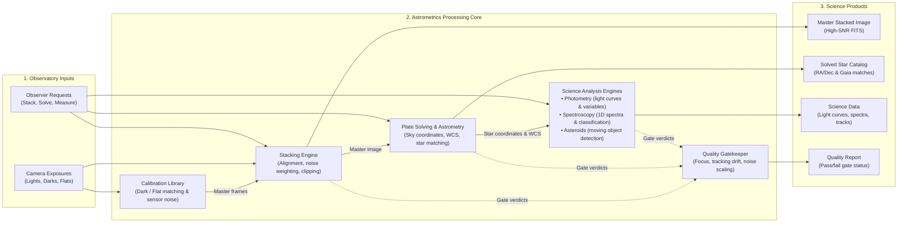

# How the Astrometrics processing pipelines fit together

*Version 2.1 · 2026-10-24 · Status: current*

## Abstract

This guide explains how the Astrometrics software processes telescope images. It shows how raw camera exposures turn into clean, calibrated master images and scientific measurements, including star brightness changes, stellar spectra, and moving asteroid tracks. It is written for astrophotographers and observers who want to understand the structure of the processing pipelines.

Terms are defined in the [glossary](../Glossary.md). This document also defines each term the first time it appears.

## 1. How images travel through the library

When you take pictures through a telescope, each exposure captures starlight along with camera noise, atmospheric blur, and sky glow. The library takes those raw frames and processes them in a natural sequence:

1. **Remove camera noise and combine exposures (Stacking).** Raw light frames (the pictures of your target) are cleaned using calibration frames (darks, biases, and flats) to remove sensor heat and optical dust spots. The clean frames are aligned and combined into a single deep image with high signal-to-noise ratio.
2. **Find the exact patch of sky and name the stars (Astrometry).** The stacked image (or a single light frame) is plate-solved: an algorithm matches the pattern of stars to an astronomical star catalog (such as Gaia). This tells the software exactly where the telescope was pointing on the celestial sphere (Right Ascension and Declination) and identifies every star in the frame.
3. **Track changes in star brightness over time (Photometry).** Using the identified stars as reference points, the software measures each star's brightness across every frame of a session. It compares target stars against steady comparison stars to find pulsating variable stars, eclipsing binaries, or transit dips.
4. **Spread starlight into spectra and classify stars (Spectroscopy).** For frames taken through a diffraction grating (such as a Star Analyser filter), the light spreads out into a rainbow trail. The software traces that line of light, extracts a one-dimensional spectrum, calibrates the wavelengths, and determines the star's spectral type.
5. **Spot moving asteroids and comets (Asteroid detection).** By comparing pictures taken over several hours, the software picks out dots that move while the background stars stay still. It tracks their path and speed, and checks whether they match known asteroids and comets.
6. **Check quality at every step.** Automatic quality gates verify tracking accuracy, star sharpness, sky background brightness, and noise reduction so poor frames do not spoil the science.

---

## 2. Library structure and internal components

Figure 1 shows the internal architecture of the library: how camera exposures and user requests enter the system, flow through the five processing engines, and produce validated astronomical data products.

**Figure 1.** Overview of the Astrometrics processing core, showing how observational inputs flow through internal engines to produce science outputs.

---

## 3. What each part does

### 3.1 The five processing pipelines

1. **Stacking.** Combines multiple exposures of the same target into one image with less noise. It subtracts darks and biases to remove thermal noise and hot pixels, and divides by flat frames to correct for optical vignetting and dust shadows. It uses star positions to align the pictures, weights each frame by its sharpness and noise, and rejects satellite trails and cosmic rays using sigma clipping.
   * *Detailed guide:* [Stacking review guide](pipelines/stacking.md)
   * *Underlying math & equations:* [Stacking equations](Astrometrics_Library_Architecture.md#3-image-stacking-pipeline)
2. **Astrometry.** Looks at the stars in an image, extracts their center positions, and plate-solves the field against the Gaia catalog. It writes a World Coordinate System (WCS) into the FITS header, which converts any pixel $(x, y)$ into sky coordinates $(\alpha, \delta)$.
   * *Detailed guide:* [Astrometry review guide](pipelines/astrometry.md)
   * *Underlying math & equations:* [Plate solving & WCS refit](Astrometrics_Library_Architecture.md#4-astrometry-pipeline)
3. **Photometry.** Measures star brightness by summing the pixel counts inside a small circular aperture around each star and subtracting the surrounding sky background. It tracks brightness across every frame in an observing run, picks non-variable comparison stars to cancel out changing atmospheric transparency, and plots light curves to reveal variable stars and eclipsing binaries.
   * *Detailed guide:* [Photometry review guide](pipelines/photometry.md)
   * *Underlying math & equations:* [Differential ensemble & period search](Astrometrics_Library_Architecture.md#5-stellar-photometry-pipeline)
4. **Spectroscopy.** Designed for slitless spectroscopy using a transmission grating. It locates the zero-order star point, tracks the dispersed spectrum rainbow, and extracts a one-dimensional graph of brightness versus wavelength. It corrects for atmospheric light absorption (extinction) and matches the spectrum against reference star templates to determine the star's spectral classification (such as A0V or M2III).
   * *Detailed guide:* [Spectroscopy review guide](pipelines/spectroscopy.md)
   * *Underlying math & equations:* [Grating equations & classification](Astrometrics_Library_Architecture.md#6-stellar-spectroscopy-pipeline)
5. **Asteroid detection.** Searches sequential frames for objects that move relative to fixed background stars. It links detections into continuous tracks, estimates their speed and heading on the sky, and checks online ephemeris databases to confirm whether the object is a known asteroid or a new candidate.
   * *Detailed guide:* [Asteroid detection review guide](pipelines/asteroid_detection.md)
   * *Underlying math & equations:* [Straight-line motion fitting](Astrometrics_Library_Architecture.md#7-asteroid-detection-pipeline)

### 3.2 Supporting library services

* **Calibration library:** Keeps track of darks, biases, and flats sorted by camera, sensor temperature, optical filter, and exposure duration so the right master frame is automatically applied. It also measures camera gain (electrons per ADU) and read noise from flat-pair tests.
* **Quality assurance:** Tests each run against automatic pass/fail quality gates. Gates check whether stacking reduced noise as expected, whether plate solving met pointing tolerances, whether enough comparison stars were found, and whether tracking remained stable throughout the session.
* **Lineage and history:** Audits every generated image and science table, recording the raw files, calibration masters, and algorithm settings used to build it.

---

## 4. What you can ask the library to do

The library groups its operations into four practical areas:

### 4.1 Image processing
* **Run target analysis:** Runs the full sequence of analysis pipelines on an astronomical target in fixed order (Astrometry $\to$ Photometry $\to$ Spectroscopy $\to$ Asteroid search).
* **Stack images:** Stacks imaging or spectral frames with customizable clipping thresholds and frame filters.
* **Remake preview:** Generates a new stretched preview picture (displaying faint details) without having to re-stack the raw frames.
* **Check noise scaling:** Tests whether stacking more frames continues to reduce noise following the theoretical $1/\sqrt{N}$ rule.

### 4.2 Calibration
* **Add calibration frames:** Ingests new darks, biases, and flats, cataloging them by camera and temperature.
* **Evaluate flat frames:** Checks flat field frames for uneven gradients, centering, and proper exposure levels.
* **Measure camera noise:** Analyzes bias and flat pairs to measure your camera sensor's read noise and gain.

### 4.3 Quality verification
* **Read stack and run summaries:** Reviews which quality gates passed, which failed, and why.
* **Inspect excluded frames:** Reviews frames that were set aside due to cloud cover, guiding errors, or poor focus, with the option to restore them.

### 4.4 History and jobs
* **Track running jobs:** Follows long-running background tasks such as stacking or multi-frame photometry batches.
* **Export lineage records:** Traces any final master image or measurement table back to the exact telescope frames it came from.
