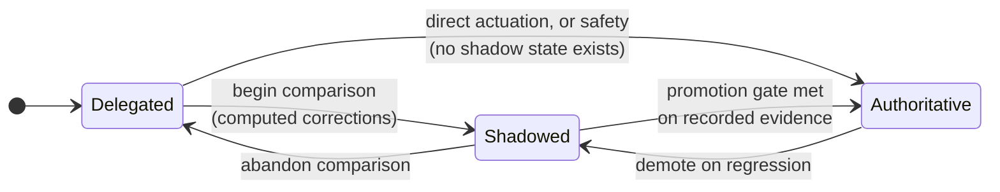

# Wayfinding library architecture

*Version 3.0 · 2026-10-15 · Status: current*

## Abstract

Amateur and small observatories run their nights with software that mixes three jobs: choosing what to image, operating the equipment, and carrying the plan out. This paper describes the architecture of the Wayfinding library, which runs a single-observer observatory. The library splits the work into three functions over one shared foundation. Observation planning builds reusable imaging requests and places them in a night. Observatory control operates the telescope, camera, enclosure and mount, and protects them. Observation execution carries a planned night out and records what happened next to what was intended. Planning and control never depend on each other, and execution is optional. A per-capability delegation model lets this system take over each job from the third-party software now in charge, one job at a time, on recorded evidence. This paper explains the theory behind each part. It names no code and states no tuned values; the companion implementation paper does both.

Terms are defined in the [glossary](#appendix-a-glossary). This document also defines each term the first time it appears.

## 1. Introduction

**Statement of need.** An observing night has three separable jobs: deciding what to image and in what order, operating the equipment, and carrying out the plan while conditions change. Today one program, such as KStars with its Ekos module [1], usually does all three, and a separate program such as PHD2 [2] guides the telescope. These programs are built for an operator who sits at the telescope. An observatory that runs on its own needs more. It must protect itself when no plan is running. It must say why a target did not fit in the night. It must show, on real nights, that a replacement for the current software acts the same way before it is trusted to act alone.

**Approach.** This architecture separates the three jobs so each can be built, used and checked alone. Observation planning and observatory control are peers. An operator can plan a night without commanding any hardware, and the observatory can protect itself with no plan in existence. Observation execution sits above both and drives the automation. The programming interface that drives each function is the same one a graphical client uses. An operator can direct the observatory by hand or write the same steps into a script.

**Scope.** This paper explains the theory: what each part does and why. It does not give the tuned settings the code uses, such as limits, counts and time steps. It describes the idea behind each setting instead. The [Wayfinding library implementation](./Wayfinding_Library_Implementation.md) paper names the code and lists the settings. The library has no validation register yet, so this paper makes no claim that a setting has been measured.

The rest of this paper is organized as follows. Section 1.1 reviews related work. Section 2 presents the three functions, the capability delegation model, and the state each function owns. Section 3 covers the shared foundation. Sections 4, 5 and 6 cover planning, execution and control in turn. Section 7 says how the design is checked. Section 8 lists limitations and Section 9 concludes.

### 1.1 Related work

Each tool below solves part of the problem. This library reuses several and replaces one: the observing-night software that now runs the hardware.

**Observatory control software.** KStars with Ekos [1] is an open-source suite that plans, aligns, focuses, guides and captures. It is the software this library is designed to replace in stages. PHD2 [2] is an open-source autoguiding program. INDI [3] is a protocol that lets one program command many kinds of astronomy hardware through drivers. The library speaks INDI today and keeps its own logic free of any one protocol.

**Device interface standards.** ASCOM Alpaca [4] defines one interface for each type of device, such as a telescope or a camera, carried over a network. This library follows the same shape: one interface for each device type, not one for each protocol (Section 6.2).

**Facility control systems.** The Vera C. Rubin Observatory control system [5] gives every component one standard lifecycle state, separates a scheduler from a queue of work, and treats safety as a layer around operation. Its scheduler [6] picks the next observation greedily by scoring candidates. This library adopts the state vocabulary and the layered view of safety and diverges on scale, scope and scheduling timing (Section 2.2).

**What the library adds.** The tools above do not provide four things. These are a delegation model that moves each job from the current software to this system on recorded evidence, a record of every disagreement between the two systems, a closed set of named reasons that a target could not be placed, and limits for judging a night that follow the equipment in use instead of fixed numbers.

## 2. System architecture

### 2.1 Three functions and one foundation

The library is organized as three functions over one foundation, shown in Figure 1.

**Figure 1.** The three-function architecture. Control and planning are peers that share the foundation and never import each other. Execution depends on both, and nothing depends on execution. Safety sits in control, not execution, because it must work whether or not a session is running.

Five rules govern the architecture. Later sections restate the ones that belong to a single function.

1. **Foundation independence.** Domain models and astronomy calculation depend on nothing above themselves.
2. **Control and planning peerage.** Observatory control and observation planning never depend on one another. Either can be used with the other absent.
3. **Execution is optional.** Execution may depend on control, planning and the foundation. Nothing outside execution depends on it. A system built without execution is a complete planning-and-control system, not a partial one.
4. **One litmus test per boundary.** A capability belongs to the science-side image processing library (see the [Astrometrics library architecture](./Astrometrics_Library_Architecture.md)) if a scientist could use it with archived data and no telescope. Otherwise it belongs here. This keeps the science library usable without hardware and keeps this library free of astrophysical analysis it does not need.
5. **Delegation is a per-capability state, not an architecture boundary.** Which system performs a hardware-facing capability is a setting read at run time (Section 2.3). No function may be written so that changing a capability's delegation state requires changing the function's structure.

<!-- impl: wayfindinglib.Wayfinder -->
<!-- impl: wayfindinglib.api.control.control.ObservatoryControl -->
<!-- impl: wayfindinglib.api.planning.ObservationPlanning -->
<!-- impl: wayfindinglib.api.execution.ObservationExecution -->

### 2.2 Precedent and deliberate divergence

The decomposition follows the Vera C. Rubin Observatory control system, which separates three concerns that are easily confused [5].

The first is *component lifecycle*. Rubin represents each piece of hardware as a component that runs one standard summary-state machine with five states: offline, standby, disabled, enabled and fault. Components publish that state in the same way whatever hardware is underneath, and they talk to each other as peers over a shared bus. This architecture adopts the idea and the five states directly (Section 6.3). An operator or a running session can then ask any device the same question and get an answer in the same words, including an explicit fault state that execution must read before it advances.

The second is *work-item lifecycle*. Rubin's nightly operation separates a scheduler, which decides what to observe, from a script queue, which runs the resulting work against the hardware. A queue entry has its own progression, distinct from the summary state of the components that carry it out. The split between planning and execution here has the same shape. The status progression of a queue entry (Section 5.3) matches the script queue entry's, not the component state.

The third is *safety as a layer, not a step*. Rubin treats environmental monitoring and interlocks as constraints that act on operation from outside it. This architecture does the same. Safety lives in control, where it works with or without a session, and it is exempt from the shadow requirement of the delegation model (Section 2.3).

Three divergences are deliberate design choices, not omissions.

- **Granularity.** Rubin splits its hardware into many components, each owned by its own engineering team. A single-observer observatory has no such need. Observatory control here is one function that covers the whole imaging train and the enclosure. It reports a summary state for each device without making each device a component.
- **Scope of the word control.** Rubin's observatory control system includes the scheduler and the script queue as well as device commanding. Observatory control here is narrower. It excludes both, which live in planning and execution. This narrower scope is what lets control work with no plan in existence, and readers who know Rubin's usage should not carry the wider meaning across.
- **Scheduling posture.** Rubin re-scores candidates continuously during the night. This architecture resolves a queue before the night and advances it as written (Section 4.2).

Appendix E maps the terms of the two systems to each other.

### 2.3 Capability delegation

Every hardware-facing job this system is meant to perform is performed today by the current third-party software, called the *incumbent*. The architecture does not treat that as a fixed boundary or as one future cutover. It gives each job a *delegation state*, which has one of three values.

- **Delegated.** The incumbent performs the capability. This system neither computes nor commands it, and it only reads what the incumbent publishes.
- **Shadowed.** The incumbent still performs the capability and stays the only source of hardware commands. This system independently computes what it would have done and records every disagreement between the two (Section 5.4). Nothing it computes reaches hardware.
- **Authoritative.** This system performs the capability and the incumbent is disengaged from it.

Six capabilities carry a state. They match the functional modules of the software being replaced: mount control, plate-solve alignment, autoguiding, autofocus, capture orchestration and observatory safety. Plate solving is the step that finds where an image points by matching its stars to a catalog. Each capability advances alone, so the observatory works at every intermediate setting. A capability that does not earn promotion can stay delegated for as long as needed without blocking the others.

Figure 2 shows the moves a capability can make.

**Figure 2.** Delegation state moves for one capability. Demotion paths exist on purpose: a capability that regresses returns to a state that issues no hardware commands, with no structural change. Safety has no shadow state, so it takes the direct edge.

Four rules govern how a capability moves.

- **Computed corrections pass through shadow.** A capability that computes a *correction* may reach the authoritative state only from the shadowed state, and only on recorded evidence from real nights. A correction is a pointing adjustment, a guiding pulse or a focus position. A capability that only carries out an explicit operator command, such as a slew to stated coordinates, has no independent computation to compare, so it is exempt.
- **Safety is never shadowed.** Observatory safety may be only delegated or authoritative. A shadowed safety system would compute that it should close the enclosure while the enclosure stays open. That is not a test. It is a system that sees a hazard and does nothing. Safety is therefore promoted on component-level evidence, which shows that each protective action works when commanded. It must be authoritative before unattended operation is allowed.
- **Capture waits for the corrections.** Capture orchestration may leave the delegated state only when alignment, guiding and focus are all authoritative. A capture sequence this system runs depends on corrections it also computes. Promoting the dependent capability first would leave a failure with several possible causes and no way to separate them.
- **Calibration comes first.** Autoguiding may leave the delegated state only when a guider calibration exists, and autofocus only when a focus model exists. Without them there is no mapping from a measurement to a command that could be compared.

A fifth rule, *single command authority*, applies to every device: at most one system holds actuation authority at a time. A capability may be authoritative only while the incumbent is disengaged from that device. The shadowed state is safe because it is defined to issue nothing.

The policy checks the rules above when a state changes. It cannot check the first rule by looking at a policy alone, because "was this capability ever shadowed" is a question about history. The check therefore compares the prior state with the requested one at the moment of change. Every hardware command also checks the delegation state of the capability it belongs to and refuses to run unless that capability is authoritative. Reads need no such check.

<!-- impl: wayfindinglib.models.policy.delegation.ObservatoryCapability -->
<!-- impl: wayfindinglib.models.policy.delegation.DelegationState -->
<!-- impl: wayfindinglib.models.policy.delegation.DelegationPolicy -->
<!-- impl: wayfindinglib.data_access.delegation_policy_reader.validate_delegation_policy -->
<!-- impl: wayfindinglib.data_access.delegation_policy_reader.promote_capability -->
<!-- impl: wayfindinglib.tasks.control_tasks.hardware_operations._require_authoritative -->

### 2.4 Delegation phases

The delegation states allow many combinations. Table 1 names the six this architecture targets, in order. Each is a working observatory setting, not a waypoint. Each has a promotion gate (Section 7.2). At Phase 5 no capability remains delegated, which is the concrete meaning of replacing the incumbent: it is uninstalled, not merely idle.

**Table 1.** Delegation phases. D means delegated, S shadowed and A authoritative.

| Phase | Mount | Align | Guide | Focus | Capture | Safety | What this phase establishes |
| --- | --- | --- | --- | --- | --- | --- | --- |
| 0 Observed baseline | D | D | D | D | D | D | The incumbent runs the night. This system records telemetry and plans nights without commanding anything. |
| 1 Direct control | A | D | D | D | D | D | The mount is commanded through this system, inside its own configured pointing envelope, with device summary state reported. |
| 2 Shadowed correction | A | S | S | S | D | D | This system's alignment, guiding and focus algorithms compute corrections on every real night and are compared with the incumbent's, without touching hardware. |
| 3 Assumed correction | A | A | A | A | D | D | All three corrections run on this system's algorithms. The incumbent still sequences the night. |
| 4 Full authority | A | A | A | A | A | D | This system runs planned sessions end to end, including meridian flips and camera cooling. The incumbent no longer operates the observatory. |
| 5 Unattended | A | A | A | A | A | A | This system protects the observatory: environmental monitoring, enclosure control, fault recovery and safe-state shutdown. The incumbent is removed. |

The order across capabilities is not arbitrary. Alignment, guiding and focus come before capture, for the reason given in Section 2.3. Safety comes last, not because it matters least but because comparison cannot validate it. Until Phase 5 an operator is present because validation is in progress, and the incumbent keeps the duty of protection.

### 2.5 Domain state and operations

Table 2 sorts the architecture's state by the function that owns it and by how long it lasts.

**Table 2.** State across the three functions.

| State category | Element | Description and rationale |
| --- | --- | --- |
| Foundation: equipment and site (configured rarely, read by both peer functions) | Telescope specification | A physical imaging rig's optics and tracking envelope: focal length, the altitude range and hour-angle bound the mount may safely point across, and the hour angle at which a meridian flip starts. |
| | Camera specification | A physical sensor's imaging geometry and thermal envelope: pixel pitch, dimensions and cooling limits. |
| | Guide optics | An optional separate guide telescope with its own focal length, and the camera that sees the guide star. |
| | Equipment catalog | The configured telescopes and cameras, with which of each is active. |
| | Site profile | The observing location's coordinates and any horizon obstructions. |
| | Enclosure specification | The roof or dome: its type, its motion limits and the mount positions at which closing is mechanically allowed. |
| | Guider calibration | The measured link between guide-camera pixels and mount motion. It is required before autoguiding can be computed, not just observed. |
| | Focus model | The measured link between focuser position, temperature and filter: the per-filter offsets and the thermal coefficient that autofocus starts from. |
| | Calibration inventory | Counts of calibration frames already captured, grouped by camera, exposure and filter. Planning reads it, and execution brings it up to date after a session (Section 5.7). |
| Foundation: policy (configured on purpose, read by every function) | Capability delegation | Which system performs one hardware-facing capability, and since when. |
| | Delegation policy | The delegation state of every capability together, which is the observatory's current phase. |
| | Safety rule set | The environmental limits and age bounds at which conditions count as unsafe. |
| | Recovery policy | How many times, and how far apart, a faulted device may be recovered before the observatory goes to a safe state. |
| | Correction settings | The gains, limits and tolerances of the pointing, guiding and focus corrections, and the tolerances that decide whether a computed action agrees with the incumbent's. |
| Foundation: computed limits (derived on demand, never stored) | Performance envelope | The limits that separate normal from abnormal for the equipment in use now. A change of equipment changes every limit (Section 6.8). |
| Planning: reusable request (written independent of any night) | Observation package | A reusable imaging request for one target: which exposures, science and calibration alike, how many, through which filters, with what pacing and dithering, and any target-specific altitude floor. |
| | Mosaic panel set | A group of sibling observation packages made from one multi-panel request. |
| Planning: computed advice (derived on demand, never stored) | Target quality advisory | What the science-side archive already knows about a target. It informs package writing and priority. It never dictates either. |
| | Calibration advisory | What the calibration inventory already holds for a requested calibration frame, under the same advisory rule. |
| Planning and execution: session (stored, fields owned by one function each) | Observation session | One observing night's record: the equipment and site it was planned against, an ordered queue with placement diagnostics (written by planning), and the telemetry, per-entry outcomes, divergence records, fault records and flip outcomes (written by execution). |
| | Queued observation package | One queue entry: a self-contained frozen copy of a package's request, its scheduled start, its execution status and what actually happened. |
| | Unplaced package diagnostic | A specific reason that a package could not be placed. It is never a silent omission. |
| Evidence (stored, append-only) | Divergence record | One measured disagreement between an action this system computed and the action the incumbent took, for one capability at one moment. A promotion gate rests on these (Section 5.4). |
| | Fault record | One device fault, the recovery attempts made against it, and whether recovery worked or the observatory went to a safe state (Section 5.6). |
| | Commissioning run | The outcome of one commissioning drill: which phase it qualifies, what it saw against each gate criterion, and whether it was aborted. It carries gate evidence that arises outside any night and is not tied to any session. |
| | Session record | What the incumbent recorded of one session apart from guiding: where the mount pointed, every finished and cancelled exposure, every autofocus run, and the plate-solve and guider state changes. It is tied to the equipment the session's own data shows (Section 6.8). |
| Control: live state (published continuously) | Device summary state | One device's lifecycle in the five-state vocabulary, with fault detail (Section 6.3). |
| | Enclosure state | The roof or dome position in its own motion states. An unknown state counts as unsafe. |
| | Safety assessment | The current environmental verdict, the rule that produced it and how old the readings are (Section 6.5). |
| Execution: volatile (active only while a session runs) | Telemetry buffer | Parsed guiding and weather samples held in memory until the next save. |

Table 3 lists each core operation, the function that owns it, and the delegation state that gates it.

**Table 3.** Core operations and their delegation gate.

| Operation | Function | Gated by | Purpose |
| --- | --- | --- | --- |
| Mount slew, park, tracking | Control | Mount control | Move the mount, checked against the active telescope's pointing envelope. |
| Mount sync | Control | Plate-solve alignment | Tell the mount where it really points after a plate solve. |
| Filter change and capture | Control | Capture orchestration | Turn the filter wheel and take exposures. |
| Focuser move | Control | Autofocus | Move the focuser. |
| Guide pulse and guide exposure | Control | Autoguiding | Send the mount a guide correction and take a guide frame. |
| Enclosure open and close | Control | Observatory safety | Move the roof or dome, with the close interlocked against mount position. |
| Pointing correction computation | Control | None (pure computation) | Turn a solved field into a mount pointing correction. The solve itself is science-side (Section 6.4). |
| Guiding correction computation | Control | None (pure computation) | Turn a measured guide-star drift into signed pulse lengths. |
| Focus correction computation | Control | None (pure computation) | Turn a measured focus curve into a focuser position. The star measurement is science-side. |
| Camera cooling arithmetic | Control | None (pure computation) | Work out the ramped temperature setpoints toward a target and back to ambient. |
| Environmental safety assessment | Control | None (read) | Judge conditions safe, marginal, unsafe or unknown against the safety rules. |
| Safe-state sequencing | Control | Steps are supplied by the caller | Bring the observatory to a protected configuration in a fixed order. |
| Equipment activation | Control | None (configuration) | Choose which configured telescope and camera are active. |
| Remote file retrieval | Control | None (read) | Copy captured frames and logs from the telescope computer. |
| Night-window resolution | Planning | Not applicable | Bracket the usable part of a calendar night. |
| Package placement | Planning | Not applicable | Give each package a feasible start or a specific reason it has none. |
| Mosaic panel generation | Planning | Not applicable | Expand one multi-panel request into sibling packages. |
| Archive-informed advising | Planning | Not applicable | Show target-quality and calibration advice. |
| Queue advancement | Execution | Each action's own capability | Carry a session's queue forward, one entry per cycle. |
| Meridian flip sequencing | Execution | Steps are supplied by the caller | Interrupt, flip, re-acquire and resume across a meridian crossing. |
| Fault recovery | Execution | Steps are supplied by the caller | Try bounded recovery of a faulted device, then escalate. |
| Divergence recording | Execution | Active while a capability is shadowed | Measure computed intent against the incumbent's action and store the comparison. |
| Telemetry recording | Execution | None (passive) | Turn published guiding events and weather snapshots into structured samples. |
| Post-session reconciliation | Execution | None | Update the calibration inventory and the science-side link after a session ends. |

<!-- impl: wayfindinglib.models.equipment_and_site.equipment.Telescope -->
<!-- impl: wayfindinglib.models.equipment_and_site.equipment.EquipmentCatalog -->
<!-- impl: wayfindinglib.models.session.observation_session.ObservationSession -->
<!-- impl: wayfindinglib.models.policy.commissioning.CommissioningRun -->

## 3. Foundation: equipment, site and session domain

### 3.1 Purpose and interfaces

- **Inputs:** operator-configured equipment, enclosure and site specifications; the measured guider calibration and focus model; the calibration inventory; the delegation, safety and recovery policies; and the accumulating record of one night.
- **Outputs:** the shared vocabulary that every function above the foundation uses.

### 3.2 Theoretical rationale

A telescope's optics and its mount's safe pointing envelope are set together, changed together and meaningless apart. The architecture therefore keeps a telescope specification as one flat record that changes rarely. It is held with the camera specifications in an equipment catalog that records the configured set and which entry of each kind is active. Reading the catalog is a foundation task because both peer functions need the active entries. Changing which entry is active is an operator action on hardware, so it belongs to control.

Two derived quantities come straight from the specifications. The pixel scale $\rho$, in arcseconds of sky per pixel, follows from the pixel pitch $\ell$ in micrometers and the focal length $F$ in millimeters:

$$
\rho = 206.265\,\frac{\ell}{F}
\tag{1}
$$

The field of view follows from the pixel scale and the sensor size. A separate guide telescope has its own focal length, so a guide camera's pixel scale uses that focal length instead of the main telescope's. Guiding through the main telescope is the common case and uses the main focal length.

<!-- impl: wayfindinglib.models.equipment_and_site.equipment.EquipmentConfiguration -->
<!-- impl: wayfindinglib.models.equipment_and_site.equipment.GuideScope -->

The enclosure is specified beside the equipment, not as part of it, because its constraint is geometric and mutual. A roof can close only when the mount sits where it clears the roof, and the mount can leave park only when the roof is open. The permitted closing position is recorded as configuration, a park position with a tolerance, instead of being derived. That makes the interlock checkable without commanding anything.

<!-- impl: wayfindinglib.models.equipment_and_site.enclosure.Enclosure -->

Site obstructions belong to the location, not to one piece of equipment. They attach to the site profile as an azimuth range with its own raised altitude floor. The site profile is also the one source of observer position for planning and for the live-status tools. A planning calculation made with no hardware present then agrees with every other calculation that reads the site. Control reads the position differently in one case, which Section 8 states.

<!-- impl: wayfindinglib.models.equipment_and_site.site_profile.SiteProfile -->
<!-- impl: wayfindinglib.models.equipment_and_site.site_profile.AvoidanceZone -->
<!-- impl: wayfindinglib.data_access.site_profile_reader.resolve_site_location -->

Guider calibration and the focus model are foundation state for the same reason as the equipment specification. Both describe measured, slowly changing physical links, not per-night observations. Each is the precondition for its capability to be computed instead of merely observed.

<!-- impl: wayfindinglib.models.equipment_and_site.guider_calibration.GuiderCalibration -->
<!-- impl: wayfindinglib.models.equipment_and_site.focus_model.FocusModel -->

The delegation, safety and recovery policies are foundation state because every function reads them and none writes them during operation. This placement lets a capability's state, a weather limit or a recovery bound change without changing any function's structure.

<!-- impl: wayfindinglib.models.policy.safety.SafetyRuleSet -->
<!-- impl: wayfindinglib.models.policy.recovery.RecoveryPolicy -->
<!-- impl: wayfindinglib.models.session.correction_config.CorrectionConfig -->

Calibration frames already captured are reference data that planning reads. Capturing new ones goes through the ordinary package path. The inventory must then be brought back into agreement with what was captured. Execution does this once, after a session ends (Section 5.7). The inventory stays a deliberately updated fact and not live telemetry.

<!-- impl: wayfindinglib.models.equipment_and_site.calibration.CalibrationStats -->

The observation session is the one object with shared ownership. Planning writes its queue, and execution, when present, fills in what happened. A session written by planning alone, with every entry unexecuted, is already a complete plan for the night that a reader can review. That is the concrete meaning of the optional-execution rule. Placement depends on the pointing envelope of one rig and the obstructions of one site, so the session records which telescope, camera and site profile it was planned against.

### 3.3 Design invariants

- **Configuration, not telemetry.** Equipment, enclosure, site, calibration and policy records are configured facts. A running session never writes them. The calibration inventory is updated after a session ends, never during one.
- **One source of site position for planning.** Planning and the live-status tools read the site's latitude, longitude and elevation from the site settings, never from a connected device.
- **Session field ownership.** Within one session, only planning writes the queue and its placement diagnostics. Only execution writes execution status, per-entry outcomes, divergence records, fault records and telemetry.
- **Template and instance separation.** An observation package is a reusable template. A queued observation package is a frozen instance placed in one session. A queue entry carries every value needed to run it, so editing or deleting the template later cannot change what that session recorded.
- **Live target resolution.** A package names its target by identifier only and the target's position is read when the package is placed, so a target solved again since the package was written is placed where it really is.
- **Reproducible placement context.** A session records the equipment and site its placement was computed against, so its queue stays readable after either changes.
- **Reference-only science link.** A session refers to the science-side target session it matches by identifier only. It never embeds or extends science-side records. The reference may be empty and is attached after the fact.

## 4. Observation planning

### 4.1 Purpose and interfaces

- **Inputs:** a set of observation packages to attempt, a site profile, the active telescope specification, a target night, and optionally advice drawn from the science-side archive.
- **Outputs:** an observation session's queue, ordered and placed in time, with a specific diagnostic for every package that could not be placed.

### 4.2 Theoretical rationale

An exposure list is not limited to science exposures. A package asks for whichever frames an operator wants for that target: light, dark, flat or bias, each with its own pacing, plus an overall dithering cadence. Dithering is a small deliberate pointing shift between exposures that spreads fixed sensor defects across the sky. Treating calibration requests as ordinary entries in the same list matches how an operator plans a target and avoids a second request mechanism.

<!-- impl: wayfindinglib.models.planning.observation_package.ObservationPackage -->
<!-- impl: wayfindinglib.models.planning.observation_package.ExposureRequest -->

A multi-panel request is not a package field. It is a package *generator*. The operator gives a tiling of one region and a shared exposure recipe, and planning expands the request into one sibling package for each panel. A mosaic is a grid of overlapping panels that together cover a region too large for one field of view. Neighboring panels are one field apart, less an overlap. Along right ascension the step is divided by the cosine of the declination, because lines of equal right ascension draw together toward the poles. Each generated package is placed on its own by the same rule as any other, so no separate multi-target mode is needed.

<!-- impl: wayfindinglib.tasks.planning_tasks.mosaic_tasks.calculate_panels -->
<!-- impl: wayfindinglib.tasks.planning_tasks.mosaic_tasks.create_mosaic -->

Placing several packages in one night is a constrained scheduling problem. Each package has a visibility window shaped by the site's obstructions, the active telescope's altitude range and the package's own altitude floor, and all of them compete for the same finite night. The architecture resolves this with one stated rule: place whichever remaining package can start soonest, and break ties by priority. The rule is evaluated again at each step and is not solved for all packages at once. This follows the design view that one justified rule is better than an under-validated tuned system, especially when no body of past scheduling outcomes exists to check one against. The same view guides the Astrometrics library architecture.

Placement checks visibility at sampled instants, not continuously. It tests the altitude floor, the telescope's upper altitude limit and the site's obstructions. The telescope's hour-angle bound and meridian flip are stored with the telescope but are not placement constraints. A package that would cross the meridian is placed as if no flip were needed.

<!-- impl: wayfindinglib.tasks.planning_tasks.scheduling.place -->
<!-- impl: wayfindinglib.tasks.planning_tasks.visibility_tasks.visibility_state_at -->
<!-- impl: wayfindinglib.tasks.planning_tasks.visibility_tasks.effective_altitude_floor -->

The Rubin scheduler also selects greedily. It scores candidates against weighted decision factors and chooses the best one at each step, instead of solving the survey as a whole [6]. The algorithm shape is shared. The two differ in *dimensionality*, because Rubin's score combines a very large number of weighted factors tuned over years of survey science and this architecture uses one criterion. They differ more in *timing*. Rubin re-scores continuously during the night against live conditions. This architecture resolves the whole queue before the night, and execution advances it as written. A target that rises late, a package that overruns, or an hour lost to cloud does not cause the remaining entries to be placed again. This is a deliberate scope choice, because a fixed queue can be reviewed in advance, repeated and diagnosed. It is also a real limitation (Section 8). Closed-loop re-placement is the natural next step once the delegation phases reach Phase 5 and this system itself feels those conditions.

Operators may want a package to start at a given clock time, so placement knows two starting dispositions: soonest available and fixed time. Fixed-time requests are checked and placed first, as anchors that the soonest-available placements route around. Two fixed-time requests that overlap are both reported and neither is placed.

A scheduling result that silently drops a package is not useful. The operator needs to know *why* it did not fit. The architecture therefore reports each outcome as one of a closed set of named reasons, on a channel separate from the queue. The reasons are: the target never rises above the altitude floor in the night, the target clears the floor only inside a site obstruction, a clear window exists but is shorter than the package, a long enough window existed but earlier placements used it, and a fixed-time request cannot be met. This differs from Rubin, which encodes infeasibility inside the score by giving an impossible candidate a score of negative infinity [6]. That is efficient for a scheduler whose decisions no person reads one by one. It discards the difference between "impossible" and "outscored", which is what an operator planning one night needs.

<!-- impl: wayfindinglib.models.session.observation_session.InfeasibilityReasonCode -->
<!-- impl: wayfindinglib.models.session.observation_session.InfeasibilityReason -->

Two kinds of archive-derived advice inform authoring and placement without dictating them. The target quality advisory can influence which packages an operator ranks higher. The calibration advisory can influence whether a calibration entry belongs in a package at all. Both are advice only. An operator opts a package in to a bounded priority boost drawn from the target quality advisory. The boost only ever raises priority, in response to a flagged quality condition or a notable science outcome, and never lowers it because more data already exists. The calibration advisory never changes placement. The boost changes the resulting order only when two packages could start at the same time, because priority is the tie-breaker. The amount applied is recorded on the queue entry it affected.

<!-- impl: wayfindinglib.models.planning.quality_advisory.TargetQualityAdvisory -->
<!-- impl: wayfindinglib.models.equipment_and_site.calibration.CalibrationAdvisory -->
<!-- impl: wayfindinglib.tasks.planning_tasks.quality_advisory_tasks.build_target_quality_advisory -->
<!-- impl: wayfindinglib.tasks.planning_tasks.calibration_advisory_tasks.build_calibration_advisory -->

An automatically placed queue is a convenience, not the only way to a queue. An operator may also build or edit a session's queue by hand. Both paths write the same structure.

Planning also answers visibility questions that do not place anything. A visibility report gives, for one moment or across a night, the altitude of each requested object, the times it is above the required altitude, the sun and moon conditions, and the meridian status of the object.

<!-- impl: wayfindinglib.tasks.planning_tasks.visibility_report.build_visibility_report -->
<!-- impl: wayfindinglib.models.planning.visibility.VisibilityReport -->

### 4.3 Placement sequence

Table 4 lists the steps of automatic package placement.

**Table 4.** Observation planning sequence.

| Step | Phase | Inputs and outputs | Description |
| --- | --- | --- | --- |
| 1 | Night-window resolution | In: site profile, target date. Out: the usable window. | Bracket the part of the night suitable for imaging. The solar altitude is sampled across a full day, and the window runs outward from the sun's lowest point to where the sun rises above a twilight limit. This is coarse sampling, not an exact rise and set calculation, and it is enough for the scheduling step size. |
| 2 | Disposition split | In: requested packages. Out: fixed-time and soonest-available groups. | Separate packages by starting disposition. |
| 3 | Fixed-time placement | In: fixed-time group, telescope range, obstructions. Out: anchors or conflict diagnostics. | Check that the target stays visible for the whole requested span, and place it. Overlapping requests are each diagnosed. |
| 4 | Advisory-informed priority | In: soonest-available group, opted-in advice. Out: priority boosts. | Work out each bounded boost and record it. |
| 5 | Greedy placement | In: soonest-available group, anchors, priorities. Out: ordered queue entries. | Repeatedly place the package whose earliest free visible start is soonest. |
| 6 | Infeasibility diagnosis | In: unplaced packages, full night window. Out: a diagnostic for each. | Tell physically impossible placements from those crowded out by earlier choices. |
| 7 | Session assembly | In: placed queue, diagnostics, active equipment, site. Out: observation session. | Build the night's session with its placement context. |

<!-- impl: wayfindinglib.tasks.planning_tasks.night_window.resolve_night_window -->
<!-- impl: wayfindinglib.tasks.planning_tasks.scheduling.schedule_session -->

### 4.4 Design invariants

- **Single justified placement rule.** Placement follows one stated rule, not an unstated or per-case heuristic.
- **Diagnosable infeasibility.** Every unplaced package carries a specific reason from a closed, named set.
- **Advisory, not authority.** Archive-derived information never dictates package contents or placement.
- **Explicable ordering.** Any advisory boost that was applied is recorded on the queue entry.
- **Manual parity.** Hand-written and automatically placed queues share one structure.
- **Planning is hardware-free.** Placement reads equipment and site specifications as data and never contacts a device, so a full night can be planned with nothing connected.

## 5. Observation execution

### 5.1 Purpose and interfaces

- **Inputs:** an observation session, observatory control, the delegation and recovery policies, and, while a session runs, guiding events, device summary state and the current safety assessment.
- **Outputs:** a session record advanced one entry at a time, with per-entry outcomes, telemetry, divergence records and fault records.

### 5.2 Theoretical rationale

Carrying out a session is a queue-advancement problem. Entries move through one status progression as the night runs: pending, running, and then completed, failed or skipped. The session itself is planned, running, suspended, completed or aborted. Execution is the one function allowed to depend on the other two, because advancing a queue and driving hardware to do it are inseparable once the night is running. That dependency runs one way.

Execution builds the same list of candidate actions for an entry in every phase. The delegation policy then decides what happens to each. An authoritative capability issues the action through control. A shadowed capability computes its intent, compares it with what the incumbent did and records the result. A delegated capability computes and issues nothing. One construction path serves every phase in Table 1, so moving between phases is a settings change and not a rewrite. What is measured in the shadowed state is exactly what will run after promotion.

Execution reads device summary state before it acts. A device in the fault state is a condition to act on, not one to command through.

**Unattended operation changes what a failure means.** With an operator present, a fault can stop and wait. When unattended, stopping is itself a decision. An unrecovered mount left tracking into its pier, or an open enclosure under advancing rain, is worse than a lost night. Execution therefore treats a fault as the start of a bounded recovery attempt (Section 5.6). Exhausting the bound escalates to the safe-state sequence that control owns (Section 6.6). The bound makes this safe. An unbounded retry cannot be told from a hang, and unattended operation cannot tolerate a hang.

<!-- impl: wayfindinglib.models.session.observation_session.SessionStatus -->
<!-- impl: wayfindinglib.models.session.observation_session.QueueEntryStatus -->
<!-- impl: wayfindinglib.tasks.execution_tasks.session_runner.dispose_action -->

### 5.3 Queue advancement

Table 5 lists one queue-advancement cycle. A cycle advances at most one entry. A runner repeats the cycle until the queue has nothing left to run, the session ends or is suspended, or the caller asks it to stop. It waits in short steps when the next entry's start time is still ahead.

**Table 5.** Queue advancement sequence.

| Step | Phase | Description |
| --- | --- | --- |
| 1 | Safety gate | Read the current safety assessment. Only a safe verdict permits observing. Any other verdict, including marginal, unknown and stale readings, suspends the session. |
| 2 | Entry selection | Pick the first pending entry whose start time has arrived. |
| 3 | Readiness check | Confirm that no device the selected entry needs is in the fault state. Readiness is checked after selection because a device matters only to the entry that needs it. |
| 4 | Meridian check | Decide whether the entry crosses the flip threshold and, if so, run the flip sequence (Section 5.5). A flip that does not resume fails the entry. |
| 5 | Disposition | For each candidate action, consult the delegation policy: issue it where authoritative, compare and record it where shadowed, and do nothing where delegated. |
| 6 | Outcome capture | Record what happened: start and end times as observed and the frames captured, beside what was planned. |
| 7 | Status transition | Move the entry to its new status. When every entry has finished, close the session. |
| 8 | Checkpoint | Save the session, so data loss is bounded to one cycle. |

A session ended by conditions can also be aborted. Aborting skips every pending entry, records the reason on each, and closes the session. A night ended by conditions is therefore a valid, closed record that carries its reason.

<!-- impl: wayfindinglib.tasks.execution_tasks.session_runner.advance_session -->
<!-- impl: wayfindinglib.tasks.execution_tasks.session_runner.abort_session -->
<!-- impl: wayfindinglib.tasks.execution_tasks.queue_runner.run_queue -->

### 5.4 Divergence recording

Divergence recording is the evidence on which promotion gates are decided. It is therefore durable, per-capability evidence and not diagnostic logging.

Whenever a capability is shadowed, each action this system computes is paired with the action the incumbent took. The pair is stored as a divergence record. The record carries the capability, the moment of comparison, both actions, the signed difference between them in that capability's natural unit, the tolerance used, and whether the difference fell within it. The sign (computed minus observed) lets a steady bias be told apart from random noise. Records are written whether or not the two agreed. A promotion decision needs the rate of agreement, and a rate cannot be computed from disagreements alone. For a set of $n$ comparisons of which $n_{\text{in}}$ fall within tolerance, the agreement rate is

$$
R = \frac{n_{\text{in}}}{n}
\tag{2}
$$

and a rate computed from no comparisons is reported as zero, never as perfect agreement.

Three capabilities are compared this way, each in its own unit.

- **Plate-solve alignment.** The pointing correction computed from a solved field, against the correction the incumbent's aligner applied, in arcseconds. Whether the alignment converged is recorded too.
- **Autoguiding.** The signed pulse for each axis computed from a measured guide-star drift, against the pulse the incumbent's guider issued for the same drift, in milliseconds.
- **Autofocus.** The focuser position computed from a measured focus curve, against the position the incumbent chose, in focuser steps.

Mount control, capture orchestration and safety produce no divergence records. The first two carry out an explicit intent that has no independent computation to compare, and safety has no shadowed state at all.

The comparison is meaningful only when both systems respond to the *same* measurement. A divergence record therefore names the shared input it was computed from. It does not pair actions by how close their timestamps are, which could pair a computed correction with an unrelated one when the system is busy.

<!-- impl: wayfindinglib.tasks.execution_tasks.divergence_recording.record_divergence -->
<!-- impl: wayfindinglib.models.session.divergence.DivergenceRecord -->
<!-- impl: wayfindinglib.tasks.control_tasks.capability_promotion.summarize_divergence_evidence -->
<!-- impl: wayfindinglib.tasks.control_tasks.capability_promotion.DivergenceEvidenceSummary -->

### 5.5 Meridian flip sequencing

A German equatorial mount must turn over when a tracked target crosses the local meridian, the line in the sky from north to south through the zenith. The turn-over interrupts an exposure sequence in the middle of a package and invalidates both the pointing solution and the guide star. Under delegation this is the incumbent's job. From Phase 4 it is this system's, and it is the most failure-prone moment of an unattended night.

The architecture treats a flip as a bounded, ordered interruption and not as an event handled inline. The steps are: complete or abandon the current exposure, stop guiding, turn the mount over, re-establish pointing by repeated plate solves, re-acquire a guide star, and resume the exposures. The first failing step stops the sequence and records its reason. The two steps that repeat, re-establishing pointing and re-acquiring the guide star, each have an attempt bound. Exhausting either is a fault and not a retry loop. A flip that cannot re-acquire is a night that must end safely, not one that keeps trying while the target sets.

The flip threshold is a property of the telescope, not of the night, because it describes where that mount's mechanics require the turn-over. It is stored once as an hour angle past transit. The delay in minutes is derived from it at the sidereal rate of 15° of hour angle per hour:

$$
t_{\text{flip}} = 60\,\frac{H_{\text{flip}}}{15}
\tag{3}
$$

Control and planning read the same threshold, expressed in one unit, instead of keeping a control-side and a planning-side value that could disagree.

<!-- impl: wayfindinglib.tasks.execution_tasks.meridian_flip.execute_meridian_flip -->
<!-- impl: wayfindinglib.models.session.meridian_flip.MeridianFlipOutcome -->
<!-- impl: wayfindinglib.data_access.equipment_catalog_reader.get_meridian_flip_delay_min -->

A lost guide star outside a flip follows the same bounded pattern. A guide frame that yields no usable star position starts a limited number of re-acquisition attempts, and the outcome is recorded.

<!-- impl: wayfindinglib.tasks.execution_tasks.guide_star_loss_recovery.attempt_guide_star_recovery -->

### 5.6 Fault recovery

A device that reports the fault state during unattended operation starts a recovery attempt governed by the recovery policy. The device is returned to standby, enabled again, and its state is read back. Recovery succeeds only if the device reports enabled. The number of attempts is bounded, and the wait before each attempt after the first grows by a fixed factor. For attempt $j$, with first wait $t_1$ and growth factor $m$:

$$
t_j =
\begin{cases}
0 & j = 1 \\
t_1\, m^{\,j-2} & j \ge 2
\end{cases}
\tag{4}
$$

Each attempt is recorded on a fault record with its outcome.

Recovery is deliberately shallow. It re-establishes a device's lifecycle state and nothing more. It does not try to reason about why the device faulted, because a system that cannot see the observatory cannot tell a passing driver disconnection from a mechanical obstruction, and treating the second as the first is how equipment is damaged. Exhausting the attempt bound therefore escalates to the safe-state sequence, not to a deeper recovery strategy.

<!-- impl: wayfindinglib.tasks.execution_tasks.fault_recovery.recover_fault -->
<!-- impl: wayfindinglib.models.policy.recovery.FaultRecord -->

### 5.7 Telemetry recording and post-session reconciliation

Recording a night's operational context has two cooperating pieces. A recorder attaches to a session that planning has already created. At a fixed interval it collects the guiding samples a guiding service has gathered and takes a best-effort weather snapshot, and it saves the session each time, so a failure loses at most one interval. It only listens. It never commands the incumbent's guider or the mount. A missing weather reading is stored as absent and never stops the recording. This tolerance is separate from the safety assessment (Section 6.5), which must not be best-effort.

<!-- impl: wayfindinglib.tasks.execution_tasks.session_recorder.ObservationSessionRecorder -->

When a session reaches a terminal status, execution runs two reconciliations that deliberately do not happen mid-run. Calibration frames the session captured are folded into the calibration inventory. The inventory is recomputed from every finished session each time, so running the step twice gives the same result and never counts a frame twice. The session's science-side link is attached by finding the science-side target sessions of each imaged target for the same night, which is possible only after the night.

<!-- impl: wayfindinglib.tasks.execution_tasks.post_session_reconciliation.reconcile_session -->
<!-- impl: wayfindinglib.tasks.execution_tasks.post_session_reconciliation.compute_calibration_stats -->

A related reconciliation runs inside control, not execution: reading a night's guide log and refitting the standing mount-mechanical model, and refitting the session's pointing model from that night's alignment attempts (Section 6.7). Both compute and expose a result. Attaching either to a session record is left to a later step.

### 5.8 Design invariants

- **Execution depends downward only.** Execution may use control and planning. Neither may depend on execution.
- **One construction path for every phase.** The candidate actions for an entry are built the same way in all delegation states. Only the disposition of each action differs.
- **Shadow issues nothing.** A shadowed capability produces divergence records and no hardware commands.
- **Evidence is symmetric.** Divergence records are written for agreeing comparisons as well as disagreeing ones, because a promotion gate is a rate and not a count.
- **Not safe suspends, never continues.** Any safety assessment that does not permit observing suspends queue advancement, whatever the queue holds.
- **Recovery is bounded.** Every recovery attempt sequence has an attempt count and a wait. Exhaustion escalates to the safe state.
- **Best-effort telemetry.** Missing weather telemetry is recorded as absent and never halts recording. The tolerance applies to the record and never to the safety assessment.
- **Checkpoint durability.** Session state is saved at bounded intervals and not only at the end.
- **Graceful incompleteness.** A session does not need every entry to reach a finished status before its record is closed.

## 6. Observatory control

### 6.1 Purpose and interfaces

- **Inputs:** direct commands (slew, park, unpark, filter, focus, enclosure motion, equipment activation), status queries, environmental readings, and the measurements from which corrections are computed.
- **Outputs:** hardware state changes, device summary state, enclosure state, the current safety assessment, and computed pointing, guiding and focus corrections.

Control groups its operations by topic, so each group is small enough to read as a whole. The root object holds only the device drivers, which tests and the application replace with their own. Seven groups hold the operations, and all share one record of the configuration, storage and drivers. A group that has readable state offers one status read, and the caller names the sections it wants. Table 6 lists the groups.

**Table 6.** The seven groups of observatory control.

| Group | Contents |
| --- | --- |
| Mount | Pointing and tracking: slew to a target or a sky position, optionally centered by plate solving; sync; park; tracking; manual motion; the pointing correction; and the polar alignment assistant. Its status also reports the pier side, the park state and the tracking rate. |
| Imaging | The main camera, filter wheel and focuser: a capture run of several exposures with one filter change and optional dithering, and the focus correction. |
| Guiding | The guide camera, guide pulses, the guider calibrations, the mount's periodic error model, the guiding in progress with its root-mean-square (RMS) error, and a test of guide exposure lengths. A guiding driver chosen for each telescope reads the guider: PHD2, the pulses that KStars and Ekos send the mount, or a simulator that can also run this system's own guide loop. |
| Remote | The telescope computer's folders and files, and copying new frames and logs into the library. One name-matching rule finds a target's remote folder. After a copy, each new frame whose header holds a plate solve gives the mount's pointing error at that moment. |
| History | Past and current observing sessions: the night analyses, the plate-solve alignment record of each night, the live session report and the performance limits. |
| Safety | Weather, the enclosure, the safe state, and which capabilities this system may command. |
| Equipment | The equipment profile, the site and the device connections. |

Every hardware step of the application goes through this one front door: centering by plate solving, capture runs, guiding, the imaging queue and remote syncs. A mount sync during centering, a guide pulse and a remote file transfer therefore pass through the same authority checks and pluggable drivers as everything else. The application only starts and stops the long-running loops on its own threads.

<!-- impl: wayfindinglib.api.control.mount.MountControl -->
<!-- impl: wayfindinglib.api.control.imaging.ImagingControl -->
<!-- impl: wayfindinglib.api.control.guiding.GuidingControl -->
<!-- impl: wayfindinglib.api.control.remote.RemoteControl -->
<!-- impl: wayfindinglib.api.control.history.HistoryControl -->
<!-- impl: wayfindinglib.api.control.safety.SafetyControl -->
<!-- impl: wayfindinglib.api.control.equipment.EquipmentControl -->

### 6.2 Hardware protocol abstraction

Every command this function issues reaches one physical device over one wire protocol. Which protocol that is must be a per-device setting and not a fixed assumption inside control. INDI is the protocol available today. A second telescope on the same equipment set could use ASCOM Alpaca instead, and nothing in control's own logic should have to change.

The architecture does this the way ASCOM Alpaca does: **one interface for each device type, not one for each protocol.** Separate interfaces exist for the mount, camera, focuser, filter wheel, enclosure, switch bank and weather source. Each defines the operations its device type supports, such as slew and park for a mount or expose and read temperature for a camera, independent of how they reach the device. Control builds one instance of each for the active equipment, using the protocol named in the equipment catalog. A mount on one protocol and a camera on another can therefore share one equipment set, and control never branches on protocol. INDI is the first implementation of every interface. A second protocol that implements the same interfaces needs no change to control, planning or execution.

Guiding has its own interface, because the guider is chosen for each telescope and is not always a device on the same server. Three kinds exist: PHD2, the KStars and Ekos internal guider, whose pulses reach the mount over INDI, and a simulator. Each reads what another guider measured. The simulator can also run this system's own guide loop, in which every pulse still passes the delegation check.

File retrieval, such as downloading frames and guide logs from a telescope computer, is a separate, independently pluggable abstraction. It has no connection lifecycle or device state like a hardware protocol, since it is not part of INDI or ASCOM. Joining the two would force every hardware protocol to solve file transfer whether or not it needs to. The first implementation copies files with a standard file-synchronization tool over a secure network connection.

<!-- impl: wayfindinglib.drivers.interfaces.base_protocol_driver.ProtocolDriver -->
<!-- impl: wayfindinglib.drivers.interfaces.mount_driver.MountDriver -->
<!-- impl: wayfindinglib.drivers.interfaces.camera_driver.CameraDriver -->
<!-- impl: wayfindinglib.drivers.interfaces.focuser_driver.FocuserDriver -->
<!-- impl: wayfindinglib.drivers.interfaces.filter_wheel_driver.FilterWheelDriver -->
<!-- impl: wayfindinglib.drivers.interfaces.enclosure_driver.EnclosureDriver -->
<!-- impl: wayfindinglib.drivers.interfaces.switch_driver.SwitchDriver -->
<!-- impl: wayfindinglib.drivers.interfaces.weather_driver.WeatherDriver -->
<!-- impl: wayfindinglib.drivers.interfaces.guiding_driver.GuidingDriver -->
<!-- impl: wayfindinglib.drivers.interfaces.remote_transfer_driver.RemoteTransferDriver -->

### 6.3 Device state and direct operation

Direct hardware operation is useful alone. An operator jogging the mount, parking at the end of a session or checking alignment has no need for a plan. Observatory control is therefore built with no dependency on planning, and it works the same whether or not any session or package exists. Safety makes this more than a convenience. The observatory must be able to protect itself when nothing is running, which is possible only if protection lives in a function that needs no plan.

Every device control operates exposes its lifecycle in one five-state vocabulary, adopted from the Rubin precedent [5]. A device that is not present on the server is *offline*. One that is present but not connected is in *standby*. One that is connected with commands withheld is *disabled*. One that is connected and commandable is *enabled*. One that reports an alert, or whose command failed in a way that needs attention, is in *fault*. A uniform vocabulary lets a caller reason about readiness without knowing the device type. A running session's readiness check asks the same question of a mount and of a roof. The fault state gives execution something to recover from, and it gives an operator a place to see that a device reported a specific failure and did not merely go quiet.

The classification itself is a function of raw signals that the caller reads from each device. The library supplies the mapping. It does not yet gather the signals for every device role (Section 8).

<!-- impl: wayfindinglib.models.policy.device_state.DeviceSummaryState -->
<!-- impl: wayfindinglib.tasks.control_tasks.device_state_tasks.classify_device_state -->

### 6.4 Correction computation

Pointing, guiding and focus corrections are computed here and not in the science library. The litmus test draws the same line through all three. Solving a field's position from an image, measuring a star's centroid, and measuring a star's size can each be done by a scientist with archived data and no telescope, so they belong to the science library. Turning a solved position into a mount pointing correction, a measured drift into a signed mount pulse, and a measured size curve into a focuser position each need to know the mount's orientation, the guider's calibrated scale and rotation, the mount's response rate, or the focuser's backlash and thermal behavior. None of these mean anything without a telescope. Control therefore consumes the science library's measurements and computes only the telescope-dependent remainder. That the same seam appears three times, independently, is evidence that the litmus test describes a real boundary. It is also why guider calibration and the focus model are configured facts and not quantities recomputed each night.

Each correction is a pure function of its measurement and calibration inputs. Issuing the correction is a separate, delegation-gated step. This split lets one computation serve the shadowed and the authoritative states.

**Pointing.** After a plate solve, the pointing error is the angular separation $\theta$ between the commanded and the solved position. The correction that closes it is the signed offset in right ascension and declination from the solved position to the commanded one. Alignment has converged when $\theta$ is at or below a tolerance $\epsilon_{\text{align}}$. When a fitted model of the mount's systematic pointing error is supplied, control predicts the offset $(\Delta\alpha_{\text{model}}, \Delta\delta_{\text{model}})$ that the model implies at the commanded position. It judges convergence on what the model does not explain:

$$
r = \sqrt{(\Delta\alpha - \Delta\alpha_{\text{model}})^2 + (\Delta\delta - \Delta\delta_{\text{model}})^2}, \qquad r \le \epsilon_{\text{align}}
\tag{5}
$$

A measured error that the model fully explains is a known, steady bias and not a failure that still needs correcting. A model that has too little data is ignored.

**Guiding.** The guide-star drift in pixels is rotated onto the mount's right ascension and declination axes by the calibrated camera angle and converted to arcseconds with the guider's pixel scale. For one axis with drift $d$ in arcseconds, guide rate $v$ in arcseconds per second, aggressiveness $g$ between zero and one, deadband $\epsilon_{\text{dead}}$ and longest pulse $p_{\max}$, the signed pulse duration in seconds is

$$
p =
\begin{cases}
0 & |d| < \epsilon_{\text{dead}} \\
\operatorname{sign}(d)\,\min\!\left(\dfrac{g\,|d|}{v},\; p_{\max}\right) & |d| \ge \epsilon_{\text{dead}}
\end{cases}
\tag{6}
$$

This is one control law, not a tuned multi-mode controller. An optional feed-forward term uses the standing mount-mechanical model (Section 6.7). In right ascension, the dominant worm-gear harmonic is modeled as one sinusoid with the measured peak-to-peak amplitude $A$ and period $P$, so the predicted error at time $t$ since guiding began is

$$
e(t) = \frac{A}{2}\,\sin\!\left(\frac{2\pi t}{P}\right)
\tag{7}
$$

A pulse that cancels $-e(t)$ is computed by the same law and added to the reactive pulse. It is applied on every call, even inside the deadband, because the point is to correct before the error is seen. In declination, a flagged reversal of direction adds a lead-in pulse as long as the learned backlash delay, which takes up the slack before the reactive correction has to fight it. The sum on each axis is limited to the longest pulse.

**Focus.** Autofocus samples a focus curve of star width against focuser position. Every sample is approached from the same direction, because a curve sampled with mixed directions folds backlash into its shape and gives a minimum that comes from the order of visits. The curve of star widths $w_i$ at focuser positions $x_i$ is fitted with a parabola $\hat{w}(x) = a x^2 + b x + c$ by least squares. At least three points are needed. The quality of the fit is

$$
Q = 1 - \frac{\sum_i \left(w_i - \hat{w}_i\right)^2}{\sum_i \left(w_i - \bar{w}\right)^2}
\tag{8}
$$

The fit is accepted when $a > 0$ and $Q$ is at or above a quality floor. The selected position is the vertex of the parabola:

$$
x^{*} = -\frac{b}{2a}
\tag{9}
$$

limited to the sampled range, so a poorly conditioned fit cannot command an extrapolated position. A rejected fit leaves the focuser where it started and reports no convergence.

<!-- impl: wayfindinglib.tasks.control_tasks.pointing_correction.compute_pointing_correction -->
<!-- impl: wayfindinglib.tasks.control_tasks.guiding_correction.compute_guiding_correction -->
<!-- impl: wayfindinglib.tasks.control_tasks.focus_correction.compute_focus_correction -->
<!-- impl: wayfindinglib.tasks.control_tasks.focus_correction.sample_focus_curve -->
<!-- impl: wayfindinglib.analytics.pointing_model.predict_pointing_error -->

Centering a target combines these pieces. A slew alone lands near the target but not on it, because the mount's own idea of where it points is off. Centering waits for the mount to settle, takes a short exposure, plate solves it, compares the result with the commanded position, and stops if the error is within tolerance. Otherwise it syncs the mount to the solved position and slews again. Each round is stored as an alignment attempt, and a call to stop the mount also stops the loop.

<!-- impl: wayfindinglib.tasks.control_tasks.centering.center_on -->

### 6.5 Environmental safety

Unattended operation needs the observatory to judge, continuously and alone, whether conditions let it stay open. Three properties of that judgment are architectural.

**Absence of information is not safety.** A safety assessment has four verdicts: safe, marginal, unsafe and unknown. A reading that is missing, older than its age bound, or unparseable gives unknown for the rules that name it, and so does a missing rule set. Only a safe verdict permits observing. Unknown is treated exactly as unsafe. A sensor that stops reporting, a driver that disconnects or a reading that cannot be parsed must produce closure and not silence. This reverses the general tolerance for missing readings in telemetry recording (Section 5.7). Environment *telemetry* may be absent. An environment *verdict* may not. When several rules apply, the most severe definite verdict wins.

**Reopening is not the inverse of closing.** Conditions that swing around a limit would, under a symmetric rule, make the enclosure cycle without end. That is mechanically damaging and worse than staying closed. Closure is therefore immediate on an unsafe verdict. Reopening requires every rule to have read safe continuously for a settling period. The monitor holds the time and verdict of the last non-safe reading so that it can withhold a return to safe.

**Safety authority is not observing authority.** The assessment constrains operation from outside it. That is why it lives in control and not in execution's loop, and why it cannot be shadowed (Section 2.3). A session consults it. The absence of a session does not disable it.

Readings reach the monitor as a plain mapping of measurement names to values and observation times, so the rules can be tested with no hardware. A weather driver supplies the mapping from the observatory's environmental sensors. The age of a reading is measured from the time it was read from the driver, because the sensor values carry no time stamp of their own.

<!-- impl: wayfindinglib.tasks.control_tasks.safety_monitor.SafetyMonitor -->
<!-- impl: wayfindinglib.models.policy.safety.SafetyAssessment -->
<!-- impl: wayfindinglib.models.policy.safety.SafetyVerdict -->
<!-- impl: wayfindinglib.tasks.control_tasks.hardware_operations.refresh_safety_assessment -->

### 6.6 Enclosure and the safe state

The enclosure is mechanically coupled to the mount. A roof or dome may move only through positions that clear the telescope, and the telescope may leave park only when the enclosure is open. The architecture expresses this as a mutual interlock evaluated before either is commanded, not as an ordering convention. An unread or unknown enclosure state blocks mount motion in the same way as a closed one. An enclosure whose motion lasts longer than its timeout is reported as faulted, so a stuck motor never reports an endless motion in progress.

Reaching a safe state is a defined, ordered sequence and not a set of independent actions. Table 7 gives the order. The sequence tries every step even if an earlier one failed, with one exception: closing the enclosure is skipped, not forced, when the mount did not reach a position that clears it. Each step records its outcome, and the first failure is named. A partly completed safe state is therefore a diagnosable condition and not an unknown one.

**Table 7.** Safe-state sequence. It runs on an unsafe verdict, on recovery exhaustion, or on loss of the controlling process.

| Step | Action | Why this place in the order |
| --- | --- | --- |
| 1 | Abandon the current exposure | Frames are expendable. Waiting for one to finish spends the time the sequence exists to save. |
| 2 | Stop guiding | Guiding commands must stop before the mount is commanded elsewhere, or the two contend. |
| 3 | Park the mount | The enclosure cannot close until the telescope is within the clearance positions that park guarantees. |
| 4 | Close the enclosure | The protective action itself. Every earlier step exists to make it possible. |
| 5 | Warm the sensor toward ambient | Uncontrolled warming risks condensation on optics that closure has just sealed in. |
| 6 | Close the session with its reason | The night becomes a complete record that says why it ended. |

:::{warning}
Step 3 is the sequence's single point of failure. A mount that cannot park leaves an enclosure that cannot safely close. No software arrangement fixes this, because the failure is mechanical and the software has already lost the ability to move the obstruction. An unattended observatory therefore needs a hardware interlock independent of this system, one that prevents enclosure motion into an obstructed telescope whatever any software commands. That interlock is outside this architecture's scope. This architecture is not safe to run unattended without it.
:::

**Loss of the controlling process** is the failure that a safe-state sequence inside that process cannot handle. Unattended operation therefore needs a liveness signal that the running system emits and that something outside it observes, so that the signal's cessation triggers the same sequence. A watchdog that shares the fate of what it watches gives no protection. The design uses a heartbeat file written by the running system and a watchdog in a separate process that shares no code path with it. A missing or unreadable heartbeat counts as stale, never as live. The library supplies the watchdog and the heartbeat format. Section 8 says what is not yet connected.

The enclosure's hardware commands go through the enclosure interface of Section 6.2. Closing the enclosure checks the mount's current position against the configured clearance before it dispatches to the driver, and refuses to close into an obstructed telescope. Opening and closing also require the observatory safety capability to be authoritative.

Power distribution and environmental sensing follow the same one-interface-for-each-device-type pattern. The switch interface covers power outlets and variable outputs such as dew heaters. The weather interface returns readings in the shape the safety monitor accepts. The safety status read ties these together: it reads the weather source and judges the readings against the recorded rules in one call.

<!-- impl: wayfindinglib.tasks.control_tasks.safe_state.execute -->
<!-- impl: wayfindinglib.tasks.control_tasks.safe_state.SafeStateSteps -->
<!-- impl: wayfindinglib.models.session.safe_state.SafeStateOutcome -->
<!-- impl: wayfindinglib.tasks.control_tasks.enclosure_control.can_close_enclosure -->
<!-- impl: wayfindinglib.tasks.control_tasks.enclosure_control.can_leave_park -->
<!-- impl: wayfindinglib.tasks.control_tasks.enclosure_control.check_motion_timeout -->
<!-- impl: wayfindinglib.tasks.control_tasks.hardware_operations.close_enclosure -->
<!-- impl: wayfindinglib.watchdog.heartbeat.heartbeat_is_stale -->
<!-- impl: wayfindinglib.watchdog.watchdog_process.check_and_escalate -->
<!-- impl: wayfindinglib.tasks.control_tasks.cooling_control.compute_ramped_setpoint -->

### 6.7 Mount-mechanical models and bulk delegation modes

The standing mount-mechanical model closes the loop from "this system learned something about the mount" to "this system commands the mount better because of it". The guiding correction feeds a stored periodic-error and backlash model forward as an anticipatory correction on top of its reactive pulse (Equation (7)). The model comes from analyzing the guide error left after the guider's own corrections, so it is a cross-night fact about the mount. The analysis splits the guide samples into continuous stretches wherever they pause, analyzes each stretch with its true time stamps using a Lomb-Scargle periodogram, and combines the stretches. A stretch counts toward a period only if it holds enough full cycles of it. Peaks slower than the longest period a gear could plausibly produce are labeled slow drift and are never the dominant period.

The pointing correction takes a session-scoped fitted model as an optional input instead. The classic geometric pointing model splits plate-solve offsets across the sky into physical mount terms: index errors in the two axes, polar axis elevation and azimuth misalignment, cone error and tube flexure. Evaluating the fit in the forward direction predicts the systematic error a position implies (Equation (5)). The polar-misalignment terms describe tonight's setup, not the mount, so they are never stored and never fed forward to a later session. Applying a stale alignment's correction to a setup that no longer has that error would be wrong.

Three routines produce and refine these models from deliberate, controlled runs instead of waiting to observe them by chance. A guider calibration run sends a known pulse on each axis and measures the star's shift. A backlash calibration run reverses the declination direction in small steps and measures the response delay. A polar-alignment assistant fits tonight's model from the plate solves collected so far, so an operator can adjust and check before imaging starts. The hardware-facing step of each routine is supplied by the caller, as in the safe-state sequence, so the library does not invent production wiring ahead of the image-capture path that would back it.

<!-- impl: wayfindinglib.analytics.guiding_spectrum.analyze_guiding_telemetry -->
<!-- impl: wayfindinglib.analytics.pointing_model.fit_pointing_model -->
<!-- impl: wayfindinglib.tasks.control_tasks.calibration_routines.run_guider_calibration -->
<!-- impl: wayfindinglib.tasks.control_tasks.calibration_routines.run_backlash_calibration -->
<!-- impl: wayfindinglib.tasks.control_tasks.calibration_routines.run_polar_alignment_assist -->
<!-- impl: wayfindinglib.tasks.control_tasks.guiding_log_ingestion.ingest_guide_log_file -->
<!-- impl: wayfindinglib.tasks.control_tasks.pointing_log_ingestion -->

The six delegation states are set one at a time, but an operator often wants to move all of them together: go hands-off, or take control. The bulk operation replays the single-capability path once for each capability, in dependency order, and reports any capability that cannot yet legally reach the requested state. It never skips or forces one. Moving every capability toward delegated, called *monitoring mode*, always succeeds, because that state has no precondition. Moving toward authoritative, called *controller mode*, succeeds only for capabilities that are already positioned for the jump. Safety and mount control have no precondition. The three correction capabilities must already be shadowed. Capture orchestration must wait until all three are authoritative. A bulk request to enter controller mode from a fresh policy therefore usually returns a partial result, which the caller is expected to show and not hide. This bulk operation is the only global switch. A flag that is blind to which capability is being commanded would be a second authority that competes with the per-capability one.

<!-- impl: wayfindinglib.tasks.control_tasks.capability_promotion.set_all_capabilities -->
<!-- impl: wayfindinglib.tasks.control_tasks.capability_promotion.BulkDelegationOutcome -->

### 6.8 Incumbent session logs and equipment-derived limits

While the incumbent runs the night (Phase 0 of Table 1), it also records the night: the guiding error frame by frame, every exposure, every autofocus run and where the mount pointed. Control reads those records so the observatory can judge its own performance. The judgment depends on what "normal" means for the equipment in use, and that changes whenever a telescope, camera or guide telescope changes. This section says how control stores the logs and how it decides what is normal.

**Recording.** Four rules govern how logs become stored data.

- *Estimates are not measurements.* Every stored guiding sample names its origin. A sample rebuilt from the guide pulses the mount received is an estimate, because its drift value is a model's output and no camera measured it. Analysis reads measured samples only. A sample whose origin was never recorded is treated as unverified, not as measured.
- *Units are converted, never guessed.* Guide logs give errors in guide-camera pixels. Control converts them to arcseconds with the pixel scale written in the same log section. A section with no known pixel scale yields no samples.
- *Sessions have one name.* An observing night is named for the local date on which it began, so a night that crosses midnight is one session.
- *Reading is repeatable.* Reading the same log again replaces its earlier samples and never adds a second copy. A session record is keyed by its file name. A database write that fails is reported as a failure, not as stored data.

**Equipment identity comes from the data.** Each session is tied to the equipment it used, read from the session itself. The guide log states the focal length and pixel scale the guider used, and the frames captured during the session name the imaging telescope and camera. Reading identity from the data, not from today's configuration, keeps each past session attached to the equipment that produced it after the equipment changes. A part that cannot be determined stays unknown, and a session with unknown parts is never pooled with a fully known one.

**The performance envelope.** The envelope holds every limit control needs to call something normal or abnormal. It is computed each time it is requested and stored nowhere, so it cannot go stale. Its limits come in four kinds: geometry, sensor profile, physical budget and own baseline.

**Geometry.** Limits that follow from dimensions and physics: the pixel scales, the half-width of the guide camera's field (a measured offset larger than that is a different star), and the sidereal rate as the ceiling on any mount guide speed.
**Sensor profile.** The saturation level, taken from the camera's stored profile together with how each number was obtained.
**Physical budget.** How much guiding error or trailing the equipment's own images can absorb. Adding an independent blur of width $\beta$ to a star of width $W$ gives a width of $\sqrt{W^2 + \beta^2}$. Requiring this to stay within $(1 + \phi)\,W$ gives

$$
\beta \le W\sqrt{(1+\phi)^2 - 1}
\tag{10}
$$

A guiding error with standard deviation $s$ per axis blurs a star by $2\sqrt{2\ln 2}\,s$. The error limit is therefore the budget divided by that factor, and the trailing limit is the budget itself:

$$
s_{\max} = \frac{\beta}{2\sqrt{2\ln 2}}
\tag{11}
$$

The star width $W$ is the median over the equipment's own frames, using only exposures long enough to span several guide cycles, because a shorter exposure does not show the guiding error. The tolerance $\phi$ is the one policy choice: the largest fraction by which guiding may widen a star.

**Own baseline.** How low a guide-star signal, or how high a guiding error, is unusual for this equipment, taken from its own earlier sessions. These quantities are positive and change by factors, so the median and spread are taken on logarithms. With $\tilde{y}$ the median of the logged values, $\hat{\sigma}$ the robust spread of the logged values, and $k$ a multiplier, the lower and upper limits are

$$
L_{\text{low}} = \exp\!\left(\tilde{y} - k\,\hat{\sigma}\right), \qquad L_{\text{high}} = \exp\!\left(\tilde{y} + k\,\hat{\sigma}\right)
\tag{12}
$$

A limit is not judged until enough sessions exist. For fractions that are zero on most good nights, such as the share of lost frames, a high percentile of the equipment's earlier nights replaces the median and spread, because the spread of a mostly zero series is itself zero.

A limit that cannot be worked out reports why and carries no value. It is never replaced by a default.

The envelope also carries a *tracking-risk map*. It scores each part of the sky, by hour angle and declination, from zero (safe) to one (likely to trail). Each score starts from a prior set by geometry alone: a mount balanced heavy to the east can let its gears float west of the meridian, the declination bearing can stick near the pole, and the air blurs stars and the load arm is long near the horizon. Measured targets then pull the score toward what was seen. A target's pull comes from the scatter of its repeated plate solves compared with the pixel scale, and it falls off with distance in the sky and grows with the number of solves.

:::{warning}
Two equipment setups must never share a baseline. Sessions are grouped by an equipment fingerprint made from the imaging telescope, the imaging camera and the guide optics. When the equipment changes, the fingerprint changes, and the new setup starts with an empty history.
:::

<!-- impl: wayfindinglib.analytics.performance_envelope.derive_performance_envelope -->
<!-- impl: wayfindinglib.analytics.performance_envelope.robust_median_and_spread -->
<!-- impl: wayfindinglib.models.equipment_and_site.performance_envelope.PerformanceEnvelope -->
<!-- impl: wayfindinglib.models.equipment_and_site.equipment_fingerprint.build_equipment_fingerprint -->
<!-- impl: wayfindinglib.tasks.control_tasks.ekos_log_ingestion -->
<!-- impl: wayfindinglib.drivers.phd2.guide_log_parser -->
<!-- impl: wayfindinglib.drivers.ekos.analyze_log_parser -->
<!-- impl: wayfindinglib.models.session.telemetry.GuidingSampleSource -->
<!-- impl: wayfindinglib.analytics.tracking_risk.build_tracking_risk_map -->
<!-- impl: wayfindinglib.drivers.control_record_store.ControlRecordStore -->

### 6.9 Session-quality analysis

The recorded logs of Section 6.8 answer a practical question: did the night go well, and should anything change? Control answers it in the same three stages that the science-side processing pipelines use, so a reader who knows one knows the other.

1. *Pre-processing* asks whether the data is good. It reports problems in how the data was gathered: frames the guider lost, a guide star too weak for its own history, jumps to the wrong star, a calibration that measured an impossible mount speed, and guide optics that differ from the configuration. These are reported before anything is interpreted, because a night with a lost star gives error numbers that say little about the mount.
2. *Processing* measures what the data shows: the guiding error, what that error does to the width of a star, and how far the guider moved the mount along declination. The error is a robust one, so a few excursions cannot distort it.
3. *Post-processing* turns the measurements into recommendations. Each names the evidence behind it, the equipment-derived limit it was compared with, and a confidence. The confidence is lowered when the limits come from equipment that only partly matches the night's, or when the guide signal was poor enough that the error numbers describe a bad measurement.

The same three stages judge a night of captured frames.

1. *Pre-processing* compares what the incumbent says it finished with what reached the frame library. An exposure the incumbent logged that has no frame means the night is only partly there. It also reports exposures the incumbent cancelled, frames that lack measurements later steps need, and sensor temperatures too far apart for one set of dark frames.
2. *Processing* measures whether a star clipped at each exposure length, how sharp and round the stars were, and how much of the night was spent exposing.
3. *Post-processing* recommends a shorter exposure for a spectroscopy star that clips, flags a night whose stars were wider or more elongated than the equipment's earlier nights, and reports the gaps found in pre-processing.

*How long an exposure can guiding hold?* The guiding analysis also answers this directly. For each exposure length the equipment is used with, it tries every start time during the night's guiding and asks whether an exposure started then would have had clean guiding for its whole length: the star never lost, no jump, and the error within what the equipment can absorb. The share of clean start times is the chance that an exposure of that length would have worked. It is a model of the exposures and not a measurement of the frames. Exposures that would run past the end of guiding are not counted against the guider.

*Is the guide star bright enough?* Pre-processing also compares the light the guide star delivered with the equipment's earlier nights. Brightness does not depend on the noise, so it shows directly whether something in the guide camera's path changed, and the message says how much of a drop a shorter guide exposure could explain. A live test of the guide camera answers the follow-up question, whether a longer exposure is needed. It takes short series of guide frames at several exposure lengths while the mount tracks without guiding, and it measures the star's brightness, its saturation and its frame-to-frame position noise at each. A short exposure is judged by the noise it adds beyond the best length tried, because seeing moves the star at every length, against the guiding error the equipment can absorb.

*Where in the sky does it perform worse?* A third analysis judges every night together. It compares each part of the sky (altitude band, compass direction, side of the pier) with the rest of the same nights, which removes each night's seeing. A night counts toward a comparison only if it observed at least two parts of the sky, and a part is judged only when several nights support it. It also reports the parts of the sky no night reached, so they are not mistaken for parts that performed well. A separate summary lists the findings that recur on several nights, because one bad night can be weather and a repeat points at the equipment or the routine.

*How is the session going now?* A live report reads the incumbent's newest session files while a session runs. It answers whether guiding is steady, whether the last dither worked, and which frames are already ruined. It stores nothing.

**Verdicts about the data are reused, not repeated.** Whether a star clips at an exposure length is a property of the pixels alone, so the science side judges it when it stacks a target, and control quotes that verdict and its recommended exposure. Control counts saturated pixels itself only for a target the science side has not stacked. Saturation advice covers spectroscopy only. In a deep imaging field the brightest stars clip at any useful exposure, and the frame records do not say which star is the target.

**A night is judged only against earlier nights.** The baseline limits of Section 6.8 come from the equipment's own history. A history that contained the night being judged, or nights after it, would let a bad night raise the limit it is compared with, and a run of poor nights would make each other look normal. Each night is therefore compared with the equipment's nights before it, and a night with too little earlier history gets its numbers but no verdict.

**Limits apply by how well the equipment matches.** The limits are worked out for the equipment in use now. A past night on the same guide optics but unknown or different imaging equipment is judged with lower confidence, and a night on different guide optics is not judged at all.

**Results are not stored.** A stored recommendation would be wrong as soon as the equipment, and so every limit, changed. Each analysis is computed from the stored samples and the equipment's current limits.

**No polar alignment estimate.** The incumbent does not keep the result of its polar alignment routine, and this architecture makes no estimate of it from guiding. The net declination corrections were tested as a stand-in. A polar misalignment makes declination drift follow a fixed pattern in hour angle, and the corrections recorded on real nights did not follow it: corrections of opposite sign appeared at nearly the same hour angle. They are reported as what they are, the distance the guider moved the mount, and nothing more.

<!-- impl: wayfindinglib.session_analysis.pipeline_base.SessionAnalysisPipeline -->
<!-- impl: wayfindinglib.session_analysis.guiding.pipeline.GuidingSessionPipeline -->
<!-- impl: wayfindinglib.session_analysis.capture.pipeline.CaptureSessionPipeline -->
<!-- impl: wayfindinglib.session_analysis.sky.pipeline.SkySessionPipeline -->
<!-- impl: wayfindinglib.session_analysis.recurring_issues.find_recurring_issues -->
<!-- impl: wayfindinglib.session_analysis.live_status.summarize_live_session -->
<!-- impl: wayfindinglib.session_analysis.guiding.processing.measure_exposure_feasibility -->
<!-- impl: wayfindinglib.analytics.guide_exposure_ladder.analyze_guide_exposure_ladder -->
<!-- impl: wayfindinglib.analytics.alignment_sessions.group_alignment_attempts -->

### 6.10 Design invariants

- **No upward dependency.** Observatory control never depends on observation planning or observation execution.
- **One interface for each device type, not each protocol.** A device's hardware-control interface follows what kind of device it is, never which wire protocol commands it. A device's protocol is a per-device setting, and a second protocol that implements the same interfaces needs no change above the driver layer.
- **Configured envelope respected.** A commanded slew is checked against the active telescope's configured altitude range and, where enabled, its hour-angle bound before it is issued.
- **Uniform device vocabulary.** Every device exposes summary state in the same five-state vocabulary, whatever its type or driver.
- **Authority is checked, not assumed.** A hardware command is issued only where the delegation policy records the command's capability as authoritative.
- **Corrections are pure.** Correction computation is a pure function of its measurement and calibration inputs. Issuing is a separate, delegation-gated step.
- **Unknown is unsafe.** A safety assessment that is stale, unparseable or unavailable is treated as unsafe, never as permission to continue.
- **Asymmetric enclosure hysteresis.** Closure is immediate on an unsafe verdict. Reopening requires a settling period of continuous safe readings.
- **Interlock before closing.** The enclosure is closed only when the mount sits within the clearance of the park position.
- **Safe state is ordered and recorded.** The safe-state sequence runs in the specified order, records the outcome of each step, and names the first failure.
- **Estimates are not measurements.** A stored sample names its origin, and analysis reads only samples measured from a real star.
- **Limits follow the equipment.** No performance limit is stored. Every limit is derived from the equipment in use, so changing the equipment changes the limit with no other step.
- **Earlier nights only.** A night is compared with its equipment's history before it, never with itself or later nights.
- **Science verdicts are reused.** A property of the data alone, such as whether a star clipped, is judged once on the science side. Control quotes that verdict and does not repeat the judgment.
- **Insufficient data is stated.** A limit without enough data behind it says so and carries no value.

## 7. Verification

Verification favors real transport and real persistence over mocks wherever practical, backed by a hardware simulator for end-to-end coverage.

### 7.1 Library-wide structural checks

Five checks apply across the whole library. They take two forms. A *static* check reads the import graph of the source code without running it, so it sees every import, including ones made only on a rarely used path. A *runtime* check starts a fresh interpreter, runs the code, and lists the modules it loaded. It needs a fresh interpreter because the test run as a whole loads every layer on purpose. Imports made only for type checking are ignored by both, since they never run.

- **Layering conformance (static).** Import-graph contracts assert foundation independence, control and planning peerage, and execution's downward-only dependency. Within the foundation they also assert that the domain models import no calculation, reader or store, so the models stay plain schemas.
- **Execution is optional (static and runtime).** A contract allows only the composition root, the entry point that builds all three functions together, to import execution. A runtime test builds control and planning, uses both, and asserts that no execution module was loaded.
- **Safety runs without execution (runtime).** A test runs the safety monitor, the enclosure interlock and the safe-state sequence, and asserts that no execution module was loaded, since safety that needs a session is not safety.
- **Planning is hardware-free (static and runtime).** A contract forbids planning from reaching any hardware driver, counting indirect chains through the foundation as violations. A runtime test imports planning, reads the equipment catalog, builds a session for the active rig, and asserts that no hardware-driver or control module was loaded.
- **Cross-library dependency (static).** A contract asserts that the science library imports nothing from this library.

The [Wayfinding library implementation](./Wayfinding_Library_Implementation.md) paper names the files that hold each check.

<!-- impl: wayfindinglib.test.import_probe.wayfindinglib_modules_loaded_by -->

### 7.2 Delegation promotion gates

A phase of Table 1 is entered only when the gate for it is met. Table 8 states each gate in words. The counts and rates are given in the implementation paper. Every one is a design estimate chosen to be conservative. No body of past divergence measurements exists to derive one from. The gates are expected to change once Phase 2 produces the first real spread of divergence sizes. The library records the evidence a gate needs: divergence records and their agreement rate, and commissioning runs for evidence that arises outside any night. The library does not itself apply a gate. The operator reads the evidence and makes the promotion decision, and the policy then checks the rules of Section 2.3.

**Table 8.** Delegation phase promotion gates.

| Entering phase | Gate | Threshold origin |
| --- | --- | --- |
| 1 Direct control | Mount slew, park, unpark and tracking are commanded through this system over several nights and many commands with the incumbent disengaged from the mount. The envelope check rejects an out-of-envelope command on real hardware. Every device reports a summary state. No unintended motion occurs. | Design estimate. The command count is meant to exercise each operation several times. It is not derived statistically. |
| 2 Shadowed correction | A guider calibration and a focus model exist for the active pairing. All three correction functions run on every real night without issuing commands, shown by a test with a stand-in control layer and by no commanded motion attributable to this system. | No numeric gate. The shadowed state is safe by construction, since it issues nothing. |
| 3 Assumed correction | Over several nights, alignment and guiding each reach a large number of paired comparisons and focus a smaller number of paired sweeps. The agreement rate is high for each capability. The mean signed difference is within half the tolerance, which rules out a steady bias. No sign or axis is inverted. Alignment converges within its iteration limit on nearly all attempts. | Design estimates. The comparison counts approximate several nights of guiding at a typical cadence and focus sweeps at a typical trigger rate. |
| 4 Full authority | Over several nights with corrections authoritative, guiding RMS is not worse than the Phase 2 delegated baseline by more than a small allowance. No guide-star loss goes unrecovered. Several meridian flips complete and resume with none unrecovered. Cooling reaches and holds its target on every session. | Design estimates. The allowance is a judgment about acceptable regression, not a measured tolerance. The flip count is meant to span both pier sides several times. |
| 5 Unattended | A hardware enclosure interlock independent of this system is installed and verified. The safety monitor gives correct verdicts for induced stale, absent and unsafe readings. The enclosure opens and closes under the interlock over many cycles with no interlock violation. The safe-state sequence is verified end to end from each of its three triggers, which are an unsafe verdict, recovery exhaustion and watchdog expiry, including with the controlling process killed. Fault recovery is exercised against an induced device fault. | Design estimates, except the interlock, which is a categorical precondition and not a threshold. |

Two sequencing constraints are not visible in the table. The delegated guiding baseline that the Phase 4 gate compares against can be measured only during the shadow phases. The shadow no-issue behavior must also be shown against a stand-in control layer before any shadow drill runs on hardware.

## 8. Limitations and assumptions

The design rests on assumptions that the current code meets in part. This section lists them. Several parts of the architecture are written as units that take their hardware steps from the caller, and the code that wires them to hardware is not all present.

- **Static placement.** Placement is resolved before the night and not repeated. A late-rising target, an overrun or lost time does not move the remaining entries. The greedy rule is not guaranteed to give the best arrangement.
- **Placement constraints.** Placement tests altitude, the telescope's upper altitude limit and site obstructions at sampled instants. It does not apply the hour-angle bound or plan around a meridian flip. The night window comes from coarse sampling of the solar altitude.
- **Imaging queue wiring.** The queue that the application runs wires only a mount slew and a capture of each entry's exposures. It does not read device fault states, run meridian flips or build a guiding or focusing action. It captures calibration requests with the same call as light requests.
- **Units that take caller-supplied steps.** The safe-state sequence, the flip sequence, fault recovery and the calibration routines receive their hardware steps from the caller. The library builds no default set for them.
- **Watchdog.** The watchdog and the heartbeat format exist. Nothing in the library writes the heartbeat or starts the watchdog, so loss of the controlling process is not yet covered.
- **Enclosure interlock.** The check that lets the mount leave park only when the enclosure is open and the enclosure motion timeout exist as functions. The mount commands do not call them. Closing the enclosure does check the mount's position. An independent hardware interlock is still required.
- **Safety readings.** A reading's age is measured from the time it was read from the driver, because the sensor values carry no time stamp. A sensor that keeps repeating its last value looks fresh.
- **Observer position.** Planning reads the site from the site settings. Control reads the position from the mount first and falls back to the settings, and the slew limit check uses the position the mount reports. The single-source rule of Section 3.3 therefore holds for planning only.
- **Device summary state.** The classification exists. The library does not yet read the raw signals for every device role, and the imaging queue passes no device states to execution.
- **Own guide loop.** This system's own guide loop runs only against a simulated guider. With real hardware, the samples come from the incumbent's guider.
- **Advice.** The variable-star count in the target quality advisory is always zero, because the star catalog cannot yet list a target's stars cheaply.
- **One hardware protocol.** INDI is the only implementation of the mount, camera, focuser, filter wheel, enclosure, switch and weather interfaces, and one implementation of remote transfer exists.
- **Delegation gates.** The promotion gates are design estimates. The library has no validation register and no measured distribution of divergence sizes.
- **Equipment-derived limits.** A limit needs enough earlier sessions of the same equipment. A new setup gets numbers without verdicts until its history builds. Mount-mechanical models assume that the dominant worm-gear error behaves as a single sinusoid.
- **Dependence on the incumbent's files.** Session-quality analysis reads the incumbent's guide and analyze logs. A change to their format needs a change to the parsers.

## 9. Conclusion

This paper presented a three-function architecture for operating a single-observer observatory unattended and for replacing the current third-party control software in stages. Observatory control and observation planning are independent peers, with observation execution built on top of both and required by neither. Environmental safety and enclosure control sit in control, where they work with no plan and no session. Across the three runs a per-capability delegation model. Six capabilities each hold a delegated, shadowed or authoritative state, and they move through the six phases of Table 1 on recorded evidence until no capability is delegated and the incumbent is removed. Planning places packages with one stated rule and reports a named reason for every package that does not fit. Control derives its limits from the equipment in use, judges each night only against earlier nights, and treats missing safety information as unsafe.

The main limits are in Section 8. Placement is static, several units still wait for hardware wiring, the watchdog has no heartbeat writer, and the promotion gates are design estimates. Future work follows from these limits. It includes closed-loop re-placement, wiring the flip, recovery and safe-state sequences into the queue, connecting the watchdog, a validation register for the library's settings, and the first measured spread of divergence sizes from the shadow phase.

## Acknowledgments

This architecture builds on the open-source observatory control ecosystem: the PHD2 autoguiding application [2], the INDI device control protocol [3], and the KStars and Ekos suite [1] whose functions it is designed to assume. It follows the layered, domain-model-centered design of the Astrometrics library architecture. It also draws on the published control-system and scheduler design of the Vera C. Rubin Observatory [5], [6] as precedent for its device state vocabulary, its treatment of safety as a constraining layer, and its planner-feeds-a-queue execution structure. The one-interface-for-each-device-type pattern follows ASCOM Alpaca [4].

## References

<!-- vale off -->

[1] J. Mutlaq et al., "KStars: Free, open source, cross-platform astronomy software," KDE Project. Accessed: Oct. 15, 2026. [Online]. Available: <https://edu.kde.org/kstars>

[2] Open PHD Guiding Project, "PHD2: Open source telescope autoguiding software." Accessed: Oct. 15, 2026. [Online]. Available: <https://openphdguiding.org>

[3] INDI Library, "INDI: Instrument-Neutral Distributed Interface." Accessed: Oct. 15, 2026. [Online]. Available: <https://www.indilib.org>

[4] ASCOM Initiative, "ASCOM Alpaca API reference," Version 10, Jul. 2025. [Online]. Available: [https://ascom-standards.org/](https://ascom-standards.org/AlpacaDeveloper/ASCOMAlpacaAPIReference.html)

[5] Vera C. Rubin Observatory, "Rubin Observatory controls documentation," 2024. [Online]. Available: <https://obs-controls.lsst.io/>

[6] E. Naghib, P. Yoachim, R. J. Vanderbei, A. J. Connolly, and R. L. Jones, "A framework for telescope schedulers: With applications to the Large Synoptic Survey Telescope," *Astron. J.*, vol. 157, no. 4, p. 151, 2019.

<!-- vale on -->

## Appendix A. Glossary

Terms used in this paper, in alphabetical order.

| Term | Definition |
| --- | --- |
| Authoritative (delegation state) | The state in which this system performs a capability and the incumbent is disengaged from it. |
| Autoguiding | Closed-loop correction of mount tracking errors using a continuously imaged guide star. |
| Avoidance zone | A site-specific azimuth range with a raised altitude floor, representing a horizon obstruction. |
| Backlash | Lost motion when a gear train reverses direction, before the output starts to move. |
| Calibration advisory | Information on the calibration frames already held, shown while a package is written. |
| Capability delegation | The state (delegated, shadowed or authoritative) that records which system performs one hardware-facing capability. |
| Checkpoint | A save of the session record in the middle of a run, which limits data loss to one recording interval. |
| Commissioning run | The append-only record of one commissioning drill and what it observed against a phase gate's criteria. |
| Delegated (delegation state) | The state in which the incumbent performs a capability and this system neither computes nor commands it. |
| Delegation phase | One named combination of every capability's delegation state that forms a working configuration (Table 1). |
| Deadband | A range of small errors inside which no correction is sent. |
| Device summary state | A device's lifecycle in the five-state vocabulary: offline, standby, disabled, enabled, fault. |
| Dither | A deliberate small pointing shift between exposures that spreads fixed sensor defects across the sky. |
| Divergence record | One measured comparison between an action this system computed and the action the incumbent took, stored whether or not the two agreed. |
| Enclosure | The observatory's roof or dome, modeled as a device with its own motion state and interlock. |
| Fault record | One device fault, the bounded recovery attempts made against it, and their outcome. |
| Fixed-time disposition | A placement request pinned to a given clock time and not to the soonest available window. |
| Focus model | The measured link between focuser position, temperature and filter. |
| Frame type | The role of a requested exposure within an observation package: light, dark, flat or bias. |
| FWHM (full width at half maximum) | The width of a star's brightness profile measured where the brightness falls to half its peak. It measures star size. |
| Guider calibration | The measured link between guide-camera pixels and mount motion: angular scale, camera rotation and the rate on each axis. |
| Guiding sample | The structured record of one guiding measurement: drift, issued correction and signal quality. |
| Hour angle | How far an object is west of the local meridian, measured as an angle. It is zero at transit. |
| Incumbent | The third-party software that now runs the observatory and that this system is designed to replace. |
| Meridian | The line in the sky from north to south through the zenith. |
| Meridian flip | The mount turn-over needed when a tracked target crosses the local meridian. |
| Mosaic panel set | A group of sibling observation packages made from one multi-panel imaging request. |
| Night window | The usable part of a calendar night, bracketed by a solar-altitude limit. |
| Observation package | A reusable imaging request for one target, written independent of any night. |
| Observation session | The stored record of one observing night: its planned queue, placement context, telemetry, divergence records and fault records. |
| Pixel scale | The angle of sky covered by one pixel, in arcseconds per pixel. |
| Plate solving | Finding where an image points by matching its stars to a catalog. |
| Pointing correction | The mount adjustment computed from the difference between a solved field and the commanded position. |
| Promotion gate | The recorded-evidence test that a capability must meet before its delegation state advances. |
| Queued observation package | One placed, time-scoped, self-contained copy of a package in a session's queue. |
| Safe state | The protected observatory configuration reached by the ordered sequence of Table 7. |
| Safety assessment | The current environmental verdict (safe, marginal, unsafe or unknown) with the rule that produced it. |
| Settling period | The time that conditions must stay continuously safe before the enclosure may reopen. |
| Shadowed (delegation state) | The state in which the incumbent still performs a capability while this system computes and records what it would have done, and issues nothing. |
| Sidereal rate | The rate at which the sky appears to turn, about 15° of hour angle per hour. |
| Staleness bound | The age past which a safety reading is treated as unknown, and so as unsafe. |
| Telemetry | Continuous operating measurements from running equipment, as opposed to science data. |
| Watchdog | An observer, in another process, of the controlling system's liveness, whose loss triggers the safe state. |
| Weather sample | The structured record of ambient conditions at one moment, kept for context and not for safety. |

## Appendix B. Notation

Each symbol has one meaning in this paper. Equations are numbered in order of appearance.

| Symbol | Meaning | Unit | Where used |
| --- | --- | --- | --- |
| $\rho$ | Pixel scale of a camera on a telescope | arcsec/pixel | Eq. (1) |
| $\ell$ | Pixel pitch of a sensor | µm | Eq. (1) |
| $F$ | Focal length of a telescope | mm | Eq. (1) |
| $R$ | Agreement rate of a set of comparisons | none | Eq. (2) |
| $n$, $n_{\text{in}}$ | Number of comparisons, and number within tolerance | count | Eq. (2) |
| $H_{\text{flip}}$ | Hour angle past transit at which a flip starts | ° | Eq. (3) |
| $t_{\text{flip}}$ | Flip delay after transit | min | Eq. (3) |
| $j$ | Index of a recovery attempt | count | Eq. (4) |
| $t_j$ | Wait before recovery attempt $j$ | s | Eq. (4) |
| $t_1$, $m$ | First wait, and growth factor of the wait | s; none | Eq. (4) |
| $\Delta\alpha$, $\Delta\delta$ | Measured pointing offset in right ascension and declination | arcsec | Eq. (5) |
| $\Delta\alpha_{\text{model}}$, $\Delta\delta_{\text{model}}$ | Offset predicted by the pointing model | arcsec | Eq. (5) |
| $r$ | Pointing error not explained by the model | arcsec | Eq. (5) |
| $\epsilon_{\text{align}}$ | Alignment convergence tolerance | arcsec | Eq. (5) |
| $d$ | Guide-star drift on one axis | arcsec | Eq. (6) |
| $v$ | Guide rate on one axis | arcsec/s | Eq. (6) |
| $g$ | Guiding aggressiveness | none | Eq. (6) |
| $\epsilon_{\text{dead}}$ | Deadband | arcsec | Eq. (6) |
| $p$ | Signed guide pulse duration | s | Eq. (6) |
| $p_{\max}$ | Longest guide pulse | s | Eq. (6) |
| $A$, $P$ | Peak-to-peak amplitude and period of the periodic error | arcsec; s | Eq. (7) |
| $e(t)$ | Predicted periodic error at time $t$ | arcsec | Eq. (7) |
| $x_i$, $w_i$ | Focuser position and star width of focus sample $i$ | steps; pixel | Eqs. (8), (9) |
| $\hat{w}$, $\bar{w}$ | Fitted star width, and the mean star width of the samples | pixel | Eq. (8) |
| $a$, $b$, $c$ | Coefficients of the fitted focus parabola | various | Eqs. (8), (9) |
| $Q$ | Quality of the parabola fit | none | Eq. (8) |
| $x^{*}$ | Selected focuser position | steps | Eq. (9) |
| $W$ | Star width (FWHM) over the equipment's own frames | arcsec | Eqs. (10), (11) |
| $\phi$ | Largest accepted fractional widening of a star | none | Eq. (10) |
| $\beta$ | Blur width that guiding error or trailing may add | arcsec | Eqs. (10), (11) |
| $s_{\max}$ | Largest acceptable guiding error per axis | arcsec | Eq. (11) |
| $k$ | Baseline multiplier | none | Eq. (12) |
| $\tilde{y}$, $\hat{\sigma}$ | Median and robust spread of logged baseline values | ln of the quantity | Eq. (12) |
| $L_{\text{low}}$, $L_{\text{high}}$ | Lower and upper baseline limits | unit of the quantity | Eq. (12) |

## Appendix C. Capability roadmap

Table 9 tracks capability status against the roadmap, sequenced by the delegation phases of Table 1. Each phase must be independently useful, and a night's science must never depend on unfinished code. The status column describes the code, not field results.

**Table 9.** Capability roadmap, sequenced by delegation phase.

| Capability | Phase | Status | Target direction |
| --- | --- | --- | --- |
| Session recording | 0 | Implemented. Passive guiding and weather capture with periodic saving. | Broaden device coverage as later phases need it. |
| Incumbent session log ingestion | 0 | Implemented. Guiding and session logs are read, tied to the equipment they used, and stored so that reading twice gives the same result. | Feed the session-quality analyses. |
| Equipment-derived performance envelope | 0 | Implemented for geometry, sensor, physical-budget and baseline limits, and a tracking-risk map. | Apply to every stage of session-quality analysis. |
| Session-quality analyses | 0 | Implemented, computed on demand: guiding, capture, sky position, recurring issues, the exposure-length view and a live report. | Focus analysis, and exposure-count advice once the camera's noise is measured. |
| Multi-target night scheduling | 0 | Implemented. Greedy placement with named reasons for unplaced packages. Usable at every phase, since planning needs no hardware. | Closed-loop re-placement. |
| Quality-informed target suggestions | 0 | Implemented as an opt-in, bounded priority boost. The variable-star count is not yet filled. | Fill the variable-star count. |
| Site-aware constraint modeling | 0 | Implemented for obstructions and per-package altitude floors. | Apply the hour-angle bound in placement. |
| Per-rig pointing envelope | 1 | Implemented for the altitude range and hour-angle bound, checked when the mount is sent to a position. The position used is the one the mount reports. | Evaluate at the site profile's position. |
| Uniform device summary state | 1 | The five-state classification is implemented. | Read the raw signals for every device role. |
| Direct mount command authority | 1 | Implemented. Mount commands require the mount capability to be authoritative. | Commission with the incumbent disengaged. |
| Guider calibration capture | 2 | Routine implemented, with hardware steps supplied by the caller. | Default wiring to the capture path. |
| Focus model capture | 2 | Derivation of backlash, thermal coefficient and per-filter offsets implemented. | Connect to a focus run. |
| Pointing, guiding and focus correction computation | 2 | Implemented as pure functions, with feed-forward from the mount-mechanical models. | Compare against the incumbent on real nights. |
| Divergence recording and gating evidence | 2 | Recording and agreement-rate summary implemented. The gate values are not applied by code. | Collect the first real divergence record set. |
| Alignment, guiding and focus authority | 3 | The delegation policy can hold and check these states. | Promote on recorded evidence. |
| Capture sequencing authority | 4 | Partly present. The imaging queue slews and captures each entry. | Flips, device fault states and guiding in the queue. |
| Meridian flip sequencing | 4 | The bounded sequence is implemented. The imaging queue does not call it. | Wire the flip into the queue. |
| Camera thermal management | 4 | The ramp arithmetic is implemented. No loop applies it. | Controlled cooldown before a session and warm-up after. |
| Environmental safety assessment | 5 | Implemented, with a weather source for INDI powerbox sensors. | Treat reading age as the sensor's own. |
| Enclosure control and interlock | 5 | Open and close are implemented, and close checks mount position. | Apply the mount-side check to mount commands. |
| Safe-state sequencing | 5 | Implemented with caller-supplied steps. | A default step set for the observatory. |
| Bounded fault recovery | 5 | Implemented with caller-supplied steps. | Wire into the queue. |
| External liveness watchdog | 5 | The watchdog and the heartbeat format are implemented. No heartbeat writer exists. | Write the heartbeat at each save and run the watchdog. |
| Hardware enclosure interlock | 5 | Out of scope and required from outside. | Independent of this system. Unattended operation is unsafe without it. |
| Closed-loop re-placement | Beyond 5 | Absent. | Re-place remaining entries during the night as conditions change. |

## Appendix D. Design rules

Table 10 indexes the named rules of this paper. Each is stated in full in the section given.

**Table 10.** Index of design rules.

| Rule | Statement | Section |
| --- | --- | --- |
| Execution is optional | Nothing outside observation execution may depend on it. | 2.1 |
| Litmus test boundary | Hardware-dependent capability lives here. Capability usable from archived data alone does not. | 2.1 |
| Per-capability delegation | Which system performs a capability is a setting carried for each capability, not a structural boundary. | 2.1 |
| Computed corrections pass through shadow | A capability that computes a correction reaches authority only by way of a measured shadow phase. | 2.3 |
| Safety is never shadowed | Safety may be only delegated or authoritative. | 2.3 |
| Single command authority | At most one system holds actuation authority for a device. | 2.3 |
| One construction path for every phase | Candidate actions are built the same way in all delegation states, so shadow evidence describes the code that will later run. | 5.8 |
| Evidence is symmetric | Divergence records capture agreement as well as disagreement, since a promotion gate is a rate. | 5.8 |
| Uniform device vocabulary | Every device publishes lifecycle state in the five-state vocabulary. | 6.3 |
| One interface for each device type | The interface follows the kind of device, never the wire protocol. | 6.2 |
| Unknown is unsafe | A missing or stale safety verdict produces closure. | 6.5 |
| Asymmetric enclosure hysteresis | Closing is immediate and reopening needs a settling period. | 6.5 |
| Interlock before closing | The enclosure closes only when the mount is clear of it. | 6.6 |
| Recovery is bounded | Fault recovery has an attempt bound whose exhaustion escalates to the safe state. | 5.6 |
| Template and instance separation | A reusable package differs from its frozen, session-scoped queue entry. | 3.3 |
| Diagnosable infeasibility | Every unplaced package carries a reason from a closed named set. | 4.4 |
| Explicable ordering | A session records enough to explain why its queue is ordered as it is. | 4.4 |
| Advisory, not authority | Archive-derived information may only inform a package's standing. | 4.4 |
| Package generation | One composite request expands into a set of independently placed packages. | 4.2 |
| Reference-only science link | A session points to a science-side target session by identifier only. | 3.3 |

## Appendix E. Terminology correspondence with the Rubin control system

Table 11 maps this architecture's vocabulary onto the Vera C. Rubin Observatory's. Where the match is partial, the difference is stated. Section 2.2 discusses the three structural divergences in full.

**Table 11.** Terminology correspondence.

| This architecture | Rubin equivalent | Correspondence |
| --- | --- | --- |
| Device summary state | Commandable component summary state | Direct. The same five states, adopted on purpose [5]. |
| Observatory control (function) | Observatory control system | Partial. Rubin's term also includes the scheduler and script queue. This architecture's excludes both (Section 2.2). |
| Observation planning (function) | Scheduler | Same role: decide what to observe and in what order. |
| Observation execution (function) | Script queue | Same role: sequence placed work against the hardware layer. |
| Observation package | Observing block or script | Partial. Rubin's is a validated executable procedure. This one is a declarative request expanded at execution time. |
| Queued observation package | Script queue entry | Direct. A placed instance with its own status progression. |
| Safety assessment | Environmental awareness monitoring | Same role: a continuously refreshed environmental verdict that constrains operation from outside it. |
| Safe state | Safe or shutdown state | Same role, far smaller scope: one mount, one enclosure and one sensor. |
| Enclosure | Dome component | Same role. Rubin's is an independently owned component. This one is a device within a single control function. |
| Watchdog | Heartbeat monitoring | Same role: liveness observed from outside the observed process. |
| Fault record and bounded recovery | Fault state and recovery to standby | Direct in shape: recover through standby and escalate on exhaustion. |
| Night window | Almanac-derived observing window | Same role. This architecture resolves it by coarse solar-altitude sampling and not exact ephemeris bracketing. |
| Priority with bounded advisory boost | Basis function weights | Partial. Rubin combines a very large number of weighted factors. This uses one criterion plus a capped, opted-in boost. |
| Unplaced package diagnostic | Basis function returning negative infinity | Deliberate divergence. Rubin encodes infeasibility in the score. This reports it on a separate channel as a named reason (Section 4.2). |
| Placement resolved before the night | Continuous in-night re-scoring | Deliberate divergence. Rubin decides again in a closed loop. This resolves a fixed, reviewable queue in advance (Section 4.2). |
| Session telemetry record | Engineering facilities database | Partial. Rubin sends telemetry to a dedicated time-series store. This embeds bounded samples in the session record. |
| Commissioning run | Commissioning campaign record | Same role at a far smaller scale: durable evidence that a capability met its criteria before it was trusted. |
| Capability delegation | No direct equivalent | This architecture's own construct, motivated by staged replacement of the incumbent software, which a purpose-built facility does not need. |

## Appendix F. Correspondence with KStars and Ekos

Table 12 maps the desktop modules of KStars and Ekos [1] onto the functions of this library. Where Ekos works through interactive dialogs, this library offers the same capability through a programming interface that a script or a graphical client can call. The [Wayfinding library implementation](./Wayfinding_Library_Implementation.md) paper names the calls.

**Table 12.** Ekos module to library function mapping.

| Ekos module | Library function | Functional equivalence |
| --- | --- | --- |
| Mount | Observatory control, mount group | Slewing, park and unpark, and tracking rate. Each command requires the mount capability to be authoritative. |
| Align | Observatory control, pointing correction | Plate-solving alignment and pointing error correction in right ascension and declination, plus a centering loop. |
| Focus | Observatory control, focus correction | Parabola fitting of the focus curve and thermal compensation through the focus model. |
| Guide | Observatory control, guiding group and dithering in capture | Pulse correction computation, guide log ingestion, and dither orchestration. The guider itself is still the incumbent's. |
| Scheduler | Observation planning | Night window calculation, visibility testing and queue placement. |
| Capture | Observation planning, observation packages | Declarative request writing for light and calibration exposure sequences. |
| Dome and weather interlock | Observatory control, safety group | Safety assessment, enclosure interlock and the safe-state sequence. The out-of-process watchdog is not yet connected. |
| Session recording and analysis | Observation execution, and control history | Live session recording, status progression, divergence logging against the incumbent, and analysis of the incumbent's session logs. |
