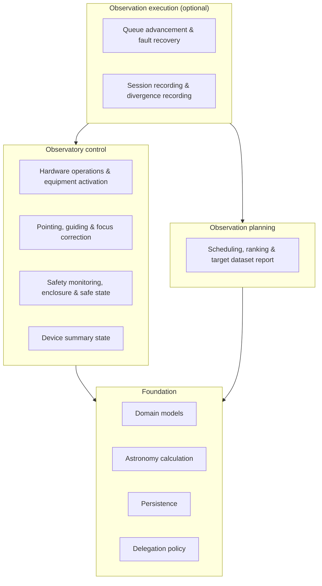
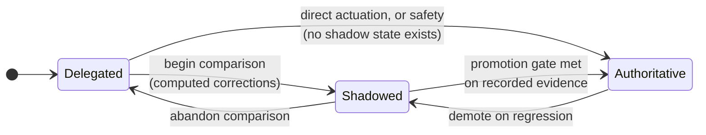

# Wayfinding library architecture

*Version 3.2 · 2026-10-24 · Status: current*

## Abstract

Amateur and small observatories run their nights with software that mixes three jobs: choosing what to image, operating the equipment, and carrying the plan out. This paper describes the architecture of the Wayfinding library, which runs a single-observer observatory. The library splits the work into three functions over one shared foundation. Observation planning builds reusable imaging requests and places them in a night. Observatory control operates the telescope, camera, enclosure and mount, and protects them. Observation execution carries a planned night out and records what happened next to what was intended. Planning and control never depend on each other, and execution is optional. A per-capability delegation model lets this system take over each job from the third-party software now in charge, one job at a time, on recorded evidence. This paper explains the theory behind each part. It names no code and states no tuned values; the companion implementation paper does both.

Terms are defined in the [glossary](../Glossary.md). This document also defines each term the first time it appears.

## 1. Introduction

**Statement of need.** An observing night has three separable jobs: deciding what to image and in what order, operating the equipment, and carrying out the plan while conditions change. Today one program, such as KStars with its Ekos module [1], usually does all three, and a separate program such as PHD2 [2] guides the telescope. These programs assume an operator at the telescope. An observatory that runs on its own must also protect itself when no plan is running, say why a target did not fit in the night, and show on real nights that a replacement for the current software acts the same way before it is trusted to act alone.

**Approach.** This architecture separates the three jobs so each can be built, used and checked alone. Planning and control are peers: an operator can plan a night without commanding any hardware, and the observatory can protect itself with no plan in existence. Execution sits above both.

**Scope.** This paper explains what each part does and why, and the idea behind each setting, not its value. The [Wayfinding library implementation](./Wayfinding_Library_Implementation.md) paper names the code and lists the settings. The evidence for each setting is in the validation register, not here.

### 1.1 Related work

**Observatory control software.** KStars with Ekos [1] is an open-source suite that plans, aligns, focuses, guides and captures. This library is designed to replace it in stages. PHD2 [2] is an autoguiding program. INDI [3] is a protocol that lets one program command many kinds of astronomy hardware through drivers. ASCOM Alpaca [4] defines one network interface for each type of device. The library speaks INDI today and follows the Alpaca shape (Section 6.2).

**Facility control systems.** The Vera C. Rubin Observatory control system [5] gives every component one lifecycle state, separates a scheduler from a queue of work, and treats safety as a layer around operation. Its scheduler [6] scores candidates and picks greedily. This library adopts the state vocabulary and the layered view of safety, and diverges on scale, scope and scheduling timing (Section 2.2).

**What the library adds.** Four things are new: a delegation model that moves each job to this system on recorded evidence; a record of every disagreement between the two systems; a closed set of named reasons that a target could not be placed; and limits for judging a night that follow the equipment in use.

## 2. System architecture

### 2.1 Three functions and one foundation

The library is organized as three functions over one foundation, shown in Figure 1.

**Figure 1.** The three-function architecture. Safety sits in control, not execution, because it must work whether or not a session is running.

Five rules govern the architecture.

1. **Foundation independence.** Domain models and astronomy calculation depend on nothing above themselves.
2. **Control and planning peerage.** Control and planning never depend on one another. Either can be used with the other absent.
3. **Execution is optional.** Execution may depend on control, planning and the foundation. Nothing else depends on it, so a system built without it is a complete planning-and-control system.
4. **One litmus test per boundary.** A capability belongs to the science-side image processing library (see the [Astrometrics library architecture](./Astrometrics_Library_Architecture.md)) if a scientist could use it with archived data and no telescope. Otherwise it belongs here.
5. **Delegation is a per-capability state, not an architecture boundary.** Which system performs a hardware-facing capability is a setting read at run time (Section 2.3).

<!-- impl: wayfindinglib.Wayfinder -->
<!-- impl: wayfindinglib.api.control.control.ObservatoryControl -->
<!-- impl: wayfindinglib.api.planning.ObservationPlanning -->
<!-- impl: wayfindinglib.api.execution.ObservationExecution -->

### 2.2 Precedent and deliberate divergence

The decomposition follows the Rubin control system, which separates three concerns that are easily confused [5].

- **Component lifecycle.** Rubin runs every component through one summary-state machine with five states. This architecture adopts them (Section 6.3), so any device answers the same question in the same words.
- **Work-item lifecycle.** Rubin separates a scheduler, which decides what to observe, from a script queue, which runs the work. A queue entry has its own progression, distinct from component state. Planning and execution here have the same shape (Section 5.3).
- **Safety as a layer, not a step.** Rubin treats monitoring and interlocks as constraints on operation from outside it. Here, safety lives in control, works with or without a session, and is exempt from the shadow requirement (Section 2.3).

Three divergences are deliberate. Rubin splits its hardware into many components, each owned by its own team. Control here is one function that reports a summary state for each device. Rubin's control system includes the scheduler and script queue. Control here excludes both, so it works with no plan in existence. Rubin re-scores candidates continuously during the night. This architecture resolves a queue before the night (Section 4.2).

### 2.3 Capability delegation

Every hardware-facing job this system is meant to perform is performed today by the current third-party software, called the *incumbent*. Each job gets a *delegation state* with one of three values.

- **Delegated.** The incumbent performs the capability. This system only reads what the incumbent publishes.
- **Shadowed.** The incumbent still performs the capability and stays the only source of hardware commands. This system computes what it would have done and records every disagreement (Section 5.4). Nothing it computes reaches hardware.
- **Authoritative.** This system performs the capability and the incumbent is disengaged from it.

Six capabilities carry a state, matching the modules of the software being replaced: mount control, plate-solve alignment (finding where an image points by matching its stars to a catalog), autoguiding, autofocus, capture orchestration and observatory safety. Each advances alone, so the observatory works at every intermediate setting. Figure 2 shows the allowed moves.

**Figure 2.** Delegation state moves for one capability. Safety has no shadow state, so it takes the direct edge.

Four rules govern how a capability moves.

- **Computed corrections pass through shadow.** A capability that computes a *correction* (a pointing adjustment, a guiding pulse or a focus position) may become authoritative only from the shadowed state, on recorded evidence from real nights. A capability that only carries out an explicit operator command, such as a slew to stated coordinates, has nothing to compare and is exempt.
- **Safety is never shadowed.** Safety may be only delegated or authoritative. A shadowed safety system would compute that it should close the enclosure while the enclosure stays open: it would see a hazard and do nothing. Safety is promoted on component-level evidence that each protective action works when commanded.
- **Capture waits for the corrections.** Capture may leave the delegated state only when alignment, guiding and focus are all authoritative. Otherwise a failure would have several possible causes and no way to separate them.
- **Calibration comes first.** Autoguiding needs a guider calibration, and autofocus needs a focus model, or there is no mapping from a measurement to a command.

A fifth rule, *single command authority*, applies to every device: at most one system holds actuation authority at a time. The shadowed state is safe because it is defined to issue nothing.

The policy checks these rules when a state changes, comparing the prior state with the requested one. Every hardware command also refuses to run unless its capability is authoritative. Reads need no such check.

<!-- impl: wayfindinglib.models.policy.delegation.ObservatoryCapability -->
<!-- impl: wayfindinglib.models.policy.delegation.DelegationState -->
<!-- impl: wayfindinglib.models.policy.delegation.DelegationPolicy -->
<!-- impl: wayfindinglib.data_access.delegation_policy_reader.validate_delegation_policy -->
<!-- impl: wayfindinglib.data_access.delegation_policy_reader.promote_capability -->
<!-- impl: wayfindinglib.tasks.control_tasks.hardware_operations._require_authoritative -->

### 2.4 Delegation phases

Table 1 names the six phases this architecture targets. Each is a working setting with its own promotion gate (Section 7.2). At Phase 5 the incumbent is uninstalled, not merely idle.

**Table 1.** Delegation phases. D means delegated, S shadowed and A authoritative.

| Phase | Mount | Align | Guide | Focus | Capture | Safety | What this phase establishes |
| --- | --- | --- | --- | --- | --- | --- | --- |
| 0 Observed baseline | D | D | D | D | D | D | The incumbent runs the night. This system records and plans. |
| 1 Direct control | A | D | D | D | D | D | The mount is commanded through this system, inside its configured pointing envelope. |
| 2 Shadowed correction | A | S | S | S | D | D | The three corrections are computed on every real night and compared with the incumbent's. |
| 3 Assumed correction | A | A | A | A | D | D | The corrections run on this system's algorithms. The incumbent still sequences the night. |
| 4 Full authority | A | A | A | A | A | D | This system runs planned sessions end to end, including flips and camera cooling. |
| 5 Unattended | A | A | A | A | A | A | This system protects the observatory. The incumbent is removed. |

Safety comes last because comparison cannot validate it. Until Phase 5 an operator is present and the incumbent keeps the duty of protection.

### 2.5 Domain state and operations

State is either configured (equipment, site, enclosure, calibrations and policies, which a running session never writes), computed on demand and never stored (the performance envelope and the advisories), or recorded as a session or as append-only evidence (Sections 3.3, 5.4 and 6.8). Commissioning runs are drills whose gate evidence arises outside any night.

Table 2 lists each core operation, its owner and the delegation state that gates it.

**Table 2.** Core operations and their delegation gate.

| Operation | Function | Gated by |
| --- | --- | --- |
| Mount slew, park, tracking | Control | Mount control |
| Mount sync | Control | Plate-solve alignment |
| Filter change and capture | Control | Capture orchestration |
| Focuser move | Control | Autofocus |
| Guide pulse and exposure | Control | Autoguiding |
| Enclosure open and close | Control | Observatory safety |
| Correction computation (pointing, guiding, focus) | Control | None (pure computation) |
| Camera cooling arithmetic | Control | None (pure computation) |
| Safe-state sequencing | Control | Steps supplied by the caller |
| Queue advancement | Execution | Each action's own capability |
| Meridian flip, fault recovery | Execution | Steps supplied by the caller |
| Divergence recording | Execution | Active while a capability is shadowed |

<!-- impl: wayfindinglib.models.equipment_and_site.equipment.Telescope -->
<!-- impl: wayfindinglib.models.equipment_and_site.equipment.EquipmentCatalog -->
<!-- impl: wayfindinglib.models.session.observation_session.ObservationSession -->
<!-- impl: wayfindinglib.models.policy.commissioning.CommissioningRun -->

## 3. Foundation: equipment, site and session domain

### 3.1 Purpose and interfaces

- **Inputs:** operator-configured equipment, enclosure and site specifications; the guider calibration and focus model; the calibration inventory; the delegation, safety and recovery policies; and the accumulating record of one night.
- **Outputs:** the shared vocabulary that every function above the foundation uses.

### 3.2 Theoretical rationale

A telescope's optics and its mount's safe pointing envelope are set and changed together, so they form one telescope specification, held with the camera specifications in an equipment catalog. Reading the catalog is a foundation task because both peer functions need the active entries. Changing the active entry is an operator action on hardware, so it belongs to control.

The pixel scale $\rho$, in arcseconds of sky per pixel, follows from the pixel pitch $\ell$ in micrometers and the focal length $F$ in millimeters:

$$
\rho = 206.265\,\frac{\ell}{F}
\tag{1}
$$

The field of view follows from the pixel scale and the sensor size. A guide telescope has its own focal length, which sets its camera's pixel scale.

<!-- impl: wayfindinglib.models.equipment_and_site.equipment.EquipmentConfiguration -->
<!-- impl: wayfindinglib.models.equipment_and_site.equipment.GuideScope -->

The enclosure is specified beside the equipment because its constraint is mutual: a roof can close only when the mount clears it, and the mount can leave park only when the roof is open. The permitted closing position is configuration, a park position with a tolerance, so the interlock can be checked without commanding anything.

<!-- impl: wayfindinglib.models.equipment_and_site.enclosure.Enclosure -->

Site obstructions belong to the location. They attach to the site profile as an azimuth range with its own raised altitude floor. The site profile is also the one source of observer position for planning and live-status tools (Section 8 states one exception in control).

<!-- impl: wayfindinglib.models.equipment_and_site.site_profile.SiteProfile -->
<!-- impl: wayfindinglib.models.equipment_and_site.site_profile.AvoidanceZone -->
<!-- impl: wayfindinglib.data_access.site_profile_reader.resolve_site_location -->

Guider calibration, the focus model, and the delegation, safety and recovery policies are foundation state: every function reads them and none writes them during operation. Guider calibration and the focus model are the preconditions for their capabilities to be computed instead of merely observed.

<!-- impl: wayfindinglib.models.equipment_and_site.guider_calibration.GuiderCalibration -->
<!-- impl: wayfindinglib.models.equipment_and_site.focus_model.FocusModel -->

<!-- impl: wayfindinglib.models.policy.safety.SafetyRuleSet -->
<!-- impl: wayfindinglib.models.policy.recovery.RecoveryPolicy -->
<!-- impl: wayfindinglib.models.session.correction_config.CorrectionConfig -->

<!-- impl: wayfindinglib.models.equipment_and_site.calibration.CalibrationStats -->

The observation session is the one object with shared ownership. Planning writes its queue, and execution, when present, fills in what happened. A session written by planning alone is already a complete, reviewable plan. It records which telescope, camera and site it was planned against.

### 3.3 Design invariants

- **Configuration, not telemetry.** A running session never writes equipment, enclosure, site, calibration or policy records.
- **One source of site position for planning.** Planning and the live-status tools read the site's position from the site settings, never from a device.
- **Session field ownership.** Only planning writes the queue and its placement diagnostics. Only execution writes statuses, outcomes, divergence and fault records, and telemetry. Execution saves its copy of the session by merging, not by overwriting. At each save it reads the stored session again, in the same database transaction as the write, and keeps what Planning wrote: the checklist, the framing, the revision, and any queue entry added, removed, reordered or edited since Execution loaded the session. Execution's own fields (statuses, outcomes, telemetry, divergence and fault records) come from its copy. An entry Planning removed stays if Execution has already started it. Execution never changes the revision.
- **Template and instance separation.** A package is a reusable template. A queue entry is a frozen copy with every value needed to run it, so editing the template cannot change what a session recorded.
- **Live target resolution.** A package names its target by identifier only. The position is read when the package is placed.
- **Reference-only science link.** A session refers to its science-side target session by identifier only. The reference may be empty and is attached after the fact.

## 4. Observation planning

### 4.1 Purpose and interfaces

- **Inputs:** observation packages to attempt, a site profile, the active telescope specification, a target night, and optionally advice from the science-side archive.
- **Outputs:** an observation session's queue, ordered and placed in time, with a specific diagnostic for every package that could not be placed.

### 4.2 Theoretical rationale

A package asks for whichever frames an operator wants for a target: light, dark, flat or bias, each with its own pacing, plus a dithering cadence. Dithering is a small deliberate pointing shift between exposures that spreads fixed sensor defects across the sky. Calibration requests are ordinary entries in the same list.

<!-- impl: wayfindinglib.models.planning.observation_package.ObservationPackage -->
<!-- impl: wayfindinglib.models.planning.observation_package.ExposureRequest -->

A multi-panel request is a package *generator*, not a package field. A mosaic is a grid of overlapping panels that cover a region too large for one field of view. Neighboring panels are one field apart, less an overlap. Along right ascension the step is divided by the cosine of the declination, because lines of equal right ascension draw together toward the poles. Each generated package is placed like any other.

<!-- impl: wayfindinglib.tasks.planning_tasks.mosaic_tasks.calculate_panels -->
<!-- impl: wayfindinglib.tasks.planning_tasks.mosaic_tasks.create_mosaic -->

Placing several packages in one night is a constrained scheduling problem. Each package has a visibility window shaped by the site's obstructions, the telescope's altitude range and its own altitude floor, and all compete for the same night. The architecture uses one stated rule: place whichever remaining package can start soonest, and break ties by priority. One justified rule is better than an under-validated tuned system when no past scheduling outcomes exist to check one against.

Placement checks visibility at sampled instants against the altitude floor, the telescope's upper altitude limit and the site's obstructions. The hour-angle bound and meridian flip are not placement constraints.

<!-- impl: wayfindinglib.tasks.planning_tasks.scheduling.place -->
<!-- impl: wayfindinglib.tasks.planning_tasks.visibility_tasks.visibility_state_at -->
<!-- impl: wayfindinglib.tasks.planning_tasks.visibility_tasks.effective_altitude_floor -->

The Rubin scheduler also selects greedily, but it re-scores candidates continuously against live conditions [6]. This architecture resolves the whole queue before the night, and execution advances it as written. A late-rising target or an hour lost to cloud does not cause re-placement. A fixed queue can be reviewed in advance, repeated and diagnosed, but this is also a real limitation (Section 8).

A package may start soonest or at a fixed clock time. Fixed-time requests are placed first, as anchors the others route around. Two overlapping fixed-time requests are both reported and neither is placed.

A silent drop is not useful, so the operator is told *why* a package did not fit. Each outcome is one of a closed set of named reasons, on a channel separate from the queue: the target never clears the altitude floor; it clears the floor only inside a site obstruction; a clear window exists but is too short; a long enough window existed but earlier placements used it; or a fixed-time request cannot be met. Rubin instead gives an impossible candidate a score of negative infinity [6]. That suits a scheduler whose decisions no person reads one by one, but it loses the difference between "impossible" and "outscored", which an operator planning one night needs.

<!-- impl: wayfindinglib.models.session.observation_session.InfeasibilityReasonCode -->
<!-- impl: wayfindinglib.models.session.observation_session.InfeasibilityReason -->

Archive-derived advice informs authoring and placement without dictating them. An operator may opt a package in to a bounded priority boost drawn from the target dataset report. The boost only raises priority, when the report has one or more warnings that need attention or a notable science outcome (a confirmed asteroid candidate or a variable star candidate). It changes the order only when two packages could start together, because priority is the tie-breaker. The amount is recorded on the queue entry. The calibration advisory shows what the inventory already holds and never changes placement.

<!-- impl: wayfindinglib.models.planning.target_report.TargetDatasetReport -->
<!-- impl: wayfindinglib.models.equipment_and_site.calibration.CalibrationAdvisory -->
<!-- impl: wayfindinglib.tasks.planning_tasks.target_report_tasks.build_target_dataset_report -->
<!-- impl: wayfindinglib.tasks.planning_tasks.calibration_advisory_tasks.build_calibration_advisory -->

An operator may also build or edit a queue by hand. Both paths write the same structure. Planning also answers visibility questions that place nothing.

<!-- impl: wayfindinglib.tasks.planning_tasks.visibility_report.build_visibility_report -->
<!-- impl: wayfindinglib.models.planning.visibility.VisibilityReport -->

### 4.3 Placement sequence

Table 3 lists the steps of automatic package placement.

**Table 3.** Observation planning sequence.

| Step | Phase | Description |
| --- | --- | --- |
| 1 | Night-window resolution | Bracket the usable night by sampling the solar altitude across a day. This is coarse sampling, not an exact rise and set calculation. |
| 2 | Disposition split | Separate fixed-time from soonest-available packages. |
| 3 | Fixed-time placement | Check that the target stays visible for the whole span, and place it. Overlapping requests are each diagnosed. |
| 4 | Advisory-informed priority | Work out each bounded boost and record it. |
| 5 | Greedy placement | Repeatedly place the package whose earliest free visible start is soonest. |
| 6 | Infeasibility diagnosis | Tell physically impossible placements from those crowded out by earlier choices. |
| 7 | Session assembly | Build the session with its placement context. |

<!-- impl: wayfindinglib.tasks.planning_tasks.night_window.resolve_night_window -->
<!-- impl: wayfindinglib.tasks.planning_tasks.scheduling.schedule_session -->

### 4.4 Design invariants

- **Diagnosable infeasibility.** Every unplaced package carries a reason from a closed, named set.
- **Advisory, not authority.** Archive-derived information never dictates package contents or placement. Any boost applied is recorded on the queue entry.
- **Planning is hardware-free.** Placement reads equipment and site specifications as data and never contacts a device, so a night can be planned with nothing connected.

## 5. Observation execution

### 5.1 Purpose and interfaces

- **Inputs:** an observation session, observatory control, the delegation and recovery policies, and, while a session runs, guiding events, device summary state and the current safety assessment.
- **Outputs:** a session record advanced one entry at a time, with outcomes, telemetry, divergence records and fault records.

### 5.2 Theoretical rationale

Carrying out a session is a queue-advancement problem. Entries move through one status progression: pending, running, and then completed, failed or skipped. The session itself is planned, running, suspended, completed or aborted. Execution may depend on the other two functions, because advancing a queue and driving hardware are inseparable once the night is running.

Execution builds the same list of candidate actions for an entry in every phase, and the delegation policy decides what happens to each. An authoritative capability issues the action through control. A shadowed one computes its intent, compares it with what the incumbent did and records the result. A delegated one issues nothing. Moving between phases is a settings change, not a rewrite, and what is measured in the shadowed state is what will run after promotion.

**Unattended operation changes what a failure means.** With an operator present, a fault can stop and wait. When unattended, stopping is itself a decision: a mount left tracking into its pier, or an open enclosure under advancing rain, is worse than a lost night. Execution therefore treats a fault as the start of a bounded recovery attempt (Section 5.6). Exhausting the bound escalates to the safe-state sequence that control owns (Section 6.6). An unbounded retry cannot be told from a hang.

<!-- impl: wayfindinglib.models.session.observation_session.SessionStatus -->
<!-- impl: wayfindinglib.models.session.observation_session.QueueEntryStatus -->
<!-- impl: wayfindinglib.tasks.execution_tasks.session_runner.dispose_action -->

### 5.3 Queue advancement

Table 4 lists one queue-advancement cycle. A cycle advances at most one entry. A runner repeats it until the queue is empty, the session ends or is suspended, or the caller asks it to stop.

**Table 4.** Queue advancement sequence.

| Step | Phase | Description |
| --- | --- | --- |
| 1 | Safety gate | Read the safety assessment. Only a safe verdict permits observing. Any other verdict suspends the session. |
| 2 | Entry selection | Pick the first pending entry whose start time has arrived. |
| 3 | Readiness check | Confirm that no device the entry needs is in the fault state. |
| 4 | Meridian check | If the entry crosses the flip threshold, run the flip sequence (Section 5.5). A flip that does not resume fails the entry. |
| 5 | Disposition | Consult the delegation policy for each action: issue, compare and record, or do nothing. |
| 6 | Outcome capture | Record what happened beside what was planned. |
| 7 | Status transition | Move the entry to its new status. Close the session when all have finished. |
| 8 | Checkpoint | Save the session, so data loss is bounded to one cycle. |

Aborting a session skips every pending entry and records the reason on each, so a night ended by conditions is a closed record that carries its reason.

<!-- impl: wayfindinglib.tasks.execution_tasks.session_runner.advance_session -->
<!-- impl: wayfindinglib.tasks.execution_tasks.session_runner.abort_session -->
<!-- impl: wayfindinglib.tasks.execution_tasks.queue_runner.run_queue -->

### 5.4 Divergence recording

Divergence records are the evidence on which promotion gates are decided. They are durable, per-capability evidence and not diagnostic logging.

Whenever a capability is shadowed, each action this system computes is paired with the action the incumbent took. The record carries the capability, the moment, both actions, the signed difference (computed minus observed) in the capability's natural unit, the tolerance, and whether the difference fell within it. The sign separates a steady bias from random noise. Records are written whether or not the two agreed, because a rate cannot be computed from disagreements alone. For $n$ comparisons of which $n_{\text{in}}$ fall within tolerance, the agreement rate is

$$
R = \frac{n_{\text{in}}}{n}
\tag{2}
$$

and a rate computed from no comparisons is reported as zero, never as perfect agreement.

Three capabilities are compared. Alignment is compared by pointing correction, in arcseconds. Guiding is compared by the signed pulse on each axis for the same drift, in milliseconds. Autofocus is compared by focuser position, in focuser steps. Mount control and capture carry out an explicit intent with nothing to compare, and safety has no shadowed state, so they produce no records.

Both systems must respond to the *same* measurement, so a record names the shared input. It does not pair actions by timestamp proximity, which could pair unrelated corrections.

<!-- impl: wayfindinglib.tasks.execution_tasks.divergence_recording.record_divergence -->
<!-- impl: wayfindinglib.models.session.divergence.DivergenceRecord -->
<!-- impl: wayfindinglib.tasks.control_tasks.capability_promotion.summarize_divergence_evidence -->
<!-- impl: wayfindinglib.tasks.control_tasks.capability_promotion.DivergenceEvidenceSummary -->

### 5.5 Meridian flip sequencing

A German equatorial mount must turn over when a tracked target crosses the local meridian, the line in the sky from north to south through the zenith. The turn-over interrupts exposures and invalidates both the pointing solution and the guide star. From Phase 4 it is this system's job, and it is the most failure-prone moment of the night.

A flip is a bounded, ordered interruption: end the exposure, stop guiding, turn the mount over, re-establish pointing by repeated plate solves, re-acquire a guide star, and resume. The first failing step stops the sequence and records its reason. The two repeating steps each have an attempt bound, and exhausting either is a fault, not a retry loop. A night that cannot re-acquire must end safely, not keep trying while the target sets.

The flip threshold is a property of the telescope, stored once as an hour angle past transit. The delay in minutes follows at the sidereal rate of 15° of hour angle per hour:

$$
t_{\text{flip}} = 60\,\frac{H_{\text{flip}}}{15}
\tag{3}
$$

Control and planning read this one threshold, so they cannot disagree.

<!-- impl: wayfindinglib.tasks.execution_tasks.meridian_flip.execute_meridian_flip -->
<!-- impl: wayfindinglib.models.session.meridian_flip.MeridianFlipOutcome -->
<!-- impl: wayfindinglib.data_access.equipment_catalog_reader.get_meridian_flip_delay_min -->

A lost guide star outside a flip follows the same bounded pattern.

<!-- impl: wayfindinglib.tasks.execution_tasks.guide_star_loss_recovery.attempt_guide_star_recovery -->

### 5.6 Fault recovery

A device that reports the fault state during unattended operation starts a recovery attempt. The device is returned to standby, enabled again, and its state is read back. Recovery succeeds only if the device reports enabled. The attempts are bounded, and the wait before each one after the first grows by a fixed factor. For attempt $j$, with first wait $t_1$ and growth factor $m$:

$$
t_j =
\begin{cases}
0 & j = 1 \\
t_1\, m^{\,j-2} & j \ge 2
\end{cases}
\tag{4}
$$

Each attempt is recorded on a fault record with its outcome.

Recovery is deliberately shallow. It re-establishes a device's lifecycle state and nothing more, because a system that cannot see the observatory cannot tell a passing driver disconnection from a mechanical obstruction. Treating the second as the first damages equipment. Exhausting the bound escalates to the safe state, not to a deeper recovery.

<!-- impl: wayfindinglib.tasks.execution_tasks.fault_recovery.recover_fault -->
<!-- impl: wayfindinglib.models.policy.recovery.FaultRecord -->

### 5.7 Telemetry recording and post-session reconciliation

A recorder attaches to a session that planning created. At a fixed interval it collects guiding samples and takes a best-effort weather snapshot, then saves the session, so a failure loses at most one interval. It only listens and never commands the guider or the mount. A missing weather reading is stored as absent. This tolerance is separate from the safety assessment (Section 6.5), which must not be best-effort.

<!-- impl: wayfindinglib.tasks.execution_tasks.session_recorder.ObservationSessionRecorder -->

When a session reaches a terminal status, execution runs two reconciliations that deliberately do not happen mid-run. Captured calibration frames are folded into the calibration inventory, which is recomputed from every finished session each time, so running the step twice never counts a frame twice. The session's science-side link is attached by finding the science-side target sessions of each imaged target for the same night, which is possible only after the night.

<!-- impl: wayfindinglib.tasks.execution_tasks.post_session_reconciliation.reconcile_session -->
<!-- impl: wayfindinglib.tasks.execution_tasks.post_session_reconciliation.compute_calibration_stats -->

Two related refits run inside control, not execution: the standing mount-mechanical model and the session's pointing model (Section 6.7).

### 5.8 Design invariants

- **Execution depends downward only.** Neither control nor planning may depend on execution.
- **One construction path for every phase.** Candidate actions are built the same way in all delegation states. Only the disposition differs.
- **Shadow issues nothing.** A shadowed capability produces divergence records and no hardware commands.
- **Evidence is symmetric.** Records are written for agreeing and disagreeing comparisons, because a promotion gate is a rate and not a count.
- **Recovery is bounded.** Every recovery sequence has an attempt count and a wait, and exhaustion escalates to the safe state.

## 6. Observatory control

### 6.1 Purpose and interfaces

- **Inputs:** direct commands, status queries, environmental readings, and the measurements from which corrections are computed.
- **Outputs:** hardware state changes, device summary state, enclosure state, the safety assessment, and computed corrections.

Control groups its operations by topic: mount, imaging, guiding, remote file transfer, session history, safety and equipment. Every hardware step of the application goes through this one front door, so all of them pass the same authority checks and drivers. A guiding driver is chosen for each telescope: PHD2, the guider inside KStars and Ekos, or a simulator.

<!-- impl: wayfindinglib.api.control.mount.MountControl -->
<!-- impl: wayfindinglib.api.control.imaging.ImagingControl -->
<!-- impl: wayfindinglib.api.control.guiding.GuidingControl -->
<!-- impl: wayfindinglib.api.control.remote.RemoteControl -->
<!-- impl: wayfindinglib.api.control.history.HistoryControl -->
<!-- impl: wayfindinglib.api.control.safety.SafetyControl -->
<!-- impl: wayfindinglib.api.control.equipment.EquipmentControl -->

### 6.2 Hardware protocol abstraction

Every command reaches one physical device over one wire protocol, and the protocol must be a per-device setting. INDI is available today. A second telescope could use ASCOM Alpaca, with no change to control's own logic. The architecture follows Alpaca here: **one interface for each device type, not one for each protocol.** Separate interfaces exist for the mount, camera, focuser, filter wheel, enclosure, switch bank and weather source. Each defines the operations its device type supports, such as slew and park for a mount, independent of how they reach the device. Control builds one instance of each for the active equipment, using the protocol named in the equipment catalog, and never branches on protocol. INDI is the first implementation of every interface.

Guiding has its own interface, because the guider is chosen for each telescope and is not always a device on the same server. A simulator guider can also run this system's own guide loop, in which every pulse still passes the delegation check. File retrieval is a separate pluggable abstraction with no device state, so no hardware protocol is forced to solve file transfer.

<!-- impl: wayfindinglib.drivers.interfaces.base_protocol_driver.ProtocolDriver -->
<!-- impl: wayfindinglib.drivers.interfaces.mount_driver.MountDriver -->
<!-- impl: wayfindinglib.drivers.interfaces.camera_driver.CameraDriver -->
<!-- impl: wayfindinglib.drivers.interfaces.focuser_driver.FocuserDriver -->
<!-- impl: wayfindinglib.drivers.interfaces.filter_wheel_driver.FilterWheelDriver -->
<!-- impl: wayfindinglib.drivers.interfaces.enclosure_driver.EnclosureDriver -->
<!-- impl: wayfindinglib.drivers.interfaces.switch_driver.SwitchDriver -->
<!-- impl: wayfindinglib.drivers.interfaces.weather_driver.WeatherDriver -->
<!-- impl: wayfindinglib.drivers.interfaces.guiding_driver.GuidingDriver -->
<!-- impl: wayfindinglib.drivers.interfaces.remote_transfer_driver.RemoteTransferDriver -->

### 6.3 Device state and direct operation

Direct hardware operation is useful alone: an operator jogging or parking the mount needs no plan, so control has no dependency on planning. The observatory must also protect itself when nothing is running, which is possible only if protection lives in a function that needs no plan.

Every device exposes its lifecycle in the five-state vocabulary adopted from Rubin [5]. A device not present on the server is *offline*. One present but not connected is in *standby*. One connected with commands withheld is *disabled*. One connected and commandable is *enabled*. One that reports an alert, or whose command failed in a way that needs attention, is in *fault*. A caller can reason about readiness without knowing the device type. The fault state gives execution something to recover from and shows an operator that a device reported a failure.

The library maps raw device signals to a state but does not yet gather the signals for every device role (Section 8).

<!-- impl: wayfindinglib.models.policy.device_state.DeviceSummaryState -->
<!-- impl: wayfindinglib.tasks.control_tasks.device_state_tasks.classify_device_state -->

### 6.4 Correction computation

Pointing, guiding and focus corrections are computed here, not in the science library. Solving a field's position, measuring a star's centroid and measuring a star's size can be done with archived data and no telescope, so they belong to the science library. Turning a solved position into a mount correction, a drift into a mount pulse, and a size curve into a focuser position needs the mount's orientation, the guider's calibration, or the focuser's backlash and thermal behavior. Control takes the science library's measurements and computes only the telescope-dependent remainder.

Each correction is a pure function of its inputs. Issuing it is a separate, delegation-gated step, so one computation serves both the shadowed and the authoritative states.

**Pointing.** After a plate solve, the pointing error is the angular separation $\theta$ between the commanded and the solved position. The correction is the signed offset in right ascension and declination from the solved position to the commanded one. Alignment has converged when $\theta$ is at or below a tolerance $\epsilon_{\text{align}}$. When a fitted model of the mount's systematic pointing error is supplied, control predicts the offset $(\Delta\alpha_{\text{model}}, \Delta\delta_{\text{model}})$ the model implies at the commanded position. It judges convergence on what the model does not explain:

$$
r = \sqrt{(\Delta\alpha - \Delta\alpha_{\text{model}})^2 + (\Delta\delta - \Delta\delta_{\text{model}})^2}, \qquad r \le \epsilon_{\text{align}}
\tag{5}
$$

An error the model fully explains is a known, steady bias, not a failure. A model with too little data is ignored.

**Guiding.** The guide-star drift is rotated onto the mount's axes by the calibrated camera angle and converted to arcseconds with the guider's pixel scale. For one axis with drift $d$ in arcseconds, guide rate $v$ in arcseconds per second, aggressiveness $g$ between zero and one, deadband $\epsilon_{\text{dead}}$ and longest pulse $p_{\max}$, the signed pulse duration in seconds is

$$
p =
\begin{cases}
0 & |d| < \epsilon_{\text{dead}} \\
\operatorname{sign}(d)\,\min\!\left(\dfrac{g\,|d|}{v},\; p_{\max}\right) & |d| \ge \epsilon_{\text{dead}}
\end{cases}
\tag{6}
$$

This is one control law. An optional feed-forward term uses the standing mount-mechanical model (Section 6.7). In right ascension, the dominant worm-gear harmonic is one sinusoid with peak-to-peak amplitude $A$ and period $P$, so the predicted error at time $t$ since guiding began is

$$
e(t) = \frac{A}{2}\,\sin\!\left(\frac{2\pi t}{P}\right)
\tag{7}
$$

A pulse that cancels $e(t)$ is computed by the same law and added to the reactive pulse. It is applied even inside the deadband, because the point is to correct before the error is seen. In declination, a reversal of direction adds a lead-in pulse as long as the learned backlash delay, which takes up the slack first. The sum on each axis is limited to the longest pulse.

**Focus.** Autofocus samples a curve of star width against focuser position. Every sample is approached from the same direction, because mixed directions fold backlash into the curve. The star widths $w_i$ at focuser positions $x_i$ are fitted by least squares with a parabola $\hat{w}(x) = a x^2 + b x + c$. At least three points are needed. The quality of the fit is

$$
Q = 1 - \frac{\sum_i \left(w_i - \hat{w}_i\right)^2}{\sum_i \left(w_i - \bar{w}\right)^2}
\tag{8}
$$

The fit is accepted when $a > 0$ and $Q$ is at or above a quality floor. The selected position is the vertex of the parabola:

$$
x^{*} = -\frac{b}{2a}
\tag{9}
$$

limited to the sampled range, so a poorly conditioned fit cannot command an extrapolated position. A rejected fit leaves the focuser where it started and reports no convergence.

<!-- impl: wayfindinglib.tasks.control_tasks.pointing_correction.compute_pointing_correction -->
<!-- impl: wayfindinglib.tasks.control_tasks.guiding_correction.compute_guiding_correction -->
<!-- impl: wayfindinglib.tasks.control_tasks.focus_correction.compute_focus_correction -->
<!-- impl: wayfindinglib.tasks.control_tasks.focus_correction.sample_focus_curve -->
<!-- impl: wayfindinglib.analytics.pointing_model.predict_pointing_error -->

Centering combines these pieces. A slew alone lands near the target because the mount's idea of where it points is off. Centering plate solves a short exposure and stops if the error is within tolerance. Otherwise it syncs the mount to the solved position and slews again.

<!-- impl: wayfindinglib.tasks.control_tasks.centering.center_on -->

### 6.5 Environmental safety

An unattended observatory must judge, continuously and alone, whether conditions let it stay open. Three properties of that judgment are architectural.

**Absence of information is not safety.** A safety assessment has four verdicts: safe, marginal, unsafe and unknown. A reading that is missing, older than its age bound, or unparseable gives unknown for the rules that name it, and so does a missing rule set. Only a safe verdict permits observing, so unknown is treated as unsafe. A silent sensor must produce closure. This reverses the tolerance in telemetry recording (Section 5.7): environment *telemetry* may be absent, but an environment *verdict* may not. When several rules apply, the most severe definite verdict wins.

**Reopening is not the inverse of closing.** Conditions that swing around a limit would, under a symmetric rule, make the enclosure cycle without end, which is mechanically damaging. Closure is therefore immediate on an unsafe verdict. Reopening requires every rule to have read safe continuously for a settling period.

**Safety authority is not observing authority.** The assessment constrains operation from outside it. That is why it lives in control and not in execution, and why it cannot be shadowed (Section 2.3). A session consults it. The absence of a session does not disable it.

Readings reach the monitor as a plain mapping of names to values and read times, so the rules can be tested with no hardware.

<!-- impl: wayfindinglib.tasks.control_tasks.safety_monitor.SafetyMonitor -->
<!-- impl: wayfindinglib.models.policy.safety.SafetyAssessment -->
<!-- impl: wayfindinglib.models.policy.safety.SafetyVerdict -->
<!-- impl: wayfindinglib.tasks.control_tasks.hardware_operations.refresh_safety_assessment -->

### 6.6 Enclosure and the safe state

The enclosure is mechanically coupled to the mount. A roof or dome may move only through positions that clear the telescope, and the telescope may leave park only when the enclosure is open. This mutual interlock is evaluated before either is commanded. An unknown enclosure state blocks mount motion like a closed one. An enclosure whose motion outlasts its timeout is reported as faulted.

Reaching a safe state is a defined, ordered sequence (Table 5). Every step is tried even if an earlier one failed, except that closing the enclosure is skipped, not forced, when the mount did not reach a clearing position. Each step records its outcome and the first failure is named, so a partly completed safe state is diagnosable.

**Table 5.** Safe-state sequence. It runs on an unsafe verdict, on recovery exhaustion, or on loss of the controlling process.

| Step | Action | Why this place in the order |
| --- | --- | --- |
| 1 | Abandon the current exposure | Frames are expendable. Waiting for one wastes time. |
| 2 | Stop guiding | Guiding must stop before the mount is commanded elsewhere. |
| 3 | Park the mount | The enclosure cannot close until the telescope clears it. |
| 4 | Close the enclosure | The protective action itself. |
| 5 | Warm the sensor toward ambient | Uncontrolled warming risks condensation on optics that closure has just sealed in. |
| 6 | Close the session with its reason | The night becomes a complete record that says why it ended. |

:::{warning}
Step 3 is the sequence's single point of failure. A mount that cannot park leaves an enclosure that cannot safely close, and no software can fix a mechanical obstruction. An unattended observatory needs a hardware interlock, independent of this system, that stops enclosure motion into an obstructed telescope. That interlock is outside this architecture's scope. The architecture is not safe to run unattended without it.
:::

**Loss of the controlling process** is the failure that a safe-state sequence inside that process cannot handle. A watchdog that shares the fate of what it watches gives no protection. The design uses a heartbeat file written by the running system and a watchdog in a separate process that shares no code path with it. A stopped heartbeat triggers the same sequence, and a missing or unreadable heartbeat counts as stale. Section 8 says what is not yet connected.

Closing the enclosure checks the mount's position against the configured clearance before it reaches the driver, and requires the safety capability to be authoritative.

<!-- impl: wayfindinglib.tasks.control_tasks.safe_state.execute -->
<!-- impl: wayfindinglib.tasks.control_tasks.safe_state.SafeStateSteps -->
<!-- impl: wayfindinglib.models.session.safe_state.SafeStateOutcome -->
<!-- impl: wayfindinglib.tasks.control_tasks.enclosure_control.can_close_enclosure -->
<!-- impl: wayfindinglib.tasks.control_tasks.enclosure_control.can_leave_park -->
<!-- impl: wayfindinglib.tasks.control_tasks.enclosure_control.check_motion_timeout -->
<!-- impl: wayfindinglib.tasks.control_tasks.hardware_operations.close_enclosure -->
<!-- impl: wayfindinglib.watchdog.heartbeat.heartbeat_is_stale -->
<!-- impl: wayfindinglib.watchdog.watchdog_process.check_and_escalate -->
<!-- impl: wayfindinglib.tasks.control_tasks.cooling_control.compute_ramped_setpoint -->

### 6.7 Mount-mechanical models and bulk delegation modes

The standing mount-mechanical model feeds a stored periodic-error and backlash model forward into the guiding correction (Equation (7)). The model comes from the guide error left after the guider's own corrections, so it is a cross-night fact about the mount. The analysis splits the guide samples into continuous stretches, analyzes each with its true time stamps using a Lomb-Scargle periodogram, and combines them. Peaks slower than any plausible gear period count as slow drift.

The pointing correction takes a session-scoped fitted model instead. The classic geometric pointing model splits plate-solve offsets across the sky into physical mount terms, such as index errors, polar axis misalignment, cone error and tube flexure. Evaluating the fit forward predicts the systematic error at a position (Equation (5)). The polar-misalignment terms describe tonight's setup, not the mount, so they are never fed forward to a later session.

Three routines build these models from deliberate runs: a guider calibration that sends a known pulse on each axis, a backlash calibration that reverses declination in small steps, and a polar-alignment assistant that fits tonight's model from the plate solves so far. The caller supplies each routine's hardware step.

<!-- impl: wayfindinglib.analytics.guiding_spectrum.analyze_guiding_telemetry -->
<!-- impl: wayfindinglib.analytics.pointing_model.fit_pointing_model -->
<!-- impl: wayfindinglib.tasks.control_tasks.calibration_routines.run_guider_calibration -->
<!-- impl: wayfindinglib.tasks.control_tasks.calibration_routines.run_backlash_calibration -->
<!-- impl: wayfindinglib.tasks.control_tasks.calibration_routines.run_polar_alignment_assist -->
<!-- impl: wayfindinglib.tasks.control_tasks.guiding_log_ingestion.ingest_guide_log_file -->
<!-- impl: wayfindinglib.tasks.control_tasks.pointing_log_ingestion -->

An operator often wants to move all six delegation states together. The bulk operation replays the single-capability path for each capability, in dependency order, and reports any capability that cannot legally reach the requested state. It never skips or forces one. Moving every capability toward delegated (*monitoring mode*) always succeeds. Moving toward authoritative (*controller mode*) succeeds only for capabilities already positioned for the jump: safety and mount control have no precondition, the three corrections must already be shadowed, and capture must wait until all three are authoritative. A bulk request from a fresh policy therefore usually returns a partial result, which the caller shows. A flag blind to which capability is commanded would be a second authority competing with the per-capability one.

<!-- impl: wayfindinglib.tasks.control_tasks.capability_promotion.set_all_capabilities -->
<!-- impl: wayfindinglib.tasks.control_tasks.capability_promotion.BulkDelegationOutcome -->

### 6.8 Incumbent session logs and equipment-derived limits

While the incumbent runs the night (Phase 0 of Table 1), it also records it: guiding error frame by frame, every exposure, every autofocus run and where the mount pointed. Control reads those records to judge its own performance. What counts as normal depends on the equipment in use, and that changes whenever a telescope, camera or guide telescope changes.

**Recording.** Four rules govern how logs become stored data.

- *Estimates are not measurements.* Every guiding sample names its origin. A sample rebuilt from the pulses the mount received is an estimate, because no camera measured it. Analysis reads measured samples only.
- *Units are converted, never guessed.* Control converts guide-camera pixels to arcseconds with the pixel scale in the same log section. A section with no known pixel scale yields no samples.
- *Reading is repeatable.* A night is named for the local date on which it began, and reading a log again replaces its earlier samples.

**Equipment identity comes from the data.** Each session is tied to the equipment it used, read from the session itself: the guide log states the focal length and pixel scale, and the frames name the imaging telescope and camera. A past session thus stays attached to its own equipment after a change. A part that cannot be determined stays unknown, and such a session is never pooled with a fully known one.

**The performance envelope.** The envelope holds every limit control needs to call something normal or abnormal. It is computed on request and never stored, so it cannot go stale. Its limits come in three kinds.

*Geometry and sensor.* Limits from dimensions, physics and the camera's stored profile: the pixel scales, the half-width of the guide camera's field (a larger offset is a different star), the sidereal rate as the ceiling on guide speed, and the saturation level.

*Physical budget.* How much guiding error or trailing the equipment's own images can absorb. Adding an independent blur of width $\beta$ to a star of width $W$ gives a width of $\sqrt{W^2 + \beta^2}$. Requiring this to stay within $(1 + \phi)\,W$ gives

$$
\beta \le W\sqrt{(1+\phi)^2 - 1}
\tag{10}
$$

A guiding error with standard deviation $s$ per axis blurs a star by $2\sqrt{2\ln 2}\,s$. The error limit is the budget divided by that factor, and the trailing limit is the budget itself:

$$
s_{\max} = \frac{\beta}{2\sqrt{2\ln 2}}
\tag{11}
$$

The star width $W$ is the median over the equipment's own frames, using only exposures long enough to span several guide cycles. The tolerance $\phi$ is the one policy choice: the largest accepted widening.

*Own baseline.* How low a guide-star signal, or how high a guiding error, is unusual for this equipment, from its earlier sessions. These quantities change by factors, so the median and spread are taken on logarithms. With $\tilde{y}$ the median of the logged values, $\hat{\sigma}$ their robust spread, and $k$ a multiplier, the limits are

$$
L_{\text{low}} = \exp\!\left(\tilde{y} - k\,\hat{\sigma}\right), \qquad L_{\text{high}} = \exp\!\left(\tilde{y} + k\,\hat{\sigma}\right)
\tag{12}
$$

A limit is not judged until enough sessions exist. For fractions that are zero on most good nights, such as the share of lost frames, a high percentile replaces the median and spread. A limit that cannot be worked out reports why and carries no value. It is never replaced by a default.

The envelope also carries a *tracking-risk map*. It scores each part of the sky, by hour angle and declination, from zero (safe) to one (likely to trail). Each score starts from a prior set by geometry alone, then moves toward what measured targets showed, by the scatter of their repeated plate solves.

:::{warning}
Two equipment setups must never share a baseline. Sessions are grouped by an equipment fingerprint made from the imaging telescope, imaging camera and guide optics. A change of equipment changes the fingerprint, and the new setup starts with an empty history.
:::

<!-- impl: wayfindinglib.analytics.performance_envelope.derive_performance_envelope -->
<!-- impl: wayfindinglib.analytics.performance_envelope.robust_median_and_spread -->
<!-- impl: wayfindinglib.models.equipment_and_site.performance_envelope.PerformanceEnvelope -->
<!-- impl: wayfindinglib.models.equipment_and_site.equipment_fingerprint.build_equipment_fingerprint -->
<!-- impl: wayfindinglib.tasks.control_tasks.ekos_log_ingestion -->
<!-- impl: wayfindinglib.drivers.phd2.guide_log_parser -->
<!-- impl: wayfindinglib.drivers.ekos.analyze_log_parser -->
<!-- impl: wayfindinglib.models.session.telemetry.GuidingSampleSource -->
<!-- impl: wayfindinglib.analytics.tracking_risk.build_tracking_risk_map -->
<!-- impl: wayfindinglib.drivers.control_record_store.ControlRecordStore -->

### 6.9 Session-quality analysis

The logs of Section 6.8 answer a practical question: did the night go well, and should anything change? Control answers it in the three stages the science-side pipelines use.

1. *Pre-processing* asks whether the data is good. It reports lost guide frames, a guide star too weak for its own history, jumps to the wrong star, an impossible measured mount speed, and guide optics that differ from the configuration. A night with a lost star says little about the mount, so these come first.
2. *Processing* measures the guiding error, what it does to the width of a star, and how far the guider moved the mount along declination. The error is a robust one, so a few excursions cannot distort it.
3. *Post-processing* turns the measurements into recommendations. Each names its evidence, the limit it was compared with, and a confidence. The confidence drops when the limits come from equipment that only partly matches the night's, or when the guide signal was poor.

The same stages judge a night of captured frames: what the incumbent says it finished against what reached the frame library; whether stars clipped at each exposure length, and how sharp and round they were; and a shorter exposure for a spectroscopy star that clips.

*How long an exposure can guiding hold?* For each exposure length in use, the analysis tries every start time during the night's guiding and asks whether an exposure started then would have had clean guiding for its whole length. The share of clean start times is the chance that such an exposure would have worked. It models the exposures and does not measure the frames.

*Where in the sky does it perform worse?* A cross-night analysis compares each part of the sky (altitude band, compass direction, side of the pier) with the rest of the same nights, which removes each night's seeing. Findings that recur are listed together, because one bad night can be weather and a repeat points at the equipment.

Four rules keep the analysis honest.

- **Verdicts about the data are reused.** Whether a star clips depends on the pixels alone, so the science side judges it when it stacks a target, and control quotes that verdict. Saturation advice covers spectroscopy only, since in a deep imaging field the brightest stars clip at any useful exposure.
- **A night is judged only against earlier nights.** Otherwise a bad night would raise its own limit. A night with too little earlier history gets its numbers but no verdict.
- **Limits follow the match.** A past night on the same guide optics but different imaging equipment is judged with lower confidence. A night on different guide optics is not judged.
- **Results are not stored.** A stored recommendation would be wrong as soon as the equipment, and so every limit, changed.

**No polar alignment estimate.** The incumbent does not keep its polar alignment result, and this architecture makes no estimate of it from guiding. A polar misalignment makes declination drift follow a fixed pattern in hour angle, and the net declination corrections recorded on real nights did not follow it. They are reported only as the distance the guider moved the mount.

<!-- impl: wayfindinglib.session_analysis.pipeline_base.SessionAnalysisPipeline -->
<!-- impl: wayfindinglib.session_analysis.guiding.pipeline.GuidingSessionPipeline -->
<!-- impl: wayfindinglib.session_analysis.capture.pipeline.CaptureSessionPipeline -->
<!-- impl: wayfindinglib.session_analysis.sky.pipeline.SkySessionPipeline -->
<!-- impl: wayfindinglib.session_analysis.recurring_issues.find_recurring_issues -->
<!-- impl: wayfindinglib.session_analysis.live_status.summarize_live_session -->
<!-- impl: wayfindinglib.session_analysis.guiding.processing.measure_exposure_feasibility -->
<!-- impl: wayfindinglib.analytics.guide_exposure_ladder.analyze_guide_exposure_ladder -->
<!-- impl: wayfindinglib.analytics.alignment_sessions.group_alignment_attempts -->

### 6.10 Design invariants

- **No upward dependency.** Control never depends on planning or execution.
- **One interface for each device type, not each protocol.** A second protocol needs no change above the driver layer.
- **Configured envelope respected.** A commanded slew is checked against the active telescope's configured altitude range and, where enabled, its hour-angle bound before it is issued.
- **Corrections are pure.** Correction computation is a pure function of its inputs. Issuing is a separate, delegation-gated step.
- **Unknown is unsafe.** A stale, unparseable or unavailable assessment is treated as unsafe.
- **Asymmetric enclosure hysteresis.** Closure is immediate. Reopening needs a settling period of safe readings.
- **Estimates are not measurements.** Analysis reads only samples measured from a real star.
- **Limits follow the equipment.** No limit is stored. Changing the equipment changes the limit.
- **Advice names its evidence and its class.** Every statement cites its measurements, and none advises new hardware (Section 6.11).

### 6.11 Judging quality and recommending the next observation

Planning and control share one way to judge stored measurements and to recommend the next observation. The science library measures and gives no advice. This library compares measurements with limits that follow the equipment, and it states each result with its evidence, its class of action and a confidence taken from the validation register. It never advises new hardware, and it stores no judgment. The theory is in the companion paper [Wayfinding quality judgment](./Wayfinding_Quality_Judgment.md).

## 7. Verification

Verification favors real transport and real persistence over mocks wherever practical, backed by a hardware simulator for end-to-end coverage.

### 7.1 Library-wide structural checks

Five checks apply across the whole library. A *static* check reads the import graph of the source without running it. A *runtime* check starts a fresh interpreter, runs the code, and lists the modules it loaded. Imports made only for type checking are ignored by both.

- **Layering conformance (static).** Contracts assert foundation independence, control and planning peerage, and execution's downward-only dependency.
- **Execution is optional (static and runtime).** Only the composition root, the entry point that builds all three functions, may import execution. A runtime test uses control and planning and asserts that no execution module was loaded.
- **Safety runs without execution (runtime).** A test runs the safety monitor, the enclosure interlock and the safe-state sequence and asserts that no execution module was loaded, since safety that needs a session is not safety.
- **Planning is hardware-free (static and runtime).** Planning may not reach any hardware driver, directly or through the foundation. A runtime test plans a night and asserts that no driver or control module was loaded.
- **Cross-library dependency (static).** The science library imports nothing from this one.

The [Wayfinding library implementation](./Wayfinding_Library_Implementation.md) paper names the files that hold each check.

<!-- impl: wayfindinglib.test.import_probe.wayfindinglib_modules_loaded_by -->

### 7.2 Delegation promotion gates

A phase of Table 1 is entered only when its gate is met. Table 6 states each gate in words, and the implementation paper gives the counts and rates. Every one is a conservative design estimate, because no past divergence measurements exist to derive one from. The library records the evidence a gate needs, which is divergence records and commissioning runs (drills whose evidence arises outside any night), but does not apply a gate. The operator reads the evidence and decides, and the policy then checks the rules of Section 2.3.

**Table 6.** Delegation phase promotion gates.

| Entering phase | Gate | Threshold origin |
| --- | --- | --- |
| 1 Direct control | Mount commands run through this system over several nights with the incumbent disengaged. The envelope check rejects an out-of-envelope command on real hardware. No unintended motion occurs. | Design estimate. |
| 2 Shadowed correction | A guider calibration and a focus model exist. All three corrections run on every real night with no commanded motion attributable to this system. | None. Shadowing issues nothing. |
| 3 Assumed correction | Alignment and guiding each reach a large number of paired comparisons, and focus a smaller number. The agreement rate is high for each. The mean signed difference is within half the tolerance, which rules out a steady bias. No sign or axis is inverted. | Design estimates. |
| 4 Full authority | With corrections authoritative, guiding RMS is not worse than the Phase 2 baseline by more than a small allowance. No guide-star loss goes unrecovered. Several meridian flips complete, spanning both pier sides. Cooling reaches its target every session. | Design estimates. |
| 5 Unattended | A hardware enclosure interlock independent of this system is installed and verified. The safety monitor gives correct verdicts for induced stale, absent and unsafe readings. The safe-state sequence is verified end to end from each trigger (an unsafe verdict, recovery exhaustion and watchdog expiry), including with the controlling process killed. Fault recovery is exercised against an induced fault. | Design estimates. The interlock is a categorical precondition. |

The Phase 4 guiding baseline can be measured only during the shadow phases. The no-issue behavior of shadowing must be shown against a stand-in control layer before any shadow drill runs on hardware.

## 8. Limitations and assumptions

Several parts of the architecture are units that take their hardware steps from the caller, and the code that wires them to hardware is not all present.

- **Static placement.** Placement is resolved before the night and not repeated. The greedy rule is not guaranteed to give the best arrangement.
- **Placement constraints.** Placement does not apply the hour-angle bound or plan around a flip. The night window comes from coarse sampling of the solar altitude.
- **Imaging queue wiring.** The queue the application runs wires only a mount slew and a capture of each entry's exposures. The safe-state sequence, flip sequence, fault recovery and calibration routines take their hardware steps from the caller, and the queue calls none of them.
- **Watchdog.** The watchdog and heartbeat format exist, but nothing writes the heartbeat or starts the watchdog, so loss of the controlling process is not yet covered.
- **Enclosure interlock.** The check that lets the mount leave park only when the enclosure is open exists but the mount commands do not call it. Closing does check the mount's position. A hardware interlock is still required.
- **Observer position.** Control reads the position from the mount first and falls back to the settings, so the single-source rule of Section 3.3 holds for planning only.
- **Device summary state.** The library does not yet read the raw signals for every device role, and the queue passes no device states to execution.
- **Own guide loop and protocols.** This system's own guide loop runs only against a simulated guider, and only INDI implements the hardware interfaces.
- **Advice.** The variable-star count in the target dataset report comes from the stored photometry measurements, so it is zero for a target that no photometry run has measured.
- **Equipment-derived limits.** A new setup gets numbers without verdicts until its history builds. The periodic-error model assumes a single sinusoid.

## 9. Conclusion

This paper presented a three-function architecture for operating a single-observer observatory unattended and for replacing the current third-party control software in stages. Control and planning are independent peers, with execution built on both and required by neither. Safety sits in control, where it works with no plan and no session. A per-capability delegation model moves six capabilities through the phases of Table 1 on recorded evidence until the incumbent is removed. Planning places packages with one stated rule and names a reason for every package that does not fit. Control derives its limits from the equipment in use, judges each night only against earlier nights, and treats missing safety information as unsafe.

The main limits are in Section 8. Future work follows from them: closed-loop re-placement, wiring the flip, recovery and safe-state sequences into the queue, connecting the watchdog, and the first measured spread of divergence sizes from the shadow phase.

## Acknowledgments

This architecture builds on the open-source observatory control ecosystem: the PHD2 autoguiding application [2], the INDI device control protocol [3], and the KStars and Ekos suite [1] whose functions it is designed to assume. It follows the layered, domain-model-centered design of the Astrometrics library architecture. It also draws on the published control-system and scheduler design of the Vera C. Rubin Observatory [5], [6] as precedent for its device state vocabulary, its treatment of safety as a constraining layer, and its planner-feeds-a-queue execution structure. The one-interface-for-each-device-type pattern follows ASCOM Alpaca [4].

## References

<!-- vale off -->

[1] J. Mutlaq et al., "KStars: Free, open source, cross-platform astronomy software," KDE Project. Accessed: Oct. 15, 2026. [Online]. Available: <https://edu.kde.org/kstars>

[2] Open PHD Guiding Project, "PHD2: Open source telescope autoguiding software." Accessed: Oct. 15, 2026. [Online]. Available: <https://openphdguiding.org>

[3] INDI Library, "INDI: Instrument-Neutral Distributed Interface." Accessed: Oct. 15, 2026. [Online]. Available: <https://www.indilib.org>

[4] ASCOM Initiative, "ASCOM Alpaca API reference," Version 10, Jul. 2025. [Online]. Available: [https://ascom-standards.org/](https://ascom-standards.org/AlpacaDeveloper/ASCOMAlpacaAPIReference.html)

[5] Vera C. Rubin Observatory, "Rubin Observatory controls documentation," 2024. [Online]. Available: <https://obs-controls.lsst.io/>

[6] E. Naghib, P. Yoachim, R. J. Vanderbei, A. J. Connolly, and R. L. Jones, "A framework for telescope schedulers: With applications to the Large Synoptic Survey Telescope," *Astron. J.*, vol. 157, no. 4, p. 151, 2019.

<!-- vale on -->

## Appendix A. Notation

Each symbol has one meaning in this paper. Equations are numbered in order of appearance.

| Symbol | Meaning | Unit |
| --- | --- | --- |
| $\rho$, $\ell$, $F$ | Pixel scale; pixel pitch; focal length | arcsec/pixel; µm; mm |
| $R$; $n$, $n_{\text{in}}$ | Agreement rate; comparisons, and comparisons within tolerance | none; count |
| $H_{\text{flip}}$, $t_{\text{flip}}$ | Hour angle past transit at which a flip starts; flip delay after transit | °; min |
| $j$, $t_j$; $t_1$, $m$ | Recovery attempt index; wait before attempt $j$; first wait and growth factor | count; s; s, none |
| $\Delta\alpha$, $\Delta\delta$; $\Delta\alpha_{\text{model}}$, $\Delta\delta_{\text{model}}$ | Measured pointing offset; offset predicted by the pointing model | arcsec |
| $r$; $\epsilon_{\text{align}}$ | Pointing error not explained by the model; alignment tolerance | arcsec |
| $d$, $v$; $g$, $\epsilon_{\text{dead}}$ | Guide-star drift; guide rate; aggressiveness; deadband | arcsec; arcsec/s; none; arcsec |
| $p$, $p_{\max}$ | Signed guide pulse duration; longest pulse | s |
| $A$, $P$; $e(t)$ | Peak-to-peak amplitude and period of the periodic error; predicted error at time $t$ | arcsec; s; arcsec |
| $x_i$, $w_i$; $\hat{w}$, $\bar{w}$ | Focuser position and star width of sample $i$; fitted and mean star width | steps; pixel |
| $a$, $b$, $c$; $Q$; $x^{*}$ | Parabola coefficients; fit quality; selected focuser position | various; none; steps |
| $W$; $\phi$ | Star width (FWHM) over the equipment's own frames; largest accepted fractional widening | arcsec; none |
| $\beta$; $s_{\max}$ | Blur width that guiding error or trailing may add; largest acceptable guiding error per axis | arcsec |
| $k$; $\tilde{y}$, $\hat{\sigma}$; $L_{\text{low}}$, $L_{\text{high}}$ | Baseline multiplier; median and robust spread of logged values; lower and upper limits | none; ln of the quantity; unit of the quantity |

## Appendix B. Design rules

Table 7 indexes the named rules of this paper. Each is stated in full in the section given.

**Table 7.** Index of design rules.

| Rule | Section |
| --- | --- |
| Execution is optional | 2.1 |
| Litmus test boundary | 2.1 |
| Computed corrections pass through shadow | 2.3 |
| Safety is never shadowed | 2.3 |
| Single command authority | 2.3 |
| Template and instance separation | 3.3 |
| Diagnosable infeasibility | 4.4 |
| Advisory, not authority | 4.4 |
| Recovery is bounded | 5.6 |
| Evidence is symmetric | 5.8 |
| One interface for each device type | 6.2 |
| Unknown is unsafe | 6.5 |
| Asymmetric enclosure hysteresis | 6.5 |
| Interlock before closing | 6.6 |
