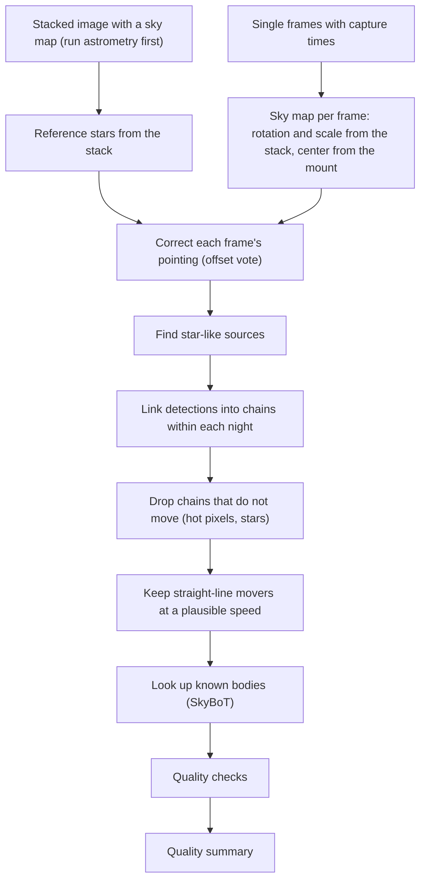

# Asteroid and Moving Object Detection Pipeline Review Guide

*Version 1.2 · 2026-10-15 · Status: current*

## Abstract

This document reviews the moving-object detection pipeline
(`astrometricslib.pipelines.asteroid_detection`): per-frame pointing,
detection, per-night chaining, the stationary and straight-line tests, and the
SkyBoT cross-match.

Terms are defined in the [glossary](../Astrometrics_Library_Architecture.md#appendix-a-glossary). This guide also defines each term where it first appears, so it can be read on its own.

## 1. Overview & Scientific Objective

### 1.1 In Plain Words

This pipeline looks for asteroids and comets in a series of images of the
same patch of sky. Stars stay put from image to image. A nearby body in the
solar system moves a little between images.

Many things appear in one image and not the next without being asteroids:
noise, hot pixels (sensor pixels that always read high) and faint stars near
the detection limit. Each image's pointing also differs slightly. The
pipeline lines up every image on the stars and links detections from image to
image into chains. It drops chains that do not move, and keeps chains that
move in a straight line at a plausible, steady speed. It then asks an online
service which known bodies were at those places at those times.

The result is a list of moving objects, each matched to a known body or marked
as unknown and worth a closer look.

### 1.2 Statement of Need

Asteroids and comets move against the stars, so they show up as point sources
(star-like dots) that shift from frame to frame. The pipeline finds those
sources, links them into straight-line tracks and asks the IMCCE SkyBoT
service (an online list of where every known solar-system body is at a given
time) which known bodies were there. A confirmed mover with no match is a lead
for a person to check.

The diagram shows one run. The left branch prepares the reference stars; the
right branch prepares each frame.

A sky map is a WCS (World Coordinate System): the map from pixels to sky
positions. A plate-solved stack is a stacked image whose WCS has been found by
the astrometry pipeline. The quality summary is an
`AsteroidDetectionQualitySummary` (Section 7).

## 2. Input Requirements & FITS Header Specification

A FITS file (the standard file format for astronomy images) starts with a
header: a list of named cards, each a keyword and a value, that describe the
exposure. The table lists the cards this pipeline reads. "When Missing" says
what the pipeline does if a card is absent.

The target must have a plate-solved stack: run astrometry first. Without a
stacked image the run raises `ConflictError`.

| FITS Keyword | Requirement | Data Type | What It Is Used For | When Missing |
| :--- | :--- | :--- | :--- | :--- |
| `DATE-OBS` | Mandatory (per frame) | `str` (ISO-8601, UTC) | Time the shutter opened, read into the frame record's timestamp. | The frame is not searched. |
| `RA` / `DEC` | Mandatory (per frame) | `float` (deg) | The mount's pointing (right ascension and declination, the sky's longitude and latitude), which sets the center of the frame's WCS (pixel-to-sky map). | The frame is excluded; `pointing_metadata` fails. |
| `NAXIS1` / `NAXIS2` | Mandatory (per frame) | `int` | Frame width and height in pixels; the WCS reference pixel is the frame's center. | The frame is excluded; `pointing_metadata` fails. |
| Stack WCS | Mandatory | WCS cards of the stacked image | The stacked image's sky map. Gives the rotation and scale for every frame's WCS. | The run cannot start without a stacked image. |
| `EXPTIME` | Optional | `float` (s) | Recorded with each detection. | Left empty. |

## 3. Mathematical & Algorithmic Formulation

This section follows the frames from pointing, through linking detections into
chains, to the tests a chain must pass and the look-up of known bodies.
Angles on the sky are in arcseconds (arcsec, 1/3600 of a degree).

### 3.1 Per-Frame Pointing

**Why.** Siril (the stacking program) does not save each frame's alignment, so
each frame's WCS takes its rotation and scale from the stack and its center
from the mount's `RA`/`DEC` (`frame_wcs_composer.py`). A mount is often tens
of arcseconds off.

**How.** The stack's own stars are therefore matched to each frame's
detections within 300 arcsec. Every pair votes for an offset
in 5-arcsec bins, and the winning offset is removed from the
frame's positions. True pairs agree on one offset; chance pairs scatter their
votes. A plain nearest-star match is not used: where the stars are about as
far apart as the mount's error, many detections pair with the wrong star
(partly measured; see [MOV-05](../validation/asteroid_detection.md#mov-05)).

**Position error.** The same vote measures each frame's position error: the
scatter of the matched stack stars about the winning offset, on each axis,
combined with the error of finding a faint dot's center. This is the
"position error" the tests below use. A chain's error is the root mean
square (RMS) of its detections' errors.

### 3.2 Chaining

Detections are linked only within one observing night. Frames are taken in
time order, and each open chain may claim the nearest detection in the next
frame. The search radius is the distance the fastest allowed mover could
travel in the time between frames $\Delta t$, capped so it never grows too
large:

$$r = \min\left(v_\text{max}\, \Delta t,\; r_\text{cap}\right) \tag{1}$$

with $v_\text{max}$ = 300 arcsec/h and
$r_\text{cap}$ = 300 arcsec. Claims go
nearest-first over all chains. A chain may skip frames; it is not limited to
consecutive ones. A chain needs at least 3
detections.

### 3.3 Stationary Tests

A chain that does not move is not an asteroid. If it stays put on the sensor,
it is a hot pixel; if it stays put on the sky, it is a star. Both spreads are
the largest distance of any detection from the chain's mean position. A small
spread means the chain did not move:

$$\max_i \left\lVert \mathbf{p}_i - \bar{\mathbf{p}} \right\rVert
  < 1.5\ \text{px} \;\Rightarrow\; \text{hot pixel}, \qquad
\max_i \theta\left(\mathbf{s}_i, \bar{\mathbf{s}}\right)
  < 3'' \;\Rightarrow\; \text{fixed star} \tag{2}$$

where $\mathbf{p}_i$ is a pixel position and $\mathbf{s}_i$ a sky position
on the tangent plane (the sky projected onto a flat plane that touches it at
the field center), and $\theta$ is the angle between two sky positions.

### 3.4 Straight-Line and Rate Tests

Over one night, an asteroid moves in a nearly straight line at a nearly steady
speed. Noise linked by chance does not. Each detection's RA and Dec (right
ascension and declination, the sky's longitude and latitude) are turned into
offsets $\xi, \eta$ in arcsec on the tangent plane, measured from a reference
point $(\alpha_\text{ref}, \delta_\text{ref})$:

$$\xi = (\alpha - \alpha_\text{ref}) \cos \delta_\text{ref}, \qquad
  \eta = \delta - \delta_\text{ref} \tag{3}$$

The $\cos \delta$ factor is needed because lines of equal RA meet at the
poles: away from the equator, a step in RA covers a smaller angle on the sky.
Each offset is fitted against time with a straight line. The slopes
$\dot{\xi}$ and $\dot{\eta}$ are the true speeds across the sky along the two
axes:

$$\xi(t) = \xi_0 + \dot{\xi}\,(t - t_0), \qquad
  \eta(t) = \eta_0 + \dot{\eta}\,(t - t_0) \tag{4}$$

A chain passes when all of these hold:

- The total rate $\sqrt{\dot\xi^2 + \dot\eta^2}$ is between
  1 and 300
  arcsec/h.
- On each axis, the RMS distance from the line is at most
  2 times that axis's position error.
- The total displacement is at least 3
  times the position error, so a star that only jitters by its error does
  not pass.
- The positions never move back along the fitted direction by more than the
  combined position error of the two detections compared (the square root of
  the sum of their squared errors). Otherwise the chain is
  `REJECTED_NON_MONOTONIC`, meaning the motion is not one-way.

### 3.5 Known-Body Match

SkyBoT's prediction of where a known body is at a given time is its
ephemeris. SkyBoT is asked twice per mover: at its first and at its last
detection. Checking both ends makes sure the known body also moves the same
way. A known body matches only if it is within
10 arcsec at both moments.

## 4. Processing Flow

`run_asteroid_detection_analysis` (`runner.py`) runs
`AsteroidDetectionPipelineAdapter` through `run_pipeline`. `run_pipeline` (`pipeline_base.py`) calls the adapter's four methods in
order. It skips `run` only when `process_input` returns a `Result` with
`has_work=False`. After `validate_output` it stores the quality summary on the
target and records the run's provenance.

- **Stage 1 (`process_input`):** A no-op that returns an empty `Result`.
- **Stage 2 (`run`):** Runs `AsteroidDetectionPipeline.process` on the light
  frames that have a timestamp. Only straight-line movers and matched bodies
  are kept on the target.
- **Stage 3 (`validate_output`):** Builds the summary and records
  `asteroid_run_gates` (5 run gates).
- **Stage 4 (`to_result_dict`):** Returns the status, stage counts and
  surviving candidates.

`mpc_report.py` can write Minor Planet Center (MPC, the clearing house for
asteroid observations) reports from detections, in its 80-column and ADES
text formats, but no pipeline step calls it yet. A run does not produce MPC
records. `rotation_period.py` builds a light curve from a track for the
period search; the pipeline does not call it either.

### 4.1 Quality Gates

A quality gate is an automatic check on a run. It passes, fails, or is
"not checked" when the data it needs are missing. A failed gate marks the run
as flagged (the `flagged` field in Section 7) so a person can look at it. The
list below is read from the code when this guide is generated.

A failed gate here does not always mean the run went wrong. `unmatched_movers`
fails on purpose when a confirmed mover matches no known body: the failure
flags the run so that a person looks at what may be a new object, or at a
known one the match missed.

| Gate | Role | Defined in | What it checks |
| :--- | :--- | :--- | :--- |
| `search_frames` | run gate | `run_gates.py` | Not checked when fewer frames could be searched than a track (a chain of detections of one object) needs, so no mover could have been found. |
| `pointing_metadata` | run gate | `run_gates.py` | Fails when any frame was left out for missing `RA`, `DEC` or `NAXIS` cards. |
| `ephemeris_cross_match` | run gate | `run_gates.py` | Fails when SkyBoT (the online service listing known solar-system bodies) could not be reached for confirmed movers. Not checked when no mover reached it. |
| `unmatched_movers` | run gate | `run_gates.py` | Fails when a confirmed straight-line mover matched no known solar-system body. The failure is a prompt, not an error: it flags the run so a person checks what may be a new object. Not checked when no mover was confirmed. |
| `track_residuals` | run gate | `run_gates.py` | Fails when any chain that reached the straight-line test used the assumed position error (`astrometric_error_default_arcsec`) for a detection, since the verdict then rests on a number nobody measured. Passes otherwise, and its detail counts the chains tested and rejected. Not checked when no chain reached the test. |

## 5. Tuned Calibration Parameters

These are the fixed limits and settings the pipeline uses. "Live Value" is
read from the code when this guide is generated. "Empirical Status" says how
far real data back the value, with one of three labels:

- **Measured.** Chosen or confirmed from a measurement on real data.
- **Partly measured.** Backed by a measurement that is incomplete,
  such as synthetic (simulated) data only, one target or a small sample.
- **Design estimate.** Chosen by reasoning and not yet measured.

The labels are defined in the [validation register](../validation/index.md).
Each label links to the register entry that holds the evidence: the data, the
library calls, the result, and how to repeat the check on your own data. A
design estimate links to the register's table of values not yet measured,
which says how each one could be measured. The Notes column gives the reason
for the value.

The values below are the defaults of `MovingObjectConfig`, plus the two
pointing-vote constants of `pipeline.py`. The configuration can change the
defaults.

| Parameter | Live Value | Empirical Status | Notes |
| :--- | :--- | :--- | :--- |
| `min_frames_for_persistence` | `3` | Design estimate ([how to measure](../validation/asteroid_detection.md#design-estimates); related: [MOV-01](../validation/asteroid_detection.md#mov-01)) | Fewest detections in a chain (detections linked across frames as one object). |
| `pixel_match_tolerance_px` | `1.5` | Design estimate ([how to measure](../validation/asteroid_detection.md#design-estimates); related: [MOV-02](../validation/asteroid_detection.md#mov-02)) | Pixel spread below which a chain is a hot pixel (a sensor pixel that always reads high). |
| `sky_match_tolerance_arcsec` | `3` | Design estimate ([how to measure](../validation/asteroid_detection.md#design-estimates); related: [MOV-02](../validation/asteroid_detection.md#mov-02)) | Sky spread below which a chain is a fixed star (Eq. 2). |
| `rate_min_arcsec_per_hour` / `rate_max_arcsec_per_hour` | `1` / `300` arcsec/h | Design estimate ([how to measure](../validation/asteroid_detection.md#design-estimates); related: [MOV-01](../validation/asteroid_detection.md#mov-01)) | Allowed range of the total speed across the sky. |
| `chain_match_radius_max_arcsec` | `300` arcsec | Design estimate ([how to measure](../validation/asteroid_detection.md#design-estimates); related: [MOV-08](../validation/asteroid_detection.md#mov-08)) | Cap on how far a chain may reach for its next detection (Eq. 1). |
| `residual_rms_max_multiple` | `2` | Partly measured ([MOV-03](../validation/asteroid_detection.md#mov-03)) | Largest RMS (root mean square) distance from the fitted straight line on each axis, in units of that axis's position error. |
| `min_displacement_error_multiple` | `3` | Partly measured ([MOV-03](../validation/asteroid_detection.md#mov-03)) | Smallest total distance moved, in units of the position error. |
| `astrometric_error_default_arcsec` | `10` arcsec | Design estimate ([how to measure](../validation/asteroid_detection.md#design-estimates); related: [MOV-06](../validation/asteroid_detection.md#mov-06)) | Position error assumed for a detection with none measured. |
| `ephemeris_cross_match_radius_arcsec` | `10` arcsec | Design estimate ([how to measure](../validation/asteroid_detection.md#design-estimates); related: [MOV-06](../validation/asteroid_detection.md#mov-06)) | Match radius for a known body from SkyBoT (an online service that lists known solar-system bodies), at both the first and last detection. |
| `_POINTING_CORRECTION_SEARCH_RADIUS_ARCSEC` | `300` arcsec | Partly measured ([MOV-05](../validation/asteroid_detection.md#mov-05)) | Pairing radius between stack stars and frame detections in the per-frame pointing-offset vote (Section 3.1). Wide enough to contain a mount error of several arcminutes; the vote copes with the wrong pairs a wide radius admits. |
| `_POINTING_CORRECTION_VOTE_BIN_ARCSEC` | `5` arcsec | Partly measured ([MOV-05](../validation/asteroid_detection.md#mov-05)) | Bin width of the offset vote. Small enough to separate the true offset from the typical spacing of the field's stars, and well above the star finder's sub-arcsec centering noise. |

## 6. Degraded States & Fallback Pathways

1. **Too few frames.** With fewer searchable frames than a chain needs,
   `search_frames` is not checked, rather than reporting a clean null result.
2. **Missing pointing cards.** Frames without `RA`, `DEC`, `NAXIS1` or
   `NAXIS2` are excluded and `pointing_metadata` fails.
3. **Weak pointing vote.** When too few pairs agree on an offset, the frame
   keeps its raw mount pointing and has no measured position error.
4. **SkyBoT outages.** Confirmed movers stay as candidates and
   `ephemeris_cross_match` fails.
5. **No measured position error.** The default error is assumed, and
   `track_residuals` fails and says how many detections used it.

## 7. Quality Summary Data Models

Every run saves a quality summary: a record of what the run measured and how each quality gate came out. Section 7.1 lists the fields every pipeline shares. Section 7.2 lists the measurements that belong to this pipeline. The tables are read from the data models in the code.

### 7.1 Pipeline Execution Envelope (`AsteroidDetectionQualitySummary`)

| Field Name | Type | Description |
| :--- | :--- | :--- |
| `pipeline_name` | `str` | Which pipeline made this summary (for example astrometry or photometry). |
| `pipeline_version` | `str` | Version number of the pipeline's processing rules. |
| `target_id` | `str` | Identifier of the target (the sky object being studied). |
| `target_session_ids` | `list[str]` | Identifiers of the observing sessions (usually one night each) used in the run. |
| `target_session_breakdown` | `list[astrometricslib.models.quality_summary.TargetSessionContribution]` | For each session, how many frames it had and how many the run used. |
| `upstream_quality_summary_reference` | `str \| None` | Name of the pipeline that had to run first, if any. |
| `resolved_parameters` | `dict[str, Any]` | The settings the run actually used, after defaults were filled in. |
| `camera_profile` | `astrometricslib.models.quality_summary.AppliedCameraProfile \| None` | The camera settings applied, such as the gain (e-/ADU) and the level at which pixels clip. |
| `quality_processing_applied` | `bool` | Whether the quality gates and checks were run. |
| `flagged` | `bool` | True if one or more quality gates failed, so a person should look at the run. |
| `flag_reasons` | `list[str]` | One plain sentence for each reason the run was flagged. |
| `gates` | `list[astrometricslib.models.gate_result.GateResult]` | Every quality gate result: passed, failed or not checked. |
| `created_at` | `datetime.datetime` | Time the quality summary was made, in UTC. |
| `provenance_activity_id` | `str \| None` | Identifier of this run in the provenance record (the IVOA-standard log of which run made which data). |
| `upstream_entity_id` | `str \| None` | Identifier of the exact database record this run read as its input. |
| `asteroid_detection_metrics` | `astrometricslib.models.quality_summary.AsteroidDetectionPipelineQualityMetrics` | The asteroid-detection measurements (Section 7.2). |

### 7.2 Domain Scientific Metrics Schema (`AsteroidDetectionPipelineQualityMetrics`)

| Field Name | Type | Description |
| :--- | :--- | :--- |
| `frames_with_wcs_estimate` | `int` | Frames given a WCS (pixel-to-sky map) from the mount's RA/DEC and the stack's WCS. |
| `frames_excluded_missing_pointing_metadata` | `int` | Frames left out for missing RA, DEC or NAXIS header cards. |
| `candidates_detected` | `int` | Total chains of detections (one object linked across frames), before any test. |
| `candidates_persistence_confirmed` | `int` | Chains seen in at least `min_frames_for_persistence` frames. |
| `candidates_rate_linearity_confirmed` | `int` | Candidates whose apparent motion is a straight line. |
| `candidates_ephemeris_matched` | `int` | Candidates matched to known asteroids by SkyBoT (an online list of known solar-system bodies). |
| `ephemeris_queries_attempted` | `int` | Number of SkyBoT requests sent. |
| `ephemeris_queries_failed` | `int` | Number of SkyBoT requests that failed or timed out. |
