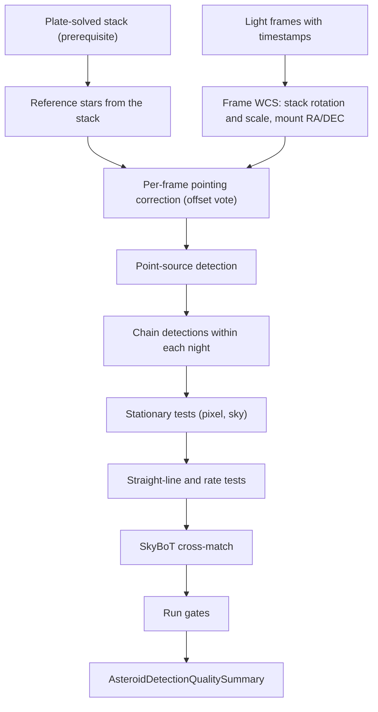

# Asteroid and Moving Object Detection Pipeline Review Guide

*Version 1.1 · 2026-10-14 · Status: current*

## Abstract

This document reviews the moving-object detection pipeline
(`astrometricslib.pipelines.asteroid_detection`): per-frame pointing,
detection, per-night chaining, the stationary and straight-line tests, and the
SkyBoT cross-match.

## 1. Overview & Scientific Objective

**Statement of need.** Asteroids and comets move against the stars, so they
show up as point sources that shift from frame to frame. The pipeline finds
those sources, links them into straight-line tracks and asks the IMCCE SkyBoT
service which known bodies were there. A confirmed mover with no match is a
lead for a person to check.

## 2. Input Requirements & FITS Header Specification

The target must have a plate-solved stack: run astrometry first. Without a
stacked image the run raises `ConflictError`.

| FITS Keyword | Requirement | Data Type | What It Is Used For | When Missing |
| :--- | :--- | :--- | :--- | :--- |
| `DATE-OBS` | Mandatory (per frame) | `str` (ISO-8601, UTC) | Time the shutter opened, read into the frame record's timestamp. | The frame is not searched. |
| `RA` / `DEC` | Mandatory (per frame) | `float` (deg) | The mount's pointing, which centers the frame's WCS. | The frame is excluded; `pointing_metadata` fails. |
| `NAXIS1` / `NAXIS2` | Mandatory (per frame) | `int` | Frame size; the WCS reference pixel is its center. | The frame is excluded; `pointing_metadata` fails. |
| Stack WCS | Mandatory | WCS cards of the stacked image | Rotation and scale for every frame's WCS. | The run cannot start without a stacked image. |
| `EXPTIME` | Optional | `float` (s) | Recorded with each detection. | Left empty. |

## 3. Mathematical & Algorithmic Formulation

### 3.1 Per-Frame Pointing

Siril does not save each frame's alignment, so each frame's WCS takes its
rotation and scale from the stack and its center from the mount's `RA`/`DEC`
(`frame_wcs_composer.py`). A mount is often tens of arcseconds off. The stack's
own stars are therefore matched to each frame's detections within
300 arcsec, every pair votes for an offset in 5-arcsec bins,
and the winning offset is removed from the frame's positions.

### 3.2 Chaining

Detections are linked only within one observing night. Frames are taken in
time order, and each open chain may claim the nearest detection in the next
frame within

$$r = \min\left(v_\text{max}\, \Delta t,\; r_\text{cap}\right) \tag{1}$$

with $v_\text{max}$ = 300 arcsec/h and
$r_\text{cap}$ = 300 arcsec. Claims go
nearest-first over all chains. A chain may skip frames; it is not limited to
consecutive ones. A chain needs at least 3
detections.

### 3.3 Stationary Tests

Both spreads are measured from the chain's mean position:

$$\max_i \left\lVert \mathbf{p}_i - \bar{\mathbf{p}} \right\rVert
  < 1.5\ \text{px} \;\Rightarrow\; \text{hot pixel}, \qquad
\max_i \theta\left(\mathbf{s}_i, \bar{\mathbf{s}}\right)
  < 3'' \;\Rightarrow\; \text{fixed star} \tag{2}$$

where $\mathbf{p}_i$ is a pixel position and $\mathbf{s}_i$ a sky position
on the tangent plane.

### 3.4 Straight-Line and Rate Tests

RA and Dec offsets on the tangent plane are each fitted against time:

$$\alpha(t) = \alpha_0 + \dot{\alpha}\,(t - t_0), \qquad
  \delta(t) = \delta_0 + \dot{\delta}\,(t - t_0) \tag{3}$$

A chain passes when all of these hold:

- The total rate $\sqrt{\dot\alpha^2 + \dot\delta^2}$ is between
  1 and 300
  arcsec/h.
- On each axis, the RMS distance from the line is at most
  2 times that axis's position error.
- The total displacement is at least 3
  times the position error.
- The positions never move back along the fitted direction by more than the
  position error (otherwise `REJECTED_NON_MONOTONIC`).

### 3.5 Known-Body Match

SkyBoT is asked twice per mover: at its first and at its last detection. A
known body matches only if it is within
10 arcsec at both moments.

## 4. Processing Flow

`run_asteroid_detection_analysis` (`runner.py`) runs
`AsteroidDetectionPipelineAdapter` through `run_pipeline`. `run_pipeline` (`pipeline_base.py`) calls the adapter's four methods in
order. It skips `run` only when `process_input` returns a `Result` with
`has_work=False`. After `validate_output` it stores the quality summary on the
target and records the run's provenance.

- **Stage 1 (`process_input`):** A no-op that returns an empty `Result`.
- **Stage 2 (`run`):** Runs `AsteroidDetectionPipeline.process` on the light
  frames that have a timestamp. Only straight-line movers and matched bodies
  are kept on the target.
- **Stage 3 (`validate_output`):** Builds the summary and records
  `asteroid_run_gates` (5 run gates).
- **Stage 4 (`to_result_dict`):** Returns the status, stage counts and
  surviving candidates.

`mpc_report.py` can write Minor Planet Center 80-column and ADES text from
detections, but no pipeline step calls it yet. A run does not produce MPC
records. `rotation_period.py` builds a light curve from a track for the
period search; the pipeline does not call it either.

### 4.1 Quality Gates

| Gate | Role | Defined in | What it checks |
| :--- | :--- | :--- | :--- |
| `search_frames` | run gate | `run_gates.py` | Not checked when fewer frames could be searched than a track needs, so no mover could have been found. |
| `pointing_metadata` | run gate | `run_gates.py` | Fails when any frame was left out for missing `RA`, `DEC` or `NAXIS` cards. |
| `ephemeris_cross_match` | run gate | `run_gates.py` | Fails when SkyBoT could not be reached for confirmed movers. Not checked when no mover reached it. |
| `unmatched_movers` | run gate | `run_gates.py` | Fails when a confirmed straight-line mover matched no known body: a lead worth a manual look. |
| `track_residuals` | run gate | `run_gates.py` | Reports how the straight-line test went and whether it used measured or assumed position errors. |

## 5. Tuned Calibration Parameters

The values below are the defaults of `MovingObjectConfig`. The configuration
can change them.

| Parameter | Live Value | Empirical Status | Notes |
| :--- | :--- | :--- | :--- |
| `min_frames_for_persistence` | `3` | Designed | Fewest detections in a chain. |
| `pixel_match_tolerance_px` | `1.5` | Designed | Pixel spread below which a chain is a hot pixel. |
| `sky_match_tolerance_arcsec` | `3` | Designed | Sky spread below which a chain is a fixed star. |
| `rate_min_arcsec_per_hour` / `rate_max_arcsec_per_hour` | `1` / `300` arcsec/h | Designed | Allowed range of the total rate. |
| `chain_match_radius_max_arcsec` | `300` arcsec | Designed | Cap on the chaining search radius. |
| `residual_rms_max_multiple` | `2` | Designed | Largest per-axis RMS from the line, in units of the position error. |
| `min_displacement_error_multiple` | `3` | Designed | Smallest total displacement, in units of the position error. |
| `astrometric_error_default_arcsec` | `10` arcsec | Designed | Position error assumed for a detection with none measured. |
| `ephemeris_cross_match_radius_arcsec` | `10` arcsec | Designed | SkyBoT match radius, at both the first and last detection. |
| `_POINTING_CORRECTION_SEARCH_RADIUS_ARCSEC` | `300` arcsec | Unvalidated (NGC 2403) | Pairing radius for the per-frame pointing-offset vote. |

## 6. Degraded States & Fallback Pathways

1. **Too few frames.** With fewer searchable frames than a chain needs,
   `search_frames` is not checked, rather than reporting a clean null result.
2. **Missing pointing cards.** Frames without `RA`, `DEC`, `NAXIS1` or
   `NAXIS2` are excluded and `pointing_metadata` fails.
3. **Weak pointing vote.** When too few pairs agree on an offset, the frame
   keeps its raw mount pointing.
4. **SkyBoT outages.** Confirmed movers stay as candidates and
   `ephemeris_cross_match` fails.
5. **No measured position error.** The default error is assumed and
   `track_residuals` says how many detections used it.

## 7. Quality Summary Data Models

### 7.1 Pipeline Execution Envelope (`AsteroidDetectionQualitySummary`)

| Field Name | Type | Description |
| :--- | :--- | :--- |
| `pipeline_name` | `str` | Unique pipeline domain identifier (e.g., astrometry, photometry). |
| `pipeline_version` | `str` | Semantic version of the pipeline processing contract. |
| `target_id` | `str` | Target celestial object identifier. |
| `target_session_ids` | `list[str]` | List of observing session IDs included in the analysis. |
| `target_session_breakdown` | `list[astrometricslib.models.quality_summary.TargetSessionContribution]` | Per-session frame counts and contribution breakdown. |
| `upstream_quality_summary_reference` | `str \| None` | Category name of prerequisite pipeline. |
| `resolved_parameters` | `dict[str, Any]` | Effective configuration parameters used during execution. |
| `camera_profile` | `astrometricslib.models.quality_summary.AppliedCameraProfile \| None` | Camera sensor parameters and clipping thresholds applied. |
| `quality_processing_applied` | `bool` | Indicates whether QA gates and checks were executed. |
| `flagged` | `bool` | True if one or more quality gates failed, indicating data concerns. |
| `flag_reasons` | `list[str]` | Human-readable sentences describing reasons for quality flags. |
| `gates` | `list[astrometricslib.models.gate_result.GateResult]` | Complete collection of passed, failed, and unchecked GateResults. |
| `created_at` | `datetime.datetime` | UTC timestamp when the quality summary was generated. |
| `provenance_activity_id` | `str \| None` | IVOA provenance activity / job tracking identifier. |
| `upstream_entity_id` | `str \| None` | Exact upstream database entity consumed by this run. |
| `asteroid_detection_metrics` | `astrometricslib.models.quality_summary.AsteroidDetectionPipelineQualityMetrics` | The asteroid-detection measurements (Section 7.2). |

### 7.2 Domain Scientific Metrics Schema (`AsteroidDetectionPipelineQualityMetrics`)

| Field Name | Type | Description |
| :--- | :--- | :--- |
| `frames_with_wcs_estimate` | `int` | Frames given a WCS from the mount's RA/DEC and the stack's WCS. |
| `frames_excluded_missing_pointing_metadata` | `int` | Frames left out for missing RA, DEC or NAXIS cards. |
| `candidates_detected` | `int` | Total chains of detections, before any test. |
| `candidates_persistence_confirmed` | `int` | Chains seen in at least `min_frames_for_persistence` frames. |
| `candidates_rate_linearity_confirmed` | `int` | Candidates exhibiting linear apparent motion vectors. |
| `candidates_ephemeris_matched` | `int` | Candidates matched to known asteroids in SkyBoT database. |
| `ephemeris_queries_attempted` | `int` | SkyBoT API requests submitted. |
| `ephemeris_queries_failed` | `int` | Failed or timed-out SkyBoT queries. |
