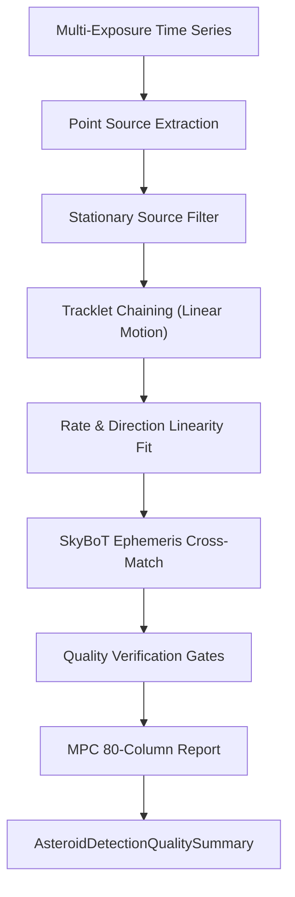

# Asteroid and Moving Object Detection Pipeline Review Guide

*Version 1.0 · 2026-10-10 · Status: current*

## Abstract

This document reviews the optical transient detection, tracklet persistence
chaining, ephemeris cross-matching, and Minor Planet Center reporting
pipeline in Astrometrics (`astrometricslib.pipelines.asteroid_detection`).

## 1. Overview & Scientific Objective

**Statement of need.** Small Solar System bodies (asteroids and comets) appear
as moving point sources across sequential exposures of the same sky field.
The Asteroid Detection pipeline automates the identification of non-stationary
sources, links detections into linear motion tracks (tracklets), queries the
IMCCE SkyBoT database to cross-match known bodies, and formats candidate
recoveries for submission to the Minor Planet Center (MPC).

## 2. Input Requirements & FITS Header Specification

| FITS Keyword | Requirement | Data Type | Description | Fallback Mode |
| :--- | :--- | :--- | :--- | :--- |
| `DATE-OBS` | Mandatory | `str` (ISO-8601) | Mid-exposure observation timestamp. | Excludes frame from track. |
| `CRVAL1` / `CRVAL2` | Mandatory | `float` (deg) | WCS field center coordinates. | Excludes frame from search. |
| `CDELT1` / `CDELT2` | Mandatory | `float` (deg/px) | WCS pixel coordinate scales. | Excludes frame from search. |

## 3. Mathematical & Algorithmic Formulation

### 3.1 Stationary Star Rejection
Residual point sources are cross-matched against static reference star catalogs.
Sources moving less than the stationary threshold are rejected:
$$\Delta d = \sqrt{(x_2 - x_1)^2 + (y_2 - y_1)^2} < 1.5\text{ px} \approx 3.0\text{ arcsec}$$

### 3.2 Tracklet Persistence Chaining & Velocity Filter
Candidates must appear in $N \ge 3$ consecutive frames with apparent motion:
$$v = \frac{\Delta \theta}{\Delta t} \in [1.0, 300.0]\text{ arcsec/h}$$

### 3.3 Linear Trajectory Least-Squares Fit
Candidate positions are fitted to uniform linear motion:
$$\alpha(t) = \alpha_0 + \dot{\alpha} (t - t_0)$$
$$\delta(t) = \delta_0 + \dot{\delta} (t - t_0)$$
Tracks are rejected if orthogonal residuals exceed $2.0\,\sigma_\text{pos}$.

## 4. Four-Stage Lifecycle Architecture

Implemented via `AsteroidDetectionPipelineAdapter` in `runner.py`:

- **Stage 1 (`process_input`):** Validates sequence availability and WCS pointing.
- **Stage 2 (`run`):** Source extraction, static filtering, velocity filtering,
  and SkyBoT ephemeris cross-matching.
- **Stage 3 (`validate_output`):** Evaluates 5 quality run gates (`search_frames`,
  `pointing_metadata`, `ephemeris_cross_match`, `unmatched_movers`, `track_residuals`).
- **Stage 4 (`to_result_dict`):** Emits MPC 80-column observation records and
  `AsteroidDetectionQualitySummary`.

## 5. Tuned Calibration Parameters

| Parameter | Live Value | Empirical Status | Notes |
| :--- | :--- | :--- | :--- |
| Minimum Track Frames | 3 frames | Designed | Minimum detections required to confirm a tracklet. |
| Apparent Motion Bounds | 1 to 300 arcsec/h | Designed | Physical velocity window for Solar System bodies. |
| Stationary Distance Cutoff | 1.5 px (3 arcsec) | Designed | Sources moving less than this are deemed fixed stars. |
| Ephemeris Search Radius | 10.0 arcsec | Designed | Cone search radius for SkyBoT known body matches. |
| Maximum Fit Residual Multiple | 2.0 × error | Simulated | Maximum allowed RMS departure from linear motion. |

## 6. Degraded States & Fallback Pathways

1. **Short Sequences ($< 3$ frames):** The pipeline cannot confirm persistence;
   `search_frames` gate reports `not_checked` rather than claiming a null detection.
2. **Missing WCS Pointing:** Frames without valid WCS are excluded; if all frames
   lack WCS, the run terminates safely.
3. **SkyBoT Service Outages:** Unmatched movers are preserved as candidate recoveries
   while `ephemeris_cross_match` records a service failure.

## 7. Quality Summary Data Models

### 7.1 Pipeline Execution Envelope
| Field Name | Type | Description |
| :--- | :--- | :--- |
| `pipeline_name` | `str` | Unique pipeline domain identifier (e.g., astrometry, photometry). |
| `pipeline_version` | `str` | Semantic version of the pipeline processing contract. |
| `target_id` | `str` | Target celestial object identifier. |
| `target_session_ids` | `list[str]` | List of observing session IDs included in the analysis. |
| `target_session_breakdown` | `list[astrometricslib.models.quality_summary.TargetSessionContribution]` | Per-session frame counts and contribution breakdown. |
| `upstream_quality_summary_reference` | `str | None` | Category name of prerequisite pipeline. |
| `resolved_parameters` | `dict[str, Any]` | Effective configuration parameters used during execution. |
| `camera_profile` | `astrometricslib.models.quality_summary.AppliedCameraProfile | None` | Camera sensor parameters and clipping thresholds applied. |
| `quality_processing_applied` | `bool` | Indicates whether QA gates and checks were executed. |
| `flagged` | `bool` | True if one or more quality gates failed, indicating data concerns. |
| `flag_reasons` | `list[str]` | Human-readable sentences describing reasons for quality flags. |
| `gates` | `list[astrometricslib.models.gate_result.GateResult]` | Complete collection of passed, failed, and unchecked GateResults. |
| `created_at` | `datetime.datetime` | UTC timestamp when the quality summary was generated. |
| `provenance_activity_id` | `str | None` | IVOA provenance activity / job tracking identifier. |
| `upstream_entity_id` | `str | None` | Exact upstream database entity consumed by this run. |
| `asteroid_detection_metrics` | `astrometricslib.models.quality_summary.AsteroidDetectionPipelineQualityMetrics` | Quality metric attribute. |

### 7.2 Domain Scientific Metrics Schema
| Field Name | Type | Description |
| :--- | :--- | :--- |
| `frames_with_wcs_estimate` | `int` | Frames possessing valid telescope pointing coordinates. |
| `frames_excluded_missing_pointing_metadata` | `int` | Frames discarded due to missing coordinates. |
| `candidates_detected` | `int` | Total moving candidate detections before persistence filter. |
| `candidates_persistence_confirmed` | `int` | Candidates appearing in 3 or more consecutive frames. |
| `candidates_rate_linearity_confirmed` | `int` | Candidates exhibiting linear apparent motion vectors. |
| `candidates_ephemeris_matched` | `int` | Candidates matched to known asteroids in SkyBoT database. |
| `ephemeris_queries_attempted` | `int` | SkyBoT API requests submitted. |
| `ephemeris_queries_failed` | `int` | Failed or timed-out SkyBoT queries. |
