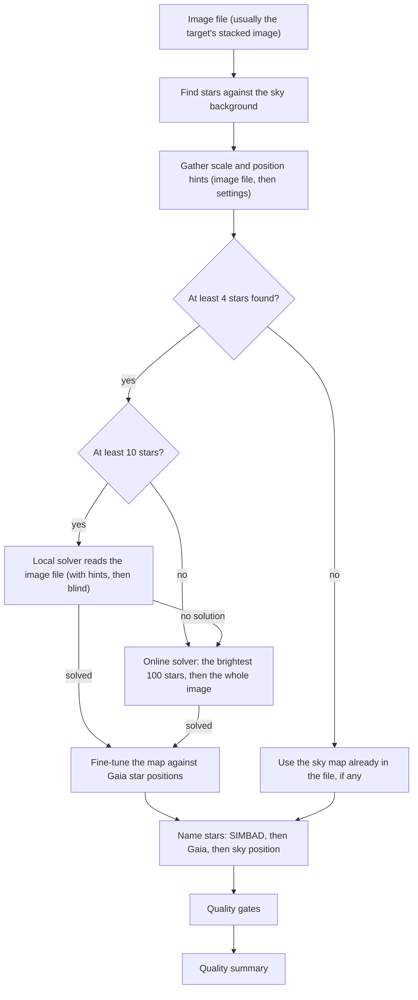

# Astrometry and plate solving pipeline review guide

*Version 1.2 · 2026-10-15 · Status: current*

## Abstract

This document reviews the plate solving and astrometric calibration pipeline (`astrometricslib.pipelines.astrometry`). It covers the header cards the pipeline reads, its detection and solving methods, the Gaia DR3 refit of the solution, how stars are named, the run flow, the tuned limits, the fallback paths and the quality-summary fields.

Terms are defined in the [glossary](../Astrometrics_Library_Architecture.md#appendix-a-glossary). This document also defines each term the first time it appears.

## 1. Overview and scientific objective

The [astrometry pipeline README](https://github.com/m1chae2/astrometrics/blob/main/astrometricslib/pipelines/astrometry/README.md) describes the code stage by stage.

**In plain words.** A telescope image shows stars, but it does not say where on the sky it points. This pipeline works that out. For every pixel it finds the matching sky direction, given as right ascension and declination (the sky's longitude and latitude). Finding this pixel-to-sky map is called a plate solve.

The image carries no labels, so the map must come from the stars themselves. The mount's reported pointing can be off, the optics bend the field slightly, and stars drift slowly across the sky over the years. The pipeline finds the stars in the image and matches their pattern against a star catalog. It then fine-tunes the map against Gaia DR3 (the third data release of the Gaia space mission, the most accurate star positions available).

The result is the map, written into the image file, a name for each star, and a quality summary that says how accurate the map is.

**Statement of need.** Astrometry (the measurement of star positions) finds the World Coordinate System (WCS) of an image. The WCS is the map from detector pixels $(x, y)$ to sky coordinates $(\alpha, \delta)$ in the International Celestial Reference System (ICRS, the standard sky coordinate frame). Photometry needs it to match stars across sessions. Spectroscopy needs it to name the stars whose spectra it extracts. Asteroid detection needs it to place every frame on the sky.

The diagram shows one run, top to bottom.

Astrometry.net is an open-source plate solver, used both as a program installed on this computer (the local solver) and as an online service. SIMBAD is an online database of named stars and other objects. The fine-tuning step fits SIP distortion terms of order 2 (Section 3.3), and the quality summary is an `AstrometryQualitySummary` (Section 7).

## 2. Input requirements and FITS header specification

A FITS file (the standard file format for astronomy images) starts with a header: a list of named cards, each a keyword and a value, that describe the exposure. The table lists the cards this pipeline reads. The last column says what the pipeline does if a card is absent.

No card is strictly required: a missing card weakens a hint or a correction, and the run says so in its flags.

| FITS keyword | Requirement | Data type | Used for | When missing |
| --- | --- | --- | --- | --- |
| `DATE-OBS` | Recommended | `str` (ISO-8601, UTC) | Time the shutter opened. Used to move Gaia DR3 star positions from the catalog date to the image date (Eq. 3). | Gaia positions stay at the catalog date (epoch 2016.0) and the run is flagged. |
| `FOCALLEN` | Recommended | `float` (mm) | Telescope focal length, used for the pixel-scale hint (Eq. 2). | The focal length set in the configuration. |
| `XPIXSZ` / `YPIXSZ` | Recommended | `float` (μm) | Pixel size after binning (binning joins neighboring sensor pixels into one), used as written. If the two values differ, they are averaged and the run is flagged. | `PIXSIZE1` / `PIXSIZE2` times `XBINNING` / `YBINNING`. |
| `PIXSIZE1` / `PIXSIZE2` | Optional | `float` (μm) | Pixel size before binning; multiplied by the binning factor. | `PIXSCAL`. |
| `XBINNING` / `YBINNING` | Optional | `int` | Binning factor: how many sensor pixels are joined along each axis. Applied to `PIXSIZE1` / `PIXSIZE2`. | 1. |
| `PIXSCAL` | Optional | `float` (arcsec/px) | Pixel scale (the sky angle one pixel covers), read only when no pixel size is given. | No scale hint: the solver searches all scales. |
| `RA` / `DEC` (or `OBJCTRA` / `OBJCTDEC`) | Optional | `float` or sexagesimal `str` (base-60, such as hours, minutes, seconds) | Where the telescope pointed, as right ascension and declination (the sky's longitude and latitude). A search hint when the target record has no coordinates. | No position hint. |
| `OBJECT` | Optional | `str` | Target name, used for the extended-source hint (whether the target is spread out, like a galaxy, rather than a point). | Guessed from the file name. |

The pixel-scale hint is the scale from Eq. 2 with a window of ±5%. The solver driver widens that window to 0.8 times its lower edge and 1.2 times its upper edge before calling `solve-field`. With no focal length or no pixel size, no scale hint is sent.

## 3. Mathematical and algorithmic formulation

This section covers, in order: finding stars, estimating how much sky a pixel covers, solving and refining the map, moving catalog stars to the image date, naming stars, and judging the map's accuracy.

### 3.1 Point source detection

A point source is anything in the image that looks like a single star. To find them, the pipeline first estimates the sky background: the faint glow behind the stars. The background is a 2-D map (photutils `Background2D`, median estimator, 3σ clipping). Sigma clipping repeatedly drops pixels more than 3 standard deviations from the median, so stars do not inflate the sky estimate. A small image falls back to one sigma-clipped median.

The test below asks how many noise units a pixel stands above the local sky. A large value means a real source; a value near zero means only sky. A source is kept when its peak stands above the background $B$ by the threshold $k$, where $\sigma_B$ is the noise of the background:

$$\frac{I(x, y) - B(x, y)}{\sigma_B} \ge k = 5 \tag{1}$$

`DAOStarFinder` (a standard star finder from photutils) also checks shape. Sharpness compares a peak's height with its spread; roundness compares its width along the two axes, with 0 meaning round. It keeps sharpness in $[0.2, 1.0]$ and roundness in $[-0.6, +0.6]$, which rejects hot pixels (single pixels that always read high) and filament structure.

**The kernel width.** The finder looks for blobs of a set width, the kernel width. On a single-color (monochrome) frame that width is measured from the image. It is the spread (second moment) of all the light in a 30-pixel box around each of the 15 brightest sources. It is written as the FWHM (full width at half maximum, the width of a star's light profile at half its peak height) of a Gaussian with the same spread, which is 2.355 times its standard deviation. Because the box also holds faint wings and neighbors, this blob width reads about twice the star's fitted FWHM. It is used because it detects better than a kernel sized from the fitted FWHM: more catalog matches and a smaller residual (partly measured; see [AST-06](../validation/astrometry.md#ast-06)). It is never reported as a FWHM.

**Clean-up.** Detections closer than 15 pixels are merged into one, because the finder can split one large star into two. Color frames are averaged in 2×2 blocks before detection: color interpolation leaves clumps of noise that would otherwise be found as thousands of false stars.

### 3.2 Pixel-scale hint

The pixel scale is the sky angle one pixel covers. A longer focal length or a smaller pixel gives a smaller (finer) scale. The solver runs much faster when it knows the scale in advance:

$$s = 206.265 \, \frac{p}{f} \tag{2}$$

where $s$ is the scale in arcsec/pixel (1 arcsec is 1/3600 of a degree), $p$ the binned pixel size in μm and $f$ the focal length in mm. The constant is the number of arcseconds in a radian (206,265) times $10^{-3}$, which turns μm over mm into the same unit.

### 3.3 Plate solve and Gaia DR3 refit

**Local, then online.** Astrometry.net is tried in up to three ways, in order:

1. The local solver reads the image file and finds its own stars. It is tried only when the pipeline found at least 10 stars; with fewer, a local attempt would spend its whole time limit on a near-certain failure. It runs first with the scale and position hints. If that fails quickly, it retries blind (no hints), because a wrong hint, such as a forgotten focal reducer, can block the right answer. If the hinted run used at least 90% of its time limit, the blind retry is skipped.
2. The online service is sent the brightest 100 of the pipeline's own detections.
3. As a last resort, the whole image is uploaded to the online service.

Only the local solver reports its fit statistics; an online solve has none (Section 3.6).

**Why refit.** The solver fits only the bright stars of its index files, so its solution can be a pixel or more off. The pipeline then refits the solution to the field's Gaia DR3 stars (`wcs_refinement.py`).

**How.** Each detection is matched to the nearest Gaia star within 4 pixels, then 1.5 pixels on later passes. The map is fitted with `astropy.wcs.utils.fit_wcs_from_points` as a tangent-plane solution (the sky projected onto a flat plane touching it at the field center) plus SIP distortion of order 2. SIP (Simple Imaging Polynomial) adds small polynomial terms that model the bending of the field by the optics. Stars more than 3 robust standard deviations off are dropped, and the fit repeats until the matched set stops changing. A robust standard deviation is 1.4826 times the median absolute deviation, a measure of spread that a few wild points cannot inflate.

**When it is kept.** The refit needs at least 40 matches. It is kept only when it fits Gaia better than the solver's solution and moves the field by at most 30 arcsec.

### 3.4 Proper motion epoch propagation

Stars move slowly across the sky; this drift is their proper motion. Gaia DR3 gives each position at one date, the epoch J2016.0. Before matching, each position is moved to the image time with astropy's `SkyCoord.apply_space_motion`. The move grows with the star's speed and with the years since 2016. To first order it is

$$\alpha(t) = \alpha_0 + \frac{\mu_{\alpha*} \, \Delta t}{\cos \delta_0}, \qquad
\delta(t) = \delta_0 + \mu_\delta \, \Delta t, \qquad \Delta t = t_\text{obs} - 2016.0 \tag{3}$$

where $\mu_{\alpha*}$ is Gaia's `pmra` (which already includes $\cos \delta$) and $\mu_\delta$ is `pmdec`. Both are in milliarcseconds per year and $\Delta t$ is in years, so each product is an angle in milliarcseconds. It is turned into degrees (1 degree is $3.6 \times 10^6$ milliarcseconds) before it is added to $\alpha_0$ or $\delta_0$.

### 3.5 Star naming

With a solution, each star is named from SIMBAD first, within 10 arcsec. Stars SIMBAD does not know are matched against a Gaia DR3 cone (all catalog stars within a circle around the field).

The cone's faint limit is set from the frame's magnitude zero point: the catalog magnitude a star of flux 1 would have. Each SIMBAD-named star with a catalog V magnitude gives $V + 2.5 \log_{10}(\text{flux})$, and the median over at least 5 stars is the frame's zero point. With it, the flux of the faintest detection gives the faintest magnitude the Gaia search needs. Stars neither catalog knows get a position-based name such as `FIELD_J123.4+45.6`.

Separations are great-circle distances (the shortest angle between two points on the sky) from `SkyCoord.separation`. The catalog match separation is the typical distance between a detected star and its catalog match:

$$\text{RMS}_\text{sep} = \sqrt{\frac{1}{N} \sum_{i=1}^N \Delta \theta_i^2} \tag{4}$$

over the $N$ stars matched within the radius. RMS (root mean square) is the square root of the mean squared distance. It is a rough test, not a measure of the fit: wrong matches and SIMBAD's uneven position precision raise it, and the match radius caps it.

### 3.6 Residual gate

The residual $r$ (arcsec) is the map's typical position error. A position error matters in proportion to the size of a star in the image, so the gate divides it by the FWHM in arcsec. A ratio of 0.1 means the error is a tenth of the FWHM; above 0.5 the map is too loose:

$$\frac{r}{s \cdot \text{FWHM}} \le 0.5 \tag{5}$$

The residual is the first of these that was measured:

1. the RMS distance to Gaia stars under the kept solution, when the Gaia refit ran (it does not depend on the solver);
2. the solver's own fit residual, which only a local solve reports;
3. the catalog match separation of Eq. 4.

The gate detail names the one used.

## 4. Processing flow

`run_astrometry_analysis` (`runner.py`) runs `AstrometryPipelineAdapter` through `run_pipeline`. `run_pipeline` (`pipeline_base.py`) calls the adapter's four methods in order. It skips `run` only when `process_input` returns a `Result` with `has_work=False`. After `validate_output` it stores the quality summary on the target and records the run's provenance.

- **Stage 1 (`process_input`).** A no-op that returns an empty `Result`. `analyze_target` has already checked that an image path exists.
- **Stage 2 (`run`).** Runs `AstrometryPipeline.process` (detection, solve, refit, header-WCS fallback, naming). It writes the solved WCS into the FITS header, fills in the target's RA/Dec when they were unset, and saves the stars to the shared catalog.
- **Stage 3 (`validate_output`).** Builds the `AstrometryQualitySummary`. The runner records `plate_solve`, then `astrometry_run_gates` adds the rest (5 run gates in all).
- **Stage 4 (`to_result_dict`).** Returns `context`, `stellar_objects`, `wcs` and `image_stats`.

### 4.1 Quality gates

A quality gate is an automatic test on a run. It passes, fails, or is "not checked" when the data it needs are missing. A failed gate marks the run as flagged (the `flagged` field in Section 7) so a person can look at it. The list below is read from the code when this guide is generated.

| Gate | Role | Defined in | What it checks |
| --- | --- | --- | --- |
| `source_detection` | run gate | `post_processing/run_gates.py` | Fails when no star was detected. |
| `astrometric_residual` | run gate | `post_processing/run_gates.py` | Fails when the solution misses its stars by more than `MAXIMUM_RESIDUAL_FRACTION_OF_FWHM` of the FWHM (Eq. 5). Not checked when the residual (position error), pixel scale (sky angle per pixel) or FWHM is missing. |
| `catalog_matches` | run gate | `post_processing/run_gates.py` | Fails when fewer than `MINIMUM_MATCHED_STARS` stars were matched to a catalog. Not checked when the image was not solved. |
| `catalog_lookup` | run gate | `post_processing/run_gates.py` | Fails when the remote-catalog circuit breaker (a switch that stops online catalog queries after repeated failures) tripped during the run, or when at least `MAXIMUM_FAILED_LOOKUP_FRACTION` of lookups failed. Not checked when no lookup was made. |
| `plate_solve` | run gate | `runner.py` | Fails when the image ends the run with no sky solution (pixel-to-sky map, or WCS), from the solver or from the image's own header. |

## 5. Tuned calibration parameters

These are the fixed limits and settings the pipeline uses. The live value is read from the code when this guide is generated. The status says how far real data back the value, with one of three labels:

- **Measured.** Chosen or confirmed from a measurement on real data.
- **Partly measured.** Backed by a measurement that is incomplete, such as synthetic (simulated) data only, one target or a small sample.
- **Design estimate.** Chosen by reasoning and not yet measured.

The labels are defined in the [validation register](../validation/index.md). Each label links to the register entry that holds the evidence: the data, the library calls, the result, and how to repeat the test on your own data. A design estimate links to the register's table of values not yet measured, which says how each one could be measured. The Notes column gives the reason for the value.

| Parameter | Live value | Status | Notes |
| --- | --- | --- | --- |
| `MAXIMUM_RESIDUAL_FRACTION_OF_FWHM` | `0.5` | Partly measured ([AST-04](../validation/astrometry.md#ast-04)) | Largest allowed residual (position error of the sky map), as a share of the FWHM. It is there to catch a failed solve, not to rank good ones. |
| `MINIMUM_MATCHED_STARS` (`run_gates`) | `20` | Partly measured ([AST-05](../validation/astrometry.md#ast-05)) | Fewest stars matched to a catalog for the residual to mean anything. |
| `MAXIMUM_FAILED_LOOKUP_FRACTION` | `0.5` | Design estimate ([astrometry design estimates](../validation/astrometry.md#design-estimates)) | Share of failed online catalog lookups at which `catalog_lookup` fails. |
| `CATALOG_MATCH_RADIUS_ARCSEC` | `10.0` arcsec | Design estimate ([astrometry design estimates](../validation/astrometry.md#design-estimates)) | Largest distance at which a detected star is paired with a SIMBAD or Gaia DR3 star. |
| `MAXIMUM_PLATE_SOLVE_SOURCES` | `100` | Design estimate ([astrometry design estimates](../validation/astrometry.md#design-estimates)) | How many of the brightest detected stars are sent to the online solver. |
| Solve minimum | 4 sources | Design estimate ([astrometry design estimates](../validation/astrometry.md#design-estimates)) | Fewest detections for a solve to be tried (`process_image`). |
| `MINIMUM_SOURCES_FOR_LOCAL_SOLVE` | `10` | Partly measured ([AST-13](../validation/astrometry.md#ast-13)) | Fewest detections for the local solver to be tried; with fewer, the run goes straight to the online solver, because a local attempt would spend its whole time limit on a near-certain failure (Section 3.3). |
| `SourceDetector` threshold | `5σ` | Design estimate ([astrometry design estimates](../validation/astrometry.md#design-estimates)) | How far a peak must stand above the sky, in standard deviations of the sky noise (Eq. 1). |
| `MINIMUM_MATCHED_STARS` (`wcs_refinement`) | `40` | Design estimate ([astrometry design estimates](../validation/astrometry.md#design-estimates)) | Fewest Gaia star matches needed for the refit with distortion terms (SIP). The fit has about a dozen terms per axis, and 40 stars leaves a wide margin. |
| `MAXIMUM_SHIFT_ARCSEC` | `30.0` arcsec | Partly measured ([AST-02](../validation/astrometry.md#ast-02)) | Largest move of the whole field a refit may make and still be kept. Set at about ten times the largest solver error seen; a larger move means the fit followed wrong matches. |

## 6. Degraded states and fallback pathways

1. **Missing optical metadata.** `FOCALLEN` falls back to the configured focal length. Pixel size falls back from `XPIXSZ` to `PIXSIZE1` times `XBINNING`, then to `PIXSCAL`. With none of these, the solve runs with no scale hint.
2. **Too few detections (fewer than 4).** No solve is tried. A celestial WCS already in the image header is used instead. Without one, `plate_solve` fails.
3. **Solver failure.** A tried solve that finds no solution, locally or online, raises `PlateSolveFailedError`. The adapter does not catch it, so the error reaches the caller: `validate_output` never runs, and no quality summary or gate is saved for that run.
4. **No Gaia stars.** The refit is skipped with a flag and the solver's solution is kept. Without `DATE-OBS`, or with a cache that has no proper motions, Gaia positions stay at epoch 2016.0 with a flag.
5. **Catalog outages.** Repeated failures trip a process-wide circuit breaker: a shared switch that stops further online catalog queries. Unnamed stars keep position-based names, and `catalog_lookup` reports the outage.

## 7. Quality summary data models

Every run saves a quality summary: a record of what the run measured and how each quality gate came out. Section 7.1 lists the fields every pipeline shares. Section 7.2 lists the measurements that belong to this pipeline. The tables are read from the data models in the code.

### 7.1 Pipeline execution envelope (`AstrometryQualitySummary`)

| Field name | Type | Description |
| --- | --- | --- |
| `pipeline_name` | `str` | Which pipeline made this summary (for example astrometry or photometry). |
| `pipeline_version` | `str` | Version number of the pipeline's processing rules. |
| `target_id` | `str` | Identifier of the target (the sky object being studied). |
| `target_session_ids` | `list[str]` | Identifiers of the observing sessions (usually one night each) used in the run. |
| `target_session_breakdown` | `list[astrometricslib.models.quality_summary.TargetSessionContribution]` | For each session, how many frames it had and how many the run used. |
| `upstream_quality_summary_reference` | `str \| None` | Name of the pipeline that had to run first, if any. |
| `resolved_parameters` | `dict[str, Any]` | The settings the run actually used, after defaults were filled in. |
| `camera_profile` | `astrometricslib.models.quality_summary.AppliedCameraProfile \| None` | The camera settings applied, such as the gain (e-/ADU) and the level at which pixels clip. |
| `quality_processing_applied` | `bool` | Whether the quality gates were run. |
| `flagged` | `bool` | True if one or more quality gates failed, so a person should look at the run. |
| `flag_reasons` | `list[str]` | One plain sentence for each reason the run was flagged. |
| `gates` | `list[astrometricslib.models.gate_result.GateResult]` | Every quality gate result: passed, failed or not checked. |
| `created_at` | `datetime.datetime` | Time the quality summary was made, in UTC. |
| `provenance_activity_id` | `str \| None` | Identifier of this run in the provenance record (the IVOA-standard log of which run made which data). |
| `upstream_entity_id` | `str \| None` | Identifier of the exact database record this run read as its input. |
| `astrometry_metrics` | `astrometricslib.models.quality_summary.AstrometryPipelineQualityMetrics` | The astrometry measurements (Section 7.2). |

### 7.2 Domain scientific metrics schema (`AstrometryPipelineQualityMetrics`)

| Field name | Type | Description |
| --- | --- | --- |
| `catalog_matched_star_count` | `int` | Stars matched to a SIMBAD or Gaia DR3 entry. |
| `position_only_star_count` | `int` | Stars named only by their sky position. |
| `unresolved_star_count` | `int` | Stars with no catalog match whose sky position could not be worked out (as when the image has no pixel-to-sky map); not saved. |
| `sources_detected` | `int` | Number of star-like sources found above the sky background threshold. |
| `solve_attempted` | `bool` | Whether a plate solve (finding the pixel-to-sky map) was tried. |
| `plate_solve_succeeded` | `bool` | Whether the image ended the run with a WCS (pixel-to-sky map). |
| `simbad_matched_count` | `int` | Number of detected stars matched to an entry in SIMBAD (an online database of named objects). |
| `catalog_match_separation_rms_arcsec` | `float \| None` | Typical (RMS) distance, in arcsec, from each star to its nearest SIMBAD or Gaia DR3 catalog star. |
| `plate_solve_fit_residual_rms_arcsec` | `float \| None` | The Astrometry.net solver's own measure of its fit error, in arcsec. |
| `plate_solve_matched_star_count` | `int \| None` | Number of stars the solver used to build the WCS (pixel-to-sky map). |
| `gaia_fit_rms_arcsec` | `float \| None` | Typical (RMS) distance to Gaia DR3 stars under the kept solution. |
| `gaia_fit_rms_before_arcsec` | `float \| None` | Typical (RMS) distance to the same Gaia stars under the solver's solution. |
| `gaia_fit_star_count` | `int \| None` | Stars used in the Gaia refit. |
| `wcs_refinement_shift_arcsec` | `float \| None` | Largest move of the field made by the Gaia refit. |
| `astrometry_flags` | `list[str]` | Warnings about conditions that limit the accuracy of the sky positions. |
| `plate_scale_arcsec_per_pixel` | `float \| None` | Pixel scale: the sky angle one pixel covers, in arcsec/pixel. |
| `star_fwhm_px` | `float \| None` | Median FWHM across the image, in pixels. |
| `remote_catalog_queries_attempted` | `int` | Number of online catalog requests started. |
| `remote_catalog_queries_failed` | `int` | Number of online catalog requests that timed out or failed. |
| `remote_catalog_circuit_breaker_tripped` | `bool` | True if repeated network failures switched off further online catalog requests. |
| `plate_solve_attempts` | `int` | Number of plate-solve tries. |
