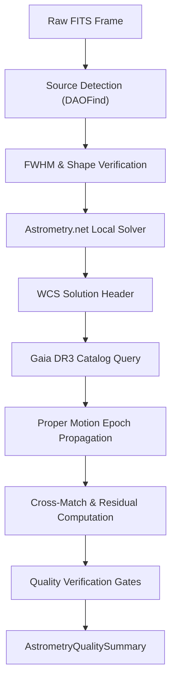

# Astrometry and Plate Solving Pipeline Review Guide

*Version 1.0 · 2026-10-10 · Status: current*

## Abstract

This document details the scientific methodology, mathematical formulations,
input requirements, execution lifecycle, calibration parameters, and quality
verification gates implemented in the Astrometrics plate solving and astrometric
calibration pipeline (`astrometricslib.pipelines.astrometry`).

## 1. Overview & Scientific Objective

**Statement of need.** Astrometry establishes the World Coordinate System
(WCS) for raw astronomical exposures by mapping detector pixel coordinates
$(x, y)$ to International Celestial Reference System (ICRS) celestial
coordinates $(\alpha, \delta)$. Precise coordinates are a prerequisite
for aperture positioning in photometry and dispersion tracing in spectroscopy.

## 2. Input Requirements & FITS Header Specification

The pipeline requires specific header metadata to constrain scale hints:

| FITS Keyword | Requirement | Data Type | Description | Fallback Mode |
| :--- | :--- | :--- | :--- | :--- |
| `DATE-OBS` | Mandatory | `str` (ISO-8601) | Observation epoch UTC timestamp. | Epoch stays 2016.0. |
| `FOCALLEN` | Recommended | `float` (mm) | Telescope focal length. | Blind solve window (±20%). |
| `XPIXSZ` | Recommended | `float` (μm) | Camera pixel physical width. | Assumes 3.76 μm. |
| `YPIXSZ` | Recommended | `float` (μm) | Camera pixel physical height. | Assumes 3.76 μm. |
| `BINNING` | Optional | `int` | Sensor pixel binning factor. | Assumes 1x1 binning. |

## 3. Mathematical & Algorithmic Formulation

### 3.1 Point Source Detection & Morphological Filtering
Sources are identified by convolving the calibrated frame with a Gaussian kernel
matching the estimated stellar FWHM:
$$\text{SNR}(x, y) = \frac{I(x, y) - \text{median}(B)}{\sigma_B} \ge 5.0$$
Detections are vetted using roundness $r \in [-0.6, +0.6]$ and sharpness
$s \in [0.2, 1.0]$ to reject cosmic rays and satellite streaks.

### 3.2 Proper Motion Epoch Propagation
Gaia DR3 reference catalog positions are observed at epoch J2016.0. Before
cross-matching against detected centroids, catalog coordinates are propagated to
the exposure timestamp $t_\text{obs}$:
$$\Delta t = t_\text{obs} - 2016.0$$
$$\alpha(t_\text{obs}) = \alpha_0 + \frac{\mu_\alpha^* \Delta t}{\cos \delta_0}$$
$$\delta(t_\text{obs}) = \delta_0 + \mu_\delta \Delta t$$

### 3.3 Astrometric Residual Evaluation
The cross-match separation RMS measures concordance between detected centroids
and catalog positions:
$$\text{RMS}_\text{sep} = \sqrt{\frac{1}{N} \sum_{i=1}^N \Delta \theta_i^2}$$
where $\Delta \theta_i$ is the great-circle separation computed via the
haversine formula.

## 4. Four-Stage Lifecycle Architecture

Implemented via `AstrometryPipelineAdapter` in `runner.py`:

- **Stage 1 (`process_input`):** Extracts FITS metadata, computes pixel scale hints,
  and confirms image readability.
- **Stage 2 (`run`):** Executes DAOFind source detection, runs local Astrometry.net
  solver, queries Gaia DR3 catalog, and propagates proper motions.
- **Stage 3 (`validate_output`):** Evaluates 4 quality run gates (`source_detection`,
  `astrometric_residual`, `catalog_matches`, `catalog_lookup`).
- **Stage 4 (`to_result_dict`):** Packages WCS solution header and
  `AstrometryQualitySummary`.

## 5. Tuned Calibration Parameters

| Parameter | Live Value | Empirical Status | Notes |
| :--- | :--- | :--- | :--- |
| `MAXIMUM_RESIDUAL_FRACTION_OF_FWHM` | `0.5` | Designed | Gate fails if separation RMS exceeds 0.5 of star FWHM. |
| `MINIMUM_MATCHED_STARS` | `20` | Designed | Minimum catalog matches required for residual validity. |
| `MAXIMUM_FAILED_LOOKUP_FRACTION` | `0.5` | Designed | Maximum failed catalog queries before flagging. |
| Catalog Match Radius | 10.0 arcsec | Designed | Search radius for pairing centroids with Gaia stars. |
| Local Solve Star Limit | 10 sources | Designed | Minimum detected stars required to attempt local solve. |

## 6. Degraded States & Fallback Pathways

1. **Missing Optical Metadata:** When `FOCALLEN` or pixel sizes are absent,
   the pipeline widens the solver search window to $\pm 20\%$ around default hints.
2. **Offline Catalog Access:** If SIMBAD/Gaia queries fail or time out, the
   remote circuit breaker trips; positions remain in solved WCS coordinates
   without external naming.
3. **Solver Fit Residual Fallback:** When the plate solver provides no internal
   fit residual, the residual gate falls back to the Gaia catalog separation RMS.

## 7. Quality Summary Data Models

### 7.1 Pipeline Execution Envelope
| Field Name | Type | Description |
| :--- | :--- | :--- |
| `pipeline_name` | `str` | Unique pipeline domain identifier (e.g., astrometry, photometry). |
| `pipeline_version` | `str` | Semantic version of the pipeline processing contract. |
| `target_id` | `str` | Target celestial object identifier. |
| `target_session_ids` | `list[str]` | List of observing session IDs included in the analysis. |
| `target_session_breakdown` | `list[astrometricslib.models.quality_summary.TargetSessionContribution]` | Per-session frame counts and contribution breakdown. |
| `upstream_quality_summary_reference` | `str | None` | Category name of prerequisite pipeline. |
| `resolved_parameters` | `dict[str, Any]` | Effective configuration parameters used during execution. |
| `camera_profile` | `astrometricslib.models.quality_summary.AppliedCameraProfile | None` | Camera sensor parameters and clipping thresholds applied. |
| `quality_processing_applied` | `bool` | Indicates whether QA gates and checks were executed. |
| `flagged` | `bool` | True if one or more quality gates failed, indicating data concerns. |
| `flag_reasons` | `list[str]` | Human-readable sentences describing reasons for quality flags. |
| `gates` | `list[astrometricslib.models.gate_result.GateResult]` | Complete collection of passed, failed, and unchecked GateResults. |
| `created_at` | `datetime.datetime` | UTC timestamp when the quality summary was generated. |
| `provenance_activity_id` | `str | None` | IVOA provenance activity / job tracking identifier. |
| `upstream_entity_id` | `str | None` | Exact upstream database entity consumed by this run. |
| `astrometry_metrics` | `astrometricslib.models.quality_summary.AstrometryPipelineQualityMetrics` | Quality metric attribute. |

### 7.2 Domain Scientific Metrics Schema
| Field Name | Type | Description |
| :--- | :--- | :--- |
| `catalog_matched_star_count` | `int` | Quality metric attribute. |
| `position_only_star_count` | `int` | Quality metric attribute. |
| `unresolved_star_count` | `int` | Quality metric attribute. |
| `sources_detected` | `int` | Total point sources detected above background threshold. |
| `solve_attempted` | `bool` | Whether a plate solve was attempted on the frame. |
| `plate_solve_succeeded` | `bool` | Whether the plate solving engine found a valid WCS solution. |
| `simbad_matched_count` | `int` | Count of detected stars matched with SIMBAD catalog entries. |
| `catalog_match_separation_rms_arcsec` | `float | None` | RMS separation to the nearest SIMBAD or Gaia DR3 star. |
| `plate_solve_fit_residual_rms_arcsec` | `float | None` | Internal solver fit residual from Astrometry.net. |
| `plate_solve_matched_star_count` | `int | None` | Number of stars used by solver to compute WCS. |
| `gaia_fit_rms_arcsec` | `float | None` | Quality metric attribute. |
| `gaia_fit_rms_before_arcsec` | `float | None` | Quality metric attribute. |
| `gaia_fit_star_count` | `int | None` | Quality metric attribute. |
| `wcs_refinement_shift_arcsec` | `float | None` | Quality metric attribute. |
| `astrometry_flags` | `list[str]` | Warning flags for conditions that limit coordinate accuracy. |
| `plate_scale_arcsec_per_pixel` | `float | None` | Calculated plate scale in arcseconds per detector pixel. |
| `star_fwhm_px` | `float | None` | Median stellar Full-Width at Half-Maximum across the image in pixels. |
| `remote_catalog_queries_attempted` | `int` | Number of remote catalog requests initiated. |
| `remote_catalog_queries_failed` | `int` | Number of remote catalog queries that timed out or failed. |
| `remote_catalog_circuit_breaker_tripped` | `bool` | True if network outages halted catalog queries. |
| `plate_solve_attempts` | `int` | Number of plate solve iterations attempted. |
