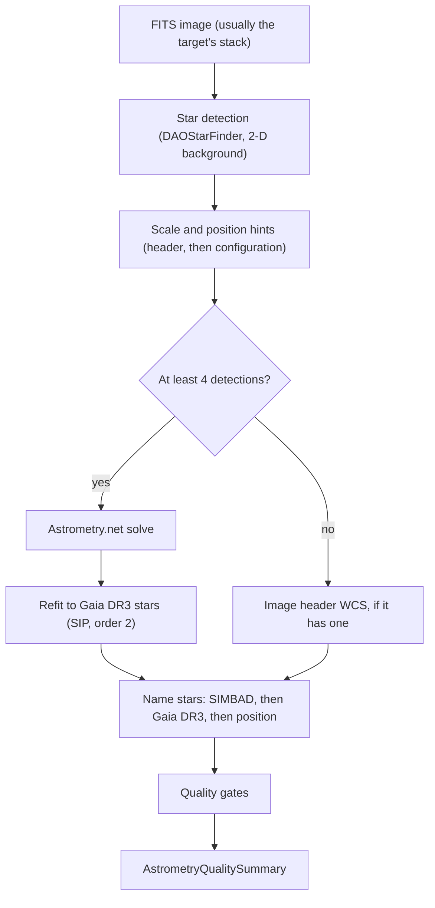

# Astrometry and Plate Solving Pipeline Review Guide

*Version 1.1 · 2026-10-14 · Status: current*

## Abstract

This document reviews the plate solving and astrometric calibration pipeline
(`astrometricslib.pipelines.astrometry`). It covers the header cards the
pipeline reads, its detection and solving methods, the Gaia DR3 refit of the
solution, how stars are named, the run flow, the tuned limits, the fallback
paths and the quality-summary fields.

## 1. Overview & Scientific Objective

**Statement of need.** Astrometry finds the World Coordinate System (WCS) of
an image: the map from detector pixels $(x, y)$ to sky coordinates
$(\alpha, \delta)$ in the International Celestial Reference System (ICRS).
Photometry needs it to match stars across sessions. Spectroscopy needs it to
name the stars whose spectra it extracts. Asteroid detection needs it to place
every frame on the sky.

## 2. Input Requirements & FITS Header Specification

No card is strictly required: a missing card weakens a hint or a correction,
and the run says so in its flags.

| FITS Keyword | Requirement | Data Type | What It Is Used For | When Missing |
| :--- | :--- | :--- | :--- | :--- |
| `DATE-OBS` | Recommended | `str` (ISO-8601, UTC) | Time the shutter opened. Moves Gaia DR3 positions to the image date (Eq. 3). | Gaia positions stay at epoch 2016.0 and the run is flagged. |
| `FOCALLEN` | Recommended | `float` (mm) | Focal length for the pixel-scale hint (Eq. 2). | The configured focal length. |
| `XPIXSZ` / `YPIXSZ` | Recommended | `float` (μm) | Binned pixel size, used as written. Two different values are averaged and flagged. | `PIXSIZE1` / `PIXSIZE2` times `XBINNING` / `YBINNING`. |
| `PIXSIZE1` / `PIXSIZE2` | Optional | `float` (μm) | Unbinned pixel size, multiplied by the binning. | `PIXSCAL`. |
| `XBINNING` / `YBINNING` | Optional | `int` | Binning factor applied to `PIXSIZE1` / `PIXSIZE2`. | 1. |
| `PIXSCAL` | Optional | `float` (arcsec/px) | Pixel scale, read only when no pixel size is given. | No scale hint: the solver searches all scales. |
| `RA` / `DEC` (or `OBJCTRA` / `OBJCTDEC`) | Optional | `float` or sexagesimal `str` | Pointing hint when the target record has no coordinates. | No position hint. |
| `OBJECT` | Optional | `str` | Target name, used for the extended-source hint. | Guessed from the file name. |

The pixel-scale hint is the scale from Eq. 2 with a window of ±5%. The solver
driver widens that window to 0.8 times its lower edge and 1.2 times its upper
edge before calling `solve-field`. With no focal length or no pixel size, no
scale hint is sent.

## 3. Mathematical & Algorithmic Formulation

### 3.1 Point Source Detection

The background is a 2-D map (photutils `Background2D`, median estimator,
3σ clipping). A small image falls back to one sigma-clipped median. A source
is kept when its peak stands above the background by the threshold $k$:

$$\frac{I(x, y) - B(x, y)}{\sigma_B} \ge k = 5 \tag{1}$$

`DAOStarFinder` keeps sharpness in $[0.2, 1.0]$ and roundness in
$[-0.6, +0.6]$, which rejects hot pixels and filament structure. The kernel
width is the measured blob width: the second moment of the light in a 30-pixel
box around the brightest sources. It counts faint wings and neighbours, so it
reads about twice the stellar FWHM (full width at half maximum). Detections
closer than 15 px are merged. Colour frames are block-averaged before
detection.

### 3.2 Pixel-Scale Hint

$$s = 206.265 \, \frac{p}{f} \tag{2}$$

where $s$ is the scale in arcsec per pixel, $p$ the binned pixel size in μm
and $f$ the focal length in mm.

### 3.3 Plate Solve and Gaia DR3 Refit

The brightest 100 detections go to Astrometry.net. The
solver fits only the bright stars of its index files, so its solution can be
a pixel or more off. The pipeline then refits the solution to the field's
Gaia DR3 stars (`wcs_refinement.py`). Each detection is matched to the nearest
Gaia star within 4 px, then 1.5 px on later passes. A
tangent-plane solution with SIP distortion of order 2 is fitted
with `astropy.wcs.utils.fit_wcs_from_points`. Stars more than
3 robust standard deviations off are dropped, and the fit repeats
until the matched set stops changing. The refit needs at least
40 matches. It is kept only when it fits Gaia better than
the solver's solution and moves the field by at most 30 arcsec.

### 3.4 Proper Motion Epoch Propagation

Gaia DR3 positions are given at epoch J2016.0. Before matching, they
are moved to the image time with astropy's `SkyCoord.apply_space_motion`. To
first order this is

$$\alpha(t) = \alpha_0 + \frac{\mu_{\alpha*} \, \Delta t}{\cos \delta_0}, \qquad
\delta(t) = \delta_0 + \mu_\delta \, \Delta t, \qquad \Delta t = t_\text{obs} - 2016.0 \tag{3}$$

where $\mu_{\alpha*}$ is Gaia's `pmra` (which already includes
$\cos \delta$) and $\mu_\delta$ is `pmdec`.

### 3.5 Star Naming

With a solution, each star is named from SIMBAD first, within
10 arcsec. Stars SIMBAD does not know are matched against a
Gaia DR3 cone, whose faint limit is set from the frame's own zero point. Stars
neither catalog knows get a position-based name such as
`FIELD_J123.4+45.6`. Separations are great-circle distances from
`SkyCoord.separation`. The catalog match separation is

$$\text{RMS}_\text{sep} = \sqrt{\frac{1}{N} \sum_{i=1}^N \Delta \theta_i^2} \tag{4}$$

over the $N$ stars matched within the radius.

### 3.6 Residual Gate

The residual $r$ (arcsec) is judged against the star width:

$$\frac{r}{s \cdot \text{FWHM}} \le 0.5 \tag{5}$$

The residual is the first of these that was measured: the RMS against Gaia
from the refit, then the solver's own fit residual, then the catalog match
separation of Eq. 4. The gate detail names the one used.

## 4. Processing Flow

`run_astrometry_analysis` (`runner.py`) runs `AstrometryPipelineAdapter`
through `run_pipeline`. `run_pipeline` (`pipeline_base.py`) calls the adapter's four methods in
order. It skips `run` only when `process_input` returns a `Result` with
`has_work=False`. After `validate_output` it stores the quality summary on the
target and records the run's provenance.

- **Stage 1 (`process_input`):** A no-op that returns an empty `Result`.
  `analyze_target` has already checked that an image path exists.
- **Stage 2 (`run`):** Runs `AstrometryPipeline.process` (detection, solve,
  refit, header-WCS fallback, naming). It writes the solved WCS into the FITS
  header, fills in the target's RA/Dec when they were unset, and saves the
  stars to the shared catalog.
- **Stage 3 (`validate_output`):** Builds the `AstrometryQualitySummary`. The
  runner records `plate_solve`, then `astrometry_run_gates` adds the rest
  (5 run gates in all).
- **Stage 4 (`to_result_dict`):** Returns `context`, `stellar_objects`, `wcs`
  and `image_stats`.

### 4.1 Quality Gates

| Gate | Role | Defined in | What it checks |
| :--- | :--- | :--- | :--- |
| `source_detection` | run gate | `post_processing/run_gates.py` | Fails when no star was detected. |
| `astrometric_residual` | run gate | `post_processing/run_gates.py` | Fails when the solution misses its stars by more than `MAXIMUM_RESIDUAL_FRACTION_OF_FWHM` of a star's width (Eq. 5). Not checked when the residual, plate scale or star width is missing. |
| `catalog_matches` | run gate | `post_processing/run_gates.py` | Fails when fewer than `MINIMUM_MATCHED_STARS` stars were matched to a catalog. Not checked when the image was not solved. |
| `catalog_lookup` | run gate | `post_processing/run_gates.py` | Fails when the remote-catalog circuit breaker tripped during the run, or when at least `MAXIMUM_FAILED_LOOKUP_FRACTION` of lookups failed. Not checked when no lookup was made. |
| `plate_solve` | run gate | `runner.py` | Fails when the image ends the run with no sky solution, from the solver or from the image's own header WCS. |

## 5. Tuned Calibration Parameters

| Parameter | Live Value | Empirical Status | Notes |
| :--- | :--- | :--- | :--- |
| `MAXIMUM_RESIDUAL_FRACTION_OF_FWHM` | `0.5` | Design estimate | Largest residual, as a share of the star FWHM. 8 saved solves gave 0.14 to 0.44. |
| `MINIMUM_MATCHED_STARS` (`run_gates`) | `20` | Design estimate | Fewest catalog-matched stars for the residual to mean anything. |
| `MAXIMUM_FAILED_LOOKUP_FRACTION` | `0.5` | Design estimate | Share of failed catalog lookups that fails `catalog_lookup`. |
| `CATALOG_MATCH_RADIUS_ARCSEC` | `10.0` arcsec | Designed | Radius for pairing a detected star with a SIMBAD or Gaia DR3 star. |
| `MAXIMUM_PLATE_SOLVE_SOURCES` | `100` | Designed | The brightest detections sent to the solver. |
| Solve minimum | 4 sources | Designed | Fewest detections for a solve to be tried (`process_image`). |
| `SourceDetector` threshold | `5` σ | Designed | Detection threshold above the background RMS. |
| `MINIMUM_MATCHED_STARS` (`wcs_refinement`) | `40` | Design value | Fewest Gaia matches for the SIP refit. |
| `MAXIMUM_SHIFT_ARCSEC` | `30.0` arcsec | Designed | Largest field shift a refit may make and still be kept. |

## 6. Degraded States & Fallback Pathways

1. **Missing optical metadata.** `FOCALLEN` falls back to the configured focal
   length. Pixel size falls back from `XPIXSZ` to `PIXSIZE1` times
   `XBINNING`, then to `PIXSCAL`. With none of these, the solve runs with no
   scale hint.
2. **Too few detections (fewer than 4).** No solve is tried. A celestial WCS
   already in the image header is used instead. Without one, `plate_solve`
   fails.
3. **Solver failure.** A tried solve that finds no solution raises
   `PlateSolveFailedError`, and the adapter does not catch it.
4. **No Gaia stars.** The refit is skipped with a flag and the solver's
   solution is kept. Without `DATE-OBS`, or with a cache that has no proper
   motions, Gaia positions stay at epoch 2016.0 with a flag.
5. **Catalog outages.** Repeated failures trip a process-wide circuit breaker.
   Unnamed stars keep position-based names, and `catalog_lookup` reports the
   outage.

## 7. Quality Summary Data Models

### 7.1 Pipeline Execution Envelope (`AstrometryQualitySummary`)

| Field Name | Type | Description |
| :--- | :--- | :--- |
| `pipeline_name` | `str` | Unique pipeline domain identifier (e.g., astrometry, photometry). |
| `pipeline_version` | `str` | Semantic version of the pipeline processing contract. |
| `target_id` | `str` | Target celestial object identifier. |
| `target_session_ids` | `list[str]` | List of observing session IDs included in the analysis. |
| `target_session_breakdown` | `list[astrometricslib.models.quality_summary.TargetSessionContribution]` | Per-session frame counts and contribution breakdown. |
| `upstream_quality_summary_reference` | `str \| None` | Category name of prerequisite pipeline. |
| `resolved_parameters` | `dict[str, Any]` | Effective configuration parameters used during execution. |
| `camera_profile` | `astrometricslib.models.quality_summary.AppliedCameraProfile \| None` | Camera sensor parameters and clipping thresholds applied. |
| `quality_processing_applied` | `bool` | Indicates whether QA gates and checks were executed. |
| `flagged` | `bool` | True if one or more quality gates failed, indicating data concerns. |
| `flag_reasons` | `list[str]` | Human-readable sentences describing reasons for quality flags. |
| `gates` | `list[astrometricslib.models.gate_result.GateResult]` | Complete collection of passed, failed, and unchecked GateResults. |
| `created_at` | `datetime.datetime` | UTC timestamp when the quality summary was generated. |
| `provenance_activity_id` | `str \| None` | IVOA provenance activity / job tracking identifier. |
| `upstream_entity_id` | `str \| None` | Exact upstream database entity consumed by this run. |
| `astrometry_metrics` | `astrometricslib.models.quality_summary.AstrometryPipelineQualityMetrics` | The astrometry measurements (Section 7.2). |

### 7.2 Domain Scientific Metrics Schema (`AstrometryPipelineQualityMetrics`)

| Field Name | Type | Description |
| :--- | :--- | :--- |
| `catalog_matched_star_count` | `int` | Stars matched to a SIMBAD or Gaia DR3 entry. |
| `position_only_star_count` | `int` | Stars named only by their sky position. |
| `unresolved_star_count` | `int` | Stars with no catalog match and no sky position; not saved. |
| `sources_detected` | `int` | Total point sources detected above background threshold. |
| `solve_attempted` | `bool` | Whether a plate solve was attempted on the frame. |
| `plate_solve_succeeded` | `bool` | Whether the image ended the run with a WCS solution. |
| `simbad_matched_count` | `int` | Count of detected stars matched with SIMBAD catalog entries. |
| `catalog_match_separation_rms_arcsec` | `float \| None` | RMS separation to the nearest SIMBAD or Gaia DR3 star. |
| `plate_solve_fit_residual_rms_arcsec` | `float \| None` | Internal solver fit residual from Astrometry.net. |
| `plate_solve_matched_star_count` | `int \| None` | Number of stars used by solver to compute WCS. |
| `gaia_fit_rms_arcsec` | `float \| None` | RMS distance to Gaia DR3 stars under the kept solution. |
| `gaia_fit_rms_before_arcsec` | `float \| None` | RMS distance to the same Gaia stars under the solver's solution. |
| `gaia_fit_star_count` | `int \| None` | Stars used in the Gaia refit. |
| `wcs_refinement_shift_arcsec` | `float \| None` | Largest move of the field made by the Gaia refit. |
| `astrometry_flags` | `list[str]` | Warning flags for conditions that limit coordinate accuracy. |
| `plate_scale_arcsec_per_pixel` | `float \| None` | Calculated plate scale in arcseconds per detector pixel. |
| `star_fwhm_px` | `float \| None` | Median stellar Full-Width at Half-Maximum across the image in pixels. |
| `remote_catalog_queries_attempted` | `int` | Number of remote catalog requests initiated. |
| `remote_catalog_queries_failed` | `int` | Number of remote catalog queries that timed out or failed. |
| `remote_catalog_circuit_breaker_tripped` | `bool` | True if network outages halted catalog queries. |
| `plate_solve_attempts` | `int` | Number of plate solve iterations attempted. |
