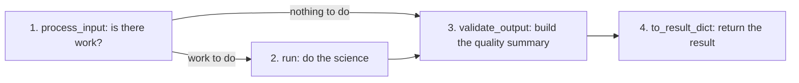

# Scientific Analysis Pipelines Review Index

*Version 1.1 · 2026-10-14 · Status: current*

## Abstract

This index is the entry point for scientific review of the Astrometrics
processing pipelines. Each guide covers the header cards a pipeline reads, its
maths, its processing flow, its tuned limits, its fallback paths and its
quality gates. The gate lists and counts are read from the code when the
guides are generated.

A pipeline here is a fixed series of processing steps that turns telescope
images into a scientific result. A quality gate is an automatic check on a
run that passes, fails, or is not checked when its data are missing.

Terms are defined in the [glossary](../Astrometrics_Library_Architecture.md#appendix-b-glossary). Each guide also
defines its terms where they first appear, so it can be read on its own.

## 1. Pipeline Architecture

Four analysis pipelines share the `AnalysisPipeline` interface
(`pipeline_base.py`). `run_pipeline` calls four methods in order:

1. **`process_input`:** decides whether there is work to do.
2. **`run`:** does the science.
3. **`validate_output`:** builds the quality summary and records the gates.
4. **`to_result_dict`:** returns the result the caller expects.

`run` is skipped only when `process_input` returns `has_work=False`. Stage 1
does real work only in photometry:

| Pipeline | Stage 1 (`process_input`) |
| :--- | :--- |
| Astrometry | No-op: returns an empty `Result`. |
| Photometry | Filters frames, builds sessions; may return `has_work=False`. |
| Spectroscopy | No-op: returns an empty `Result`. |
| Asteroid Detection | No-op: returns an empty `Result`. |

Stacking does not use this interface. It runs from `stage.stack_frames`
through `stack_runner.run_stack` to a `StackingDriver`, whose Siril
implementation runs `ImageProcessing` in `siril_interface.py`.



## 2. Pipeline Portfolio Overview

In plain words, the five pipelines do this:

- **Astrometry** finds where an image points on the sky, pixel by pixel, and
  names its stars.
- **Photometry** measures how each star's brightness changes over time and
  picks out the variable stars.
- **Spectroscopy** spreads each star's light into its colours and classifies
  the star from that spectrum.
- **Asteroid Detection** finds objects that move between images and checks
  them against known asteroids and comets.
- **Image Stacking** removes camera flaws from many exposures and combines
  them into one deeper image.

| Pipeline | Review Guide | Entry Point | Quality Summary | Gates |
| :--- | :--- | :--- | :--- | :--- |
| **Astrometry** | [Astrometry](astrometry.md) | `AstrometryPipelineAdapter` | `AstrometryQualitySummary` | 5 run gates |
| **Photometry** | [Photometry](photometry.md) | `PhotometryPipelineAdapter` | `PhotometryQualitySummary` | 11 run gates + 2 period checks |
| **Spectroscopy** | [Spectroscopy](spectroscopy.md) | `SpectroscopyPipelineAdapter` | `SpectroscopyQualitySummary` | 9 run gates |
| **Asteroid Detection** | [Asteroid Detection](asteroid_detection.md) | `AsteroidDetectionPipelineAdapter` | `AsteroidDetectionQualitySummary` | 5 run gates |
| **Image Stacking** | [Image Stacking](stacking.md) | `stage.stack_frames` (no adapter) | `StackQualitySummary` | 16 run gates |

A run gate is recorded on the run's quality summary. A period check is
recorded on each period-search result and can lower its verdict.

## 3. Reviewer Checklist

When auditing the pipelines, check:

1. **Input metadata contracts.** Which header cards each pipeline reads and
   what happens when one is missing.
2. **Mathematical formulations.** The CCD equation (the error of a measured
   brightness), $\text{BJD}_\text{TDB}$ times (times measured at the solar
   system's center of mass), Stetson $J$ (a test for smooth, real brightness
   changes), the grating equation (position along a spectrum to wavelength)
   and the stack FWHM prediction (how sharp the stars of a stack should be).
3. **Degraded states.** Sparse fields, tracking drift (the field sliding
   across the sensor during a run), saturated zero orders (clipped point
   images beside the spectra) and catalog outages.
4. **Empirical status.** Which limits were measured on real data and which are
   design estimates.

```{toctree}
:maxdepth: 1
:hidden:

astrometry
photometry
spectroscopy
asteroid_detection
stacking
```
