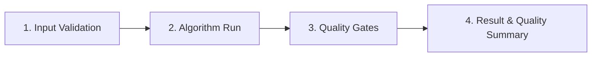

# Scientific Analysis Pipelines Review Index

*Version 1.0 · 2026-10-10 · Status: current*

## Abstract

This guide provides a centralized entry point for scientific peer review and
architectural auditing of the Astrometrics processing pipelines. Every pipeline
is documented directly from live code introspection, detailing mathematical
formulations, input FITS header contracts, lifecycle stages, calibration
parameters, degraded states, and quality gates.

## 1. Unified Pipeline Architecture

All Astrometrics analysis pipelines conform to a standardized 4-stage lifecycle
defined in `AnalysisPipeline` (`pipeline_base.py`):

1. **Input Validation (`process_input`):** Verifies sensor metadata, FITS headers,
   and frame eligibility before scientific processing begins.
2. **Algorithm Execution (`run`):** Executes core domain algorithms (star
   detection, WCS solving, aperture photometry, dispersion tracing, tracklet chaining).
3. **Quality Validation (`validate_output`):** Evaluates standardized runtime
   gates, ensuring scientific thresholds and tolerances are met.
4. **Serialization (`to_result_dict`):** Packages structured scientific data
   and Pydantic `*QualitySummary` models into persistent storage contracts.



## 2. Pipeline Portfolio Overview

| Pipeline | Review Guide | Adapter / Driver | Quality Summary | Gates |
| :--- | :--- | :--- | :--- | :--- |
| **Astrometry** | [Astrometry](astrometry.md) | `AstrometryPipelineAdapter` | `AstrometryQualitySummary` | 4 gates |
| **Photometry** | [Photometry](photometry.md) | `PhotometryPipelineAdapter` | `PhotometryQualitySummary` | 7 gates |
| **Spectroscopy** | [Spectroscopy](spectroscopy.md) | `SpectroscopyPipelineAdapter` | `SpectroscopyQualitySummary` | 7 gates |
| **Asteroid Detection** | [Asteroids](asteroid_detection.md) | `AsteroidDetectionPipelineAdapter` | `AsteroidDetectionQualitySummary` | 5 gates |
| **Image Stacking** | [Stacking](stacking.md) | `StackingDriver` | `StackQualitySummary` | 2 gates |

## 3. Reviewer Checklist

When auditing the Astrometrics pipelines, reviewers should inspect:
1. **Input Metadata Contracts:** Required FITS keywords (`DATE-OBS`, `EXPTIME`,
   `GAIN`, `RDNOISE`) and fallback behaviors when headers are missing.
2. **Mathematical Formulations:** CCD noise equations, relativistic
   $\text{BJD}_\text{TDB}$ conversions, Stetson $J$ variability,
   and dispersion polynomial tracing.
3. **Degraded States & Fallback Pathways:** Behavior during sparse fields,
   tracking drift, saturated anchors, and remote catalog outages.
4. **Empirical Status of Calibration Parameters:** Explicit distinction between
   empirically calibrated thresholds and heuristic engineering estimates.

```{toctree}
:maxdepth: 1
:hidden:

astrometry
photometry
spectroscopy
asteroid_detection
stacking
```
