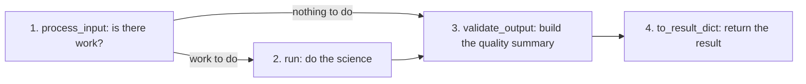

# Scientific analysis pipelines review index

*Version 1.2 · 2026-10-15 · Status: current*

## Abstract

This index is the entry point for scientific review of the Astrometrics processing pipelines. A pipeline here is a fixed series of processing steps that turns telescope images into a scientific result. A quality gate is an automatic test on a run that passes, fails, or is not checked when its data are missing. Each guide covers the header cards a pipeline reads, its math, its processing flow, its tuned limits, its fallback paths and its quality gates. Header cards are the named keyword and value entries at the top of a FITS image file, such as `EXPTIME` for the exposure length. The gate lists and counts are read from the code when the guides are generated.

Terms are defined in the [glossary](../Astrometrics_Library_Architecture.md#appendix-a-glossary). This document also defines each term the first time it appears.

## 1. Pipeline architecture

There are five pipelines. Four of them (astrometry, photometry, spectroscopy and asteroid detection) are analysis pipelines that share one Python interface, `AnalysisPipeline` (`pipeline_base.py`). Each has an adapter: a class that wraps the pipeline's own code in that interface. The function `run_pipeline` drives an adapter by calling four of its methods in order. Each guide calls these the four stages of a run:

1. **`process_input`.** Decides whether there is work to do.
2. **`run`.** Does the science.
3. **`validate_output`.** Builds the quality summary and records the gates.
4. **`to_result_dict`.** Returns the result the caller expects.

Stage 1 returns a `Result` object. `run` is skipped only when that object says `has_work=False`. Stage 1 does real work only in photometry:

| Pipeline | Stage 1 (`process_input`) |
| --- | --- |
| Astrometry | No-op: returns an empty `Result`. |
| Photometry | Filters frames, builds sessions; may return `has_work=False`. |
| Spectroscopy | No-op: returns an empty `Result`. |
| Asteroid detection | No-op: returns an empty `Result`. |

The fifth pipeline, stacking, does not use this interface and has no adapter. It runs from `stage.stack_frames` through `stack_runner.run_stack` to a `StackingDriver`: the interface for a program that calibrates, aligns and combines frames. The one implementation uses Siril, an open-source astronomy image processor, through the `ImageProcessing` class in `siril_interface.py`.



## 2. Pipeline portfolio overview

In plain words, the five pipelines do this:

- Astrometry finds where an image points on the sky, pixel by pixel, and names its stars.
- Photometry measures how each star's brightness changes over time and picks out the variable stars.
- Spectroscopy spreads each star's light into its colors and classifies the star from that spectrum.
- Asteroid detection finds objects that move between images and checks them against known asteroids and comets.
- Image stacking removes camera flaws from many frames and combines them into one deeper image.

Code outside the library calls the pipelines through the package root (see `Astrometrics_Library_Implementation.md`). The "Adapter class" column names the class each analysis run goes through inside the library.

| Pipeline | Review guide | Adapter class | Quality summary | Gates |
| --- | --- | --- | --- | --- |
| Astrometry | [Astrometry](astrometry.md) | `AstrometryPipelineAdapter` | `AstrometryQualitySummary` | 5 run gates |
| Photometry | [Photometry](photometry.md) | `PhotometryPipelineAdapter` | `PhotometryQualitySummary` | 11 run gates + 2 period checks |
| Spectroscopy | [Spectroscopy](spectroscopy.md) | `SpectroscopyPipelineAdapter` | `SpectroscopyQualitySummary` | 9 run gates |
| Asteroid detection | [Asteroid detection](asteroid_detection.md) | `AsteroidDetectionPipelineAdapter` | `AsteroidDetectionQualitySummary` | 5 run gates |
| Image stacking | [Image stacking](stacking.md) | None (runs from `stage.stack_frames`) | `StackQualitySummary` | 16 run gates |

A run gate is recorded on the run's quality summary. A period check is recorded on each period-search result and can lower its verdict. The counts cover only these recorded gates. The Architecture paper also describes quality tests that are not gates: the spectroscopy extinction record and sky-contamination share, kept with each spectrum, and the rejection of a poor wavelength fit when the instrument is calibrated.

## 3. Reviewer checklist

When auditing the pipelines, check:

1. **Input metadata contracts.** Which header cards each pipeline reads and what happens when one is missing.
2. **Mathematical formulations.** The CCD equation (the error of a measured brightness) and $\text{BJD}_\text{TDB}$ times (times measured at the solar system's center of mass). Stetson $J$ (a test for smooth, real brightness changes) and the grating equation (position along a spectrum to wavelength). The prediction of the stack's FWHM (full width at half maximum, the width of a star's light profile at half its peak), which says how sharp the stars of a stack should be.
3. **Degraded states.** Sparse fields, tracking drift (the field sliding across the sensor during a run), saturated zero orders (clipped point images beside the spectra) and catalog outages.
4. **Status labels.** Which limits were measured on real data and which are design estimates. The Status column in Section 5 of every guide labels each limit "Measured", "Partly measured" or "Design estimate", and links the label to the [validation register](../validation/index.md). The register gives the evidence for each value and the library calls to repeat the test on other data.

```{toctree}
:maxdepth: 1
:hidden:

astrometry
photometry
spectroscopy
asteroid_detection
stacking
```
