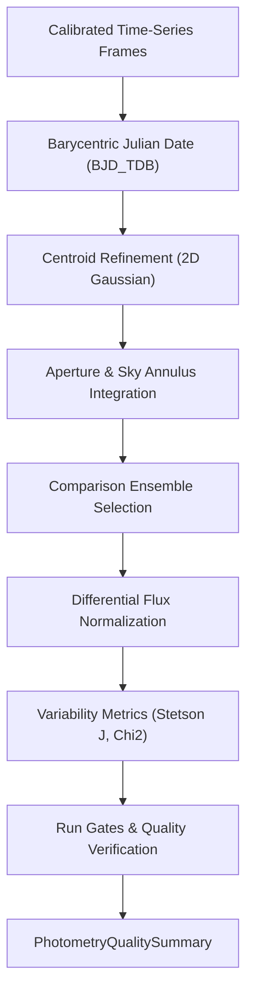

# Differential Photometry and Light Curve Pipeline Review Guide

*Version 1.0 · 2026-10-10 · Status: current*

## Abstract

This document reviews the differential aperture photometry, ensemble
normalization, and stellar variability analysis pipeline in Astrometrics
(`astrometricslib.pipelines.photometry`).

## 1. Overview & Scientific Objective

**Statement of need.** Time-domain photometry measures variations in stellar
brightness over time to detect exoplanet transits, stellar pulsations, and
eclipsing binaries. Ground-based observations suffer from atmospheric extinction
and transparency variations; differential ensemble photometry compensates for
these effects by normalizing target flux against an ensemble of constant
reference stars in the same field.

## 2. Input Requirements & FITS Header Specification

| FITS Keyword | Requirement | Data Type | Description | Fallback Mode |
| :--- | :--- | :--- | :--- | :--- |
| `DATE-OBS` | Mandatory | `str` (ISO-8601) | Mid-exposure observation time. | Aborts light curve generation. |
| `EXPTIME` | Mandatory | `float` (s) | Integration duration. | Assumes 1.0 second. |
| `FILTER` | Mandatory | `str` | Optical bandpass (e.g. V, R, B). | Filters by requested band. |
| `GAIN` | Recommended | `float` (e-/ADU) | Detector amplifier gain. | Uses camera profile default. |
| `RDNOISE` | Recommended | `float` (e-) | Sensor readout noise. | Uses camera profile default. |
| `SITELAT` | Recommended | `float` (deg) | Observatory geodetic latitude. | Disables BJD_TDB correction. |
| `SITELONG` | Recommended | `float` (deg) | Observatory geodetic longitude. | Disables BJD_TDB correction. |

## 3. Mathematical & Algorithmic Formulation

### 3.1 Relativistic Time Correction ($\text{BJD}_\text{TDB}$)
Exposure mid-times are corrected to the Solar System barycenter:
$$\text{BJD}_\text{TDB} = \text{HJD} + \Delta t_\text{rel}$$
This eliminates orbital light-travel delays of up to $\pm 8.3\text{ minutes}$.

### 3.2 Circular Aperture Photometry & Error Propagation
Net stellar flux is measured by integrating counts within radius $r = 4\text{ px}$
and subtracting local sky background $\bar{B}$ from an annulus
($r_\text{in} = 7\text{ px}, r_\text{out} = 12\text{ px}$):
$$F_\text{net} = \sum_{i \in \text{ap}} I_i - n_\text{pix} \bar{B}$$
Photometric uncertainty is calculated from the CCD equation:
$$\sigma_\text{ADU} = \sqrt{\frac{F_\text{net}}{g}
  + n_\text{pix} \left(\sigma_\text{read}^2 + \frac{\bar{B}}{g}\right)}$$

### 3.3 Differential Ensemble Normalization
A synthetic comparison light curve is formed from non-variable reference stars:
$$F_{\text{norm}, k} = \frac{F_k}{\sum_{j \in \text{ens}} w_j F_{j, k}}, \quad w_j = \frac{1}{\sigma_j^2}$$

### 3.4 Variability Detection Indices
- **Stetson $J$ Index:** Evaluates correlated departures in paired observations:
  $$J = \frac{1}{n} \sum_{k=1}^n \text{sgn}(P_k) \sqrt{|P_k|}$$
  $$P_k = \left(\frac{m_{1,k} - \bar{m}_1}{\sigma_{1,k}}\right)
    \left(\frac{m_{2,k} - \bar{m}_2}{\sigma_{2,k}}\right)$$
- **Reduced Chi-Square:**
  $$\chi_\nu^2 = \frac{1}{N-1} \sum_{k=1}^N \frac{(m_k - \bar{m})^2}{\sigma_k^2}$$

## 4. Four-Stage Lifecycle Architecture

Implemented via `PhotometryPipelineAdapter` in `runner.py`:

- **Stage 1 (`process_input`):** Partitions frames into sessions and validates bandpasses.
- **Stage 2 (`run`):** Centroid refinement, aperture integration, ensemble selection,
  and variability scoring.
- **Stage 3 (`validate_output`):** Evaluates 7 quality run gates (`rejection_fraction`,
  `observation_times`, `session_completeness`, `comparison_ensemble`,
  `tracking_stability`, `noise_model`, `photometric_scatter`).
- **Stage 4 (`to_result_dict`):** Emits light curves and `PhotometryQualitySummary`.

## 5. Tuned Calibration Parameters

| Parameter | Live Value | Empirical Status | Notes |
| :--- | :--- | :--- | :--- |
| `MINIMUM_ENSEMBLE_REJECTION_FRACTION` | `0.25` | Empirical (7.2% baseline) | Flags if rejected frame share exceeds 25%. |
| `MINIMUM_ENSEMBLE_REJECTION_COUNT` | `5` | Designed | Prevents false alarms on small sessions (< 20 frames). |
| Aperture Radius | 4.0 px | Designed | Standard photometric aperture radius. |
| Sky Annulus Radii | 7.0 to 12.0 px | Designed | Inner and outer sky background estimation radii. |
| Minimum Comparison Stars | 5 stars | Designed | Minimum ensemble size required for normalization. |
| Maximum Comparison Stars | 20 stars | Designed | Cap on comparison star ensemble size. |
| Max Detectable Amplitude | ~0.3 mag | Theoretical Limit | Large swings bias ensemble normalization. |

## 6. Degraded States & Fallback Pathways

1. **Sparse Fields ($< 20$ stars):** Empirical noise model fitting is skipped;
   the pipeline falls back to robust field scatter ($C_v = 1.4826 \times \text{MAD}$).
2. **Insufficient Comparison Stars ($< 5$ stars):** Differential normalization
   is bypassed; raw unnormalized light curves are preserved with a warning flag.
3. **Missing Geodetic Coordinates:** Mid-exposure UTC timestamps are retained
   without barycentric travel corrections.

## 7. Quality Summary Data Models

### 7.1 Pipeline Execution Envelope
| Field Name | Type | Description |
| :--- | :--- | :--- |
| `pipeline_name` | `str` | Unique pipeline domain identifier (e.g., astrometry, photometry). |
| `pipeline_version` | `str` | Semantic version of the pipeline processing contract. |
| `target_id` | `str` | Target celestial object identifier. |
| `target_session_ids` | `list[str]` | List of observing session IDs included in the analysis. |
| `target_session_breakdown` | `list[astrometricslib.models.quality_summary.TargetSessionContribution]` | Per-session frame counts and contribution breakdown. |
| `upstream_quality_summary_reference` | `str | None` | Category name of prerequisite pipeline. |
| `resolved_parameters` | `dict[str, Any]` | Effective configuration parameters used during execution. |
| `camera_profile` | `astrometricslib.models.quality_summary.AppliedCameraProfile | None` | Camera sensor parameters and clipping thresholds applied. |
| `quality_processing_applied` | `bool` | Indicates whether QA gates and checks were executed. |
| `flagged` | `bool` | True if one or more quality gates failed, indicating data concerns. |
| `flag_reasons` | `list[str]` | Human-readable sentences describing reasons for quality flags. |
| `gates` | `list[astrometricslib.models.gate_result.GateResult]` | Complete collection of passed, failed, and unchecked GateResults. |
| `created_at` | `datetime.datetime` | UTC timestamp when the quality summary was generated. |
| `provenance_activity_id` | `str | None` | IVOA provenance activity / job tracking identifier. |
| `upstream_entity_id` | `str | None` | Exact upstream database entity consumed by this run. |
| `photometry_metrics` | `astrometricslib.models.quality_summary.PhotometryPipelineQualityMetrics` | Quality metric attribute. |

### 7.2 Domain Scientific Metrics Schema
| Field Name | Type | Description |
| :--- | :--- | :--- |
| `catalog_matched_star_count` | `int` | Quality metric attribute. |
| `position_only_star_count` | `int` | Quality metric attribute. |
| `unresolved_star_count` | `int` | Quality metric attribute. |
| `stars_processed` | `int` | Total stars tracked across light curve time series. |
| `stars_found` | `int` | Reference stars initialized in reference exposure. |
| `frames_processed` | `int` | Number of calibrated time-series frames analyzed. |
| `rejected_frames` | `list[astrometricslib.models.quality_summary.ExcludedFrame]` | Frames excluded due to tracking drift, clouds, or defects. |
| `frame_ensemble_composition` | `list[astrometricslib.models.quality_summary.FrameEnsembleComposition]` | Per-frame record of comparison stars utilized. |
| `variable_candidate_count` | `int` | Number of stars flagged as short-term variable candidates. |
| `light_curve_scatter_rms_mag` | `float | None` | Median light curve scatter across non-variable field stars. |
| `cross_session_match_count` | `int` | Stars successfully matched across multi-night sessions. |
| `noise_model_curve` | `list[astrometricslib.models.quality_summary.NoiseModelPoint]` | Binned instrumental magnitude vs empirical RMS scatter curve. |
| `sessions_missing_wcs` | `list[str]` | Sessions lacking plate-solved WCS coordinate maps. |
| `long_term_variable_candidate_count` | `int` | Stars flagged as candidate long-term variables. |
| `astrometry_identified_star_count` | `int` | Stars matched to catalog astrometric seeds. |
| `sessions_with_reused_header_wcs` | `list[str]` | Sessions where pre-existing WCS was validated and used. |
| `sessions_with_replaced_header_wcs` | `list[str]` | Sessions where WCS was recalculated. |
