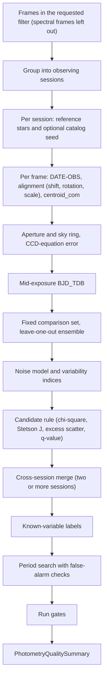

# Differential Photometry and Light Curve Pipeline Review Guide

*Version 1.1 · 2026-10-14 · Status: current*

## Abstract

This document reviews the differential aperture photometry, ensemble
normalization, variability and period-search pipeline
(`astrometricslib.pipelines.photometry`).

## 1. Overview & Scientific Objective

**Statement of need.** Time-domain photometry measures how a star's
brightness changes. It finds pulsating, eclipsing and rotating variables and
planet transits. From the ground, cloud, haze and airmass change every star's
flux together. Differential photometry removes that shared change by dividing
each star by an ensemble of constant comparison stars in the same frames.

## 2. Input Requirements & FITS Header Specification

The filter comes from each frame's record, and the observatory site comes from
the configuration. The target's sky position comes from the target record.

| FITS Keyword | Requirement | Data Type | What It Is Used For | When Missing |
| :--- | :--- | :--- | :--- | :--- |
| `DATE-OBS` | Mandatory (per frame) | `str` (ISO-8601, UTC) | Time the shutter opened. The light-curve time is mid-exposure BJD_TDB (Section 3.1). | That frame alone is rejected with a reason; `capture_timestamps` fails. |
| `EXPTIME` (or `EXPOSURE`) | Recommended | `float` (s) | Mid-exposure time and flux per second. | 1.0 s is assumed. |
| `EGAIN` | Optional | `float` (e-/ADU) | Gain for the flux errors, when the camera profile has none. `GAIN` is never read. | 1 e-/ADU is assumed; `flux_uncertainty` is not checked. |
| `RDNOISE` | Optional | `float` (e-) | Read noise for the flux errors, when the camera profile has none. | 0 e- is assumed. |
| `AIRMASS` (or `CENTAIRM`, `AIRM`, or altitude `CENTALT`, `ALTITUDE`, `ALT`) | Optional | `float` | Airmass for the optional ensemble airmass correction. | 1.0. |

## 3. Mathematical & Algorithmic Formulation

### 3.1 Capture Time ($\text{BJD}_\text{TDB}$)

`DATE-OBS` is the shutter-open time in UTC. The pipeline adds half the
exposure, converts UTC to TDB (Barycentric Dynamical Time), and adds the
light-travel time to the solar-system barycenter for the target's direction
(up to ±499 s). The result is the mid-exposure Barycentric Julian Date,
$\text{BJD}_\text{TDB}$. With no site configured, the observer is placed at
Earth's center. With no target position, the times stay as UTC start times.
The time basis is quoted in the `capture_timestamps` gate.

### 3.2 Centroid and Aperture Photometry

Each star is placed at its reference position moved by the frame's fitted
shift, rotation and scale change. It is then re-centered on its
brightness-weighted centroid (photutils `centroid_com`). When the centroid is
not trustworthy, the aligned position is kept and the reason is recorded.
Apertures are never rounded to whole pixels.

The net flux in a circle of radius 4 px is

$$F_\text{net} = \sum_{i \in \text{ap}} I_i - n_\text{pix} \bar{B} \tag{1}$$

where $\bar{B}$ is the median of a sky ring from 7 to 12 px.
Its 1σ error follows the CCD equation in electrons:

$$\sigma_F = \frac{1}{g}\sqrt{F_e + n_\text{pix}\left(S_e + R^2 + D_e\right)
  + \frac{n_\text{pix}^2}{n_\text{sky}}\left(S_e + R^2\right)} \tag{2}$$

Here $g$ is the gain (e-/ADU), $F_e = g F_\text{net}$, $S_e = g \bar{B}$ is
the sky per pixel, $R$ the read noise (e-), $D_e$ the dark current per pixel,
and $n_\text{sky}$ the number of sky pixels. The last term is the error of the
sky level itself. $\sigma_F$ is in ADU, like $F_\text{net}$.

### 3.3 Differential Ensemble Normalization

A fixed comparison set is chosen per session. Candidates are measured,
unsaturated and positive in every usable frame and not listed as variable.
The brightest 2% are skipped, the band reaches the brightest 30%, and
candidates that scatter more than their errors allow are dropped until
5 remain. At most 20 are kept.

Each member's flux is divided by its own session mean. The frame's ensemble
level is the inverse-variance weighted mean of those ratios:

$$L_k = \frac{\sum_j w_j \, F_{j,k} / \langle F_j \rangle}{\sum_j w_j}, \qquad
w_j = \frac{1}{\sigma_j^2}, \qquad \sigma_{L} = \frac{1}{\sqrt{\sum_j w_j}} \tag{3}$$

A comparison star is divided by the level built from the other members only
(leave one out), so its own changes never enter its divisor. A star's
normalized flux is $f_k = F_k / N_k$, with $N_k$ the level in ADU per second,
and its error is

$$\sigma_{f} = \sqrt{\left(\frac{\sigma_F}{N}\right)^2 + \left(\frac{F \sigma_N}{N^2}\right)^2} \tag{4}$$

Normalization needs at least 2 comparison stars. With fewer, the raw light
curves are kept.

### 3.4 Variability Indices and Candidate Rule

A noise model gives the scatter a constant star of magnitude $m$ shows in this
field, $\sigma_\text{model}(m)$, from the median scatter in brightness bins. It
needs at least 20 stars. Three indices are measured per
star:

$$\chi^2_\nu = \frac{1}{n-1}\sum_{i=1}^{n}\frac{(x_i - \bar{x}_w)^2}{\sigma_i^2} \tag{5}$$

$$\delta_i = \sqrt{\frac{n}{n-1}}\,\frac{x_i - \bar{x}_w}{\sigma_i}, \qquad
J = \frac{1}{n-1}\sum_{i=1}^{n-1}\operatorname{sgn}(P_i)\sqrt{|P_i|}, \qquad
P_i = \delta_i \, \delta_{i+1} \tag{6}$$

$$E = \frac{\sigma_\text{measured}}{\sigma_\text{model}(m)} \tag{7}$$

Eq. 6 is the single-band Stetson J with consecutive pairs and unit weights
(Stetson 1996, PASP 108, 851). The thresholds on $\chi^2_\nu$ and $J$ are the
field median plus 2.326 robust standard deviations. The threshold on
$E$ is fixed at 1.5. The ranking score is

$$S = \begin{cases}\min\left(\chi^2_\nu / \chi^2_\text{thr},\; E / E_\text{thr}\right) & J > J_\text{thr}\\
\min\left(\chi^2_\nu / \chi^2_\text{thr},\; E / E_\text{thr},\; 1\right) & \text{otherwise}
\end{cases} \tag{8}$$

A star is a candidate when $S > 1$ and its q-value is below 0.01. The
q-value is the Benjamini-Hochberg false discovery rate of the chi-square
false-alarm probability (the upper tail of the chi-square distribution with
$n - 1$ degrees of freedom).

A field too small for a noise model falls back to a cutoff on the
coefficient of variation (CV, standard deviation over mean):

$$\text{CV}_\text{cut} = \max\left(0.02,\;
  \text{median}(\text{CV}) + 7.4 \times \text{MAD}(\text{CV})\right) \tag{9}$$

where MAD is the unscaled median absolute deviation.

### 3.5 Period Search

The target's star and the brightest stars are searched with a Lomb-Scargle
periodogram (smooth cycles) and box least squares (repeating dips). The
false-alarm probability (FAP) is the share of block-shuffled copies of the
light curve that do as well. A "detected" verdict needs a FAP below
0.01. The Šidák correction, $1 - (1 - p)^m$ for $m$ searches,
keeps the chance of a false detection across the whole run at that level
(`family_wise_correction.py`). Two period checks (Section 4.1) can lower the
verdict.

### 3.6 Cross-Session Merge and Labels

With two or more sessions, each star's light curves are matched by sky
position and merged (`batch.py`). Each session keeps its own normalized level.
Stars whose level changes between sessions become long-term candidates.
Candidates are then labelled from SIMBAD, Gaia DR3 and VSX as listed,
not listed, or unknown (`known_variability_labels.py`).

## 4. Processing Flow

`run_photometry_analysis` (`runner.py`) runs `PhotometryPipelineAdapter`
through `run_pipeline`. `run_pipeline` (`pipeline_base.py`) calls the adapter's four methods in
order. It skips `run` only when `process_input` returns a `Result` with
`has_work=False`. After `validate_output` it stores the quality summary on the
target and records the run's provenance.

- **Stage 1 (`process_input`):** Keeps frames in the requested filter, leaves
  out spectral frames, and groups frames with a capture time into sessions.
  With no frame or no session it returns `has_work=False`, and
  `photometry_work` fails.
- **Stage 2 (`run`):** Runs one `VariabilityAnalyzer` pass per session, merges
  sessions, labels candidates, saves the stars, and runs the period search in
  a step whose failure cannot cost the light curves.
- **Stage 3 (`validate_output`):** Fits the run's noise model and records
  the run gates from `photometry_run_gates`. The period checks were already
  recorded on each period result in stage 2. The package defines
  11 run gates + 2 period checks.
- **Stage 4 (`to_result_dict`):** Returns run counts, the rejected frames,
  the short-term and long-term variable candidates and the cross-session
  match count.

### 4.1 Quality Gates

Run gates are recorded on the quality summary. Period checks are recorded on
each period result.

| Gate | Role | Defined in | What it checks |
| :--- | :--- | :--- | :--- |
| `ensemble_frame_rejection` | run gate | `post_processing/run_gates.py` | Fails when at least `MINIMUM_ENSEMBLE_REJECTION_COUNT_TO_FLAG` frames and at least `MINIMUM_ENSEMBLE_REJECTION_FRACTION_TO_FLAG` of the frames were rejected as ensemble outliers. |
| `capture_timestamps` | run gate | `post_processing/run_gates.py` | Fails when any frame was left out for a missing or unreadable capture time. The detail names the time basis of the light curves (Section 3.1). |
| `session_content` | run gate | `post_processing/run_gates.py` | Fails when a session produced no light curves. |
| `session_plate_solve` | run gate | `post_processing/run_gates.py` | Fails when a session could not be plate-solved for cross-session star matching. Not checked for a single session. |
| `photometry_work` | run gate | `post_processing/run_gates.py` | Fails when stage 1 found nothing to measure (no frame in the filter, or no frame with a capture time). |
| `comparison_ensemble` | run gate | `post_processing/run_gates.py` | Fails when a session has fewer than `MINIMUM_COMPARISON_STARS` comparison stars, a set that changes between frames, or comparison stars that scatter more than `MAXIMUM_ENSEMBLE_SCATTER_OVER_PREDICTED` times their predicted error. |
| `registration_drift` | run gate | `post_processing/run_gates.py` | Fails when the field shifts by more than `UNSTABLE_TRACKING_DRIFT_PX`, when rotation and scale change move a corner by more than `MAXIMUM_CORNER_DISPLACEMENT_PX` (95th percentile), or when more than `MAXIMUM_CENTROID_FALLBACK_FRACTION` of centroids fell back to the aligned position. |
| `scatter_population` | run gate | `post_processing/run_gates.py` | Not checked when too few stars have a measured scatter, or too few to fit the noise model, so the candidate cutoff is not reliable. |
| `variability_discrimination` | run gate | `post_processing/run_gates.py` | Fails when the variability score does not rank catalogued variables above unlisted stars (AUC test). Not checked with too few of either. |
| `detectable_amplitude` | run gate | `post_processing/run_gates.py` | Fails when a sinusoidal variable would need more than `MAXIMUM_DETECTABLE_AMPLITUDE_MAG` peak to peak to clear the run's noise, so the run is blind to smaller variables. |
| `flux_uncertainty` | run gate | `post_processing/run_gates.py` | Cannot fail. Reports the median per-point error. Not checked when the errors assumed a gain of 1 e-/ADU. |
| `holdout_nights` | period check | `processing/period_checks.py` | Period check. Leaves each night out in turn and asks whether the period found from the other nights predicts it. A failure lowers the period verdict one level. |
| `alias_ambiguity` | period check | `processing/period_checks.py` | Period check. Fails when a nightly-schedule alias of the best period is nearly as strong as the best peak. A failure lowers the period verdict one level. |

## 5. Tuned Calibration Parameters

| Parameter | Live Value | Empirical Status | Notes |
| :--- | :--- | :--- | :--- |
| `MINIMUM_ENSEMBLE_REJECTION_FRACTION_TO_FLAG` | `0.25` | Empirical (7.2% baseline) | Share of frames rejected as ensemble outliers that fails the gate. |
| `MINIMUM_ENSEMBLE_REJECTION_COUNT_TO_FLAG` | `5` | Designed | Fewest rejected frames that can fail the gate, so one frame of a short run cannot. |
| Aperture radius | `4` px | Designed | Default of `measure_aperture_photometry`. |
| Sky annulus radii | `7` to `12` px | Designed | Inner and outer radius of the sky ring. |
| `MINIMUM_COMPARISON_STARS` | `5` | Design choice | Vetting stops at this size; fewer fails `comparison_ensemble`. |
| `DEFAULT_MAXIMUM_COMPARISON_STARS` | `20` | Design choice | Cap on the comparison set. |
| `MINIMUM_STARS_FOR_NOISE_MODEL` | `20` | Designed | Fewer stars: no noise model, and the CV cutoff (Eq. 9) picks candidates. |
| `FALSE_DISCOVERY_LEVEL` | `0.01` | Design value (synthetic fields) | Largest Benjamini-Hochberg q-value of a candidate. |
| `EXCESS_SCATTER_THRESHOLD` | `1.5` | Design value | Fixed threshold on the excess scatter. |
| `DEFAULT_VARIABILITY_SIGMA_THRESHOLD` | `7.4` | Measured (flags 5.2%) | MAD multiplier of the CV cutoff. |
| `MAXIMUM_DETECTABLE_AMPLITUDE_MAG` | `0.3` mag | Design estimate | If the smallest detectable peak-to-peak amplitude is larger, the run is called blind to most variables. |
| `MAXIMUM_CORNER_DISPLACEMENT_PX` | `1.0` px | Designed | Largest 95th-percentile corner displacement from rotation and scale change. |
| `MAXIMUM_ENSEMBLE_SCATTER_OVER_PREDICTED` | `5.0` | Design value (3 fields) | Largest comparison-star scatter over the scatter their errors predict. |

## 6. Degraded States & Fallback Pathways

1. **Sparse fields.** Below 20 usable stars there is no
   noise model. Candidates come from the CV cutoff of Eq. 9, and
   `scatter_population` is not checked. Below 10 stars with a
   scatter, the cutoff itself is called unreliable.
2. **Few comparison stars.** With fewer than 2, raw light curves are kept.
   With fewer than 5, `comparison_ensemble` fails.
3. **Missing or bad `DATE-OBS`.** Only that frame is rejected, with a reason.
   It never gets the wall-clock time.
4. **No site configured.** BJD_TDB is computed with the observer at Earth's
   center, and the time basis says so.
5. **Unknown gain.** Errors assume 1 e-/ADU. The fluxes do not change, but
   `flux_uncertainty` is not checked.
6. **Noisy runs.** `detectable_amplitude` reports how large a variable must
   be to clear the noise. A run that needs more than 0.3 mag is blind
   to most variables.

## 7. Quality Summary Data Models

### 7.1 Pipeline Execution Envelope (`PhotometryQualitySummary`)

| Field Name | Type | Description |
| :--- | :--- | :--- |
| `pipeline_name` | `str` | Unique pipeline domain identifier (e.g., astrometry, photometry). |
| `pipeline_version` | `str` | Semantic version of the pipeline processing contract. |
| `target_id` | `str` | Target celestial object identifier. |
| `target_session_ids` | `list[str]` | List of observing session IDs included in the analysis. |
| `target_session_breakdown` | `list[astrometricslib.models.quality_summary.TargetSessionContribution]` | Per-session frame counts and contribution breakdown. |
| `upstream_quality_summary_reference` | `str \| None` | Category name of prerequisite pipeline. |
| `resolved_parameters` | `dict[str, Any]` | Effective configuration parameters used during execution. |
| `camera_profile` | `astrometricslib.models.quality_summary.AppliedCameraProfile \| None` | Camera sensor parameters and clipping thresholds applied. |
| `quality_processing_applied` | `bool` | Indicates whether QA gates and checks were executed. |
| `flagged` | `bool` | True if one or more quality gates failed, indicating data concerns. |
| `flag_reasons` | `list[str]` | Human-readable sentences describing reasons for quality flags. |
| `gates` | `list[astrometricslib.models.gate_result.GateResult]` | Complete collection of passed, failed, and unchecked GateResults. |
| `created_at` | `datetime.datetime` | UTC timestamp when the quality summary was generated. |
| `provenance_activity_id` | `str \| None` | IVOA provenance activity / job tracking identifier. |
| `upstream_entity_id` | `str \| None` | Exact upstream database entity consumed by this run. |
| `photometry_metrics` | `astrometricslib.models.quality_summary.PhotometryPipelineQualityMetrics` | The photometry measurements (Section 7.2). |

### 7.2 Domain Scientific Metrics Schema (`PhotometryPipelineQualityMetrics`)

| Field Name | Type | Description |
| :--- | :--- | :--- |
| `catalog_matched_star_count` | `int` | Stars matched to a SIMBAD or Gaia DR3 entry. |
| `position_only_star_count` | `int` | Stars named only by their sky position. |
| `unresolved_star_count` | `int` | Stars with no catalog match and no sky position; not saved. |
| `stars_processed` | `int` | Total stars tracked across light curve time series. |
| `stars_found` | `int` | Reference stars initialized in reference exposure. |
| `frames_processed` | `int` | Number of calibrated time-series frames analyzed. |
| `rejected_frames` | `list[astrometricslib.models.quality_summary.ExcludedFrame]` | Frames rejected as outliers of the comparison-ensemble level. |
| `frame_ensemble_composition` | `list[astrometricslib.models.quality_summary.FrameEnsembleComposition]` | Per-frame record of comparison stars utilized. |
| `variable_candidate_count` | `int` | Number of stars flagged as short-term variable candidates. |
| `light_curve_scatter_rms_mag` | `float \| None` | Median light curve scatter across non-variable field stars. |
| `cross_session_match_count` | `int` | Stars successfully matched across multi-night sessions. |
| `noise_model_curve` | `list[astrometricslib.models.quality_summary.NoiseModelPoint]` | Binned instrumental magnitude vs empirical RMS scatter curve. |
| `sessions_missing_wcs` | `list[str]` | Sessions lacking plate-solved WCS coordinate maps. |
| `long_term_variable_candidate_count` | `int` | Stars flagged as candidate long-term variables. |
| `astrometry_identified_star_count` | `int` | Stars matched to catalog astrometric seeds. |
| `sessions_with_reused_header_wcs` | `list[str]` | Sessions where pre-existing WCS was validated and used. |
| `sessions_with_replaced_header_wcs` | `list[str]` | Sessions where WCS was recalculated. |
