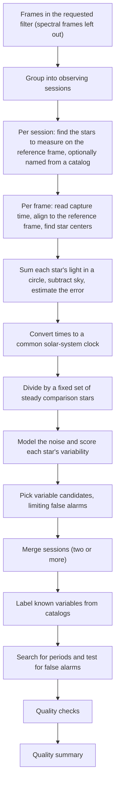

# Differential Photometry and Light Curve Pipeline Review Guide

*Version 1.1 · 2026-10-14 · Status: current*

## Abstract

This document reviews the differential aperture photometry, ensemble
normalization, variability and period-search pipeline
(`astrometricslib.pipelines.photometry`).

Terms are defined in the [glossary](../Astrometrics_Library_Architecture.md#appendix-b-glossary). This guide also defines each term where it first appears, so it can be read on its own.

## 1. Overview & Scientific Objective

### 1.1 In Plain Words

This pipeline measures how the brightness of each star in a field changes over
a night or over many nights, and picks out the stars whose changes are real. A
plot of a star's brightness against time is its light curve.

The difficulty is that the air changes too. Thin cloud, haze and a star
sinking toward the horizon dim every star at once, often by more than the
real changes. The main idea is to compare each star with a set of steady
stars in the same image, the comparison stars. The shared dimming cancels in
the ratio. Statistical tests then separate real variation from noise, and a
period search looks for patterns that repeat.

The result is a light curve for every star, a list of candidate variable
stars, any periods found, and a quality summary.

### 1.2 Statement of Need

Time-domain photometry (brightness measurement repeated over time) measures
how a star's brightness changes. It finds pulsating, eclipsing and rotating
variables and planet transits (the small dip when a planet crosses its star).
From the ground, cloud, haze and airmass (how much atmosphere the light passed
through; 1 straight overhead) change every star's flux together. Differential
photometry removes that shared change by dividing each star by an ensemble (a
combined set) of constant comparison stars in the same frames.

A session here is the frames of one night (noon to noon) taken with the same
gain setting and offset; the run uses only the frames of the requested
filter. Each session has a reference frame: the frame every other frame is
aligned to, and on which the stars to measure are found.

The diagram shows one run, top to bottom.

Section 3 gives the details: the solar-system clock is $\text{BJD}_\text{TDB}$
(Section 3.1), the error estimate is the CCD equation (Section 3.2), and the
candidate tests are the chi-square, Stetson J, excess-scatter and q-value
tests (Section 3.4). The quality summary is a `PhotometryQualitySummary`
(Section 7).

## 2. Input Requirements & FITS Header Specification

A FITS file (the standard file format for astronomy images) starts with a
header: a list of named cards, each a keyword and a value, that describe the
exposure. The table lists the cards this pipeline reads. "When Missing" says
what the pipeline does if a card is absent.

The filter comes from each frame's record, and the observatory site comes from
the configuration. The target's sky position comes from the target record.

| FITS Keyword | Requirement | Data Type | What It Is Used For | When Missing |
| :--- | :--- | :--- | :--- | :--- |
| `DATE-OBS` | Mandatory (per frame) | `str` (ISO-8601, UTC) | Time the shutter opened. Turned into the light-curve time, mid-exposure BJD_TDB (a time measured at the solar system's center of mass; Section 3.1). | That frame alone is rejected with a reason; `capture_timestamps` fails. |
| `EXPTIME` (or `EXPOSURE`) | Recommended | `float` (s) | Exposure length. Gives the mid-exposure time and turns counts into flux per second. | 1.0 s is assumed. |
| `EGAIN` | Optional | `float` (e-/ADU) | Gain (e-/ADU): electrons per ADU (analog-to-digital unit, one camera count). Used for the flux errors when the camera profile has none. `GAIN`, the camera's gain setting, is a different number and is never read. | 1 e-/ADU is assumed; `flux_uncertainty` is not checked. |
| `RDNOISE` | Optional | `float` (e-) | Read noise (electronic noise added each time the sensor is read out). Used for the flux errors when the camera profile has none. | 0 e- is assumed. |
| `AIRMASS` (or `CENTAIRM`, `AIRM`, or altitude `CENTALT`, `ALTITUDE`, `ALT`) | Optional | `float` | Airmass (how much atmosphere the light passed through; 1 straight overhead). Used only by the optional ensemble airmass correction, which is off by default: the median trend of the comparison stars' normalized flux against airmass is removed from every star. No star's own flux is fitted against airmass. | 1.0. |

## 3. Mathematical & Algorithmic Formulation

This section follows a measurement from the time stamp, through the
brightness of each star and its division by the comparison stars, to the tests
that call a star variable and the search for a period.

### 3.1 Capture Time ($\text{BJD}_\text{TDB}$)

Earth moves around the Sun, so light from a star reaches Earth up to about
8 minutes earlier or later than it reaches the Sun. Times are therefore moved
to the solar system's center of mass (the barycenter), where this effect
vanishes.

`DATE-OBS` is the shutter-open time in UTC. The pipeline adds half the
exposure, converts UTC to TDB (Barycentric Dynamical Time, a uniform time
scale for the solar system), and adds the light-travel time to the
solar-system barycenter for the target's direction (up to ±499 s). The result
is the mid-exposure Barycentric Julian Date, $\text{BJD}_\text{TDB}$ (a day
count measured at the barycenter).

With no site configured, the observer is placed at Earth's center. With no
target position, no barycentric time can be computed, and the times stay as
the UTC exposure-start times (not mid-exposure). The `capture_timestamps`
gate quotes which time basis was used.

### 3.2 Centroid and Aperture Photometry

**Placing each star.** Each star is placed at its position on the reference
frame, moved by the frame's fitted shift, rotation and scale change. It is
then re-centered on its centroid (the brightness-weighted center of its
light, photutils `centroid_com`). When the centroid is not trustworthy, the
aligned position is kept and the reason is recorded. Apertures are never
rounded to whole pixels.

**Measuring its light.** Aperture photometry sums the light inside a circle
(the aperture) and subtracts the sky that falls in the same circle. The
radius is a fixed 4 px for every star, not scaled to the star's
width. The net flux is

$$F_\text{net} = \sum_{i \in \text{ap}} I_i - n_\text{pix} \bar{B} \tag{1}$$

where $I_i$ are the pixel values in ADU (analog-to-digital units, raw camera
counts), $n_\text{pix}$ the number of pixels in the circle, and $\bar{B}$ the
median of a sky ring (annulus) from 7 to 12 px. Divided by the
exposure, it becomes a flux in ADU per second.

**Its error.** The CCD equation adds up every noise source in electrons: the
star's own photon noise, the sky, the read noise and the dark current. A
large $\sigma_F$ compared with $F_\text{net}$ means a noisy measurement. Its
1σ error (one standard deviation) is

$$\sigma_F = \frac{1}{g}\sqrt{F_e + n_\text{pix}\left(S_e + R^2 + D_e\right)
  + \frac{n_\text{pix}^2}{n_\text{sky}}\left(S_e + R^2\right)} \tag{2}$$

Here $g$ is the gain in electrons per ADU, $F_e = g F_\text{net}$,
$S_e = g \bar{B}$ is the sky per pixel, $R$ the read noise (e-, the
electronic noise of reading the sensor), $D_e$ the dark current per pixel (a
signal the sensor builds up from heat), and $n_\text{sky}$ the number of sky
pixels. The last term is the error of the sky level itself. $\sigma_F$ is in
ADU, like $F_\text{net}$. This predicted noise is compared later with the
scatter the light curves actually show (Section 3.4).

### 3.3 Differential Ensemble Normalization

**Choosing the comparison stars.** A fixed comparison set is chosen per
session. Candidates are measured, unsaturated (not clipped at the sensor's
maximum) and positive in every usable frame and not listed as variable. The
brightest 2% are skipped, and the band reaches the brightest 30%. Candidates
that scatter more than their errors allow are then dropped one at a time,
worst first. Dropping stops when no candidate is out of line, or when only
5 remain. At most 20 are kept.

**The ensemble level.** Each member's flux is divided by its own mean over
the session, so a ratio of 1 means "normal". The frame's ensemble level $L_k$
is the average of those ratios in frame $k$. It has no unit: 0.9 means the
comparison stars were 10% fainter than their session average in that frame.
The average is inverse-variance weighted: each star counts in proportion to
$1/\sigma^2$, so precise stars count more than noisy ones. With $j$ the
comparison star and $k$ the frame:

$$L_k = \frac{\sum_j w_{j,k} \, F_{j,k} / \langle F_j \rangle}{\sum_j w_{j,k}}, \qquad
w_{j,k} = \frac{1}{\sigma_{j,k}^2}, \qquad \sigma_{L,k} = \frac{1}{\sqrt{\sum_j w_{j,k}}} \tag{3}$$

Here $F_{j,k}$ is the star's flux (ADU per second), $\langle F_j \rangle$ its
session mean, and $\sigma_{j,k} = \sigma_{F,j,k} / \langle F_j \rangle$ its
fractional error in that frame. $\sigma_{L,k}$ is the fractional error of the
level.

**Back to flux units.** To divide a star's flux by the level, the level is
scaled back to flux units:

$$N_k = \bar{F}\, L_k, \qquad \sigma_{N,k} = \bar{F}\, \sigma_{L,k}$$

where $\bar{F}$ is the mean of the comparison stars' session means, in ADU
per second. $N_k$ is the flux of an "average comparison star" in frame $k$.
A star as bright as that average star then has a normalized flux near 1.

**Normalizing a star.** A star's normalized flux in frame $k$ is
$f_k = F_k / N_k$. A comparison star is divided by the level built from the
other members only (leave one out), so its own changes never enter its
divisor. The error combines the star's own error and the level's error;
either one being large makes the result noisy:

$$\sigma_{f,k} = \sqrt{\left(\frac{\sigma_{F,k}}{N_k}\right)^2
  + \left(\frac{F_k \, \sigma_{N,k}}{N_k^2}\right)^2} \tag{4}$$

Normalization needs at least 2 comparison stars. With fewer, the raw light
curves are kept.

### 3.4 Variability Indices and Candidate Rule

**Why several tests.** Every light curve scatters a little from noise alone.
A variable star scatters more than its error bars allow, and its changes are
smooth from one point to the next. Three indices each catch one of these
signs.

**Units.** The indices are computed on each star's normalized fluxes $f_k$
(Section 3.3). Scatter is quoted in magnitudes (a logarithmic scale where a
larger number means fainter; 1 mag is a factor of about 2.5). A fractional
scatter $s$ is $1.0857\,s$ magnitudes, where $1.0857 = 2.5 / \ln 10$. A star's
brightness is its instrumental magnitude $m = -2.5 \log_{10} \bar{F}_\star$,
with $\bar{F}_\star$ its mean raw flux in ADU per second: a magnitude on the
camera's own scale, not calibrated to a catalog.

**The noise model.** A noise model gives the scatter a constant star of
instrumental magnitude $m$ shows in this field, $\sigma_\text{model}(m)$. It
is the median measured scatter in brightness bins, so it includes noise the
CCD equation leaves out (centroid jitter, flat-field errors). It needs at
least 20 stars.

**The three indices.** In each, $x_i$ are the star's $n$ normalized fluxes,
$\sigma_i$ their errors and $\bar{x}_w$ their weighted mean. When a star's
errors are smaller than the noise model's scatter, they are scaled up to it,
so a constant star gives the values below.

The reduced chi-square $\chi^2_\nu$ asks whether the points scatter more than
their error bars allow. A value near 1 means noise only; well above 1 means
extra variation:

$$\chi^2_\nu = \frac{1}{n-1}\sum_{i=1}^{n}\frac{(x_i - \bar{x}_w)^2}{\sigma_i^2} \tag{5}$$

The Stetson J index asks whether neighbouring points in time stray to the same
side of the mean together. Noise gives $J$ near 0; a smooth real change gives
a clearly positive $J$:

$$\delta_i = \sqrt{\frac{n}{n-1}}\,\frac{x_i - \bar{x}_w}{\sigma_i}, \qquad
J = \frac{1}{n-1}\sum_{i=1}^{n-1}\operatorname{sgn}(P_i)\sqrt{|P_i|}, \qquad
P_i = \delta_i \, \delta_{i+1} \tag{6}$$

The excess scatter $E$ compares the star's measured scatter (in magnitudes)
with what the noise model expects for a star of its brightness. 1 means
typical; 2 means twice the usual scatter:

$$E = \frac{\sigma_\text{measured}}{\sigma_\text{model}(m)} \tag{7}$$

Eq. 6 is the single-band Stetson J (all points in one filter; Stetson also
defines a version that pairs points taken in two filters), with consecutive
pairs and unit weights (Stetson 1996, PASP 108, 851).

**Thresholds and score.** The thresholds on $\chi^2_\nu$ and $J$ are the
field median plus 2.326 robust standard deviations. A robust
standard deviation is 1.4826 times the median absolute deviation (MAD), a
spread measure that a few variable stars barely move; for normal data it
equals the standard deviation. 2.326 is the one-sided 99% point of a
normal distribution, so a constant star clears a threshold by chance about
1% of the time. For $\chi^2_\nu$ the threshold is set on its logarithm,
because its spread grows with its level. The threshold on $E$ is fixed at
1.5.

The ranking score divides each index by its threshold, so a score above 1
means the star clears its tests. Without a high $J$, the score is capped at 1,
so it cannot pass:

$$S = \begin{cases}\min\left(\chi^2_\nu / \chi^2_\text{thr},\; E / E_\text{thr}\right) & J > J_\text{thr}\\
\min\left(\chi^2_\nu / \chi^2_\text{thr},\; E / E_\text{thr},\; 1\right) & \text{otherwise}
\end{cases} \tag{8}$$

**Limiting false alarms.** Testing thousands of stars makes some pass by
chance. A star is a candidate when $S > 1$ and its q-value is below 0.01.
The chi-square false-alarm probability is the chance that noise alone gives a
$\chi^2$ this large (the upper tail of the chi-square distribution with
$n - 1$ degrees of freedom). The Benjamini-Hochberg method turns these
probabilities into q-values that control the false discovery rate: the
expected share of false alarms among all stars picked. A q-value of 0.05 means
about 1 in 20 such picks is expected to be noise.

**Small fields.** A field too small for a noise model falls back to a cutoff
on the coefficient of variation (CV, standard deviation over mean). The cutoff
is the typical CV plus a multiple of its spread, and never below 2%:

$$\text{CV}_\text{cut} = \max\left(0.02,\;
  \text{median}(\text{CV}) + 7.4 \times \text{MAD}(\text{CV})\right) \tag{9}$$

where MAD is the unscaled median absolute deviation (the median distance of
the values from their median). 7.4 unscaled MADs are about
5.0 robust standard deviations (7.4 / 1.4826).

### 3.5 Period Search

**Methods.** The target's star and the brightest stars are searched with a
Lomb-Scargle periodogram and box least squares. Lomb-Scargle fits sine waves
of many trial periods to unevenly spaced data and finds smooth cycles. Box
least squares fits a flat-bottomed dip that repeats, and finds eclipses and
transits.

**False alarms.** The false-alarm probability (FAP) $p$ is the share of
block-shuffled copies of the light curve (the data cut into blocks and put
back in random order, which destroys any real period) that do as well.

**The verdict ladder.** Each search result gets one verdict. From strongest
to weakest:

1. "detected": FAP at most 0.01, with enough repeats (cycles, or
   dips) seen;
2. "possible": FAP at most 0.05 (a dip search also needs at least
   two dips);
3. "not detected".

A light curve too short to search gets "insufficient data" instead.

**Many searches.** Searching many stars raises the chance that one passes by
luck. For $m$ independent searches, the chance that at least one reaches
probability $p$ by luck is the family-wise false-alarm rate

$$p_\text{family} = 1 - (1 - p)^m \tag{10}$$

The Šidák correction holds that family-wise rate at the verdict limit
$\alpha$ (0.01 for "detected"). Each search's $p$ is turned into
$p_\text{family}$ and judged against $\alpha$. That is the same as asking each
search for $p \le 1 - (1 - \alpha)^{1/m}$
(`family_wise_correction.py`). The correction can only lower a verdict.

**Enough shuffles.** A shuffle test with $n$ copies cannot report a
probability below about $1/(n+1)$. With many searches, that floor can sit
above the corrected limit, so no verdict could pass. Searches that need it
are run again with more copies, up to 5000.

**Period checks.** Two period checks (Section 4.1) then test each "detected"
or "possible" result. Each failed check lowers the verdict one step on the
ladder. A check that could not run lowers nothing and marks the result
"unconfirmed".

### 3.6 Cross-Session Merge and Labels

With two or more sessions, each star's light curves are matched by sky
position and merged (`batch.py`). Each session keeps its own normalized level.
Stars whose level changes between sessions become long-term candidates.
Candidates are then labelled from SIMBAD (a database of named objects),
Gaia DR3 (the Gaia space mission's third catalog) and VSX (the International
Variable Star Index) as listed, not listed, or unknown
(`known_variability_labels.py`).

## 4. Processing Flow

`run_photometry_analysis` (`runner.py`) runs `PhotometryPipelineAdapter`
through `run_pipeline`. `run_pipeline` (`pipeline_base.py`) calls the adapter's four methods in
order. It skips `run` only when `process_input` returns a `Result` with
`has_work=False`. After `validate_output` it stores the quality summary on the
target and records the run's provenance.

- **Stage 1 (`process_input`):** Keeps frames in the requested filter, leaves
  out spectral frames, and groups frames with a capture time into sessions.
  With no frame or no session it returns `has_work=False`, and
  `photometry_work` fails.
- **Stage 2 (`run`):** Runs one `VariabilityAnalyzer` pass per session, merges
  sessions, labels candidates, saves the stars, and runs the period search in
  a step whose failure cannot cost the light curves.
- **Stage 3 (`validate_output`):** Fits the run's noise model and records
  the run gates from `photometry_run_gates`. The period checks were already
  recorded on each period result in stage 2. The package defines
  11 run gates + 2 period checks.
- **Stage 4 (`to_result_dict`):** Returns run counts, the rejected frames,
  the short-term and long-term variable candidates and the cross-session
  match count.

### 4.1 Quality Gates

A quality gate is an automatic check on a run. It passes, fails, or is
"not checked" when the data it needs are missing. A failed gate marks the run
as flagged (the `flagged` field in Section 7) so a person can look at it. The
list below is read from the code when this guide is generated.

Run gates are recorded on the quality summary. Period checks are recorded on
each period result.

| Gate | Role | Defined in | What it checks |
| :--- | :--- | :--- | :--- |
| `ensemble_frame_rejection` | run gate | `post_processing/run_gates.py` | Fails when at least `MINIMUM_ENSEMBLE_REJECTION_COUNT_TO_FLAG` frames and at least `MINIMUM_ENSEMBLE_REJECTION_FRACTION_TO_FLAG` of the frames were rejected as ensemble outliers (frames whose comparison-star level is out of line with the rest). |
| `capture_timestamps` | run gate | `post_processing/run_gates.py` | Fails when any frame was left out for a missing or unreadable capture time. The detail names the time basis of the light curves (Section 3.1). |
| `session_content` | run gate | `post_processing/run_gates.py` | Fails when a session produced no light curves. |
| `session_plate_solve` | run gate | `post_processing/run_gates.py` | Fails when a session could not be plate-solved (given a pixel-to-sky map) for matching stars across sessions. Not checked for a single session. |
| `photometry_work` | run gate | `post_processing/run_gates.py` | Fails when stage 1 found nothing to measure (no frame in the filter, or no frame with a capture time). |
| `comparison_ensemble` | run gate | `post_processing/run_gates.py` | Fails when a session has fewer than `MINIMUM_COMPARISON_STARS` comparison stars, a set that changes between frames, or comparison stars that scatter more than `MAXIMUM_ENSEMBLE_SCATTER_OVER_PREDICTED` times their predicted error. |
| `registration_drift` | run gate | `post_processing/run_gates.py` | Fails when the field shifts by more than `UNSTABLE_TRACKING_DRIFT_PX`, when rotation and scale change move a corner by more than `MAXIMUM_CORNER_DISPLACEMENT_PX` (95th percentile), or when more than `MAXIMUM_CENTROID_FALLBACK_FRACTION` of centroids (brightness-weighted star centers) were untrustworthy and fell back to the aligned position. |
| `scatter_population` | run gate | `post_processing/run_gates.py` | Not checked when too few stars have a measured scatter, or too few to fit the noise model (expected scatter against brightness), so the variable-candidate cutoff is not reliable. |
| `variability_discrimination` | run gate | `post_processing/run_gates.py` | Fails when the variability score does not rank catalogued variables above unlisted stars (AUC test: the chance that a random catalogued variable scores above a random unlisted star). Not checked with too few of either. |
| `detectable_amplitude` | run gate | `post_processing/run_gates.py` | Fails when a sinusoidal variable would need more than `MAXIMUM_DETECTABLE_AMPLITUDE_MAG` peak to peak to clear the run's noise, so the run is blind to smaller variables. |
| `flux_uncertainty` | run gate | `post_processing/run_gates.py` | Cannot fail. Reports the median per-point error. Not checked when the errors assumed a gain of 1 e-/ADU (electrons per camera count), because the camera's gain was unknown. |
| `holdout_nights` | period check | `processing/period_checks.py` | Period check. Leaves each night out in turn and asks whether the period found from the other nights predicts it. A failure lowers the period verdict one level. |
| `alias_ambiguity` | period check | `processing/period_checks.py` | Period check. Fails when an alias of the best period (a false period created by observing only at night, once a day) is nearly as strong as the best peak. A failure lowers the period verdict one level. |

## 5. Tuned Calibration Parameters

These are the fixed limits and settings the pipeline uses. "Live Value" is
read from the code when this guide is generated. "Empirical Status" says how
far real data back the value, with one of three labels:

- **Measured.** The value was set from, or checked against, real
  observations. The Notes column names the data and the result.
- **Partly measured.** Real observations support the value but do not
  pin it down, for example because no failure was found to set it against.
- **Design estimate.** The value was chosen by reasoning about the
  method, not tuned on real data. Where it was checked only on synthetic
  (simulated) data, or picked with a margin over a few observed values, the
  Notes column says so.

| Parameter | Live Value | Empirical Status | Notes |
| :--- | :--- | :--- | :--- |
| `MINIMUM_ENSEMBLE_REJECTION_FRACTION_TO_FLAG` | `0.25` | Partly measured | Share of frames rejected as ensemble outliers (frames whose comparison-star level is out of line with the rest) that fails the gate. Past runs rejected about 7.2% of frames; the limit sits well above that. |
| `MINIMUM_ENSEMBLE_REJECTION_COUNT_TO_FLAG` | `5` | Design estimate | Fewest rejected frames that can fail the gate, so one frame of a short run cannot. |
| Aperture radius | `4` px | Design estimate | Radius of the circle in which a star's light is summed. Default of `measure_aperture_photometry`. It is fixed, not scaled to each star's width. |
| Sky annulus radii | `7` to `12` px | Design estimate | Inner and outer radius of the sky ring (annulus) around each star, where the sky level is measured. |
| `MINIMUM_COMPARISON_STARS` | `5` | Design estimate | Comparison-star vetting stops at this size; fewer fails `comparison_ensemble`. |
| `DEFAULT_MAXIMUM_COMPARISON_STARS` | `20` | Design estimate | Most comparison stars kept in the set. More stars lower the ensemble noise, but the extra ones are fainter, so the benefit shrinks quickly. |
| `MINIMUM_STARS_FOR_NOISE_MODEL` | `20` | Design estimate | Fewest stars for a noise model (expected scatter against brightness): two brightness bins of 10 stars. With fewer, the CV cutoff (Eq. 9) picks candidates. |
| `FALSE_DISCOVERY_LEVEL` | `0.01` | Design estimate | Largest Benjamini-Hochberg q-value a candidate may have (Section 3.4). The level journals usually ask for; checked only on synthetic fields. |
| `EXCESS_SCATTER_THRESHOLD` | `1.5` | Design estimate | Fixed threshold on the excess scatter (Eq. 7). A 50% excess, which the ordinary spread of a constant star's scatter (10 to 20% for 25 to 50 points) rarely reaches. |
| `CALIBRATION_SIGMAS` | `2.326` | Design estimate | Robust standard deviations above the field median for the chi-square and J thresholds: the one-sided 99% point of a normal distribution. |
| `DEFAULT_VARIABILITY_SIGMA_THRESHOLD` | `7.4` | Measured | Multiplier of the unscaled MAD in the CV cutoff (Eq. 9), about 5.0 robust standard deviations. Chosen to flag about the top 3% of stars. Measured on the library: it flags 5.2% of stars, and separates catalogued variables from other stars no better than chance. |
| `MAXIMUM_DETECTABLE_AMPLITUDE_MAG` | `0.3` mag | Design estimate | If the smallest detectable peak-to-peak amplitude (in magnitudes, a logarithmic brightness scale) is larger, the run is called blind to most variables. Most pulsating and rotating variables change by less than this. |
| `UNSTABLE_TRACKING_DRIFT_PX` | `20` px | Design estimate | Largest shift of the field between frames before `registration_drift` fails. Half of the ±40 px box in which a star's center is searched, so stars are caught before they leave the box. |
| `MAXIMUM_CORNER_DISPLACEMENT_PX` | `1.0` px | Design estimate | Largest shift of an image corner caused by rotation and scale change between frames (95th percentile). Measured values for comparison: M 13 0.2 px, M 81 0.9 px, NGC 2403 1.8 px. |
| `MAXIMUM_CENTROID_FALLBACK_FRACTION` | `0.2` | Design estimate | Largest share of star measurements that may keep the aligned position because the star's own centroid was refused. |
| `MAXIMUM_ENSEMBLE_SCATTER_OVER_PREDICTED` | `5.0` | Partly measured | Largest ratio of the comparison stars' measured scatter to the scatter their error bars predict. Set between three fields: 1.27 on M 13 and 1.66 on M 81, against 18 on a cloudy NGC 2403 night. |

## 6. Degraded States & Fallback Pathways

1. **Sparse fields.** Below 20 usable stars there is no
   noise model. Candidates come from the CV cutoff of Eq. 9, and
   `scatter_population` is not checked. Below 10 stars with a
   scatter, the cutoff itself is called unreliable.
2. **Few comparison stars.** With fewer than 2, raw light curves are kept.
   With fewer than 5, `comparison_ensemble` fails.
3. **Missing or bad `DATE-OBS`.** Only that frame is rejected, with a reason.
   It is never given the computer's clock time instead.
4. **No site configured.** BJD_TDB is computed with the observer at Earth's
   center, and the time basis says so.
5. **Unknown gain.** Errors assume 1 e-/ADU. The fluxes do not change, but
   `flux_uncertainty` is not checked.
6. **Noisy runs.** `detectable_amplitude` reports how large a variable must
   be to clear the noise. A run that needs more than 0.3 mag is blind
   to most variables.

## 7. Quality Summary Data Models

Every run saves a quality summary: a record of what the run measured and how each quality gate came out. Section 7.1 lists the fields every pipeline shares. Section 7.2 lists the measurements that belong to this pipeline. The tables are read from the data models in the code.

### 7.1 Pipeline Execution Envelope (`PhotometryQualitySummary`)

| Field Name | Type | Description |
| :--- | :--- | :--- |
| `pipeline_name` | `str` | Which pipeline made this summary (for example astrometry or photometry). |
| `pipeline_version` | `str` | Version number of the pipeline's processing rules. |
| `target_id` | `str` | Identifier of the target (the sky object being studied). |
| `target_session_ids` | `list[str]` | Identifiers of the observing sessions (usually one night each) used in the run. |
| `target_session_breakdown` | `list[astrometricslib.models.quality_summary.TargetSessionContribution]` | For each session, how many frames it had and how many the run used. |
| `upstream_quality_summary_reference` | `str \| None` | Name of the pipeline that had to run first, if any. |
| `resolved_parameters` | `dict[str, Any]` | The settings the run actually used, after defaults were filled in. |
| `camera_profile` | `astrometricslib.models.quality_summary.AppliedCameraProfile \| None` | The camera settings applied, such as the gain (e-/ADU) and the level at which pixels clip. |
| `quality_processing_applied` | `bool` | Whether the quality gates and checks were run. |
| `flagged` | `bool` | True if one or more quality gates failed, so a person should look at the run. |
| `flag_reasons` | `list[str]` | One plain sentence for each reason the run was flagged. |
| `gates` | `list[astrometricslib.models.gate_result.GateResult]` | Every quality gate result: passed, failed or not checked. |
| `created_at` | `datetime.datetime` | Time the quality summary was made, in UTC. |
| `provenance_activity_id` | `str \| None` | Identifier of this run in the provenance record (the IVOA-standard log of which run made which data). |
| `upstream_entity_id` | `str \| None` | Identifier of the exact database record this run read as its input. |
| `photometry_metrics` | `astrometricslib.models.quality_summary.PhotometryPipelineQualityMetrics` | The photometry measurements (Section 7.2). |

### 7.2 Domain Scientific Metrics Schema (`PhotometryPipelineQualityMetrics`)

| Field Name | Type | Description |
| :--- | :--- | :--- |
| `catalog_matched_star_count` | `int` | Stars matched to a SIMBAD or Gaia DR3 entry. |
| `position_only_star_count` | `int` | Stars named only by their sky position. |
| `unresolved_star_count` | `int` | Stars with no catalog match whose sky position could not be worked out (as when the image has no pixel-to-sky map); not saved. |
| `stars_processed` | `int` | Number of stars tracked through the light curves (brightness over time). |
| `stars_found` | `int` | Number of stars detected on the reference frame (the frame every other frame is aligned to). |
| `frames_processed` | `int` | Number of calibrated frames measured. |
| `rejected_frames` | `list[astrometricslib.models.quality_summary.ExcludedFrame]` | Frames rejected because their comparison-star level was out of line with the rest. |
| `frame_ensemble_composition` | `list[astrometricslib.models.quality_summary.FrameEnsembleComposition]` | For each frame, which comparison stars were used. |
| `variable_candidate_count` | `int` | Number of stars flagged as short-term variable candidates. |
| `light_curve_scatter_rms_mag` | `float \| None` | Median scatter (RMS, in magnitudes) of the light curves of non-variable field stars. |
| `cross_session_match_count` | `int` | Number of stars matched across sessions from different nights. |
| `noise_model_curve` | `list[astrometricslib.models.quality_summary.NoiseModelPoint]` | The noise model: typical measured scatter (RMS) against instrumental magnitude (-2.5 log10 of the mean raw flux in ADU per second), in brightness bins. |
| `sessions_missing_wcs` | `list[str]` | Sessions with no plate-solved WCS (pixel-to-sky map). |
| `long_term_variable_candidate_count` | `int` | Number of stars flagged as long-term variable candidates. |
| `astrometry_identified_star_count` | `int` | Stars matched to a SIMBAD or Gaia DR3 catalog star on each session's reference frame, summed over sessions (a star seen in two sessions counts twice). 0 when catalog identification is turned off. |
| `sessions_with_reused_header_wcs` | `list[str]` | Sessions whose existing header WCS (pixel-to-sky map) was checked and used. |
| `sessions_with_replaced_header_wcs` | `list[str]` | Sessions whose WCS (pixel-to-sky map) was worked out again. |
