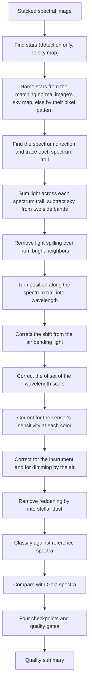

# Slitless spectroscopy extraction and classification pipeline review guide

*Version 1.2 · 2026-10-15 · Status: current*

## Abstract

This document reviews the slitless spectroscopy pipeline (`astrometricslib.pipelines.spectroscopy`): extraction, wavelength calibration, refraction, zero-point, response and extinction corrections, dereddening, classification, the Gaia XP comparison, and the quality checkpoints.

Terms are defined in the [glossary](../../Glossary.md). This document also defines each term the first time it appears.

## 1. Overview and scientific objective

The [spectroscopy pipeline README](https://github.com/m1chae2/astrometrics/blob/main/astrometricslib/pipelines/spectroscopy/README.md) describes the code stage by stage.

**In plain words.** This pipeline spreads each star's light into its colors, a spectrum, and uses the spectrum to classify the star. The class, or spectral type, mainly tells the star's surface temperature. The types run O, B, A, F, G, K, M from hottest to coolest, each split into ten finer subtypes (A0 to A9, for example).

There is no slit, so every star in the field makes its own short rainbow, its spectrum trail, at once. Spectrum trails can overlap, the sky adds light, and the camera, the optics and the air each dim some colors more than others. The pipeline traces each spectrum trail, sums its light, and turns position along the spectrum trail into wavelength. It then removes each known color effect in turn and finds the reference spectrum that matches best.

The result is a corrected spectrum and a spectral type for each star, compared with star catalogs and with spectra from the Gaia space mission.

**Statement of need.** A transmission grating (a clear plate ruled with many fine parallel lines) in front of the camera, for example a Star Analyser 100 or 200, splits each star's light into a few beams called orders. The zero order passes straight through: it is the star's undispersed point image. The first order is the first spread-out copy beside it, the first-order spectrum, and it is the one measured. The pipeline turns those spectrum trails into calibrated spectra and classifies them against the Pickles (1998) stellar library (a set of reference spectra of known types).

The diagram shows one run, top to bottom.

Section 3 names the steps in the usual terms: the grating equation, differential refraction and the zero-point shift (Section 3.1); QE, instrument response, airmass extinction and dereddening (Section 3.3); and the Pickles and Gaia XP comparisons (Sections 3.4 and 3.5). The normal image is the target's solved standard stack, whose WCS (pixel-to-sky map) names the stars. Without it, the stars are named by matching the pattern of their pixel positions to catalog stars (Section 6). The quality summary is a `SpectroscopyQualitySummary` (Section 7).

## 2. Input requirements and FITS header specification

A FITS file (the standard file format for astronomy images) starts with a header: a list of named cards, each a keyword and a value, that describe the exposure. The table lists the cards this pipeline reads. The last column says what the pipeline does if a card is absent.

The dispersion direction is measured from the image. `DISPAXIS` and `GRATROT` are not read. The observatory site comes from the configuration.

| FITS keyword | Requirement | Data type | Used for | When missing |
| --- | --- | --- | --- | --- |
| `DATE-OBS` | Optional | `str` (ISO-8601, UTC) | Exposure start, used for the mid-exposure time of the refraction correction (the shift caused by the air bending each color by a different amount). | The refraction correction is skipped, with the reason recorded. |
| `DATE-END` | Optional | `str` (ISO-8601, UTC) | Exposure end, for the mid-exposure time. | `DATE-OBS` plus half of `EXPTIME`. |
| `EXPTIME` | Recommended | `float` (s) | Exposure length. Turns counts into counts per second and gives the mid-exposure time. | The intensity scale is left unknown, never guessed. |
| `BITPIX` / `STACKCNT` | Optional | `int` | `BITPIX` is the pixel data type (negative means decimal numbers) and `STACKCNT` the number of stacked frames. Together they mark a Siril float stack, whose mean frame exposure is `EXPTIME` / `STACKCNT`. | Treated as a raw frame when `BITPIX` > 0 and there is no `STACKCNT`. |
| `AIRMASS` | Recommended | `float` | Airmass (how much atmosphere the light passed through; 1 straight overhead), for the extinction correction (Eq. 3) that undoes dimming by the air. | The extinction correction is skipped, and the skip is recorded. |
| `RA` / `DEC` | Optional | `float` (°) | Field center (right ascension and declination, the sky's longitude and latitude). When there is no solved stack (a stack with a sky map), the catalog stars offered for naming the spectra are limited to this field. | The catalog stars are not limited to the field, so a star from elsewhere on the sky can be matched by its pixel pattern alone. |

## 3. Mathematical and algorithmic formulation

This section follows one spectrum: turning position along the spectrum trail into wavelength, summing the light, correcting the brightness at each color, and matching the result to reference spectra.

### 3.1 Wavelength model

**The grating equation.** The grating bends each color by a different angle, so distance along the spectrum trail measures wavelength: the farther from the zero order, the redder the light. The dispersion is this spreading of light by wavelength, and its direction on the sensor is measured from the image. A sample's distance $x$ from the zero-order center, along the dispersion, becomes a wavelength through the first-order grating equation (`optics_physics.py`):

$$\lambda(x) = d \, \sin\left(\arctan\frac{x \, p_\text{px}}{L_g}\right) \tag{1}$$

where $d$ is the groove spacing (1 / lines per mm), $p_\text{px}$ the pixel pitch and $L_g$ the grating-to-sensor distance. A larger $L_g$ spreads the spectrum over more pixels. $L_g$ is the one fitted number. It is fitted once, from the hydrogen (Balmer) absorption lines of a bright reference star such as Vega (`calibration_tuner.py`), and saved for later runs.

**Refraction shift.** The air bends light slightly, and bends blue light more than red. Differential atmospheric refraction is this color-dependent bending. It moves each wavelength along the spectrum trail by $\rho(\lambda) - \rho(\lambda_\text{eff})$, projected onto the dispersion direction, where $\rho(\lambda)$ is the bending at wavelength $\lambda$ and $\lambda_\text{eff}$ is a reference (effective) wavelength. It needs the site, a WCS (a pixel-to-sky map) and the exposure time.

**Zero-point shift.** If the zero-order center is misplaced, the whole wavelength scale slides by a fixed amount, its wavelength zero point. A zero-point shift corrects that offset. It is measured from known absorption lines (dark lines where the star's atmosphere absorbs light). Each line must be at least 6 times the local noise deep, and the shift is applied when at least 2 lines agree, since one line could be a misidentified feature.

### 3.2 Extraction and background subtraction

**The box.** The spectrum trail is traced step by step. At each step a Gaussian (a bell-shaped curve) is fitted across the trail. Its sigma is a width measure: a wider trail gets a wider box, so the box holds the same share of the light everywhere. The box half-width is

$$w(x) = 2.5 \, \sigma_\text{trail}(x) \tag{2}$$

where $\sigma_\text{trail}$ is the fitted Gaussian sigma, smoothed over 61 steps. `median_trail_width_px` in the summary is this sigma too, not a FWHM (full width at half maximum, a different width measure about 2.35 times sigma). Edge pixels count for the fraction inside the box.

**The sky.** Two sky bands, each 10 pixels wide and 6 pixels from the box, are sigma-clipped (pixels far from the median, such as stars, are dropped). The sky level is the mean of their medians. When the two disagree by more than the noise allows, the fainter band (the one with the lower median) is used alone: light can only add to a band, so the brighter one holds a neighbor's light.

**Neighbors.** A bright neighbor's wings (the faint outer edges of its spectrum trail) are removed with a blur profile measured from an isolated star (`neighbor_trail_deblending.py`, `neighbor_wing_correction.py`).

### 3.3 Flux calibration

**What is corrected.** The raw counts at each wavelength are not the star's true brightness at that color. The sensor, the optics and the air each pass some colors better than others. Three corrections undo this in turn.

- **QE.** The counts are divided by the sensor's quantum efficiency (QE: the share of arriving light the sensor records, which depends on color).
- **Instrument response.** The counts are then divided by the instrument response: everything else about the optics and grating that favours some colors. The response is Vega's observed spectrum over the Pickles A0V template. A0V is Vega's own type: spectral type A0 with luminosity class V, a main-sequence (ordinary, hydrogen-burning) star.
- **Airmass extinction.** The air dims light more at blue wavelengths, and more when the star is low. The extinction curve $k_\text{ext}(\lambda)$ gives the dimming in magnitudes per airmass (a magnitude is a logarithmic brightness unit; 1 mag is a factor of about 2.5). Only the airmass difference $X_\text{target} - X_\text{ref}$ from the response's spectroscopic standard star (the star of known spectrum that set the response) is removed, because the response already holds that star's own dimming:

$$\Phi_\text{corr}(\lambda) = \Phi(\lambda)\; 10^{0.4\, k_\text{ext}(\lambda)\,
(X_\text{target} - X_\text{ref})} \tag{3}$$

The result is a relative $\Phi(\lambda)$ (energy flux per unit wavelength) up to one constant: the shape of the spectrum is right, its overall level is not known.

**Dereddening.** Dust between the stars dims blue light more than red, so a star seen through dust looks redder, and cooler, than it is. $E(B-V)$ is the size of this reddening, given as the extra difference between blue and visual magnitudes. When a catalog gives the star's $E(B-V)$, interstellar reddening is removed with the Cardelli, Clayton and Mathis (1989) law with $R_V = 3.1$ ($R_V$ sets how the dimming changes with wavelength).

### 3.4 Classification

Each reference spectrum is blurred to the instrument's resolution (the smallest wavelength detail it can separate) and scaled to the observation by a best-fit factor $a$. The match score is the relative RMS (root mean square) difference between the observed spectrum $\Phi$ and the scaled reference $T_\text{ref}$. It is taken over $M$ wavelengths and divided by the mean flux $\bar{\Phi}$. A score of 0 is a perfect match; 0.1 means a typical misfit of 10% of the flux:

$$\text{RMS} = \frac{1}{\bar{\Phi}}
  \sqrt{\frac{1}{M}\sum_{j=1}^{M}\left[\Phi(\lambda_j) - a\,T_\text{ref}(\lambda_j)\right]^2} \tag{4}$$

The references are ranked by this score, and the lowest wins. Above 0.15 the match is poor. Above 0.45 no type is given.

Two gaps measure how clearly the best reference wins. The gap to the second-best reference (often a neighboring subtype) and the gap to the best reference of another spectral class are each compared with 0.02. A gap below it makes the match ambiguous at that level. Only a class-level ambiguity fails `spectral_classification`; subtype-level ties are counted in the gate detail.

### 3.5 Gaia XP comparison

The Gaia space mission measured low-resolution spectra, called XP spectra, for many stars, independently of this instrument. Where Gaia DR3 (its third data release) has an XP spectrum for the star, both spectra are brought to the same resolution and divided by their median over 5400 to 5600 Å (1 Å, an ångström, is 0.1 nm). If the calibration is right, their ratio is flat. The tilt of their ratio tests the response, the extinction correction and the wavelength scale together.

### 3.6 Notation

Symbols follow the architecture paper's [list of symbols](../Astrometrics_Library_Architecture.md#appendix-a-notation). The table lists only the symbols this guide adds.

| Symbol | Meaning | Unit |
| --- | --- | --- |
| $p_\text{px}$ | Pixel pitch (binned pixel size) | μm |
| $\rho(\lambda)$ | Refraction (bending) of light of wavelength $\lambda$ | arcsec |
| $\lambda_\text{eff}$ | Reference (effective) wavelength of the refraction shift | Å |
| $w(x)$ | Width of the extraction box | px |
| $\sigma_\text{trail}(x)$ | Width (standard deviation) of the trail profile | px |
| $\Phi_\text{corr}(\lambda)$ | Spectral flux corrected for airmass extinction | relative |
| $R_V$ | Ratio of total to selective extinction of the dust | none |
| $T_\text{ref}(\lambda)$ | Reference (template) spectrum | relative |
| $a$ | Best-fit scale factor of the reference spectrum | none |
| $M$ | Number of wavelengths in the match score | none |
| $\bar{\Phi}$ | Mean spectral flux | relative |

## 4. Processing flow

`run_spectroscopy_analysis` (`runner.py`) runs `SpectroscopyPipelineAdapter` through `run_pipeline`. `run_pipeline` (`pipeline_base.py`) calls the adapter's four methods in order. It skips `run` only when `process_input` returns a `Result` with `has_work=False`. After `validate_output` it stores the quality summary on the target and records the run's provenance.

- **Stage 1 (`process_input`).** A no-op that returns an empty `Result`.
- **Stage 2 (`run`).** Finds the stars with `AstrometryPipeline` (no solve), names them from the target's solved stack, and runs `SpectroscopyPipeline.process`. Each spectrum carries four quality checkpoints, in order: `raw_frame`, `pre_processing`, `processing` and `post_processing`. Each checkpoint is a set of measured values (metrics), some with a limit. The `processing` checkpoint judges the classification: a poor match, an ambiguous match, and a type from line strengths that is more than 20 subtype steps from the template-fit type.
- **Stage 3 (`validate_output`).** Builds the summary, records the eight `spectroscopy_run_gates`, then `gaia_xp_agreement` (9 run gates in all). It then stores the run totals, the per-stage medians and the gates as quality measurements (`record_spectroscopy_quality`).
- **Stage 4 (`to_result_dict`).** Returns only `context` and `stellar_objects`.

A session of raw frames runs through `batch.py` instead. It names the stars in one reference frame, follows them through the session's other frames in parallel workers, and builds the same gates from the same plain counts.

### 4.1 Quality gates

A quality gate is an automatic test on a run. It passes, fails, or is "not checked" when the data it needs are missing. A failed gate marks the run as flagged (the `flagged` field in Section 7) so a person can look at it. The list below is read from the code when this guide is generated.

The count covers only these run gates. Some quality tests are not gates. Two travel with each spectrum: the extinction record (whether the airmass correction ran, and why not) and the share of sky readings disturbed by a neighbor. The third, the rejection of a wavelength fit that leaves too large an error, happens when the instrument is calibrated (`calibration_tuner.py`).

| Gate | Role | Defined in | What it checks |
| --- | --- | --- | --- |
| `gaia_xp_agreement` | run gate | `post_processing/compare_to_gaia_xp.py` | Fails when the median tilt of observed / Gaia XP spectra (low-resolution spectra from the Gaia space mission) is above `GAIA_XP_SLOPE_LIMIT_PERCENT_PER_1000_ANGSTROM`. Not checked with too few stars. |
| `spectra_extracted` | run gate | `post_processing/record_quality.py` | Fails when no star produced a spectrum. |
| `zero_order_saturation` | run gate | `post_processing/record_quality.py` | Fails when, for the worst star, at least `DEFAULT_SATURATION_FLAG_THRESHOLD` (0.1%) of the pixels around its zero order (its undispersed point image beside the spectrum) are saturated: at or above the camera's saturation threshold, where pixels clip. Not checked when no zero order was measured. |
| `spectral_classification` | run gate | `post_processing/record_quality.py` | Fails when a classification is a poor match (best misfit, the relative RMS of Eq. 4, above `NO_GOOD_MATCH_RMS`) or ambiguous at the class level (misfit gap to the best reference of another spectral class below `AMBIGUOUS_RMS_GAP`). A tie between neighboring subtypes alone does not fail it; such ties are counted in the detail. |
| `catalog_agreement` | run gate | `post_processing/record_quality.py` | Fails when a measured spectral type is more than `DIFFERS_FROM_CATALOG_SUBTYPES` subtype steps from the type a catalog lists for the star. |
| `feature_significance` | run gate | `post_processing/record_quality.py` | Fails when a star's feature p-values (the chance that noise alone makes a feature this strong) could not be calibrated against control windows (stretches of its own spectrum used as a noise reference). |
| `resolution_measured` | run gate | `post_processing/record_quality.py` | Not checked when no spectrum had its resolution (smallest wavelength detail it can separate) measured. |
| `processing_quality` | run gate | `post_processing/record_quality.py` | Fails when more than `PROCESSING_QUALITY_MAXIMUM_FAILED_FRACTION` of classified spectra fail a limit of the processing checkpoint, the second of four quality checkpoints on each spectrum. Its limits judge the classification: a poor match, an ambiguous match, or a type from line strengths far from the template-fit type (Section 4). |
| `wavelength_scale` | run gate | `post_processing/wavelength_scale.py` | Fails when the run's wavelength zero points (offsets of each spectrum's wavelength scale) scatter by more than `WAVELENGTH_SCALE_LIMIT_ANGSTROM` after correction. |

## 5. Tuned calibration parameters

These are the fixed limits and settings the pipeline uses. The live value is read from the code when this guide is generated. The status says how far real data back the value, with one of three labels:

- **Measured.** Chosen or confirmed from a measurement on real data.
- **Partly measured.** Backed by a measurement that is incomplete, such as synthetic (simulated) data only, one target or a small sample.
- **Design estimate.** Chosen by reasoning and not yet measured.

The labels are defined in the [validation register](../validation/index.md). Each label links to the register entry that holds the evidence: the data, the library calls, the result, and how to repeat the test on your own data. A design estimate links to the register's table of values not yet measured, which says how each one could be measured. The Notes column gives the reason for the value.

| Parameter | Live value | Status | Notes |
| --- | --- | --- | --- |
| `NO_GOOD_MATCH_RMS` | `0.15` | Partly measured ([SPE-16](../validation/spectroscopy.md#spe-16)) | Misfit to the best reference spectrum (relative RMS, Eq. 4) above which a classification is a poor match. It sits between the misfits of most right and wrong matches on stars of known type. |
| `UNRELIABLE_MATCH_RMS` | `0.45` | Partly measured ([SPE-17](../validation/spectroscopy.md#spe-17)) | Misfit (relative RMS, Eq. 4) above which no spectral type is given at all: the closest reference would only invent a type. Misfits this large mostly mean the star was identified wrongly. |
| `AMBIGUOUS_RMS_GAP` | `0.02` | Measured ([SPE-18](../validation/spectroscopy.md#spe-18)) | Smallest misfit gap to the best reference of another spectral class; a smaller gap makes the match ambiguous. It is about the smallest spacing between neighboring reference spectra. |
| `DIFFERS_FROM_CATALOG_SUBTYPES` | `20.0` | Partly measured ([SPE-19](../validation/spectroscopy.md#spe-19)) | Subtype steps (ten to a class, so 20 is two whole classes, such as B to F) beyond which the measured type disagrees with the catalog type. It is set above the ordinary spread of good classifications. |
| `APERTURE_SIGMA_MULTIPLIER` | `2.5` | Design estimate ([spectroscopy design estimates](../validation/spectroscopy.md#design-estimates)) | Half-width of the extraction box, in units of the spectrum trail's Gaussian sigma (its width measure, Eq. 2). ±2.5σ holds about 99% of a Gaussian's light. Related entry: [SPE-04](../validation/spectroscopy.md#spe-04). |
| `SKY_BAND_GAP_PX` / `SKY_BAND_WIDTH_PX` | `6` px / `10` px | Partly measured ([SPE-01](../validation/spectroscopy.md#spe-01), [SPE-02](../validation/spectroscopy.md#spe-02)) | Gap between the box and each sky band, and the band's width, on each side of the box. The gap keeps the star's own light out of the sky estimate. |
| `MINIMUM_LINE_SIGNIFICANCE` | `6` | Partly measured ([SPE-11](../validation/spectroscopy.md#spe-11)) | Depth, in units of the local noise, a line needs to count for the zero-point shift. Set above what noise alone reaches and well below the depth of a real line in a clean spectrum. |
| `WAVELENGTH_SCALE_LIMIT_ANGSTROM` | `11.0` Å | Design estimate ([spectroscopy design estimates](../validation/spectroscopy.md#design-estimates)) | Largest scatter of the run's wavelength zero points (offsets of the wavelength scale) after correction. It is one pixel of dispersion (11.0 to 11.4 Å per pixel): a larger error puts a line in the wrong sample. |
| `GAIA_XP_SLOPE_LIMIT_PERCENT_PER_1000_ANGSTROM` | `3.0` | Design estimate ([spectroscopy design estimates](../validation/spectroscopy.md#design-estimates)) | Largest median tilt of the ratio observed / Gaia XP (the Gaia mission's own low-resolution spectra), in % per 1000 Å. About the error the extinction correction makes at 0.3 airmass. Related entry: [SPE-28](../validation/spectroscopy.md#spe-28). |
| `PROCESSING_QUALITY_MAXIMUM_FAILED_FRACTION` | `0.5` | Design estimate ([spectroscopy design estimates](../validation/spectroscopy.md#design-estimates)) | Largest share of classified spectra that may fail a limit of the processing checkpoint before `processing_quality` fails. |

## 6. Degraded states and fallback pathways

1. **Zero-order saturation.** Saturated pixels are clipped at the sensor's maximum value, so their true brightness is lost. When a star's zero order holds a significant share of them, `zero_order_saturation` fails. A saturated center can offset the wavelength scale; the zero-point shift corrects it when enough lines agree.
2. **Missing header data.** No `DATE-OBS`, site or WCS skips the refraction correction. No `AIRMASS` skips the extinction correction. Each skip is recorded on the spectrum.
3. **Ambiguous or poor matches.** They are kept with a flag and counted in the summary. `spectral_classification` fails only on a class-level ambiguity or a poor match.
4. **Reddened hot stars.** With no catalog $E(B-V)$, an O, B or A star tends to read about one step of the reference list cool. The list skips some subtypes, so one step can be more than one subtype: the A stars of [SPE-16](../validation/spectroscopy.md#spe-16) read two subtypes cool.
5. **No solved stack.** Stars are named by matching the pattern of their pixel positions to catalog stars ("by geometry"), which can fail on sparse fields.

## 7. Quality summary data models

Every run saves a quality summary: a record of what the run measured and how each quality gate came out. Section 7.1 lists the fields every pipeline shares. Section 7.2 lists the measurements that belong to this pipeline. The tables are read from the data models in the code.

### 7.1 Pipeline execution envelope (`SpectroscopyQualitySummary`)

| Field name | Type | Description |
| --- | --- | --- |
| `pipeline_name` | `str` | Which pipeline made this summary (for example astrometry or photometry). |
| `pipeline_version` | `str` | Version number of the pipeline's processing rules. |
| `target_id` | `str` | Identifier of the target (the sky object being studied). |
| `target_session_ids` | `list[str]` | Identifiers of the observing sessions (usually one night each) used in the run. |
| `target_session_breakdown` | `list[astrometricslib.models.quality.quality_summary.TargetSessionContribution]` | For each session, how many frames it had and how many the run used. |
| `upstream_quality_summary_reference` | `str \| None` | Name of the pipeline that had to run first, if any. |
| `resolved_parameters` | `dict[str, Any]` | The settings the run actually used, after defaults were filled in. |
| `camera_profile` | `astrometricslib.models.applied_camera_profile.AppliedCameraProfile \| None` | The camera settings applied, such as the gain (e-/ADU) and the level at which pixels clip. |
| `quality_processing_applied` | `bool` | Whether the quality gates were run. |
| `flagged` | `bool` | True if one or more quality gates failed, so a person should look at the run. |
| `flag_reasons` | `list[str]` | One plain sentence for each reason the run was flagged. |
| `gates` | `list[astrometricslib.models.quality.gate_result.GateResult]` | Every quality gate result: passed, failed or not checked. |
| `created_at` | `datetime.datetime` | Time the quality summary was made, in UTC. |
| `provenance_activity_id` | `str \| None` | Identifier of this run in the provenance record (the IVOA-standard log of which run made which data). |
| `upstream_entity_id` | `str \| None` | Identifier of the exact database record this run read as its input. |
| `spectroscopy_metrics` | `astrometricslib.models.quality.quality_summary.SpectroscopyPipelineQualityMetrics` | The spectroscopy measurements (Section 7.2). |

### 7.2 Domain scientific metrics schema (`SpectroscopyPipelineQualityMetrics`)

| Field name | Type | Description |
| --- | --- | --- |
| `catalog_matched_star_count` | `int` | Stars matched to a SIMBAD or Gaia DR3 entry. |
| `position_only_star_count` | `int` | Stars named only by their sky position. |
| `unresolved_star_count` | `int` | Stars with no catalog match whose sky position could not be worked out (as when the image has no pixel-to-sky map); not saved. |
| `zero_order_saturated_pixel_fraction` | `float \| None` | Share of saturated (clipped) pixels in the zero order (the star's undispersed point image beside its spectrum). |
| `zero_order_saturation_flagged` | `bool` | True if, for the worst star, at least 0.1% (`DEFAULT_SATURATION_FLAG_THRESHOLD`) of the pixels around its zero order are at or above the camera's saturation threshold. It is the same test as the `zero_order_saturation` gate. False when no zero order was measured. |
| `dispersion_angle_deg` | `float \| None` | Angle of the spectra (the direction light is spread by color) relative to the sensor rows. |
| `trail_width_profile_available` | `bool` | Whether the width profile across the spectrum trail was measured. |
| `median_trail_width_px` | `float \| None` | Median Gaussian sigma (not FWHM) of the spectrum trail cross-section, in pixels. |
| `poor_match_classification_count` | `int` | Number of stars whose classification misfit (RMS) is above the rejection limit. |
| `ambiguous_classification_count` | `int` | Number of stars whose classification is ambiguous between spectral classes. |
| `flagged_spectral_classifications` | `list[astrometricslib.models.quality.quality_summary.SpectralClassificationConcern]` | Details of each star whose classification is in doubt. |
| `stage_quality_summary` | `list[astrometricslib.models.quality.spectroscopy_quality.StageQualityRollup] \| None` | Summary of the quality metrics at each extraction checkpoint. |
| `gaia_xp_summary` | `astrometricslib.models.quality.gaia_xp_comparison.GaiaXpRunSummary \| None` | Comparison with Gaia DR3 synthetic XP spectra (low-resolution spectra from the Gaia space mission). |
| `wavelength_scale_summary` | `astrometricslib.models.wavelength_scale.WavelengthScaleSummary \| None` | Scatter and drift of the wavelength zero points (offsets of the wavelength scale). |
