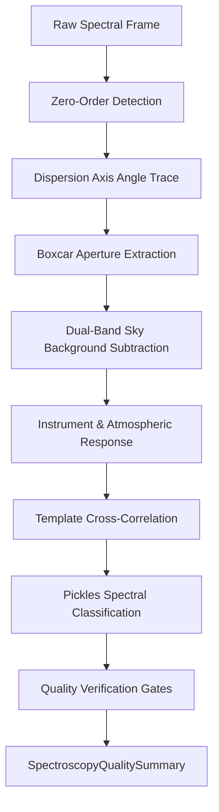

# Slitless Spectroscopy Extraction and Classification Pipeline Review Guide

*Version 1.0 · 2026-10-10 · Status: current*

## Abstract

This document details the slitless spectroscopy extraction, wavelength
calibration, response correction, and spectral classification pipeline in
Astrometrics (`astrometricslib.pipelines.spectroscopy`).

## 1. Overview & Scientific Objective

**Statement of need.** Transmission diffraction grating spectroscopy
(e.g. Star Analyser 100/200) disperses stellar light into first-order spectra
directly on the imaging sensor. The Astrometrics spectroscopy pipeline
automates zero-order identification, dispersion tracing, sky background
subtraction, wavelength calibration, and spectral classification against the
Pickles standard stellar atlas.

## 2. Input Requirements & FITS Header Specification

| FITS Keyword | Requirement | Data Type | Description | Fallback Mode |
| :--- | :--- | :--- | :--- | :--- |
| `DATE-OBS` | Mandatory | `str` (ISO-8601) | Exposure timestamp. | Assumes observation epoch 2016.0. |
| `DISPAXIS` | Optional | `int` (1 or 2) | Dispersion axis orientation. | Autodetects dispersion angle. |
| `GRATROT` | Optional | `float` (deg) | Grating rotation angle. | Autodetects dispersion angle. |

## 3. Mathematical & Algorithmic Formulation

### 3.1 Linear Grating Dispersion Model
Pixel coordinate offsets from the zero-order anchor $(x_0, y_0)$ map to wavelength:
$$\lambda(x) = \lambda_0 + D \cdot \sqrt{(x - x_0)^2 + (y - y_0)^2}$$
where $D$ is the linear dispersion factor in Å/pixel.

### 3.2 Adaptive Boxcar Extraction & Background Subtraction
Flux is extracted along the trace using an adaptive boxcar half-width:
$$w_\text{ext}(x) = 2.5 \cdot \text{FWHM}_\text{trail}(x)$$
Dual background bands separated by a 6-pixel gap estimate local background:
$$F_\text{net}(\lambda) = \sum_{y \in \text{box}} I(x, y) - n_\text{pix} \bar{B}_\text{sky}(x)$$

### 3.3 Pickles Atlas Cross-Correlation
Spectra are normalized by median continuum and cross-correlated against Pickles
standard templates:
$$\text{RMS} = \sqrt{\frac{1}{M} \sum_{i=1}^M
  \left[F_\text{norm}(\lambda_i) - T_\text{norm}(\lambda_i)\right]^2}$$

## 4. Four-Stage Lifecycle Architecture

Implemented via `SpectroscopyPipelineAdapter` in `runner.py`:

- **Stage 1 (`process_input`):** Checks zero-order saturation and dispersion angle.
- **Stage 2 (`run`):** Traces dispersion, extracts 1D spectrum, and matches atlas.
- **Stage 3 (`validate_output`):** Evaluates 7 quality run gates (`spectra_extracted`,
  `zero_order_saturation`, `spectral_classification`, `catalog_agreement`,
  `feature_significance`, `resolution_measured`, `processing_quality`).
- **Stage 4 (`to_result_dict`):** Emits calibrated 1D array and summary record.

## 5. Tuned Calibration Parameters

| Parameter | Live Value | Empirical Status | Notes |
| :--- | :--- | :--- | :--- |
| `NO_GOOD_MATCH_RMS` | `0.15` | Measured (55 stars) | Match RMS limit above which classification is rejected. |
| `AMBIGUOUS_RMS_GAP` | `0.02` | Measured | Minimum RMS gap between best and second-best template. |
| `DIFFERS_FROM_CATALOG_SUBTYPES` | `20.0` | Measured (29 stars) | Subtype difference threshold triggering catalog warning. |
| Extraction Half-Width | 2.5 × trail width | Designed | Aperture integration boundary. |
| Sky Strip Gap & Width | 6 px gap, 10 px width | Measured (Vega) | Background estimation geometry. |
| Flux Calibration Status | Relative ADU | Uncalibrated | Spectra represent instrumental counts, not absolute flux. |

## 6. Degraded States & Fallback Pathways

1. **Zero-Order Saturation:** Saturated anchors trigger `zero_order_saturation`
   warning flags; wavelength zero-points may exhibit small systematic offsets.
2. **Ambiguous Classification:** When the gap between the best and second-best
   class is $< 0.02$ RMS, the match is recorded with an ambiguity advisory.
3. **Crowded Fields:** Fixed sky background bands (6 px gap) may include flux
   from neighboring stars in crowded clusters.

## 7. Quality Summary Data Models

### 7.1 Pipeline Execution Envelope
| Field Name | Type | Description |
| :--- | :--- | :--- |
| `pipeline_name` | `str` | Unique pipeline domain identifier (e.g., astrometry, photometry). |
| `pipeline_version` | `str` | Semantic version of the pipeline processing contract. |
| `target_id` | `str` | Target celestial object identifier. |
| `target_session_ids` | `list[str]` | List of observing session IDs included in the analysis. |
| `target_session_breakdown` | `list[astrometricslib.models.quality_summary.TargetSessionContribution]` | Per-session frame counts and contribution breakdown. |
| `upstream_quality_summary_reference` | `str | None` | Category name of prerequisite pipeline. |
| `resolved_parameters` | `dict[str, Any]` | Effective configuration parameters used during execution. |
| `camera_profile` | `astrometricslib.models.quality_summary.AppliedCameraProfile | None` | Camera sensor parameters and clipping thresholds applied. |
| `quality_processing_applied` | `bool` | Indicates whether QA gates and checks were executed. |
| `flagged` | `bool` | True if one or more quality gates failed, indicating data concerns. |
| `flag_reasons` | `list[str]` | Human-readable sentences describing reasons for quality flags. |
| `gates` | `list[astrometricslib.models.gate_result.GateResult]` | Complete collection of passed, failed, and unchecked GateResults. |
| `created_at` | `datetime.datetime` | UTC timestamp when the quality summary was generated. |
| `provenance_activity_id` | `str | None` | IVOA provenance activity / job tracking identifier. |
| `upstream_entity_id` | `str | None` | Exact upstream database entity consumed by this run. |
| `spectroscopy_metrics` | `astrometricslib.models.quality_summary.SpectroscopyPipelineQualityMetrics` | Quality metric attribute. |

### 7.2 Domain Scientific Metrics Schema
| Field Name | Type | Description |
| :--- | :--- | :--- |
| `catalog_matched_star_count` | `int` | Quality metric attribute. |
| `position_only_star_count` | `int` | Quality metric attribute. |
| `unresolved_star_count` | `int` | Quality metric attribute. |
| `zero_order_saturated_pixel_fraction` | `float | None` | Fraction of saturated pixels in zero-order anchor. |
| `zero_order_saturation_flagged` | `bool` | True if zero-order anchor exceeded sensor linearity. |
| `dispersion_angle_deg` | `float | None` | Angle of spectral dispersion relative to detector rows. |
| `trail_width_profile_available` | `bool` | Whether cross-dispersion spatial profile was measured. |
| `median_trail_width_px` | `float | None` | Median spatial FWHM width of the spectral trail in pixels. |
| `poor_match_classification_count` | `int` | Stars with classification RMS above rejection limit. |
| `ambiguous_classification_count` | `int` | Stars with ambiguous classification between classes. |
| `flagged_spectral_classifications` | `list[astrometricslib.models.quality_summary.SpectralClassificationConcern]` | Detailed records of stars with doubtful classifications. |
| `stage_quality_summary` | `list[astrometricslib.models.spectroscopy_quality.StageQualityRollup] | None` | Rollup of quality checks across extraction stages. |
| `gaia_xp_summary` | `astrometricslib.models.gaia_xp_comparison.GaiaXpRunSummary | None` | Comparison against Gaia DR3 synthetic XP spectra. |
| `wavelength_scale_summary` | `astrometricslib.models.wavelength_scale.WavelengthScaleSummary | None` | Scatter and drift of wavelength calibration zero-points. |
