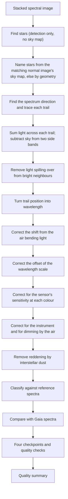

# Slitless Spectroscopy Extraction and Classification Pipeline Review Guide

*Version 1.1 · 2026-10-14 · Status: current*

## Abstract

This document reviews the slitless spectroscopy pipeline
(`astrometricslib.pipelines.spectroscopy`): extraction, wavelength
calibration, refraction, zero-point, response and extinction corrections,
dereddening, classification, the Gaia XP comparison, and the quality
checkpoints.

Terms are defined in the [glossary](../Astrometrics_Library_Architecture.md#appendix-b-glossary). This guide also defines each term where it first appears, so it can be read on its own.

## 1. Overview & Scientific Objective

### 1.1 In Plain Words

This pipeline spreads each star's light into its colours, a spectrum, and
uses the spectrum to classify the star. The class, or spectral type, mainly
tells the star's surface temperature. The types run O, B, A, F, G, K, M from
hottest to coolest, each split into finer subtypes.

There is no slit, so every star in the field makes its own short rainbow
trail at once. Trails can overlap, the sky adds light, and the camera, the
optics and the air each dim some colours more than others. The pipeline
traces each trail, sums its light, and turns position along the trail into
wavelength. It then removes each known colour effect in turn and finds the
reference spectrum that matches best.

The result is a corrected spectrum and a spectral type for each star, with
checks against star catalogs and against spectra from the Gaia space mission.

### 1.2 Statement of Need

A transmission grating (a clear plate ruled with many fine parallel lines) in
front of the camera, for example a Star Analyser 100 or 200, spreads each
star's light into a first-order spectrum on the sensor. The spectrum lies next
to the star's undispersed point image, the zero order. The pipeline turns
those trails into calibrated spectra and classifies them against the Pickles
(1998) stellar library (a set of reference spectra of known types).

The diagram shows one run, top to bottom.

Section 3 names the steps in the usual terms: the grating equation, differential
refraction and the zero-point shift (Section 3.1); QE, instrument response,
airmass extinction and dereddening (Section 3.3); and the Pickles and Gaia XP
comparisons (Sections 3.4 and 3.5). The normal image is the target's solved
standard stack, whose WCS (pixel-to-sky map) names the stars. The quality
summary is a `SpectroscopyQualitySummary` (Section 7).

## 2. Input Requirements & FITS Header Specification

A FITS file (the standard file format for astronomy images) starts with a
header: a list of named cards, each a keyword and a value, that describe the
exposure. The table lists the cards this pipeline reads. "When Missing" says
what the pipeline does if a card is absent.

The dispersion direction is measured from the image. `DISPAXIS` and `GRATROT`
are not read. The observatory site comes from the configuration.

| FITS Keyword | Requirement | Data Type | What It Is Used For | When Missing |
| :--- | :--- | :--- | :--- | :--- |
| `DATE-OBS` | Optional | `str` (ISO-8601, UTC) | Exposure start, used for the mid-exposure time of the refraction correction (the shift caused by the air bending each colour by a different amount). | The refraction correction is skipped, with the reason recorded. |
| `DATE-END` | Optional | `str` (ISO-8601, UTC) | Exposure end, for the mid-exposure time. | `DATE-OBS` plus half of `EXPTIME`. |
| `EXPTIME` | Recommended | `float` (s) | Exposure length. Turns counts into counts per second and gives the mid-exposure time. | The intensity scale is left unknown, never guessed. |
| `BITPIX` / `STACKCNT` | Optional | `int` | `BITPIX` is the pixel data type (negative means decimal numbers) and `STACKCNT` the number of stacked frames. Together they mark a Siril float stack, whose mean frame exposure is `EXPTIME` / `STACKCNT`. | Treated as a raw frame when `BITPIX` > 0 and there is no `STACKCNT`. |
| `AIRMASS` | Recommended | `float` | Airmass (how much atmosphere the light passed through; 1 straight overhead), for the extinction correction (Eq. 3) that undoes dimming by the air. | The extinction correction is skipped, and the skip is recorded. |
| `RA` / `DEC` | Optional | `float` (deg) | Field center (right ascension and declination, the sky's longitude and latitude). Used to match stars when there is no solved stack (a stack with a sky map). | No registration reference by position. |

## 3. Mathematical & Algorithmic Formulation

This section follows one spectrum: turning trail position into wavelength,
summing the light, correcting the brightness at each colour, and matching the
result to reference spectra.

### 3.1 Wavelength Model

**The grating equation.** The grating bends each colour by a different angle,
so distance along the trail measures wavelength: the farther from the zero
order, the redder the light. The dispersion is this spreading of light by
wavelength, and its direction on the sensor is measured from the image. A
sample's distance $x$ from the zero-order center, along the dispersion,
becomes a wavelength through the first-order grating equation
(`optics_physics.py`):

$$\lambda(x) = d \, \sin\left(\arctan\frac{x \, p}{L}\right) \tag{1}$$

where $d$ is the groove spacing (1 / lines per mm), $p$ the pixel pitch and
$L$ the grating-to-sensor distance, the one fitted number. A larger $L$
spreads the spectrum over more pixels.

**Refraction shift.** The air bends light slightly, and bends blue light more
than red. Differential atmospheric refraction is this colour-dependent
bending. It moves each wavelength along the trail by
$R(\lambda) - R(\lambda_\text{eff})$, projected onto the dispersion
direction, where $R(\lambda)$ is the bending at wavelength $\lambda$ and
$\lambda_\text{eff}$ is a reference (effective) wavelength.
It needs the site, a WCS (a pixel-to-sky map) and the exposure time.

**Zero-point shift.** If the zero-order center is misplaced, the whole
wavelength scale slides by a fixed amount, its zero point. A zero-point shift
corrects that offset. It is measured from known absorption lines (dark lines
where the star's atmosphere absorbs light), each at least 6 noise
widths deep, and is applied when at least 2 lines agree.

### 3.2 Extraction and Background Subtraction

**The box.** The trail is traced step by step. At each step a Gaussian (a
bell-shaped curve) is fitted across the trail. Its sigma is a width measure:
a wider trail gets a wider box, so the box holds the same share of the light
everywhere. The box half-width is

$$w(x) = 2.5 \, \sigma_\text{trail}(x) \tag{2}$$

where $\sigma_\text{trail}$ is the fitted Gaussian sigma, smoothed over 61
steps. `median_trail_width_px` in the summary is this sigma too, not a FWHM
(full width at half maximum, a different width measure about 2.35 times
sigma). Edge pixels count for the fraction inside the box.

**The sky.** Two sky bands, each 10 px wide and 6 px
from the box, are sigma-clipped (pixels far from the median, such as stars,
are dropped). The sky level is the mean of their medians, or the lower band
alone when they disagree by more than the noise allows.

**Neighbours.** A bright neighbour's wings (the faint outer edges of its
trail) are removed with a blur profile measured from an isolated star
(`neighbor_trail_deblending.py`, `neighbor_wing_correction.py`).

### 3.3 Flux Calibration

**What is corrected.** The raw counts at each wavelength are not the star's
true brightness at that colour. The sensor, the optics and the air each pass
some colours better than others. Three corrections undo this in turn.

- **QE.** The counts are divided by the sensor's quantum efficiency (QE: the
  share of arriving light the sensor records, which depends on colour).
- **Instrument response.** The counts are then divided by the instrument
  response: everything else about the optics and grating that favours some
  colours. The response is Vega's observed spectrum over the Pickles A0V
  template (a reference spectrum for Vega's type).
- **Airmass extinction.** The air dims light more at blue wavelengths, and
  more when the star is low. The extinction curve $k(\lambda)$ gives the
  dimming in magnitudes per airmass (a magnitude is a logarithmic brightness
  unit; 1 mag is a factor of about 2.5). Only the airmass difference $X -
  X_\text{ref}$ from the response's reference star is removed, because the
  response already holds the reference star's own dimming:

$$F_\text{corr}(\lambda) = F(\lambda)\; 10^{0.4\, k(\lambda)\, (X - X_\text{ref})} \tag{3}$$

The result is a relative $F_\lambda$ (energy flux per unit wavelength) up to
one constant: the shape of the spectrum is right, its overall level is not
known.

**Dereddening.** Dust between the stars dims blue light more than red, so a
star seen through dust looks redder, and cooler, than it is. $E(B-V)$ is the
size of this reddening, given as the extra difference between blue and visual
magnitudes. When a catalog gives the star's $E(B-V)$, interstellar reddening
is removed with the Cardelli, Clayton and Mathis (1989) law with $R_V = 3.1$
($R_V$ sets how the dimming changes with wavelength).

### 3.4 Classification

Each reference spectrum is blurred to the instrument's resolution (the
smallest wavelength detail it can separate) and scaled to the observation by a
best-fit factor $a$. The match score is the relative RMS (root mean square)
difference between the observed spectrum $F$ and the scaled reference $T$,
over $M$ wavelengths, divided by the mean flux $\bar{F}$. 0 is a perfect
match; 0.1 means a typical misfit of 10% of the flux:

$$\text{RMS} = \frac{1}{\bar{F}}
  \sqrt{\frac{1}{M}\sum_{i=1}^{M}\left[F(\lambda_i) - a\,T(\lambda_i)\right]^2} \tag{4}$$

The references are ranked by this score, and the lowest wins. Above
0.15 the match is poor. Above 0.45 no type is given. A gap
below 0.02 to the next reference makes the match ambiguous.

### 3.5 Gaia XP Comparison

The Gaia space mission measured low-resolution spectra, called XP spectra, for
many stars, independently of this instrument. Where Gaia DR3 (its third data
release) has an XP spectrum for the star, both spectra are brought to the same
resolution and divided by their median over 5400-5600 Å (1 Å, an angstrom, is
0.1 nm). If the calibration is right, their ratio is flat. The tilt of their
ratio tests the response, the extinction correction and the wavelength scale
together.

## 4. Processing Flow

`run_spectroscopy_analysis` (`runner.py`) runs `SpectroscopyPipelineAdapter`
through `run_pipeline`. `run_pipeline` (`pipeline_base.py`) calls the adapter's four methods in
order. It skips `run` only when `process_input` returns a `Result` with
`has_work=False`. After `validate_output` it stores the quality summary on the
target and records the run's provenance.

- **Stage 1 (`process_input`):** A no-op that returns an empty `Result`.
- **Stage 2 (`run`):** Finds the stars with `AstrometryPipeline` (no solve),
  names them from the target's solved stack, and runs
  `SpectroscopyPipeline.process`. Each spectrum carries four quality
  checkpoints, in order: `raw_frame`, `pre_processing`, `processing` and
  `post_processing`.
- **Stage 3 (`validate_output`):** Builds the summary, records the eight
  `spectroscopy_run_gates`, then `gaia_xp_agreement` (9 run gates in all).
- **Stage 4 (`to_result_dict`):** Returns only `context` and
  `stellar_objects`.

A session of raw frames runs through `batch.py` instead. It names the stars
in one reference frame, follows them through the session's other frames in
parallel workers, and builds the same gates from the same plain counts.

### 4.1 Quality Gates

A quality gate is an automatic check on a run. It passes, fails, or is
"not checked" when the data it needs are missing. A failed gate marks the run
as flagged (the `flagged` field in Section 7) so a person can look at it. The
list below is read from the code when this guide is generated.

| Gate | Role | Defined in | What it checks |
| :--- | :--- | :--- | :--- |
| `gaia_xp_agreement` | run gate | `post_processing/compare_to_gaia_xp.py` | Fails when the median tilt of observed / Gaia XP spectra (low-resolution spectra from the Gaia space mission) is above `GAIA_XP_SLOPE_LIMIT_PERCENT_PER_1000_ANGSTROM`. Not checked with too few stars. |
| `spectra_extracted` | run gate | `post_processing/run_gates.py` | Fails when no star produced a spectrum. |
| `zero_order_saturation` | run gate | `post_processing/run_gates.py` | Fails when any star's zero-order image (its undispersed point image beside the spectrum) holds a significant share of saturated pixels (pixels clipped at the sensor's maximum). |
| `spectral_classification` | run gate | `post_processing/run_gates.py` | Fails when a classification is a poor match (best misfit, the relative RMS of Eq. 4, above `NO_GOOD_MATCH_RMS`) or ambiguous at the class level (misfit gap to the next reference below `AMBIGUOUS_RMS_GAP`). |
| `catalog_agreement` | run gate | `post_processing/run_gates.py` | Fails when a measured spectral type is more than `DIFFERS_FROM_CATALOG_SUBTYPES` subtype steps from the type a catalog lists for the star. |
| `feature_significance` | run gate | `post_processing/run_gates.py` | Fails when a star's feature p-values (the chance that noise alone makes a feature this strong) could not be calibrated against control windows (stretches of its own spectrum used as a noise reference). |
| `resolution_measured` | run gate | `post_processing/run_gates.py` | Not checked when no spectrum had its resolution (smallest wavelength detail it can separate) measured. |
| `processing_quality` | run gate | `post_processing/run_gates.py` | Fails when more than `PROCESSING_QUALITY_MAXIMUM_FAILED_FRACTION` of classified spectra fail a metric of the processing checkpoint (one of four quality checkpoints on each spectrum). |
| `wavelength_scale` | run gate | `post_processing/wavelength_scale.py` | Fails when the run's wavelength zero points (offsets of each spectrum's wavelength scale) scatter by more than `WAVELENGTH_SCALE_LIMIT_ANGSTROM` after correction. |

## 5. Tuned Calibration Parameters

These are the fixed limits and settings the pipeline uses. "Live Value" is
read from the code when this guide is generated. "Empirical Status" says where
the value came from: measured on real data (the data set is named in
brackets), or set by design.

| Parameter | Live Value | Empirical Status | Notes |
| :--- | :--- | :--- | :--- |
| `NO_GOOD_MATCH_RMS` | `0.15` | Measured (14 stars) | Misfit to the best reference spectrum (relative RMS, Eq. 4) above which a classification is a poor match. |
| `UNRELIABLE_MATCH_RMS` | `0.45` | Measured (55 stars) | Misfit (relative RMS, Eq. 4) above which no spectral type is given at all. |
| `AMBIGUOUS_RMS_GAP` | `0.02` | Measured (reference ladder spacing) | Smallest misfit gap between the best reference and the next one; a smaller gap makes the match ambiguous. |
| `DIFFERS_FROM_CATALOG_SUBTYPES` | `20.0` | Measured (29 stars) | Subtype steps (the finer divisions of a spectral class) beyond which the measured type disagrees with the catalog type. |
| `APERTURE_SIGMA_MULTIPLIER` | `2.5` | Designed | Half-width of the extraction box, in units of the trail's Gaussian sigma (its width measure, Eq. 2). |
| `SKY_BAND_GAP_PX` / `SKY_BAND_WIDTH_PX` | `6` px / `10` px | Measured (Vega, one frame) | Gap between the box and each sky band, and the band's width, on each side of the box. |
| `WAVELENGTH_SCALE_LIMIT_ANGSTROM` | `11.0` Å | Designed | Largest scatter of the run's wavelength zero points (offsets of the wavelength scale) after correction. |
| `GAIA_XP_SLOPE_LIMIT_PERCENT_PER_1000_ANGSTROM` | `3.0` | Designed | Largest median tilt of the ratio observed / Gaia XP (the Gaia mission's own low-resolution spectra), in percent per 1000 Å. |
| Flux calibration | Relative F_λ | Calibrated to a constant | Energy flux per unit wavelength (F_λ), corrected for sensor sensitivity (QE), instrument response and atmospheric dimming, up to one unknown scale factor. |

## 6. Degraded States & Fallback Pathways

1. **Zero-order saturation.** Saturated pixels are clipped at the sensor's
   maximum value, so their true brightness is lost. When a star's zero order
   holds a significant share of them, `zero_order_saturation` fails. A
   saturated center can offset the wavelength scale; the zero-point shift
   corrects it
   when enough lines agree.
2. **Missing header data.** No `DATE-OBS`, site or WCS skips the refraction
   correction. No `AIRMASS` skips the extinction correction. Each skip is
   recorded on the spectrum.
3. **Ambiguous or poor matches.** They are kept with a flag and counted in
   the summary. `spectral_classification` fails only on a class-level
   ambiguity or a poor match.
4. **Reddened hot stars.** With no catalog $E(B-V)$, an O, B or A star tends
   to read about one subtype cool.
5. **No solved stack.** Stars are named by matching point patterns, which can
   fail on sparse fields.

## 7. Quality Summary Data Models

Every run saves a quality summary: a record of what the run measured and how each quality gate came out. Section 7.1 lists the fields every pipeline shares. Section 7.2 lists the measurements that belong to this pipeline. The tables are read from the data models in the code.

### 7.1 Pipeline Execution Envelope (`SpectroscopyQualitySummary`)

| Field Name | Type | Description |
| :--- | :--- | :--- |
| `pipeline_name` | `str` | Which pipeline made this summary (for example astrometry or photometry). |
| `pipeline_version` | `str` | Version number of the pipeline's processing rules. |
| `target_id` | `str` | Identifier of the target (the sky object being studied). |
| `target_session_ids` | `list[str]` | Identifiers of the observing sessions (usually one night each) used in the run. |
| `target_session_breakdown` | `list[astrometricslib.models.quality_summary.TargetSessionContribution]` | For each session, how many frames it had and how many the run used. |
| `upstream_quality_summary_reference` | `str \| None` | Name of the pipeline that had to run first, if any. |
| `resolved_parameters` | `dict[str, Any]` | The settings the run actually used, after defaults were filled in. |
| `camera_profile` | `astrometricslib.models.quality_summary.AppliedCameraProfile \| None` | The camera settings applied, such as gain and the level at which pixels clip. |
| `quality_processing_applied` | `bool` | Whether the quality gates and checks were run. |
| `flagged` | `bool` | True if one or more quality gates failed, so a person should look at the run. |
| `flag_reasons` | `list[str]` | One plain sentence for each reason the run was flagged. |
| `gates` | `list[astrometricslib.models.gate_result.GateResult]` | Every quality gate result: passed, failed or not checked. |
| `created_at` | `datetime.datetime` | Time the quality summary was made, in UTC. |
| `provenance_activity_id` | `str \| None` | Identifier of this run in the provenance record (the IVOA-standard log of which run made which data). |
| `upstream_entity_id` | `str \| None` | Identifier of the exact database record this run read as its input. |
| `spectroscopy_metrics` | `astrometricslib.models.quality_summary.SpectroscopyPipelineQualityMetrics` | The spectroscopy measurements (Section 7.2). |

### 7.2 Domain Scientific Metrics Schema (`SpectroscopyPipelineQualityMetrics`)

| Field Name | Type | Description |
| :--- | :--- | :--- |
| `catalog_matched_star_count` | `int` | Stars matched to a SIMBAD or Gaia DR3 entry. |
| `position_only_star_count` | `int` | Stars named only by their sky position. |
| `unresolved_star_count` | `int` | Stars with no catalog match and no sky position; not saved. |
| `zero_order_saturated_pixel_fraction` | `float \| None` | Share of saturated (clipped) pixels in the zero order (the star's undispersed point image beside its spectrum). |
| `zero_order_saturation_flagged` | `bool` | True if the zero order went beyond the range where the sensor responds in proportion to light. |
| `dispersion_angle_deg` | `float \| None` | Angle of the spectra (the direction light is spread by colour) relative to the sensor rows. |
| `trail_width_profile_available` | `bool` | Whether the width profile across the spectrum trail was measured. |
| `median_trail_width_px` | `float \| None` | Median Gaussian sigma (not FWHM) of the trail cross-section, in pixels. |
| `poor_match_classification_count` | `int` | Number of stars whose classification misfit (RMS) is above the rejection limit. |
| `ambiguous_classification_count` | `int` | Number of stars whose classification is ambiguous between spectral classes. |
| `flagged_spectral_classifications` | `list[astrometricslib.models.quality_summary.SpectralClassificationConcern]` | Details of each star whose classification is in doubt. |
| `stage_quality_summary` | `list[astrometricslib.models.spectroscopy_quality.StageQualityRollup] \| None` | Summary of the quality checks at each extraction stage (checkpoint). |
| `gaia_xp_summary` | `astrometricslib.models.gaia_xp_comparison.GaiaXpRunSummary \| None` | Comparison with Gaia DR3 synthetic XP spectra (low-resolution spectra from the Gaia space mission). |
| `wavelength_scale_summary` | `astrometricslib.models.wavelength_scale.WavelengthScaleSummary \| None` | Scatter and drift of the wavelength zero points (offsets of the wavelength scale). |
