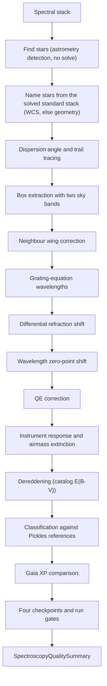

# Slitless Spectroscopy Extraction and Classification Pipeline Review Guide

*Version 1.1 · 2026-10-14 · Status: current*

## Abstract

This document reviews the slitless spectroscopy pipeline
(`astrometricslib.pipelines.spectroscopy`): extraction, wavelength
calibration, refraction, zero-point, response and extinction corrections,
dereddening, classification, the Gaia XP comparison, and the quality
checkpoints.

## 1. Overview & Scientific Objective

**Statement of need.** A transmission grating in front of the camera (for
example a Star Analyser 100 or 200) spreads each star's light into a
first-order spectrum on the sensor, next to the star's undispersed image (the
zero order). The pipeline turns those trails into calibrated spectra and
classifies them against the Pickles (1998) stellar library.

## 2. Input Requirements & FITS Header Specification

The dispersion direction is measured from the image. `DISPAXIS` and `GRATROT`
are not read. The observatory site comes from the configuration.

| FITS Keyword | Requirement | Data Type | What It Is Used For | When Missing |
| :--- | :--- | :--- | :--- | :--- |
| `DATE-OBS` | Optional | `str` (ISO-8601, UTC) | Exposure start, for the refraction correction's mid-exposure time. | The refraction correction is skipped, with the reason recorded. |
| `DATE-END` | Optional | `str` (ISO-8601, UTC) | Exposure end, for the mid-exposure time. | `DATE-OBS` plus half of `EXPTIME`. |
| `EXPTIME` | Recommended | `float` (s) | Counts-per-second scale of the spectrum; mid-exposure time. | The intensity scale is left unknown, never guessed. |
| `BITPIX` / `STACKCNT` | Optional | `int` | Mark a Siril float stack, whose mean frame exposure is `EXPTIME` / `STACKCNT`. | Treated as a raw frame when `BITPIX` > 0 and there is no `STACKCNT`. |
| `AIRMASS` | Recommended | `float` | Airmass for the extinction correction (Eq. 3). | The extinction correction is skipped, and the skip is recorded. |
| `RA` / `DEC` | Optional | `float` (deg) | Field center for star registration when there is no solved stack. | No registration reference by position. |

## 3. Mathematical & Algorithmic Formulation

### 3.1 Wavelength Model

A sample's distance $x$ from the zero-order center, along the dispersion,
becomes a wavelength through the first-order grating equation
(`optics_physics.py`):

$$\lambda(x) = d \, \sin\left(\arctan\frac{x \, p}{L}\right) \tag{1}$$

where $d$ is the groove spacing (1 / lines per mm), $p$ the pixel pitch and
$L$ the grating-to-sensor distance, the one fitted number. Two shifts follow.
First, differential atmospheric refraction moves each wavelength along the
trail by $R(\lambda) - R(\lambda_\text{eff})$, projected onto the dispersion
direction. It needs the site, a WCS and the exposure time. Second, a
zero-point shift corrects an offset zero-order center. It is measured from
known absorption lines, each at least 6 noise widths deep, and is
applied when at least 2 lines agree.

### 3.2 Extraction and Background Subtraction

The trail is traced step by step. At each step a Gaussian is fitted across
the trail, and the box half-width is

$$w(x) = 2.5 \, \sigma_\text{trail}(x) \tag{2}$$

where $\sigma_\text{trail}$ is the fitted Gaussian sigma, smoothed over 61
steps. `median_trail_width_px` in the summary is this sigma too, not a FWHM.
Edge pixels count for the fraction inside the box. Two sky bands, each
10 px wide and 6 px from the box, are sigma-clipped. The
sky level is the mean of their medians, or the lower band alone when they
disagree by more than the noise allows. A bright neighbour's wings are
removed with a blur profile measured from an isolated star
(`neighbor_trail_deblending.py`, `neighbor_wing_correction.py`).

### 3.3 Flux Calibration

The counts are divided by the sensor's quantum efficiency (QE), then by the
instrument response. The response is Vega's observed spectrum over the Pickles
A0V template. The airmass difference from the response's reference star is
removed with the extinction curve $k(\lambda)$:

$$F_\text{corr}(\lambda) = F(\lambda)\; 10^{0.4\, k(\lambda)\, (X - X_\text{ref})} \tag{3}$$

The result is a relative $F_\lambda$ (energy flux per unit wavelength) up to
one constant. When a catalog gives the star's $E(B-V)$, interstellar
reddening is removed with the Cardelli, Clayton and Mathis (1989) law with
$R_V = 3.1$.

### 3.4 Classification

Each reference spectrum is blurred to the instrument's resolution and scaled
to the observation by a best-fit factor $a$. The match score is the relative
RMS

$$\text{RMS} = \frac{1}{\bar{F}}
  \sqrt{\frac{1}{M}\sum_{i=1}^{M}\left[F(\lambda_i) - a\,T(\lambda_i)\right]^2} \tag{4}$$

The references are ranked by this score, and the lowest wins. Above
0.15 the match is poor. Above 0.45 no type is given. A gap
below 0.02 to the next reference makes the match ambiguous.

### 3.5 Gaia XP Comparison

Where Gaia DR3 has an XP spectrum for the star, both spectra are brought to the
same resolution and divided by their median over 5400-5600 Å. The tilt of
their ratio tests the response, the extinction correction and the wavelength
scale together.

## 4. Processing Flow

`run_spectroscopy_analysis` (`runner.py`) runs `SpectroscopyPipelineAdapter`
through `run_pipeline`. `run_pipeline` (`pipeline_base.py`) calls the adapter's four methods in
order. It skips `run` only when `process_input` returns a `Result` with
`has_work=False`. After `validate_output` it stores the quality summary on the
target and records the run's provenance.

- **Stage 1 (`process_input`):** A no-op that returns an empty `Result`.
- **Stage 2 (`run`):** Finds the stars with `AstrometryPipeline` (no solve),
  names them from the target's solved stack, and runs
  `SpectroscopyPipeline.process`. Each spectrum carries four quality
  checkpoints, in order: `raw_frame`, `pre_processing`, `processing` and
  `post_processing`.
- **Stage 3 (`validate_output`):** Builds the summary, records the eight
  `spectroscopy_run_gates`, then `gaia_xp_agreement` (9 run gates in all).
- **Stage 4 (`to_result_dict`):** Returns only `context` and
  `stellar_objects`.

A session of raw frames runs through `batch.py` instead. It names the stars
in one reference frame, follows them through the session's other frames in
parallel workers, and builds the same gates from the same plain counts.

### 4.1 Quality Gates

| Gate | Role | Defined in | What it checks |
| :--- | :--- | :--- | :--- |
| `gaia_xp_agreement` | run gate | `post_processing/compare_to_gaia_xp.py` | Fails when the median tilt of observed / Gaia XP spectra is above `GAIA_XP_SLOPE_LIMIT_PERCENT_PER_1000_ANGSTROM`. Not checked with too few stars. |
| `spectra_extracted` | run gate | `post_processing/run_gates.py` | Fails when no star produced a spectrum. |
| `zero_order_saturation` | run gate | `post_processing/run_gates.py` | Fails when any star's zero-order image holds a significant share of saturated pixels. |
| `spectral_classification` | run gate | `post_processing/run_gates.py` | Fails when a classification is a poor match (best RMS above `NO_GOOD_MATCH_RMS`) or ambiguous at the class level (gap below `AMBIGUOUS_RMS_GAP`). |
| `catalog_agreement` | run gate | `post_processing/run_gates.py` | Fails when a measured type is more than `DIFFERS_FROM_CATALOG_SUBTYPES` subtype steps from the catalog type. |
| `feature_significance` | run gate | `post_processing/run_gates.py` | Fails when a star's feature p-values could not be calibrated against control windows of its own spectrum. |
| `resolution_measured` | run gate | `post_processing/run_gates.py` | Not checked when no spectrum had its resolution measured. |
| `processing_quality` | run gate | `post_processing/run_gates.py` | Fails when more than `PROCESSING_QUALITY_MAXIMUM_FAILED_FRACTION` of classified spectra fail a processing-checkpoint metric. |
| `wavelength_scale` | run gate | `post_processing/wavelength_scale.py` | Fails when the run's wavelength zero points scatter by more than `WAVELENGTH_SCALE_LIMIT_ANGSTROM` after correction. |

## 5. Tuned Calibration Parameters

| Parameter | Live Value | Empirical Status | Notes |
| :--- | :--- | :--- | :--- |
| `NO_GOOD_MATCH_RMS` | `0.15` | Measured (14 stars) | Best-reference relative RMS above which a classification is a poor match. |
| `UNRELIABLE_MATCH_RMS` | `0.45` | Measured (55 stars) | Above this, no spectral type is given at all. |
| `AMBIGUOUS_RMS_GAP` | `0.02` | Measured (reference ladder spacing) | Smallest RMS gap between the best reference and the next one. |
| `DIFFERS_FROM_CATALOG_SUBTYPES` | `20.0` | Measured (29 stars) | Subtype steps beyond which the type disagrees with the catalog. |
| `APERTURE_SIGMA_MULTIPLIER` | `2.5` | Designed | Box half-width in units of the trail's Gaussian sigma. |
| `SKY_BAND_GAP_PX` / `SKY_BAND_WIDTH_PX` | `6` px / `10` px | Measured (Vega, one frame) | Sky-band geometry on each side of the box. |
| `WAVELENGTH_SCALE_LIMIT_ANGSTROM` | `11.0` Å | Designed | Largest scatter of the run's corrected wavelength zero points. |
| `GAIA_XP_SLOPE_LIMIT_PERCENT_PER_1000_ANGSTROM` | `3.0` | Designed | Largest median tilt of observed / Gaia XP. |
| Flux calibration | Relative F_λ | Calibrated to a constant | QE-, response- and extinction-corrected energy flux, up to one unknown scale factor. |

## 6. Degraded States & Fallback Pathways

1. **Zero-order saturation.** `zero_order_saturation` fails. A saturated
   center can offset the wavelength scale; the zero-point shift corrects it
   when enough lines agree.
2. **Missing header data.** No `DATE-OBS`, site or WCS skips the refraction
   correction. No `AIRMASS` skips the extinction correction. Each skip is
   recorded on the spectrum.
3. **Ambiguous or poor matches.** They are kept with a flag and counted in
   the summary. `spectral_classification` fails only on a class-level
   ambiguity or a poor match.
4. **Reddened hot stars.** With no catalog $E(B-V)$, an O, B or A star tends
   to read about one subtype cool.
5. **No solved stack.** Stars are named by matching point patterns, which can
   fail on sparse fields.

## 7. Quality Summary Data Models

### 7.1 Pipeline Execution Envelope (`SpectroscopyQualitySummary`)

| Field Name | Type | Description |
| :--- | :--- | :--- |
| `pipeline_name` | `str` | Unique pipeline domain identifier (e.g., astrometry, photometry). |
| `pipeline_version` | `str` | Semantic version of the pipeline processing contract. |
| `target_id` | `str` | Target celestial object identifier. |
| `target_session_ids` | `list[str]` | List of observing session IDs included in the analysis. |
| `target_session_breakdown` | `list[astrometricslib.models.quality_summary.TargetSessionContribution]` | Per-session frame counts and contribution breakdown. |
| `upstream_quality_summary_reference` | `str \| None` | Category name of prerequisite pipeline. |
| `resolved_parameters` | `dict[str, Any]` | Effective configuration parameters used during execution. |
| `camera_profile` | `astrometricslib.models.quality_summary.AppliedCameraProfile \| None` | Camera sensor parameters and clipping thresholds applied. |
| `quality_processing_applied` | `bool` | Indicates whether QA gates and checks were executed. |
| `flagged` | `bool` | True if one or more quality gates failed, indicating data concerns. |
| `flag_reasons` | `list[str]` | Human-readable sentences describing reasons for quality flags. |
| `gates` | `list[astrometricslib.models.gate_result.GateResult]` | Complete collection of passed, failed, and unchecked GateResults. |
| `created_at` | `datetime.datetime` | UTC timestamp when the quality summary was generated. |
| `provenance_activity_id` | `str \| None` | IVOA provenance activity / job tracking identifier. |
| `upstream_entity_id` | `str \| None` | Exact upstream database entity consumed by this run. |
| `spectroscopy_metrics` | `astrometricslib.models.quality_summary.SpectroscopyPipelineQualityMetrics` | The spectroscopy measurements (Section 7.2). |

### 7.2 Domain Scientific Metrics Schema (`SpectroscopyPipelineQualityMetrics`)

| Field Name | Type | Description |
| :--- | :--- | :--- |
| `catalog_matched_star_count` | `int` | Stars matched to a SIMBAD or Gaia DR3 entry. |
| `position_only_star_count` | `int` | Stars named only by their sky position. |
| `unresolved_star_count` | `int` | Stars with no catalog match and no sky position; not saved. |
| `zero_order_saturated_pixel_fraction` | `float \| None` | Fraction of saturated pixels in zero-order anchor. |
| `zero_order_saturation_flagged` | `bool` | True if zero-order anchor exceeded sensor linearity. |
| `dispersion_angle_deg` | `float \| None` | Angle of spectral dispersion relative to detector rows. |
| `trail_width_profile_available` | `bool` | Whether cross-dispersion spatial profile was measured. |
| `median_trail_width_px` | `float \| None` | Median Gaussian sigma (not FWHM) of the trail cross-section, in pixels. |
| `poor_match_classification_count` | `int` | Stars with classification RMS above rejection limit. |
| `ambiguous_classification_count` | `int` | Stars with ambiguous classification between classes. |
| `flagged_spectral_classifications` | `list[astrometricslib.models.quality_summary.SpectralClassificationConcern]` | Detailed records of stars with doubtful classifications. |
| `stage_quality_summary` | `list[astrometricslib.models.spectroscopy_quality.StageQualityRollup] \| None` | Rollup of quality checks across extraction stages. |
| `gaia_xp_summary` | `astrometricslib.models.gaia_xp_comparison.GaiaXpRunSummary \| None` | Comparison against Gaia DR3 synthetic XP spectra. |
| `wavelength_scale_summary` | `astrometricslib.models.wavelength_scale.WavelengthScaleSummary \| None` | Scatter and drift of wavelength calibration zero-points. |
