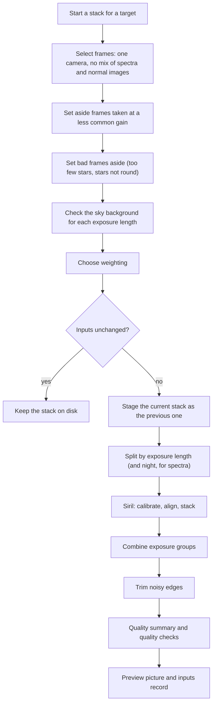

# Astronomical Stacking and Image Calibration Pipeline Review Guide

*Version 1.1 · 2026-10-14 · Status: current*

## Abstract

This document reviews the stacking pipeline
(`astrometricslib.pipelines.stacking`): frame checks, calibration-frame
selection, the Siril run, exposure groups, stack quality gates and the steps
after the stack.

Terms are defined in the [glossary](../Astrometrics_Library_Architecture.md#appendix-b-glossary). This guide also defines each term where it first appears, so it can be read on its own.

## 1. Overview & Scientific Objective

### 1.1 In Plain Words

This pipeline combines many exposures of the same target into one deeper,
cleaner image, called a stack.

Each raw exposure carries flaws from the camera and the optics: a fixed
electronic level, a glow that builds up with exposure time, and darker corners
and dust shadows. Each exposure is also noisy, and some catch satellite trails
or cosmic-ray hits. The pipeline first removes the camera and optics flaws
using reference exposures taken for the purpose (calibration frames). It then
lines the exposures up on their stars and averages them, rejecting pixels that
disagree with the rest.

The result is the stacked image, a preview picture, and a quality summary that
checks both the inputs and the result.

### 1.2 Statement of Need

Raw frames carry dark current (a signal the sensor builds up from heat, which
grows with exposure time), a bias level (the fixed electronic level of an
empty exposure), and vignetting (darker corners from the optics) and dust
shadows. Master darks, biases and flats (averaged calibration frames taken
with the shutter closed, with the shortest exposure, and of an evenly lit
surface) remove them. Stacking many aligned frames raises the signal-to-noise
ratio by about $\sqrt{N}$ for $N$ frames and rejects satellite trails and
cosmic rays.

The diagram shows one run, top to bottom.

In code terms the run starts at `stage.stack_frames(target)`, splits frames in
`stack_runner.run_stack`, and stacks through a `StackingDriver`, whose Siril
version runs `ImageProcessing` (Section 4). Siril is an open-source
astronomy image processor. Setting bad frames aside is the frame quarantine,
and the quality summary is a `StackQualitySummary` (Section 7).

## 2. Input Requirements & FITS Header Specification

A FITS file (the standard file format for astronomy images) starts with a
header: a list of named cards, each a keyword and a value, that describe the
exposure. The table lists the cards this pipeline reads. "When Missing" says
what the pipeline does if a card is absent.

| FITS Keyword | Requirement | Data Type | What It Is Used For | When Missing |
| :--- | :--- | :--- | :--- | :--- |
| `EXPTIME` | Mandatory | `float` (s) | Exposure length. Frames are stacked one exposure length at a time. Darks (frames taken with the shutter closed) are filed by it and matched within 0.1 s. | A dark with no `EXPTIME` is filed as 30 s. |
| `CCD-TEMP` (or `SET-TEMP`) | Recommended | `float` (°C) | Sensor temperature, for filing darks in temperature slots and judging how well a dark matches. | The dark's temperature is not judged. |
| `GAIN` (or `ISOSPEED`) | Recommended | `float` | Gain setting (the camera's amplification). Used for the minority-gain check and to file calibration frames. | Frames fall into one unknown-gain group; `gain_homogeneity` is not checked. |
| `OFFSET` (or `BLKLEVEL`) | Recommended | `int` | Camera offset (a fixed level added to every pixel), used to file calibration frames. | Offset 0 is assumed. |
| `XBINNING` / `YBINNING` | Optional | `int` | Binning (sensor pixels joined into one); calibration frames of another binning are never applied. | 1x1. |
| `FILTER` | Recommended | `str` | Filter name. Flats (images of an evenly lit surface) are filed and picked by filter; the stack's file name carries it. | Filter type `NONE`. |
| `INSTRUME` (or `CAMERA`) | Recommended | `str` | Camera name; frames from two cameras are never stacked together. | The camera of the frame record. |

## 3. Mathematical & Algorithmic Formulation

This section covers choosing calibration frames, predicting how sharp the
stack should be, weighting frames, and combining frames of different exposure
lengths.

### 3.1 Calibration-Frame Selection

A dark only cancels the heat signal if it was taken at about the same sensor
temperature as the light frames (the exposures of the target). The
calibration library files each frame under its gain, offset and binning, and
each dark also under a temperature slot 3 °C wide. Lights use the
darks of their own slot. With none, the nearest-temperature dark is used.

The master's temperature is the mean of its darks. A soft flag (a warning
that does not stop the dark being used) is raised when the gap between the
light's temperature and the master's is too large:

$$\left|T_\text{light} - \bar{T}_\text{dark}\right| > 3\,^\circ\text{C} \tag{1}$$

The dark is still applied; the flag makes `calibration_metadata` fail. When
no dark records a temperature, the match is not judged. A gain or offset
mismatch falls back the same way. A binning mismatch never falls back.

### 3.2 Expected Stack FWHM

FWHM (full width at half maximum) is the width of a star's light profile at
half its peak height; a smaller FWHM means a sharper image. Averaging aligned
frames adds no blur of its own, so the stack's star width follows from the
input widths. The pipeline predicts that width and checks the stack against
it. For round Gaussian (bell-shaped) stars of widths $w_1, \dots, w_N$, the
stacked star's FWHM is the root mean square of the inputs:

$$\text{FWHM}_\text{expected} = \sqrt{\frac{1}{N}\sum_{i=1}^{N}\text{FWHM}_i^2} \tag{2}$$

The ratio $R$ of measured to expected width is 1 for a perfect stack. A ratio
well above 1 means the alignment or the combination blurred the stars:

$$R = \frac{\text{FWHM}_\text{stack}}{\text{FWHM}_\text{expected}} \le 1.2 \tag{3}$$

### 3.3 Weighting and Rejection

**Weighting.** Frames of different exposure lengths have different noise, so
giving them equal weight can waste the better frames. The configured weighting
always wins. With none configured, an imaging stack uses Siril's noise
weighting when equal weights would cost at least 1.05 in noise. The
penalty $P$ is 1 when all exposures are equal and grows as they differ:

$$P = \sqrt{\overline{(1/t)}\;\cdot\;\overline{t}} \ge 1.05 \tag{4}$$

where $t$ are the frame exposures and a bar is the mean over frames. Frames
of one exposure length give $P = 1$, so such a stack is unweighted unless a
weighting is configured.

**Rejection.** Siril stacks with `-norm=addscale` (each frame's level and
spread are matched to the reference before combining) and sigma rejection
(`rej`). Sigma rejection drops, at each pixel, values more than a set number
of standard deviations from the rest, which removes satellite trails and
cosmic rays. The low and high limits are either fixed or set from the frame
count.

### 3.4 Exposure Groups

Every stack with more than one exposure length is stacked one length at a
time. Each group's stack is turned into counts per second and put on the
reference group's brightness scale using mid-range pixels. A group whose
bright end disagrees is left out, because its brightest pixels no longer grow
in step with exposure. The rest are combined with inverse-variance weights:
each group counts in proportion to $1/\sigma^2$, so less noisy groups count
more. All groups are used, not only the largest one.

## 4. Processing Flow

Stacking has no `AnalysisPipeline` adapter. The entry point is
`stage.stack_frames`:

1. **Frame selection and checks.** One camera only, no mix of spectral and
   imaging frames, minority-gain frames set aside, frames set aside by an
   earlier run dropped, the quarantine (imaging only), and the background
   check.
2. **Skip unchanged.** `stack_inputs.py` takes a fingerprint of the frames,
   calibration frames, settings and stacking code: a short code that changes
   whenever any of them changes. A match with the last run keeps the stack on
   disk, unless `force=True`.
3. **Previous-stack staging.** The current stack moves to a staging folder.
   On success it becomes the single `_previous` version
   (`previous_stack.py`), which a person can swap back or discard.
4. **Stack.** `stack_runner.run_stack` splits the frames by exposure length
   (and by night for spectra) and calls the `StackingDriver`. The Siril driver
   (`siril_stacking_driver.py`) runs `ImageProcessing` in `siril_interface.py`:
   masters, calibration, registration (alignment) and stacking. Spectral registration that
   loses too many frames is retried with relaxed detection, then with phase
   correlation (aligning whole images by their overall pattern rather than by
   single stars).
5. **After the stack.** Noisy edges are trimmed (`stack_crop.py`). The
   quality summary and its gates are built (16 run gates). A preview
   picture is made with the GraXpert and Cosmic Clarity image tools and star
   toning, and the inputs record is written last.

### 4.1 Quality Gates

A quality gate is an automatic check on a run. It passes, fails, or is
"not checked" when the data it needs are missing. A failed gate marks the run
as flagged (the `flagged` field in Section 7) so a person can look at it. The
list below is read from the code when this guide is generated.

| Gate | Role | Defined in | What it checks |
| :--- | :--- | :--- | :--- |
| `rejected_pixel_fraction` | run gate | `post_processing/assess_output_quality.py` | Fails when the share of pixels rejected as outliers in the stack is above `DEFAULT_REJECTED_FRACTION_FLAG_THRESHOLD`. |
| `stack_sharpness` | run gate | `post_processing/assess_output_quality.py` | Fails when the stack's star width (FWHM) over the expected width is above `DEFAULT_FWHM_DEGRADATION_RATIO` (Eq. 3), meaning the stack is blurrier than its inputs predict. |
| `spectral_registration` | run gate | `post_processing/assess_output_quality.py` | Fails when the registration (alignment) check of a spectral stack raised a concern. Not checked for an imaging stack. |
| `saturated_pixel_fraction` | run gate | `post_processing/assess_output_quality.py` | Fails when the stack holds a significant share of saturated pixels. |
| `zero_pixel_fraction` | run gate | `post_processing/assess_output_quality.py` | Fails when too many stack pixels are exactly zero (over-subtraction). |
| `negative_pixels` | run gate | `post_processing/assess_output_quality.py` | Fails when the stacking engine (Siril) reports too high a share of negative pixels. |
| `exposure_group_linearity` | run gate | `post_processing/exposure_group_report.py` | Fails when the bright end of an exposure group (the frames of one exposure length) is not one scale factor of the reference group; that group is left out of the combination. |
| `raw_frame_clipping` | run gate | `post_processing/exposure_group_report.py` | Fails when raw frames of an exposure group are clipped at zero. |
| `exposure_groups_combined` | run gate | `post_processing/exposure_group_report.py` | Fails when an exposure group with frames is missing from the combined stack. |
| `flat_level` | run gate | `pre_processing/assess_input_quality.py` | Fails when the level of the master flat (the averaged image of an evenly lit surface) is outside the allowed share of the sensor's full scale. |
| `flat_noise` | run gate | `pre_processing/assess_input_quality.py` | Fails when the master flat (the averaged image of an evenly lit surface) is too noisy. |
| `calibration_metadata` | run gate | `pre_processing/assess_input_quality.py` | Fails when a calibration frame (dark, bias or flat) was applied with a different gain, offset or temperature, or refused for a binning mismatch. |
| `calibration_frame_count` | run gate | `pre_processing/assess_input_quality.py` | Fails when a master bias, dark or flat was built from fewer frames than the configured minimum. |
| `background_homogeneity` | run gate | `pre_processing/background_homogeneity.py` | Fails when the frames of one exposure length split into groups with different sky background levels. Not checked when turned off or with too few measured frames. |
| `gain_homogeneity` | run gate | `pre_processing/frame_homogeneity.py` | Frames taken at a less common gain (camera amplification) setting are set aside, which corrects the stack. Not checked when no frame records its gain. |
| `frame_quarantine` | run gate | `pre_processing/frame_quarantine.py` | Fails when a batch had more bad frames (too few stars, or stars not round) than `MAXIMUM_QUARANTINED_FRACTION`, so none were moved. |

## 5. Tuned Calibration Parameters

These are the fixed limits and settings the pipeline uses. "Live Value" is
read from the code when this guide is generated. "Empirical Status" says where
the value came from: measured on real data (the data set is named in
brackets), or set by design.

| Parameter | Live Value | Empirical Status | Notes |
| :--- | :--- | :--- | :--- |
| `DEFAULT_DARK_TEMPERATURE_TOLERANCE_C` | `3.0` °C | Designed | Width of a dark temperature slot, and the largest temperature gap before a soft flag (a warning that does not stop the dark being used). |
| `DEFAULT_MINIMUM_SURVIVING_FRAMES` | `5` frames | Measured (M 13) | Fewest frames that must be left after Siril's percentage-based frame filters. |
| `DEFAULT_FWHM_DEGRADATION_RATIO` | `1.2` | Measured (6 stacks) | Largest ratio of the stack's star width (FWHM) to the expected width (Eq. 3). |
| `DEFAULT_REJECTED_FRACTION_FLAG_THRESHOLD` | `0.15` | Measured (3 sessions) | Share of pixels rejected as outliers during stacking above which `rejected_pixel_fraction` fails. |
| `MAXIMUM_QUARANTINED_FRACTION` | `0.25` | Designed | Largest share of a batch the quarantine (setting bad frames aside) may move. |
| `MINIMUM_PENALTY_TO_WEIGHT` | `1.05` | Measured (M 27) | Noise penalty of giving every frame equal weight (Eq. 4), above which noise weighting is used. |
| `MINIMUM_REGISTERED_FRACTION` | `0.9` | Unvalidated (Vega) | Share of spectral frames that must register (align on each other); fewer triggers a retry. |

## 6. Degraded States & Fallback Pathways

1. **Temperature gap above 3 °C.** The nearest dark is applied
   with a soft flag; `calibration_metadata` fails. A missing `CCD-TEMP` means
   the dark is not judged.
2. **Bad frames.** Frames with too few stars or non-round stars move to
   `_excluded`. A batch whose share of bad frames is above 0.25
   moves nothing and `frame_quarantine` fails.
3. **Registration failure.** Spectral stacks are retried. On an imaging stack,
   blur shows as $R > 1.2$ in `stack_sharpness`.
4. **Over-subtraction.** `zero_pixel_fraction` and `negative_pixels` catch
   darks or biases that remove more than the sky, which pushes pixels to zero
   or below.
5. **A dropped exposure group.** The combined stack is still written, and
   `exposure_groups_combined` fails.
6. **Restack failure.** The staged stack moves back, so the old stack is
   kept.

## 7. Quality Summary Data Models

Every run saves a quality summary: a record of what the run measured and how each quality gate came out. Section 7.1 lists the fields every pipeline shares. Section 7.2 lists the measurements that belong to this pipeline. The tables are read from the data models in the code.

### 7.1 Pipeline Execution Envelope (`StackQualitySummary`)

| Field Name | Type | Description |
| :--- | :--- | :--- |
| `pipeline_name` | `str` | Which pipeline made this summary (for example astrometry or photometry). |
| `pipeline_version` | `str` | Version number of the pipeline's processing rules. |
| `target_id` | `str` | Identifier of the target (the sky object being studied). |
| `target_session_ids` | `list[str]` | Identifiers of the observing sessions (usually one night each) used in the run. |
| `target_session_breakdown` | `list[astrometricslib.models.quality_summary.TargetSessionContribution]` | For each session, how many frames it had and how many the run used. |
| `upstream_quality_summary_reference` | `str \| None` | Name of the pipeline that had to run first, if any. |
| `resolved_parameters` | `dict[str, Any]` | The settings the run actually used, after defaults were filled in. |
| `camera_profile` | `astrometricslib.models.quality_summary.AppliedCameraProfile \| None` | The camera settings applied, such as gain and the level at which pixels clip. |
| `quality_processing_applied` | `bool` | Whether the quality gates and checks were run. |
| `flagged` | `bool` | True if one or more quality gates failed, so a person should look at the run. |
| `flag_reasons` | `list[str]` | One plain sentence for each reason the run was flagged. |
| `gates` | `list[astrometricslib.models.gate_result.GateResult]` | Every quality gate result: passed, failed or not checked. |
| `created_at` | `datetime.datetime` | Time the quality summary was made, in UTC. |
| `provenance_activity_id` | `str \| None` | Identifier of this run in the provenance record (the IVOA-standard log of which run made which data). |
| `upstream_entity_id` | `str \| None` | Identifier of the exact database record this run read as its input. |
| `stacking_metrics` | `astrometricslib.models.quality_summary.StackingPipelineQualityMetrics` | The stacking measurements (Section 7.2). |
| `input_quality` | `astrometricslib.models.stacking_quality.StackingInputQuality \| None` | Structured assessment of the raw frames' quality. |
| `output_quality` | `astrometricslib.models.stacking_quality.StackingOutputQuality \| None` | Structured assessment of the final stack's quality. |

### 7.2 Domain Scientific Metrics Schema (`StackingPipelineQualityMetrics`)

| Field Name | Type | Description |
| :--- | :--- | :--- |
| `is_spectral` | `bool` | True if the image is a slitless spectrum image (light spread by a grating) rather than a normal image. |
| `frames_submitted` | `int` | Number of frames offered for calibration and stacking. |
| `frames_stacked` | `int` | Number of light frames (exposures of the target) aligned and stacked. |
| `excluded_frames` | `list[astrometricslib.models.quality_summary.ExcludedFrame]` | Input frames set aside before stacking, each with its reason. |
| `rejected_pixel_fraction` | `float \| None` | Share of pixel values rejected (clipped) while building the stack. |
| `rejected_fraction_flagged` | `bool` | True if pixel rejection was above the warning threshold. |
| `background_split_detected` | `bool` | True if a gradient or a jump in the sky background was found. |
| `background_split_detail` | `str \| None` | Description of the sky-background jump. |
| `calibration_mismatch_flags` | `list[str]` | Soft flags for calibration frames applied with a different gain, offset or temperature. |
| `flat_frame_count` | `int \| None` | Number of flat exposures (images of an evenly lit surface) in the master flat. |
| `flat_noise_fraction` | `float \| None` | Relative noise level measured in the master flat. |
| `flat_smoothing_sigma_px` | `float \| None` | Gaussian smoothing (sigma, in pixels) applied to the master flat if it was noisy. |
| `flat_calibration_issues` | `list[str]` | Messages about problems with the flat calibration. |
| `saturated_pixel_fraction` | `float \| None` | Share of saturated pixels (clipped at the sensor's maximum) in the final stack. |
| `saturation_flagged` | `bool` | True if the stack holds a significant share of saturated pixels. |
| `exposure_groups` | `list[astrometricslib.models.quality_summary.ExposureGroupSummary]` | One sub-stack per exposure length, with its details. |
| `recommended_exposure_seconds` | `float \| None` | Estimated exposure, in seconds, that keeps bright stars below clipping. |
| `zero_pixel_fraction` | `float \| None` | Share of stack pixels that are exactly zero. |
| `zero_fraction_flagged` | `bool` | True if over-subtraction clipped pixels at zero ADU (zero camera counts). |
| `negative_pixel_max_percent` | `int \| None` | Largest percentage of negative pixels the stacking engine reported. |
| `negative_pixels_flagged` | `bool` | True if the count of negative pixels was above the tolerance. |
| `stacked_fwhm_px` | `float \| None` | Measured star width (FWHM, full width at half maximum) of the stacked image. |
| `median_input_fwhm_px` | `float \| None` | Median star width (FWHM) of all light frames that were kept. |
| `expected_stack_fwhm_px` | `float \| None` | Expected stack star width (FWHM): the RMS of a sample of input-frame FWHMs. |
| `fwhm_degraded` | `bool` | True if the stack FWHM over the expected FWHM is above the limit (the stack is blurrier than predicted). |
| `spectral_registration_flags` | `list[astrometricslib.models.quality_summary.ExcludedFrame]` | Frames the spectral registration (alignment) check raised a concern about. |
| `spectral_registration_checked` | `bool` | Whether the spectral registration (alignment) check ran. |
| `stacking_duration_seconds` | `float \| None` | How long the stacking run took, in seconds. |
| `timed_out` | `bool` | True if the stacking run timed out. |
| `debayer_applied` | `bool \| None` | Whether colour frames were debayered (turned from the sensor's colour-filter mosaic into full-colour pixels). |
| `stacking_engine` | `str \| None` | Program that did the pixel processing (for example Siril). |
| `stacking_engine_version` | `str \| None` | Version of the stacking program. |
| `registration_reference_frame` | `str \| None` | File name of the frame the others were aligned (registered) to. |
| `registration_reference_star_count` | `int \| None` | Number of stars found in that frame to align on. |
