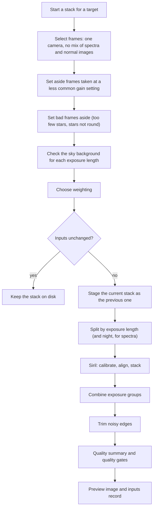

# Astronomical stacking and image calibration pipeline review guide

*Version 1.2 · 2026-10-15 · Status: current*

## Abstract

This document reviews the stacking pipeline (`astrometricslib.pipelines.stacking`): frame tests, calibration-frame selection, the Siril run, exposure groups, stack quality gates and the steps after the stack.

Terms are defined in the [glossary](../../Glossary.md). This document also defines each term the first time it appears.

## 1. Overview and scientific objective

The [stacking pipeline README](https://github.com/m1chae2/astrometrics/blob/main/astrometricslib/pipelines/stacking/README.md) describes the code stage by stage.

**In plain words.** This pipeline combines many frames of the same target into one deeper, cleaner image, called a stack.

Each raw frame carries flaws from the camera and the optics: a fixed electronic level, a glow that builds up with exposure time, and darker corners and dust shadows. Each frame is also noisy, and some catch satellite or meteor streaks or cosmic-ray hits. The pipeline first removes the camera and optics flaws using reference frames taken for the purpose (calibration frames). It then lines the frames up on their stars and averages them, rejecting pixels that disagree with the rest.

The result is the stacked image, a preview image, and a quality summary that checks both the inputs and the result.

**Statement of need.** Raw frames carry three kinds of flaw:

- dark current: a signal the sensor builds up from heat, which grows with exposure time;
- a bias level: the fixed electronic level of an empty exposure;
- vignetting (darker corners from the optics) and dust shadows.

Three kinds of master calibration frame remove them. Each master is the average of many frames. A master dark is taken with the shutter closed, a master bias with the shortest exposure the camera allows, and a master flat of an evenly lit surface. Stacking many aligned frames raises the signal-to-noise ratio by about $\sqrt{N}$ for $N$ frames and rejects streaks and cosmic rays.

The diagram shows one run, top to bottom.

Siril is an open-source astronomy image processor that does the pixel work. In code terms the run starts at `stage.stack_frames(target)`, splits frames in `stack_runner.run_stack`, and stacks through a `StackingDriver` (the interface for a stacking program), whose Siril version runs `ImageProcessing` (Section 4). Setting bad frames aside is the frame quarantine, and the quality summary is a `StackQualitySummary` (Section 7).

## 2. Input requirements and FITS header specification

A FITS file (the standard file format for astronomy images) starts with a header: a list of named cards, each a keyword and a value, that describe the exposure. The table lists the cards this pipeline reads. The last column says what the pipeline does if a card is absent.

| FITS keyword | Requirement | Data type | Used for | When missing |
| --- | --- | --- | --- | --- |
| `EXPTIME` | Mandatory | `float` (s) | Exposure length. Frames are stacked one exposure length at a time. Darks (frames taken with the shutter closed) are filed by it and matched within 0.1 s. | A dark with no `EXPTIME` is filed as 30 s. |
| `CCD-TEMP` (or `SET-TEMP`) | Recommended | `float` (°C) | Sensor temperature, for filing darks in temperature slots and judging how well a dark matches. | The dark's temperature is not judged. |
| `GAIN` (or `ISOSPEED`) | Recommended | `float` | Gain setting: the camera's amplifier setting, a unitless number (not the gain in electrons per ADU). `ISOSPEED` is a DSLR camera's ISO setting, its counterpart of a gain setting. Used for the minority-gain test and to file calibration frames. | Frames fall into one unknown-gain group; `gain_homogeneity` is not checked. |
| `OFFSET` (or `BLKLEVEL`) | Recommended | `int` | Camera offset: a constant the camera adds to every pixel so that noise below zero is still recorded. Used to file calibration frames. | Offset 0 is assumed. |
| `XBINNING` / `YBINNING` | Optional | `int` | Binning (sensor pixels joined into one); calibration frames of another binning are never applied. | 1x1. |
| `FILTER` | Recommended | `str` | Filter name. Flats (images of an evenly lit surface) are filed and picked by filter; the stack's file name carries it. | Filter type `NONE`. |
| `INSTRUME` (or `CAMERA`) | Recommended | `str` | Camera name; frames from two cameras are never stacked together. | The camera of the frame record. |

## 3. Mathematical and algorithmic formulation

This section covers choosing calibration frames, predicting how sharp the stack should be, weighting frames, and combining frames of different exposure lengths.

### 3.1 Calibration-frame selection

A dark only cancels the heat signal if it was taken at about the same sensor temperature as the light frames (the frames of the sky). The calibration library files each frame under its gain setting, offset and binning, and each dark also under a temperature slot 3 °C wide. Lights use the darks of their own slot. With none, the nearest-temperature dark is used.

The master's temperature is the mean of its darks. A soft flag (a warning that does not stop the dark being used) is raised when the gap between the light's temperature and the master's is too large:

$$\left|T_\text{light} - \bar{T}_\text{dark}\right| > 3\,^\circ\text{C} \tag{1}$$

The dark is still applied; the flag makes `calibration_metadata` fail. When no dark records a temperature, the match is not judged. A gain-setting or offset mismatch falls back the same way. A binning mismatch never falls back.

### 3.2 Expected stack FWHM

FWHM (full width at half maximum) is the width of a star's light profile at half its peak height; a smaller FWHM means a sharper image. Averaging aligned frames adds no blur of its own, so the stack's FWHM follows from the input FWHMs. The pipeline predicts that FWHM and checks the stack against it. For round Gaussian (bell-shaped) stars whose widths in the $N$ frames are $\text{FWHM}_1, \dots, \text{FWHM}_N$, the stacked star's FWHM is the root mean square of the inputs:

$$\text{FWHM}_\text{expected} = \sqrt{\frac{1}{N}\sum_{j=1}^{N}\text{FWHM}_j^2} \tag{2}$$

The ratio $\rho_\text{FWHM}$ of measured to expected FWHM is 1 for a perfect stack. A ratio well above 1 means the alignment or the combination blurred the stars. The stack passes when

$$\rho_\text{FWHM} = \frac{\text{FWHM}_\text{stack}}{\text{FWHM}_\text{expected}} \le 1.2 \tag{3}$$

### 3.3 Weighting and rejection

**Why weight.** For frames limited by the noise of the sky, a frame's signal-to-noise squared grows in step with its exposure. A 30 s frame then carries less information than a 120 s frame, and giving both the same weight wastes the better one. Weighting each frame by its own noise gives the best combination.

**The penalty of equal weights.** $P$ is how much noisier an equal-weight stack is than the best-weighted one, for sky-limited frames. It follows from the exposure times alone:

$$P = \sqrt{\langle 1/\tau_j \rangle \, \langle \tau_j \rangle} \tag{4}$$

where $\tau_j$ is the exposure of frame $j$ and $\langle \cdot \rangle$ is the mean over frames. $P$ is 1 when all exposures are equal and grows as they differ; 1.17 means 17% more noise.

**The rule.** A configured weighting always wins. With none configured, an imaging stack uses Siril's noise weighting when $P \ge 1.05$. Spectral stacks are left to the exposure-group handling of Section 3.4.

**When P is not 1.** $P$ is computed over all of a stack's frames before they are split by exposure length (Section 3.4). So a stack whose exposure lengths differ enough to reach the limit gets noise weighting, and that setting is passed to the Siril stack of every group. Inside one group the exposures are equal, so the weighting then evens out other differences in noise between frames. Frames of different lengths share one Siril stack in two cases. The first is when a length has fewer than 5 frames and joins the group with the nearest length. The second is when no length has that many frames, or a frame has no readable exposure, so all frames are stacked together. Between groups, the inverse-variance combination of Section 3.4 does the weighting.

**Rejection.** Siril stacks with `-norm=addscale` (each frame's level and spread are matched to the group's reference frame before combining) and sigma rejection (`rej`). Sigma rejection drops, at each pixel, values more than a set number of standard deviations from the rest, which removes streaks and cosmic rays.

The limits are set in one of three ways. A limit passed by the caller always wins. In the default "adaptive" mode the high limit comes from Chauvenet's criterion, which rejects a value when fewer than half a frame of a stack of $N$ frames would stray that far by chance. This limit grows slowly with $N$. The high limit is kept at or above a configured floor, and the low limit is set a little looser, because the bad values in sky images (streaks, cosmic rays, hot pixels) are brighter than the truth. A "fixed" mode uses one configured pair of limits for every stack.

### 3.4 Exposure groups

**Why groups.** Siril's usual recipe matches every frame to one noise level and then clips outliers. With several exposure lengths, a 5 s frame and a 0.5 s frame hold very different amounts of light in the same pixel, and the clipping throws away the best frames' values. Each length also needs darks of its own length. So every stack with more than one exposure length is stacked one length at a time. A spectral stack is also split by night, because the zero order (the star's undispersed image) sits on a different pixel each night and aligning two nights together can lose most frames.

**Putting groups on one scale.** Each group's stack is turned into counts per second. That alone does not line the groups up, because Siril's normalization leaves each group's stack on the brightness scale of its own reference frame. Each group therefore gets a group scale factor that puts it on the scale of the reference group (the group with the most weight). On an imaging stack the factor is the median ratio of the aperture brightness of isolated, unsaturated stars found in both groups. A group with too few such stars, and every spectral stack, uses pixels instead: the median ratio over mid-range pixels, with saturated pixels left out. A group that one factor does not describe is left out, because its brightness does not grow in step with exposure. With stars, that is when the ratio of its faintest quarter or its brightest quarter of stars sits more than a set tolerance from the factor; with pixels, when the ratio over its brightest pixels does.

**Combining.** The rest are combined with inverse-variance weights: each group counts in proportion to $1/\sigma^2$, where $\sigma$ is the background noise of its stack, so less noisy groups count more. All groups are used, not only the largest one.

### 3.5 Notation

Symbols follow the architecture paper's [list of symbols](../Astrometrics_Library_Architecture.md#appendix-a-notation). The table lists only the symbols this guide adds.

| Symbol | Meaning | Unit |
| --- | --- | --- |
| $T_\text{light}$, $\bar{T}_\text{dark}$ | Sensor temperature of a light frame, and the mean sensor temperature of the darks | °C |

## 4. Processing flow

Stacking has no `AnalysisPipeline` adapter. The entry point is `stage.stack_frames`:

1. **Frame selection and tests.** One camera only, no mix of spectral and imaging frames, frames at a less common gain setting set aside, frames set aside by an earlier run dropped, the quarantine (imaging only), and the background test.
2. **Skip unchanged.** `stack_inputs.py` takes a fingerprint of the frames, calibration frames, settings and stacking code: a short code that changes whenever any of them changes. A match with the last run keeps the stack on disk, unless `force=True`.
3. **Previous-stack staging.** The current stack moves to a staging folder. On success it becomes the single `_previous` version (`previous_stack.py`), which a person can swap back or discard.
4. **Stack.** `stack_runner.run_stack` splits the frames by exposure length (and by night for spectra) and calls the `StackingDriver`. The Siril driver (`siril_stacking_driver.py`) runs `ImageProcessing` in `siril_interface.py`: masters, calibration, registration (alignment) and stacking. Spectral registration that loses too many frames is retried with relaxed detection, then with phase correlation (aligning whole images by their overall pattern rather than by single stars).
5. **After the stack.** Noisy edges are trimmed (`stack_crop.py`). Frames never line up exactly, so the edges of a stack are covered by fewer frames than the middle and are noisier. The trim measures the noise and cuts each side back to where it matches the interior; a stack with clean edges is left alone. The quality summary and its gates are built (16 run gates).
6. **Preview image.** A JPEG for people to look at is made from a copy of the stack; the stack itself is never changed. GraXpert, an AI tool, removes the sky's brightness gradient. Siril stretches the brightness so faint parts show. Cosmic Clarity, another AI tool, removes noise. Star toning dims the stars in proportion to their brightness, because the stretch makes nearly every star the same white dot. GraXpert and Cosmic Clarity run only when configured, and a failed step never fails the stack. The inputs record is written last.

### 4.1 Quality gates

A quality gate is an automatic test on a run. It passes, fails, or is "not checked" when the data it needs are missing. A failed gate marks the run as flagged (the `flagged` field in Section 7) so a person can look at it. The list below is read from the code when this guide is generated.

| Gate | Role | Defined in | What it checks |
| --- | --- | --- | --- |
| `rejected_pixel_fraction` | run gate | `post_processing/assess_output_quality.py` | Fails when the share of pixels rejected as outliers in the stack is above `DEFAULT_REJECTED_FRACTION_FLAG_THRESHOLD`. |
| `stack_sharpness` | run gate | `post_processing/assess_output_quality.py` | Fails when the stack's FWHM over the expected FWHM is above `DEFAULT_FWHM_DEGRADATION_RATIO` (Eq. 3), meaning the stack is blurrier than its inputs predict. |
| `spectral_registration` | run gate | `post_processing/assess_output_quality.py` | Fails when the registration (alignment) test of a spectral stack raised a concern. Not checked for an imaging stack. |
| `saturated_pixel_fraction` | run gate | `post_processing/assess_output_quality.py` | Fails when at least `DEFAULT_SATURATION_FLAG_THRESHOLD` of the stack's pixels are saturated (clipped at the sensor's maximum). |
| `zero_pixel_fraction` | run gate | `post_processing/assess_output_quality.py` | Fails when too many stack pixels are exactly zero (over-subtraction). |
| `negative_pixels` | run gate | `post_processing/assess_output_quality.py` | Fails when the stacking engine (Siril) reports too high a share of negative pixels. |
| `exposure_group_linearity` | run gate | `post_processing/exposure_group_report.py` | Fails when one group scale factor does not describe an exposure group (the frames of one exposure length): the ratio of its faintest or brightest quarter of stars, or with the pixel method its brightest pixels, is more than the configured tolerance from the factor that puts it on the reference group's brightness scale (Section 3.4). That group is left out of the combination. |
| `raw_frame_clipping` | run gate | `post_processing/exposure_group_report.py` | Fails when raw frames of an exposure group are clipped at zero. |
| `exposure_groups_combined` | run gate | `post_processing/exposure_group_report.py` | Fails when an exposure group with frames is missing from the combined stack. |
| `flat_level` | run gate | `pre_processing/assess_input_quality.py` | Fails when the level of the master flat (the averaged image of an evenly lit surface) is outside `MINIMUM_FLAT_LEVEL_FRACTION` to `MAXIMUM_FLAT_LEVEL_FRACTION` of the sensor's full scale (the largest value a pixel can record). |
| `flat_noise` | run gate | `pre_processing/assess_input_quality.py` | Fails when the relative noise of the master flat (the averaged image of an evenly lit surface) is above `MAXIMUM_FLAT_NOISE_FRACTION`. |
| `calibration_metadata` | run gate | `pre_processing/assess_input_quality.py` | Fails when a calibration frame (dark, bias or flat) was applied with a different gain setting, offset or temperature, or refused for a binning mismatch. |
| `calibration_frame_count` | run gate | `pre_processing/assess_input_quality.py` | Fails when a master bias, dark or flat was built from fewer frames than the configured minimum. |
| `background_homogeneity` | run gate | `pre_processing/background_homogeneity.py` | Fails when the sky-background levels of the frames of one exposure length split into two groups with a sudden jump between them (a gap at least `DEFAULT_GAP_RATIO_THRESHOLD` times the spread within a group), as when clouds arrive. Slow changes leave no such gap. Not checked when turned off or with too few measured frames. |
| `gain_homogeneity` | run gate | `pre_processing/frame_homogeneity.py` | Frames taken at a less common gain setting (the camera's amplifier setting) are set aside, which corrects the stack. Not checked when no frame records its gain setting. |
| `frame_quarantine` | run gate | `pre_processing/frame_quarantine.py` | Fails when a batch had more bad frames (too few stars, or stars not round) than `MAXIMUM_QUARANTINED_FRACTION`, so none were moved. |

## 5. Tuned calibration parameters

These are the fixed limits and settings the pipeline uses. The live value is read from the code when this guide is generated. The status says how far real data back the value, with one of three labels:

- **Measured.** Chosen or confirmed from a measurement on real data.
- **Partly measured.** Backed by a measurement that is incomplete, such as synthetic (simulated) data only, one target or a small sample.
- **Design estimate.** Chosen by reasoning and not yet measured.

The labels are defined in the [validation register](../validation/index.md). Each label links to the register entry that holds the evidence: the data, the library calls, the result, and how to repeat the test on your own data. A design estimate links to the register's table of values not yet measured, which says how each one could be measured. The Notes column gives the reason for the value.

| Parameter | Live value | Status | Notes |
| --- | --- | --- | --- |
| `DEFAULT_DARK_TEMPERATURE_TOLERANCE_C` | `3.0` °C | Partly measured ([STK-06](../validation/stacking.md#stk-06)) | Width of a dark temperature slot, and the largest temperature gap before a soft flag (a warning that does not stop the dark being used). Two real incidents show the harm of mixing temperatures; the width itself is not fitted to the camera's dark-current curve. |
| `DEFAULT_MINIMUM_SURVIVING_FRAMES` | `5` frames | Partly measured ([STK-10](../validation/stacking.md#stk-10)) | Fewest frames that must be left after Siril's percentage-based frame filters. |
| `DEFAULT_FWHM_DEGRADATION_RATIO` | `1.2` | Partly measured ([STK-25](../validation/stacking.md#stk-25)) | Largest ratio of the stack's FWHM to the expected FWHM (Eq. 3). Set just above the ratio of a normal stack. |
| `DEFAULT_REJECTED_FRACTION_FLAG_THRESHOLD` | `0.15` | Partly measured ([STK-24](../validation/stacking.md#stk-24)) | Share of pixels rejected as outliers during stacking above which `rejected_pixel_fraction` fails. Set above the share a normal session rejects. |
| `MAXIMUM_QUARANTINED_FRACTION` | `0.25` | Partly measured ([STK-03](../validation/stacking.md#stk-03)) | Largest share of a batch the quarantine (setting bad frames aside) may move. About twice the share it picks from a normal batch: room for a bad stretch, without gutting a session whose limits do not suit the equipment. |
| `MINIMUM_PENALTY_TO_WEIGHT` | `1.05` | Design estimate ([stacking design estimates](../validation/stacking.md#design-estimates)) | Noise penalty $P$ of equal weights (Eq. 4) at or above which noise weighting is used. The benefit of noise weighting is measured; the switch-on value is not. Related entry: [STK-07](../validation/stacking.md#stk-07). |
| `MINIMUM_REGISTERED_FRACTION` | `0.9` | Design estimate ([stacking design estimates](../validation/stacking.md#design-estimates)) | Share of spectral frames that must register (align on each other); fewer triggers a retry. Chosen to tolerate one lost frame in ten. Related entry: [STK-12](../validation/stacking.md#stk-12). |
| `MINIMUM_FRAMES_PER_EXPOSURE_GROUP` | `5` | Design estimate ([stacking design estimates](../validation/stacking.md#design-estimates)) | Fewest frames an exposure length needs to be stacked on its own; a smaller set joins the group with the nearest exposure length. Related entry: [STK-11](../validation/stacking.md#stk-11). |
| `DEFAULT_GAP_RATIO_THRESHOLD` | `4` | Partly measured ([STK-04](../validation/stacking.md#stk-04)) | Smallest gap between two groups of sky-background levels, as a multiple of the spread within a group, that counts as a split. Set between the gaps of a normal night and of sudden cloud. |
| `MINIMUM_FLAT_LEVEL_FRACTION` / `MAXIMUM_FLAT_LEVEL_FRACTION` | `0.1` / `0.9` | Design estimate ([stacking design estimates](../validation/stacking.md#design-estimates)) | Allowed level of the master flat, as a share of the sensor's full scale (the largest value a pixel can record). Common practice. |
| `MAXIMUM_FLAT_NOISE_FRACTION` | `0.005` | Partly measured ([STK-05](../validation/stacking.md#stk-05)) | Largest relative noise (standard deviation over mean) of the master flat before it is smoothed and `flat_noise` fails. A flat at the limit adds only a few percent to the variance of a typical stack's sky noise; a noisier flat leaves a fixed pattern, which smoothing removes. |
| `DEFAULT_SATURATION_FLAG_THRESHOLD` | `0.001` | Design estimate ([stacking design estimates](../validation/stacking.md#design-estimates)) | Share of saturated pixels at or above which the stack is flagged (`saturated_pixel_fraction`). |

## 6. Degraded states and fallback pathways

1. **Temperature gap above 3 °C.** The nearest dark is applied with a soft flag; `calibration_metadata` fails. A missing `CCD-TEMP` means the dark is not judged.
2. **Bad frames.** Frames with too few stars or non-round stars move to `_excluded`. A batch whose share of bad frames is above 0.25 moves nothing and `frame_quarantine` fails.
3. **Registration failure.** Spectral stacks are retried. On an imaging stack, blur shows as $R > 1.2$ in `stack_sharpness`.
4. **Over-subtraction.** `zero_pixel_fraction` and `negative_pixels` catch darks or biases that remove more than the sky, which pushes pixels to zero or below.
5. **A dropped exposure group.** The combined stack is still written, and `exposure_groups_combined` fails.
6. **Restack failure.** The staged stack moves back, so the old stack is kept.

## 7. Quality summary data models

Every run saves a quality summary: a record of what the run measured and how each quality gate came out. Section 7.1 lists the fields every pipeline shares. Section 7.2 lists the measurements that belong to this pipeline. The tables are read from the data models in the code.

### 7.1 Pipeline execution envelope (`StackQualitySummary`)

| Field name | Type | Description |
| --- | --- | --- |
| `pipeline_name` | `str` | Which pipeline made this summary (for example astrometry or photometry). |
| `pipeline_version` | `str` | Version number of the pipeline's processing rules. |
| `target_id` | `str` | Identifier of the target (the sky object being studied). |
| `target_session_ids` | `list[str]` | Identifiers of the observing sessions (usually one night each) used in the run. |
| `target_session_breakdown` | `list[astrometricslib.models.quality.quality_summary.TargetSessionContribution]` | For each session, how many frames it had and how many the run used. |
| `upstream_quality_summary_reference` | `str \| None` | Name of the pipeline that had to run first, if any. |
| `resolved_parameters` | `dict[str, Any]` | The settings the run actually used, after defaults were filled in. |
| `camera_profile` | `astrometricslib.models.quality.quality_summary.AppliedCameraProfile \| None` | The camera settings applied, such as the gain (e-/ADU) and the level at which pixels clip. |
| `quality_processing_applied` | `bool` | Whether the quality gates were run. |
| `flagged` | `bool` | True if one or more quality gates failed, so a person should look at the run. |
| `flag_reasons` | `list[str]` | One plain sentence for each reason the run was flagged. |
| `gates` | `list[astrometricslib.models.quality.gate_result.GateResult]` | Every quality gate result: passed, failed or not checked. |
| `created_at` | `datetime.datetime` | Time the quality summary was made, in UTC. |
| `provenance_activity_id` | `str \| None` | Identifier of this run in the provenance record (the IVOA-standard log of which run made which data). |
| `upstream_entity_id` | `str \| None` | Identifier of the exact database record this run read as its input. |
| `stacking_metrics` | `astrometricslib.models.quality.quality_summary.StackingPipelineQualityMetrics` | The stacking measurements (Section 7.2). |
| `input_quality` | `astrometricslib.models.quality.stacking_quality.StackingInputQuality \| None` | Structured assessment of the raw frames' quality. |
| `output_quality` | `astrometricslib.models.quality.stacking_quality.StackingOutputQuality \| None` | Structured assessment of the final stack's quality. |

### 7.2 Domain scientific metrics schema (`StackingPipelineQualityMetrics`)

| Field name | Type | Description |
| --- | --- | --- |
| `is_spectral` | `bool` | True if the image is a slitless spectrum image (light spread by a grating) rather than a normal image. |
| `frames_submitted` | `int` | Number of frames offered for calibration and stacking. |
| `frames_stacked` | `int` | Number of light frames (exposures of the target) aligned and stacked. |
| `excluded_frames` | `list[astrometricslib.models.quality.quality_summary.ExcludedFrame]` | Input frames set aside before stacking, each with its reason. |
| `rejected_pixel_fraction` | `float \| None` | Share of pixel values rejected (clipped) while building the stack. |
| `rejected_fraction_flagged` | `bool` | True if pixel rejection was above the warning threshold. |
| `background_split_detected` | `bool` | True if the frames' sky-background levels split into two groups with a sudden jump between them (gap at least 4 times the spread within a group, checked for each exposure length), for example clouds arriving. The frames outside the larger group are set aside. |
| `background_split_detail` | `str \| None` | Description of the sky-background jump. |
| `calibration_mismatch_flags` | `list[str]` | Soft flags for calibration frames applied with a different gain setting, offset or temperature. |
| `flat_frame_count` | `int \| None` | Number of flat exposures (images of an evenly lit surface) in the master flat. |
| `flat_noise_fraction` | `float \| None` | Relative noise level measured in the master flat. |
| `flat_smoothing_sigma_px` | `float \| None` | Gaussian smoothing width (sigma, in pixels) applied to the master flat because its relative noise was above 0.5% (`MAXIMUM_FLAT_NOISE_FRACTION`). None when no smoothing was applied, including on color sensors. |
| `flat_calibration_issues` | `list[str]` | Messages about problems with the flat calibration. |
| `saturated_pixel_fraction` | `float \| None` | Share of saturated pixels (clipped at the sensor's maximum) in the final stack. |
| `saturation_flagged` | `bool` | True if the stack holds a significant share of saturated pixels. |
| `exposure_groups` | `list[astrometricslib.models.quality.quality_summary.ExposureGroupSummary]` | One sub-stack per exposure length, with its details. |
| `recommended_exposure_seconds` | `float \| None` | Estimated exposure, in seconds, that keeps bright stars below clipping. |
| `zero_pixel_fraction` | `float \| None` | Share of stack pixels that are exactly zero. |
| `zero_fraction_flagged` | `bool` | True if over-subtraction clipped pixels at zero ADU (zero camera counts). |
| `negative_pixel_max_percent` | `int \| None` | Largest percentage of negative pixels the stacking engine reported. |
| `negative_pixels_flagged` | `bool` | True if the count of negative pixels was above the tolerance. |
| `stacked_fwhm_px` | `float \| None` | Measured FWHM of the stacked image. |
| `median_input_fwhm_px` | `float \| None` | Median FWHM of all light frames that were kept. |
| `expected_stack_fwhm_px` | `float \| None` | Expected stack FWHM: the RMS of a sample of input-frame FWHMs. |
| `fwhm_degraded` | `bool` | True if the stack FWHM over the expected FWHM is above the limit (the stack is blurrier than predicted). |
| `spectral_registration_flags` | `list[astrometricslib.models.quality.quality_summary.ExcludedFrame]` | Frames about which the spectral registration (alignment) test raised a concern. |
| `spectral_registration_checked` | `bool` | Whether the spectral registration (alignment) test ran. |
| `stacking_duration_seconds` | `float \| None` | How long the stacking run took, in seconds. |
| `timed_out` | `bool` | True if the stacking run timed out. |
| `debayer_applied` | `bool \| None` | Whether color frames were debayered (turned from the sensor's color-filter mosaic into full-color pixels). |
| `stacking_engine` | `str \| None` | Program that did the pixel processing (for example Siril). |
| `stacking_engine_version` | `str \| None` | Version of the stacking program. |
| `registration_reference_frame` | `str \| None` | File name of the frame the others were aligned (registered) to. |
| `registration_reference_star_count` | `int \| None` | Number of stars found in that frame to align on. |
