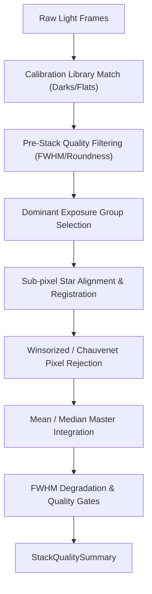

# Astronomical Stacking and Image Calibration Pipeline Review Guide

*Version 1.0 · 2026-10-10 · Status: current*

## Abstract

This document details the astronomical image stacking, dark/flat calibration
library management, outlier pixel rejection, and stack quality verification
pipeline in Astrometrics (`astrometricslib.pipelines.stacking`).

## 1. Overview & Scientific Objective

**Statement of need.** Raw astronomical CCD/CMOS frames contain thermal dark
current, read noise, and optical vignetting/dust shadows. Master calibration
frames (biases, darks, flats) remove instrumental artifacts. Stacking multiple
aligned light exposures increases the signal-to-noise ratio (SNR) by a factor
of $\sqrt{N}$ while rejecting transient satellite trails and cosmic rays.

## 2. Input Requirements & FITS Header Specification

| FITS Keyword | Requirement | Data Type | Description | Fallback Mode |
| :--- | :--- | :--- | :--- | :--- |
| `EXPTIME` | Mandatory | `float` (s) | Frame exposure duration. | Aborts calibration matching. |
| `CCD-TEMP` | Mandatory | `float` (°C) | Sensor operating temperature. | Assumes ambient 0.0 °C. |
| `FILTER` | Mandatory | `str` | Optical filter identifier. | Matches darks only. |
| `GAIN` | Recommended | `float` | Sensor gain setting. | Matches dominant subset. |
| `IMAGETYP` | Mandatory | `str` | Frame type (LIGHT, DARK, FLAT). | Infers from directory context. |

## 3. Mathematical & Algorithmic Formulation

### 3.1 Dark Temperature Matching Condition
Master dark frames are matched within a rigid temperature binning slot:
$$|T_\text{light} - T_\text{dark}| \le 3.0\,^\circ\text{C}$$

### 3.2 Expected Stack FWHM Prediction
For round Gaussian stellar profiles of widths $w_1, w_2, \dots, w_N$, the
expected stacked star width equals the root-mean-square:
$$\text{FWHM}_\text{expected} = \sqrt{\frac{1}{N} \sum_{i=1}^N \text{FWHM}_i^2}$$
The stack degradation ratio verifies registration accuracy:
$$R_\text{degrade} = \frac{\text{FWHM}_\text{stack}}{\text{FWHM}_\text{expected}} \le 1.2$$

### 3.3 Outlier Pixel Rejection & Stacking
Satellite trails and cosmic rays are rejected via Winsorized / Chauvenet sigma clipping.
Integrated master pixel values represent quality-weighted mean combinations:
$$I_\text{stack}(x, y) = \frac{\sum_{i=1}^M w_i I_i(x, y)}{\sum_{i=1}^M w_i}$$

## 4. Four-Stage Lifecycle Architecture

Implemented via `StackingDriver` and `SirilInterface` (`stack_runner.py`):

- **Stage 1 (`process_input`):** Calibration frame matching and exposure grouping.
- **Stage 2 (`run`):** Sub-pixel alignment, dominant gain subset selection, and
  sigma-clipped pixel integration.
- **Stage 3 (`validate_output`):** Evaluates FWHM degradation ratio ($< 1.2$) and
  rejected pixel fraction ($< 15\%$).
- **Stage 4 (`to_result_dict`):** Emits master FITS image, rejection maps, and
  `StackQualitySummary`.

## 5. Tuned Calibration Parameters

| Parameter | Live Value | Empirical Status | Notes |
| :--- | :--- | :--- | :--- |
| `DEFAULT_DARK_TEMPERATURE_TOLERANCE_C` | `3.0` °C | Designed | Maximum temperature gap for dark matching. |
| `DEFAULT_MINIMUM_SURVIVING_FRAMES` | `5` frames | Measured (M 13) | Floor on frames surviving quality screening. |
| `DEFAULT_FWHM_DEGRADATION_RATIO` | `1.2` | Measured (6 stacks) | Max allowed ratio of stack FWHM to expected RMS. |
| `DEFAULT_REJECTED_FRACTION_FLAG_THRESHOLD` | `0.15` | Measured (3 sessions) | Rejection fraction warning threshold (15%). |

## 6. Degraded States & Fallback Pathways

1. **High Temperature Discrepancy ($> 3^\circ\text{C}$):** Master dark
   matching fails; the pipeline emits a calibration mismatch warning.
2. **Registration Failure:** If star alignment fails, the FWHM degradation ratio
   exceeds $1.2$ and flags the stack for user inspection.
3. **Severe Over-Subtraction:** If master darks/biases exceed light background,
   the zero-pixel fraction triggers a quality alert.

## 7. Quality Summary Data Models

### 7.1 Pipeline Execution Envelope
| Field Name | Type | Description |
| :--- | :--- | :--- |
| `pipeline_name` | `str` | Unique pipeline domain identifier (e.g., astrometry, photometry). |
| `pipeline_version` | `str` | Semantic version of the pipeline processing contract. |
| `target_id` | `str` | Target celestial object identifier. |
| `target_session_ids` | `list[str]` | List of observing session IDs included in the analysis. |
| `target_session_breakdown` | `list[astrometricslib.models.quality_summary.TargetSessionContribution]` | Per-session frame counts and contribution breakdown. |
| `upstream_quality_summary_reference` | `str | None` | Category name of prerequisite pipeline. |
| `resolved_parameters` | `dict[str, Any]` | Effective configuration parameters used during execution. |
| `camera_profile` | `astrometricslib.models.quality_summary.AppliedCameraProfile | None` | Camera sensor parameters and clipping thresholds applied. |
| `quality_processing_applied` | `bool` | Indicates whether QA gates and checks were executed. |
| `flagged` | `bool` | True if one or more quality gates failed, indicating data concerns. |
| `flag_reasons` | `list[str]` | Human-readable sentences describing reasons for quality flags. |
| `gates` | `list[astrometricslib.models.gate_result.GateResult]` | Complete collection of passed, failed, and unchecked GateResults. |
| `created_at` | `datetime.datetime` | UTC timestamp when the quality summary was generated. |
| `provenance_activity_id` | `str | None` | IVOA provenance activity / job tracking identifier. |
| `upstream_entity_id` | `str | None` | Exact upstream database entity consumed by this run. |
| `stacking_metrics` | `astrometricslib.models.quality_summary.StackingPipelineQualityMetrics` | Quality metric attribute. |
| `input_quality` | `astrometricslib.models.stacking_quality.StackingInputQuality | None` | Structured assessment of raw frame quality. |
| `output_quality` | `astrometricslib.models.stacking_quality.StackingOutputQuality | None` | Structured assessment of final stacked image. |

### 7.2 Domain Scientific Metrics Schema
| Field Name | Type | Description |
| :--- | :--- | :--- |
| `is_spectral` | `bool` | True if image represents dispersed slitless spectroscopy. |
| `frames_submitted` | `int` | Total input frames provided for calibration and stacking. |
| `frames_stacked` | `int` | Number of light frames successfully aligned and integrated. |
| `excluded_frames` | `list[astrometricslib.models.quality_summary.ExcludedFrame]` | Input frames rejected during pre-stack quality filtering. |
| `rejected_pixel_fraction` | `float | None` | Fraction of pixels clipped during master stacking. |
| `rejected_fraction_flagged` | `bool` | True if pixel rejection exceeded warning threshold. |
| `background_split_detected` | `bool` | True if gradient or background discontinuity was found. |
| `background_split_detail` | `str | None` | Diagnostic description of background discontinuity. |
| `calibration_mismatch_flags` | `list[str]` | Warnings for mismatched temperatures, gains, or filters. |
| `flat_frame_count` | `int | None` | Number of individual flat exposures in master flat. |
| `flat_noise_fraction` | `float | None` | Relative noise level measured in master flat. |
| `flat_smoothing_sigma_px` | `float | None` | Gaussian smoothing applied to master flat if noisy. |
| `flat_calibration_issues` | `list[str]` | Diagnostic messages regarding flat field quality. |
| `saturated_pixel_fraction` | `float | None` | Fraction of saturated pixels in final stacked image. |
| `saturation_flagged` | `bool` | True if stacked image contains significant saturation. |
| `exposure_groups` | `list[astrometricslib.models.quality_summary.ExposureGroupSummary]` | Breakdown of sub-stacks by individual exposure duration. |
| `recommended_exposure_seconds` | `float | None` | Estimated exposure to keep bright stars below clipping. |
| `zero_pixel_fraction` | `float | None` | Fraction of pixels in stack with exact zero value. |
| `zero_fraction_flagged` | `bool` | True if over-subtraction caused clipping at zero ADU. |
| `negative_pixel_max_percent` | `int | None` | Maximum percentage of negative pixels reported by engine. |
| `negative_pixels_flagged` | `bool` | True if negative pixel count exceeded tolerance. |
| `stacked_fwhm_px` | `float | None` | Measured stellar FWHM of the integrated master image. |
| `median_input_fwhm_px` | `float | None` | Median stellar FWHM across all surviving input light frames. |
| `expected_stack_fwhm_px` | `float | None` | Quality metric attribute. |
| `fwhm_degraded` | `bool` | Quality metric attribute. |
| `spectral_registration_flags` | `list[astrometricslib.models.quality_summary.ExcludedFrame]` | Quality metric attribute. |
| `spectral_registration_checked` | `bool` | Quality metric attribute. |
| `stacking_duration_seconds` | `float | None` | Quality metric attribute. |
| `timed_out` | `bool` | Quality metric attribute. |
| `debayer_applied` | `bool | None` | Quality metric attribute. |
| `stacking_engine` | `str | None` | Software engine performing pixel processing (e.g., Siril). |
| `stacking_engine_version` | `str | None` | Version string of the stacking engine. |
| `registration_reference_frame` | `str | None` | Filename of chosen reference registration sub-frame. |
| `registration_reference_star_count` | `int | None` | Number of alignment anchor stars detected. |
