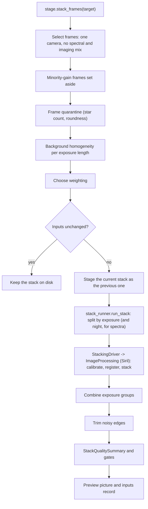

# Astronomical Stacking and Image Calibration Pipeline Review Guide

*Version 1.1 · 2026-10-14 · Status: current*

## Abstract

This document reviews the stacking pipeline
(`astrometricslib.pipelines.stacking`): frame checks, calibration-frame
selection, the Siril run, exposure groups, stack quality gates and the steps
after the stack.

## 1. Overview & Scientific Objective

**Statement of need.** Raw frames carry dark current, a bias level, and
vignetting and dust shadows. Master darks, biases and flats remove them.
Stacking many aligned frames raises the signal-to-noise ratio by about
$\sqrt{N}$ and rejects satellite trails and cosmic rays.

## 2. Input Requirements & FITS Header Specification

| FITS Keyword | Requirement | Data Type | What It Is Used For | When Missing |
| :--- | :--- | :--- | :--- | :--- |
| `EXPTIME` | Mandatory | `float` (s) | Frames are stacked one exposure length at a time. Darks are filed by it and matched within 0.1 s. | A dark with no `EXPTIME` is filed as 30 s. |
| `CCD-TEMP` (or `SET-TEMP`) | Recommended | `float` (°C) | Sensor temperature, for filing darks in temperature slots and judging the match. | The dark's temperature is not judged. |
| `GAIN` (or `ISOSPEED`) | Recommended | `float` | Gain setting: the minority-gain check and calibration filing. | Frames fall into one unknown-gain group; `gain_homogeneity` is not checked. |
| `OFFSET` (or `BLKLEVEL`) | Recommended | `int` | Camera offset for calibration filing. | Offset 0 is assumed. |
| `XBINNING` / `YBINNING` | Optional | `int` | Binning; calibration frames of another binning are never applied. | 1x1. |
| `FILTER` | Recommended | `str` | Flats are filed and picked by filter; the stack's file name carries it. | Filter type `NONE`. |
| `INSTRUME` (or `CAMERA`) | Recommended | `str` | Camera name; frames from two cameras are never stacked together. | The camera of the frame record. |

## 3. Mathematical & Algorithmic Formulation

### 3.1 Calibration-Frame Selection

The calibration library files each frame under its gain, offset and binning,
and each dark also under a temperature slot 3 °C wide. Lights
use the darks of their own slot. With none, the nearest-temperature dark is
used. The master's temperature is the mean of its darks, and a soft flag is
raised when

$$\left|T_\text{light} - \bar{T}_\text{dark}\right| > 3\,^\circ\text{C} \tag{1}$$

The dark is still applied; the flag makes `calibration_metadata` fail. When
no dark records a temperature, the match is not judged. A gain or offset
mismatch falls back the same way. A binning mismatch never falls back.

### 3.2 Expected Stack FWHM

For round Gaussian stars of widths $w_1, \dots, w_N$, the stacked star's FWHM
is the root mean square of the inputs:

$$\text{FWHM}_\text{expected} = \sqrt{\frac{1}{N}\sum_{i=1}^{N}\text{FWHM}_i^2} \tag{2}$$

$$R = \frac{\text{FWHM}_\text{stack}}{\text{FWHM}_\text{expected}} \le 1.2 \tag{3}$$

### 3.3 Weighting and Rejection

The configured weighting always wins. With none configured, an imaging stack
uses Siril's noise weighting when equal weights would cost at least
1.05 in noise:

$$P = \sqrt{\overline{(1/t)}\;\cdot\;\overline{t}} \ge 1.05 \tag{4}$$

where $t$ are the frame exposures. Frames of one exposure length give
$P = 1$, so such a stack is unweighted unless a weighting is configured. Siril stacks with
`-norm=addscale` and sigma rejection (`rej`) at low and high limits that are
either fixed or set from the frame count.

### 3.4 Exposure Groups

Every stack with more than one exposure length is stacked one length at a
time. Each group's stack is turned into counts per second and put on the
reference group's brightness scale using mid-range pixels. A group whose
bright end disagrees is left out. The rest are combined with inverse-variance
weights. All groups are used, not only the largest one.

## 4. Processing Flow

Stacking has no `AnalysisPipeline` adapter. The entry point is
`stage.stack_frames`:

1. **Frame selection and checks.** One camera only, no mix of spectral and
   imaging frames, minority-gain frames set aside, frames set aside by an
   earlier run dropped, the quarantine (imaging only), and the background
   check.
2. **Skip unchanged.** `stack_inputs.py` fingerprints the frames, calibration
   frames, settings and stacking code. A match keeps the stack on disk, unless
   `force=True`.
3. **Previous-stack staging.** The current stack moves to a staging folder.
   On success it becomes the single `_previous` version
   (`previous_stack.py`), which a person can swap back or discard.
4. **Stack.** `stack_runner.run_stack` splits the frames by exposure length
   (and by night for spectra) and calls the `StackingDriver`. The Siril driver
   (`siril_stacking_driver.py`) runs `ImageProcessing` in `siril_interface.py`:
   masters, calibration, registration and stacking. Spectral registration that
   loses too many frames is retried with relaxed detection, then with phase
   correlation.
5. **After the stack.** Noisy edges are trimmed (`stack_crop.py`). The
   quality summary and its gates are built (16 run gates). A preview
   picture is made (GraXpert, Cosmic Clarity, star toning) and the inputs
   record is written last.

### 4.1 Quality Gates

| Gate | Role | Defined in | What it checks |
| :--- | :--- | :--- | :--- |
| `rejected_pixel_fraction` | run gate | `post_processing/assess_output_quality.py` | Fails when the share of pixels rejected in the stack is above `DEFAULT_REJECTED_FRACTION_FLAG_THRESHOLD`. |
| `stack_sharpness` | run gate | `post_processing/assess_output_quality.py` | Fails when the stack's FWHM over the expected FWHM is above `DEFAULT_FWHM_DEGRADATION_RATIO` (Eq. 3). |
| `spectral_registration` | run gate | `post_processing/assess_output_quality.py` | Fails when the registration check of a spectral stack raised a concern. Not checked for an imaging stack. |
| `saturated_pixel_fraction` | run gate | `post_processing/assess_output_quality.py` | Fails when the stack holds a significant share of saturated pixels. |
| `zero_pixel_fraction` | run gate | `post_processing/assess_output_quality.py` | Fails when too many stack pixels are exactly zero (over-subtraction). |
| `negative_pixels` | run gate | `post_processing/assess_output_quality.py` | Fails when the engine reports too high a share of negative pixels. |
| `exposure_group_linearity` | run gate | `post_processing/exposure_group_report.py` | Fails when an exposure group's bright end is not one scale factor of the reference group; that group is left out of the combination. |
| `raw_frame_clipping` | run gate | `post_processing/exposure_group_report.py` | Fails when raw frames of an exposure group are clipped at zero. |
| `exposure_groups_combined` | run gate | `post_processing/exposure_group_report.py` | Fails when an exposure group with frames is missing from the combined stack. |
| `flat_level` | run gate | `pre_processing/assess_input_quality.py` | Fails when the master flat's level is outside the allowed share of full scale. |
| `flat_noise` | run gate | `pre_processing/assess_input_quality.py` | Fails when the master flat is too noisy. |
| `calibration_metadata` | run gate | `pre_processing/assess_input_quality.py` | Fails when a calibration frame was applied with a different gain, offset or temperature, or refused for a binning mismatch. |
| `calibration_frame_count` | run gate | `pre_processing/assess_input_quality.py` | Fails when a master bias, dark or flat was built from fewer frames than the configured minimum. |
| `background_homogeneity` | run gate | `pre_processing/background_homogeneity.py` | Fails when an exposure length shows a split in sky background. Not checked when turned off or with too few measured frames. |
| `gain_homogeneity` | run gate | `pre_processing/frame_homogeneity.py` | Frames of a minority gain are set aside, which corrects the stack. Not checked when no frame records its gain. |
| `frame_quarantine` | run gate | `pre_processing/frame_quarantine.py` | Fails when a batch had more bad frames (too few stars, or stars not round) than `MAXIMUM_QUARANTINED_FRACTION`, so none were moved. |

## 5. Tuned Calibration Parameters

| Parameter | Live Value | Empirical Status | Notes |
| :--- | :--- | :--- | :--- |
| `DEFAULT_DARK_TEMPERATURE_TOLERANCE_C` | `3.0` °C | Designed | Width of a dark temperature slot and the largest gap before a soft flag. |
| `DEFAULT_MINIMUM_SURVIVING_FRAMES` | `5` frames | Measured (M 13) | Floor on frames left after Siril's percentage frame filters. |
| `DEFAULT_FWHM_DEGRADATION_RATIO` | `1.2` | Measured (6 stacks) | Largest stack FWHM over the expected FWHM (Eq. 3). |
| `DEFAULT_REJECTED_FRACTION_FLAG_THRESHOLD` | `0.15` | Measured (3 sessions) | Largest share of rejected pixels. |
| `MAXIMUM_QUARANTINED_FRACTION` | `0.25` | Designed | Largest share of a batch the quarantine may move. |
| `MINIMUM_PENALTY_TO_WEIGHT` | `1.05` | Measured (M 27) | Equal-weight noise penalty (Eq. 4) above which noise weighting is used. |
| `MINIMUM_REGISTERED_FRACTION` | `0.9` | Unvalidated (Vega) | Share of spectral frames that must register before a retry. |

## 6. Degraded States & Fallback Pathways

1. **Temperature gap above 3 °C.** The nearest dark is applied
   with a soft flag; `calibration_metadata` fails. A missing `CCD-TEMP` means
   the dark is not judged.
2. **Bad frames.** Frames with too few stars or non-round stars move to
   `_excluded`. A batch with more than 0.25 bad frames moves
   nothing and `frame_quarantine` fails.
3. **Registration failure.** Spectral stacks are retried. On an imaging stack,
   blur shows as $R > 1.2$ in `stack_sharpness`.
4. **Over-subtraction.** `zero_pixel_fraction` and `negative_pixels` catch
   darks or biases that remove more than the sky.
5. **A dropped exposure group.** The combined stack is still written, and
   `exposure_groups_combined` fails.
6. **Restack failure.** The staged stack moves back, so the old stack is
   kept.

## 7. Quality Summary Data Models

### 7.1 Pipeline Execution Envelope (`StackQualitySummary`)

| Field Name | Type | Description |
| :--- | :--- | :--- |
| `pipeline_name` | `str` | Unique pipeline domain identifier (e.g., astrometry, photometry). |
| `pipeline_version` | `str` | Semantic version of the pipeline processing contract. |
| `target_id` | `str` | Target celestial object identifier. |
| `target_session_ids` | `list[str]` | List of observing session IDs included in the analysis. |
| `target_session_breakdown` | `list[astrometricslib.models.quality_summary.TargetSessionContribution]` | Per-session frame counts and contribution breakdown. |
| `upstream_quality_summary_reference` | `str \| None` | Category name of prerequisite pipeline. |
| `resolved_parameters` | `dict[str, Any]` | Effective configuration parameters used during execution. |
| `camera_profile` | `astrometricslib.models.quality_summary.AppliedCameraProfile \| None` | Camera sensor parameters and clipping thresholds applied. |
| `quality_processing_applied` | `bool` | Indicates whether QA gates and checks were executed. |
| `flagged` | `bool` | True if one or more quality gates failed, indicating data concerns. |
| `flag_reasons` | `list[str]` | Human-readable sentences describing reasons for quality flags. |
| `gates` | `list[astrometricslib.models.gate_result.GateResult]` | Complete collection of passed, failed, and unchecked GateResults. |
| `created_at` | `datetime.datetime` | UTC timestamp when the quality summary was generated. |
| `provenance_activity_id` | `str \| None` | IVOA provenance activity / job tracking identifier. |
| `upstream_entity_id` | `str \| None` | Exact upstream database entity consumed by this run. |
| `stacking_metrics` | `astrometricslib.models.quality_summary.StackingPipelineQualityMetrics` | The stacking measurements (Section 7.2). |
| `input_quality` | `astrometricslib.models.stacking_quality.StackingInputQuality \| None` | Structured assessment of raw frame quality. |
| `output_quality` | `astrometricslib.models.stacking_quality.StackingOutputQuality \| None` | Structured assessment of final stacked image. |

### 7.2 Domain Scientific Metrics Schema (`StackingPipelineQualityMetrics`)

| Field Name | Type | Description |
| :--- | :--- | :--- |
| `is_spectral` | `bool` | True if image represents dispersed slitless spectroscopy. |
| `frames_submitted` | `int` | Total input frames provided for calibration and stacking. |
| `frames_stacked` | `int` | Number of light frames successfully aligned and integrated. |
| `excluded_frames` | `list[astrometricslib.models.quality_summary.ExcludedFrame]` | Input frames set aside before stacking, each with its reason. |
| `rejected_pixel_fraction` | `float \| None` | Fraction of pixels clipped during master stacking. |
| `rejected_fraction_flagged` | `bool` | True if pixel rejection exceeded warning threshold. |
| `background_split_detected` | `bool` | True if gradient or background discontinuity was found. |
| `background_split_detail` | `str \| None` | Diagnostic description of background discontinuity. |
| `calibration_mismatch_flags` | `list[str]` | Soft flags for calibration frames applied with a different gain, offset or temperature. |
| `flat_frame_count` | `int \| None` | Number of individual flat exposures in master flat. |
| `flat_noise_fraction` | `float \| None` | Relative noise level measured in master flat. |
| `flat_smoothing_sigma_px` | `float \| None` | Gaussian smoothing applied to master flat if noisy. |
| `flat_calibration_issues` | `list[str]` | Diagnostic messages regarding flat field quality. |
| `saturated_pixel_fraction` | `float \| None` | Fraction of saturated pixels in final stacked image. |
| `saturation_flagged` | `bool` | True if stacked image contains significant saturation. |
| `exposure_groups` | `list[astrometricslib.models.quality_summary.ExposureGroupSummary]` | Breakdown of sub-stacks by individual exposure duration. |
| `recommended_exposure_seconds` | `float \| None` | Estimated exposure to keep bright stars below clipping. |
| `zero_pixel_fraction` | `float \| None` | Fraction of pixels in stack with exact zero value. |
| `zero_fraction_flagged` | `bool` | True if over-subtraction caused clipping at zero ADU. |
| `negative_pixel_max_percent` | `int \| None` | Maximum percentage of negative pixels reported by engine. |
| `negative_pixels_flagged` | `bool` | True if negative pixel count exceeded tolerance. |
| `stacked_fwhm_px` | `float \| None` | Measured stellar FWHM of the integrated master image. |
| `median_input_fwhm_px` | `float \| None` | Median stellar FWHM across all surviving input light frames. |
| `expected_stack_fwhm_px` | `float \| None` | Expected stack FWHM: the RMS of a sample of input-frame FWHMs. |
| `fwhm_degraded` | `bool` | True if the stack FWHM over the expected FWHM is above the limit. |
| `spectral_registration_flags` | `list[astrometricslib.models.quality_summary.ExcludedFrame]` | Frames the spectral registration check raised a concern about. |
| `spectral_registration_checked` | `bool` | Whether the spectral registration check ran. |
| `stacking_duration_seconds` | `float \| None` | How long the stacking run took, in seconds. |
| `timed_out` | `bool` | True if the stacking run timed out. |
| `debayer_applied` | `bool \| None` | Whether colour frames were debayered. |
| `stacking_engine` | `str \| None` | Software engine performing pixel processing (e.g., Siril). |
| `stacking_engine_version` | `str \| None` | Version string of the stacking engine. |
| `registration_reference_frame` | `str \| None` | Filename of chosen reference registration sub-frame. |
| `registration_reference_star_count` | `int \| None` | Number of alignment anchor stars detected. |
