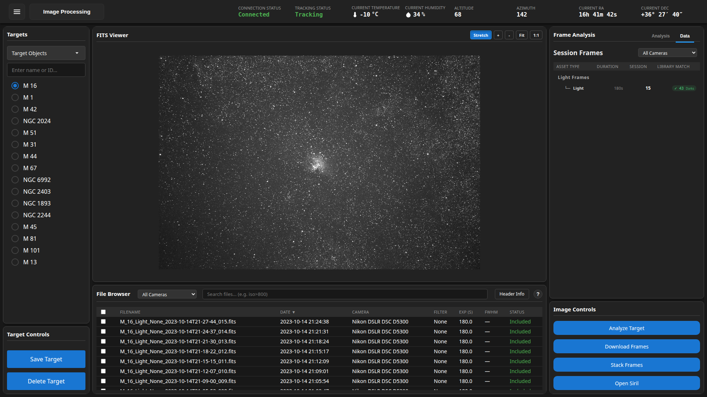

# Image processing tutorial

*Version 2.0 · 2026-10-15 · Status: current*

In this tutorial you take the frames of one target from raw files to a measured light curve. A light curve is a plot of a star's brightness over time. You will check your frames, stack them, plate solve them, and read the brightness of a star. Each step tells you what you should see before you move on.

## What you need

- Astrometrics is running. See [Getting started](../../Getting_Started.md).
- One target with at least 10 light frames in your image library. A light frame is one camera exposure of the sky. To copy frames from the telescope, use the recipe [Download captured frames](Observatory_Control_and_Automation_Guide.md#download-captured-frames).
- Matching dark frames in the library. A dark frame is an exposure with the camera covered. It records the heat noise of the sensor.
- Plate solving set up. Plate solving matches the stars in an image to a star catalog to learn where the image points. In Settings > Processing, enter an astrometry.net API Key, or install a local solver.
- Siril installed. Siril is the outside program that stacks the frames. Settings > Processing > Siril Executable names it.

## Step 1: Open your target

1. Click the mode button in the status header and choose Image Processing.
2. In the Targets list on the left, click your target. Use the search box or the Filter Targets tabs if the list is long.

**What you should see.** The FITS Viewer in the middle shows one of your frames. FITS is the standard file format for astronomy images. The File Browser under it lists every frame of the target, one row each, with Date, Camera, Filter and Exp (s). The viewer picks the frame with the longest exposure.

## Step 2: Check your frames and calibration

Calibration cleans each frame before stacking. The app subtracts the dark frames and the other calibration frames it finds in your library. You do not run a separate calibration step. You only check that the calibration frames are there.

1. In the Frame Analysis panel on the right, click the Data tab.
2. Find the Session Frames table. Each row is one exposure length.
3. Read the Session column. It is the number of light frames.
4. Read the Library Match column. A check mark with a number means that many matching dark frames are in the library.
5. Click a row in the File Browser to look at a single frame. Click the Header Info button to read its FITS header, the notes the camera saved with the image.

**What you should see.** Every row of Session Frames shows a check mark in Library Match. If a row says Missing, the library has no dark frame for that exposure length. Add dark frames with the Ingest From Telescope dialog before you go on.

## Step 3: Stack the frames

Stacking lines up your frames so each star falls on the same pixel, and then combines them. Real stars add up. Random noise averages out. Bad pixels from satellites and cosmic rays are thrown out.

1. Leave every box in the File Browser unticked to stack all frames. Tick boxes only to use a chosen set.
2. In the Image Controls panel, click Stack Frames.
3. In the Frame Analysis panel, click the Analysis tab.
4. Watch the status box until it reads Processing Successful.

**What you should see.** The status box reads Processing Active with a spinner, and the log fills with lines from the job. When the job ends, the box reads Processing Successful and the log ends with a success line. If the button reads Stacking requires matching cameras, your frames come from more than one camera. Tick the frames of one camera and try again. If it reads Pick one optic to stack, your frames were taken through more than one telescope or lens. Choose one in the Optic picker above the File Browser, or tick the frames of one optic, and try again.

Now look at the result.

1. Click the Data tab.
2. Find the Final Stack row. Click View.
3. If the image looks dark, look at the button above the viewer. If it reads Linear, click it to switch to the stretched view. A stretch brightens faint detail.

**What you should see.** The Final Stack row names the stack file, and its button now reads Viewing. Below that row, a Total Exposure line shows the exposure time of that stack, followed by its Plate Scale and Rotation when the stack has a plate solution, and its stack summary. The FITS Viewer shows the stack. It has less noise than a single frame, and faint stars stand out. Scroll to zoom in and drag to move around.

If the target also has a spectral stack, a Spectral Stack block follows with its own Total Exposure and stack summary. Each block shows only the values of its own stack. The Integration Goal row comes last, because it covers the whole target.

Pick how deep you want the image: Quick look, Standard or Deep. The line under it says whether you have reached the goal and, if not, about how much more integration time it needs. The time appears once the app has checked its estimate against a second night of this target; until then the line asks you to image the target on another night. Hover over the small info mark to see the goal and your current depth in magnitudes. Some objects, such as planets, have no integration goal, and the row says so.

Below the goal is a Stack Summary. It starts closed and shows one line, such as "Imaging stack summary: 42 of 45 frames, made on a date". Open it to see how the stack was made. It lists the frames used out of those submitted, the frames set aside before stacking, and the frames left out while stacking, with the reason for each. It also shows the share of pixels rejected and the star width in pixels against the width the input frames predict. The Warnings line lists each check of the stacking job that failed. Each warning has a plain title, the number measured, the limit it was checked against, and the outcome, which is always failed. Examples are a split in the sky background, calibration frames that do not match, wider stars, many rejected pixels, or a calibration check that failed. A warning also says what the stacking step did about it, when it did something. A stack made before the app recorded its job shows the failed checks stored for that stack instead. The line says that none was raised when there are none. A table lists each exposure length: how many of its frames were used, whether it clipped, how far it was moved to line up in pixels, and why it was left out of the final image, if it was. A target with no saved summary shows a short note instead. The summary only reports; it does not rate the stack beyond those failed checks.

Under the Set aside before stacking count, open Why they were set aside to see each frame the stacker moved into an `_excluded` folder. Each entry has a sentence, the measurement behind it, the file name and the exposure. A label of "Stars smeared, or far fewer stars than usual" covers two cases the stacker stores under one name, and the measurement under it tells which one it was. "Clouds" means far fewer stars than usual and a brighter sky. A frame that nothing explains says "No record of why this frame was set aside." A frame the app cannot put back automatically says why. The list only reads: it has no button to put a frame back.

Under the summary is a Compare with the previous stack section. Open it and press Compare to measure the current stack and the stack that came before it, the one a restack kept. Each number gets one sentence: the sky level, the noise in empty sky (the same noise number the target report uses), the flatness of the sky across the frame, the star width, and a fine-grain pixel noise. The run is a background job. If a stack has no sky coordinates, the app plate solves it first, which can take about ten minutes when the solve fails. A number that could not be measured says so and gives the reason. The section does not say which stack is better, because that depends on what changed: new flats should change the flatness and leave the noise alone, and more frames should lower the noise. A target that was never restacked says there is no previous stack.

The Frame status timeline further down the Data tab shows every frame of the target as one small square. The rows are the frame's status: Included, Flagged, or Set aside with the reason (cloud, trailed, off field, other). The time axis has one section for each night, labeled with the date and the number of frames, and a dotted line marks each break between nights. The days between nights are not drawn. Within a section the squares sit at the times the frames were taken. Hover over a square to see the file name, time, status and reason, and click it to pick that frame in the file list.

To make the stack's picture again without stacking, open the menu arrow on the Stack Frames button in the Image Controls panel and choose Post Process Target. The app makes the picture again from the stack that is there, for the imaging stack and then for the spectral stack, whichever the target has. It uses your current settings, and the stack is not changed. While it runs, the button shows Post Processing and cannot be pressed. This job has no Cancel button. It can take a minute. When it ends, the Image Viewer shows the new picture. If you attached your own picture to the target, the viewer keeps showing that one. The menu entry is off, and its tooltip says why, when the target has no stack.

To see what stacking would do before you start it, open the same menu and choose Check Frames. The app does not stack, move or save anything. It checks the same frames the Stack Frames button would send: the frames you ticked, or every listed frame when none is ticked. The check reads every frame, so it can take a minute. The report shows how many frames would be stacked, how many would be set aside, and how many are kept with a warning. Open the lists to see each set-aside frame and the reason: clouds, trailed stars, a frame off the field, a different gain or a different sky background. A frame with an uneven sky but normal stars is kept and flagged. A table shows, for each exposure length, the darks, bias and flats the library would use, with the folder they come from and a warning chip when the frames are only a near match, such as flats taken at another offset. If every frame would be set aside, or the choice matches no frames, an error message says so.

## Step 4: Plate solve and measure the stars

The next job plate solves your frames and then measures the brightness of every star in each frame.

1. In the File Browser, click the check box in the table header. This ticks every frame.
2. In the Image Controls panel, click Analyze Target. The arrow beside it opens a menu that runs only Astrometry, Photometry or Spectroscopy. Photometry and Spectroscopy run astrometry first when the stack has no solve or the solve is older than the stack.
3. Click the Analysis tab and watch the log until the job ends.
4. Click the Data tab.

**What you should see.** The log shows the job running, and the button changes to Cancel until the job ends. The Data tab then shows three counts: Total Images, Stars Found and Frames Processed. Stars Found is above zero.

Now check the plate solve.

1. Click the Astrometry button above the viewer, with the stack shown.

**What you should see.** The first time, a line beside the button shows the progress while the stars are named, and Analyze Target shows the job as running. Then small labels appear on the image. Each label sits on a star and carries its most familiar name. A dashed circle marks a star with no catalog name, and a cross marks a catalog star that was not detected. If the line says the stack could not be plate solved, check your plate solver in Settings > Processing.

## Step 5: Read a light curve

1. In the File Browser, click one of your frames, then click Astrometry. The labels now show the target's own catalog stars.
2. In the viewer, click the label of a bright star.
3. A message says that the star is opening in the Astronomy Manager. The view changes to the Astronomy Manager.
4. Look at the star list on the left. Rows with a P badge have photometry. Photometry means brightness measurements. If you see the note No photometry has been recorded for this star, click another star with a P badge.
5. Look at the Photometry panel in the middle.
6. Look at the Stellar Analysis panel on the right. Under Light Curve, read Measurements and Time span.
7. Drag the two Timeline sliders to look at part of the time range.
8. If a Run period analysis button shows under Period Search, click it. The search looks for brightness that rises and falls on a regular schedule.

**What you should see.** The Photometry panel plots brightness against time, with one point for each frame. For most stars the points scatter around a flat line. That is normal, because most stars do not change. After a period search, a Repeating Patterns section appears. It gives Detected period or Possible period, and Chance of noise. A low Chance of noise is more convincing.

## What you did

You checked that your frames had matching calibration frames, stacked them into one clean image, plate solved the frames, and read a star's brightness over time. You used four views of the app: Image Processing, the FITS Viewer, the Astrometry labels and the Astronomy Manager.

## Where to go next

The [user manual](User_Manual.md) describes every control you used here. The [Astronomy Manager section](User_Manual.md#astronomy-manager) also covers spectra, for frames taken through a diffraction grating.

## See also

- [User manual](User_Manual.md)
- [Observatory control guide](Observatory_Control_and_Automation_Guide.md)
- [Getting started](../../Getting_Started.md)
- [Pipeline review guides](../../library_design/pipelines/index.md)
