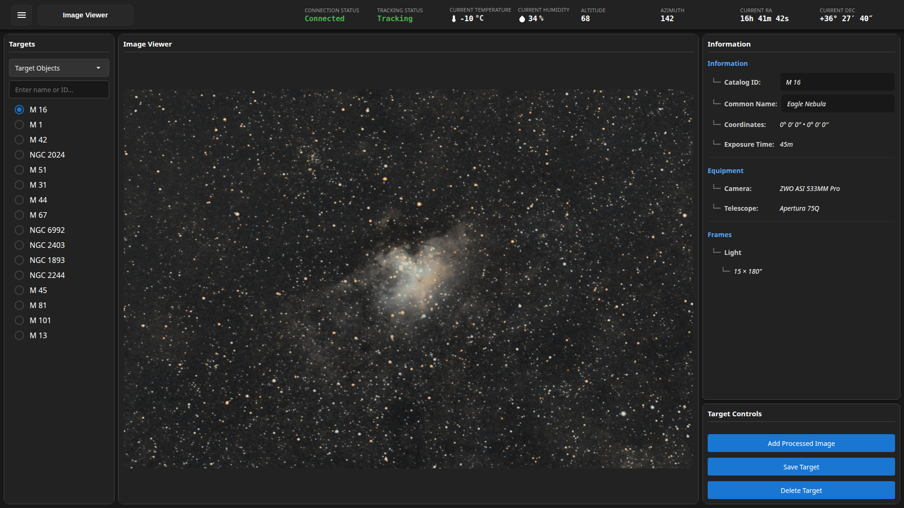
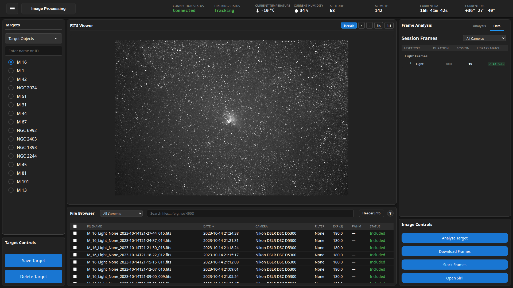
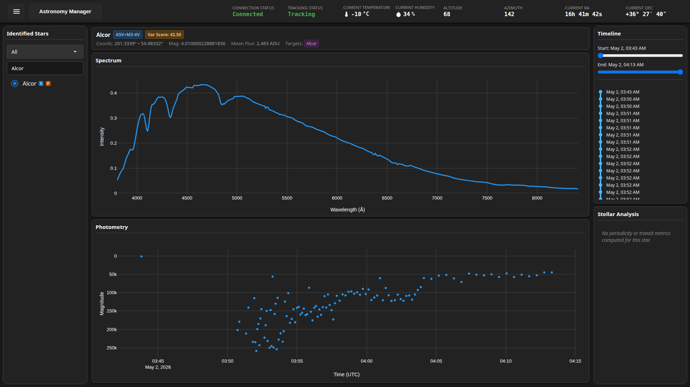
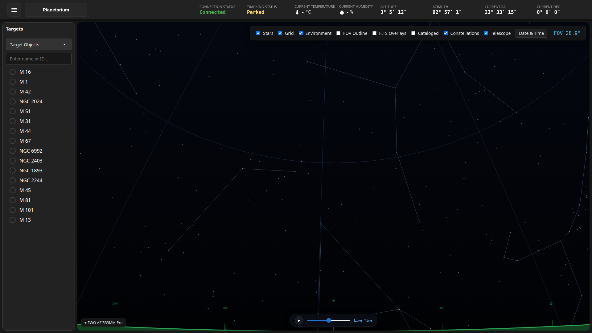
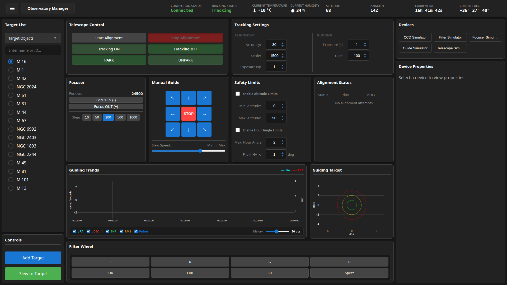
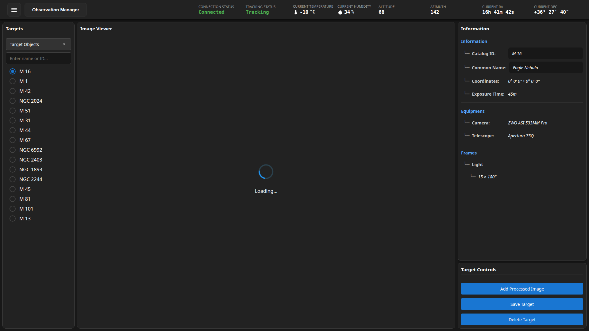

# User manual

*Version 2.0 · 2026-10-15 · Status: current*

This manual describes every view and panel of the Astrometrics desktop app. Use it to look up what a control does. It does not teach a task. To learn by doing, follow the [image processing tutorial](Image_Processing_and_Analysis_Tutorial.md). To run the telescope, use the [observatory control guide](Observatory_Control_and_Automation_Guide.md).

Each view has its own section. Every view section uses the same layout: **Purpose**, **Layout**, **Controls**, **Related settings** and **Related guides**. Button and label names appear in the same spelling as in the app.

## Views at a glance

The app has seven views. You switch between them with the mode button in the status header.

| View | Use it to | Section |
| --- | --- | --- |
| Image Viewer | Look at the finished image of a target and edit its name and coordinates | [Image Viewer](#image-viewer) |
| Image Processing | Check frames, stack them, and run star analysis | [Image Processing](#image-processing) |
| Command Console | Run Python commands and scripts, and read the documentation | [Command Console](#command-console) |
| Astronomy Manager | Inspect the light curve and spectrum of each star | [Astronomy Manager](#astronomy-manager) |
| Planetarium | See the sky, find objects, and send the telescope to them | [Planetarium](#planetarium) |
| Observatory Manager | Set up the equipment: mount, camera profiles, safety limits and calibration library, and watch guiding | [Observatory Manager](#observatory-manager) |
| Observation Manager | Keep a library of observation packages, plan tonight's session and follow its progress | [Observation Manager](#observation-manager) |

A light frame is one camera exposure file of the sky. A stack is the one image made by combining many frames. FITS is the standard file format for astronomy images.

## Window frame and status header

The top of every window has two bars. The title bar is the first. The status header is the second.

### Title bar

The title bar shows the Astrometrics name and icon. It appears only when the window uses the app's own frame, and it hides in full-screen mode.

| Control | What it does |
| --- | --- |
| Minimize window | Hides the window in the task bar |
| Maximize window or Restore window | Switches between full size and the earlier size. Double-clicking the bar does the same |
| Close window | Closes the window |

### Status header

The status header stays on screen in every view. It shows the state of the mount and lets you change view.

| Item | What it shows or does |
| --- | --- |
| Open settings button (three lines, left side) | Opens the [System Configuration dialog](#settings-dialog) |
| Mode button | Shows the name of the current view. Click it to open a menu of the enabled views |
| Pop-out button next to each view in the menu | Opens that view in a new window. It appears only in the desktop app |
| Colored dot and status text | The dot shows the mount connection. Green means connected. The text beside it reads, for example, Tracking, Not Tracking or Parked. The dot reads Checking… while the app is still connecting |
| TARGET | Name of the target the mount points at. It appears only when the mount reports one |
| CAM | Camera state, such as Idle or an exposure countdown, and the camera temperature when known |
| RA and DEC | Right ascension and declination: where the mount points on the sky |
| ALT and AZ | Altitude and azimuth: the same point as height above the horizon and compass direction |
| Thermometer and drop readouts | Outside temperature in °C and relative humidity in % |

A window narrower than 820 pixels hides CAM, ALT, AZ, temperature and humidity.

### Tray panel

The Astrometrics icon in the system tray opens a small panel. Click the icon again to close it.

| Item | What it does |
| --- | --- |
| Mount | Shows the tracking status, or Disconnected |
| RA / Dec and Alt / Az | Show where the mount points |
| Workspaces buttons | Switch the main window to Image Viewer, Astronomy Manager, Planetarium, Image Processing, Observatory or Observation Mgr |
| Park | Sends the park command to the mount at once. If it fails, an error message tells you to park the mount by hand |
| Open App | Brings the main window forward |
| Quit | Quits Astrometrics |

## Shared controls

Several views use the same lists and dialogs.

### Target list

The Image Viewer, Image Processing and Observatory Manager each have a target list on the left. It is made of two panels.

| Control | What it does |
| --- | --- |
| By catalog tab in Filter Targets | Lists the catalog choices: All Targets, Messier Catalog, NGC IC Catalog, Stars, Planets and No Image |
| By camera tab in Filter Targets | Lists your configured cameras with the number of targets each one imaged, plus All Cameras. The catalog and camera choices work together |
| A–Z and Newest | Sorts the list by name or by the most recently imaged |
| Search box | Filters the list by name or ID. Its hint reads Enter name or ID... |
| List rows | Click a row to select the target. A highlighted row means the telescope has a folder with the same name, which holds frames you have not downloaded |

### Add New Target dialog

The Observatory Manager and the Observation Manager open this dialog from their Add Target buttons.

| Field | What it holds |
| --- | --- |
| Target Name | Required. For example M42 |
| RA (Optional) | Right ascension, for example 05h 35m 17s |
| DEC (Optional) | Declination, for example -05d 23m 28s |

### FITS Header dialog

The Header Info buttons in Image Processing open this dialog. It lists the header of the chosen file. The header holds the notes the camera saved with the image, such as the exposure time. The table has the columns Keyword, Value and Comment. A Filter... box narrows the rows.

### Ingest From Telescope dialog

The Download Frames button in Image Processing and the Ingest frames button in the Observatory Manager Calibration Library open this dialog. It copies frames from the telescope's storage to your image library.

| Item | What it does |
| --- | --- |
| Target Name | The target the frames belong to. The name Calibration is for dark, bias and flat frames |
| Telescope | The telescope the frames came from |
| Files Found | Number of files in the matching folder on the telescope |
| File Selection | One check box per file. Select All and Deselect All change every box. Refresh reads the file list again |
| Dark Only, Bias Only and Flat Only | Appear when the target name is Calibration. Each one selects only that frame type |
| Start Ingestion | Starts the copy. It is hidden while a copy runs and after one finishes |
| Ingest Status | Shows Status, a progress line and a log |
| Start New | Appears after a copy finishes. It clears the dialog for another copy |
| Close | Closes the dialog |

When a copy finishes, the dialog closes by itself after about 1 s and the target is selected in the list.

## Image Viewer

**Purpose.** Look at the finished image of a target and keep its catalog details up to date.

**Layout.** Three columns. The left column is the [target list](#target-list). The center column shows the image. The right column shows target details and actions.

**Controls.**

| Control | What it does |
| --- | --- |
| Image Viewer panel, center | Shows the processed image of the selected target. The image is already stretched, so the viewer does not stretch it again. Drag to move the image. Scroll the mouse wheel to zoom |
| + and - | Zoom in and zoom out |
| Fit | Fits the whole image in the panel |
| 1:1 | Shows the image at actual size |
| Image Processing button | Opens the same target in the Image Processing view |
| Information panel, right | Shows Catalog ID, Common Name, Coordinates, Exposure Time, the camera and telescope, and the frame count for each filter and exposure length. Catalog ID and Common Name can be edited |
| Send to Phone | Opens LocalSend with the target's JPEG image ready to send |
| Save Target | Saves your edits to the target's Catalog ID and Common Name |
| Delete Target | Deletes the target after you confirm in the Delete Target dialog |

**Related settings.** The Displays boxes in Settings > General turn this view on or off. See [General tab](#general-tab).

**Related guides.** The [image processing tutorial](Image_Processing_and_Analysis_Tutorial.md) makes the image this view shows.

## Image Processing

**Purpose.** Check the frames of a target, stack them, and run star analysis on them.

**Layout.** Three columns. The left column is the [target list](#target-list). The center column holds the FITS Viewer above the File Browser. The right column holds the Frame Analysis panel above the Image Controls panel.

**Controls.**

The left column has two buttons under Target Controls.

| Control | What it does |
| --- | --- |
| Save Target | Saves edits to the selected target |
| Delete Target | Deletes the selected target after you confirm |

The FITS Viewer header has these controls.

| Control | What it does |
| --- | --- |
| FWHM and Rejected badge | Appears after analysis. FWHM is the width of a star's image at half its peak brightness, in pixels. The badge also shows how many frames were rejected |
| Stretch or Linear | Switches between the auto-stretched view and the linear view. The label shows the view in use. A stretch brightens faint detail |
| Astrometry | Shows or hides star labels drawn over the image. The labels exist only after a plate solve. If none exist, a message tells you to run plate solving first |
| + and - | Zoom in and zoom out |
| Fit and 1:1 | Fit the image to the panel, or show actual size |
| Image Viewer button | Opens the same target in the Image Viewer |

Drag the image to move it. Scroll to zoom. Click a star label to open that star in the Astronomy Manager.

The File Browser toolbar and table have these controls.

| Control | What it does |
| --- | --- |
| Camera box | Shows only the frames of one camera. All Cameras shows everything |
| Search box | Filters frames. The ? button explains the syntax. Examples are `cam: zwo`, `iso > 800`, `exp >= 30`, `name includes dark` and `(iso > 100 && exp > 60)` |
| Header Info | Opens the FITS Header dialog for the selected file |
| Trash button with a count | Appears when frames are ticked. It deletes the ticked files after you confirm. Deleting cannot be undone |
| Header check box | Ticks or clears every listed frame |
| Row check box | Ticks one frame. Shift-click ticks a range |
| Column headings Filename, Date, Camera, Filter and Exp (s) | Click a heading to sort by it |
| FWHM column | Star width of the frame, in pixels, when known |
| Status column | Shows Included, Rejected or Outlier |
| Row click | Shows that frame in the FITS Viewer |
| Row right-click | Turns the Outlier flag on or off. Use it for a frame with cosmic ray hits or a satellite streak |

The Frame Analysis panel has two tabs, Analysis and Data.

| Item | What it shows or does |
| --- | --- |
| Analysis tab, status box | Reads Idle, Processing Active, Processing Successful or Processing Complete. It streams the log of the running job. Cancel stops a running stack |
| Analysis tab, Recent Jobs | Lists earlier jobs for the target with a type, a status and a date. Click a job to read its log. Console opens the Command Console. × dismisses the job after you confirm |
| Data tab, Final Stack and Spectral Stack | One row for each stack that exists. Header Info opens its header. View shows it in the FITS Viewer, and the button then reads Viewing |
| Data tab, Total Exposure | The exposure time of the stack |
| Data tab, analysis results | Counts from the last analysis. A star analysis shows Total Images, Stars Found and Frames Processed. A spectrum analysis shows Total Images, Stars Processed and Spectra Extracted |
| Data tab, Session Frames | One row for each filter and exposure length. Session is the number of light frames. Library Match is the number of matching dark frames in the library, or Missing. The camera box narrows the table |

The Image Controls panel has these buttons.

| Control | What it does |
| --- | --- |
| Analyze Target | Starts a star analysis. It uses the ticked frames. With none ticked, it uses the final stack, then the shown file, then every listed frame. Spectral frames get spectrum extraction. Other frames get plate solving and photometry |
| Analyze Temporal Variation | Appears only for spectral frames that already have a spectral stack. It follows how each star's spectrum changes across the raw frames |
| Cancel | Replaces Analyze Target while an analysis runs |
| Download Frames | Opens the [Ingest From Telescope dialog](#ingest-from-telescope-dialog) |
| Stack Frames | Calibrates, aligns and combines the ticked frames. With none ticked, it uses every listed frame. Stack Frames is off when the frames come from more than one camera. The label then reads Stacking requires matching cameras. Right-click opens a Custom Stacking Parameters dialog, but in this version the dialog starts the same standard stack whatever you choose |
| Open Siril | Opens Siril for the target. Siril is the outside program that does the stacking |
| Summary lines | Show the selected Target, its Name and its Catalog ID |

**Related settings.** In Settings > Processing, set the astrometry.net API Key and the Siril Executable. In Settings > Advanced, set the local solver, the Siril Stack Weight and the Parallelism limits. See [Processing tab](#processing-tab) and [Advanced tab](#advanced-tab).

**Related guides.** Follow the [image processing tutorial](Image_Processing_and_Analysis_Tutorial.md). The pipeline steps are in the [pipeline review guides](../../library_design/pipelines/index.md).

## Command Console

**Purpose.** Run Python commands and scripts against the app's data and hardware, and read the documentation.

**Layout.** Three resizable columns. The left column holds a tab panel and the Workspace table. The center column is a code editor. The right column holds the Terminal and Documentation tabs.

**Controls.**

| Control | What it does |
| --- | --- |
| Scripts & Recipes tab | Lists your saved User Scripts and the built-in recipes. Click one to load it in the editor. + New starts a new script |
| Docs tab | Lists the documentation topics, with a filter box that reads Filter documentation & APIs... |
| Workspace table | Lists the variables in the console: Name, Type, Shape / Size and Value / Description. The refresh button reads them again. Built-in objects are pinned at the top |
| Editor toolbar: Clear | Empties the editor |
| Editor toolbar: Save Script | Saves the script under its file name |
| Editor toolbar: Run Script (Ctrl+Enter) | Runs the script. The button reads Running... until it ends |
| Terminal tab | Runs one Python line at a time. Press Enter to run. Tab completes a name. Up and Down recall earlier lines |
| Terminal: Clear | Clears the history on screen. Variables are kept |
| Terminal: Reset Workspace | Discards your variables and restores the built-in objects. History is kept |
| Documentation tab | Shows the selected topic. Links between topics open inside the tab |

The terminal starts with these names ready: `targets` (target catalog), `stars` (star catalog), `jobs` (job logs), `telescope` (mount control), `imaging` (camera sequencer), `np` (NumPy), `plt` (Matplotlib), and `help` and `doc(obj)` for help.

**Related settings.** The Displays box for Command Console in Settings > General turns this view on or off.

**Related guides.** The [pipeline review guides](../../library_design/pipelines/index.md) and the library documentation open from the Documentation tab.

## Astronomy Manager

**Purpose.** Inspect the brightness history (light curve) and the spectrum of each star the app has identified.

**Layout.** Three columns. The left column picks a star. The center column shows the star summary and two plots. The right column holds the Timeline and Stellar Analysis panels.

**Controls.**

| Control | What it does |
| --- | --- |
| By target and By spectral class | Choose how to browse. By target lists your targets. By spectral class lists star classes from O (hottest) to M (coolest) |
| Targets or Spectral classes list | Pick a target or a class. Each has a search box |
| Star list | Lists the stars for that pick. Its title reads Stars in the target, Class and a letter, or All stars. S marks a star with a spectrum. P marks a star with photometry, which means brightness measurements. Prev and Next page through long lists |
| Star summary card | Shows the star name, spectral type and pattern badges, RA / Dec, Mag (smaller means brighter) and the Targets that contain the star. Click a target name to open it in Image Processing with the Astrometry labels on |
| Locate in Planetarium | On the summary card. Centers the Planetarium on the star |
| Spectrum panel | Plots flux against wavelength. Click the plot to place a marker that shows the wavelength λ in Å (ångström, a unit of length: 1 Å is 0.1 nm). × removes a marker. A note appears when the measured range is smaller than the range asked for |
| Hide Feature Lines | Shows or hides the labeled lines for features found in the spectrum. It appears when the spectrum has features |
| Photometry panel | Plots brightness over time. Brighter is up when the data are magnitudes |
| Time Series and Phase-Folded | Appear when a period is known. Phase-Folded stacks the cycles on top of each other |
| Timeline panel | Two sliders set the start and end of the time range. The plots show only that range. Text shows the range and how many time points it holds |
| Quality card | The first card of the Stellar Analysis panel. It says in plain words how far to trust the star's result. A statement has a kind word (Result for a finding such as a star class, or Warning, Recommendation, Limit or Not enough data), a confidence chip (Measured, Partly measured or Tentative) and one or two plain sentences. A Show all button lists more statements. A statement with cited frames has an Evidence button. It opens the list of those frames in the Image Viewer. Each row in that list has an Open image button, which shows the frame in the Image Viewer. A row whose file the library cannot find shows the reason instead. A calibration statement has Show in calibration library, which opens the [Observatory Manager](#observatory-manager) calibration row. Technical values are available through the library and the AI companion |
| Stellar Analysis panel | Shows the results as sections: Light Curve, Stellar Classification, Glowing Gas, Emission Lines, Absorption Features and Repeating Patterns. Hover a result to read what it means |
| Run period analysis | In the Period Search section. Searches the light curve for a regular rise and fall or a repeating dip. It shows only when the star has no result yet and has enough measurements |

A plot that has no data collapses to a one-line note. The notes read No spectrum has been recorded for this star and No photometry has been recorded for this star.

**Related settings.** None. Results come from the analysis you ran in Image Processing.

**Related guides.** The [image processing tutorial](Image_Processing_and_Analysis_Tutorial.md) ends in this view. The method behind each result is in the [pipeline review guides](../../library_design/pipelines/index.md).

## Planetarium

**Purpose.** See the sky from your site, find objects, and send the telescope to them.

**Layout.** The left column lists targets and stars. The center is the sky map with a toolbar at the top right and a time bar at the bottom.

**Controls.**

| Control | What it does |
| --- | --- |
| By target and By spectral class | Work as in the [Astronomy Manager](#astronomy-manager). Picking a star centers the map on it and zooms to a 1° field |
| Layers menu | Opens check boxes for Stars, Constellations, Coordinate Grid, Deep Catalog, Ground Horizon and Tracking Risk Heatmap. The heatmap colors the sky by how likely stars are to trail in your mount's tracking |
| Telescope and FOV Outline check boxes | Show the mount's pointing mark, and the outline of the camera's field of view |
| Session menu | Shows No Session Selected, All Sessions (Cumulative), or one dated session. A session draws its alignment points on the map. Click a point to open a card with the pointing error, the frame count, the exposure total and charts of drift |
| Date & Time button | Opens the Date and Time dialog. Its Date and Time tab has arrows for year, month, day, hour, minute and second. Its Julian Day tab moves in steps of 1.0 day. Reset to Now returns to the live sky |
| FOV readout | Shows the field of view of the map in degrees |
| Mouse drag | Moves the view |
| Mouse wheel | Zooms between 0.05° and 135° |
| Arrow keys | Move the view by 10% of the field of view. Ctrl+Up and Ctrl+Down zoom |
| Click on an object | Selects it and opens an information card |
| Right-click on an object | Opens a menu with the star ID and coordinates. Open in Astronomy Manager appears when the object has a spectrum or photometry. Slew Telescope Here appears when a mount is connected. It is greyed while Ekos controls the equipment, with a Why unavailable? button beside it |
| Information card | Lists Magnitude and Spectral Type for stars, then RA/Dec in degrees and in hours-minutes-seconds, Alt/Az, Hour Angle and Rise/Set. View in Astronomy Manager appears for stars with data |
| Add to observation package | On the information card. Opens the chosen target's planned or suggested package in the Observation Manager library, or makes an empty one. It works for any catalog star. A message says what happened, and a refusal appears under the button |
| Framing button and panel | Opens a panel for the chosen target with Rows, Columns, Overlap (%) and a rotation. The panel lists each panel's center and rotation, and the map outlines each panel. The library works out the numbers. The rotation is in degrees east of north, as Ekos and KStars give it |
| Send framing to package | In the Framing panel. Saves the center, rotation and panels in the target's package. It is off, with the reason shown, until a target is chosen and the panel list has panels |
| Time bar: play button | Starts and pauses the turning of the sky. While it plays, a menu sets the speed: 1x, 5x, 25x, 100x or 1000x |
| Time bar: slider | Moves the time from 12 h before now to 12 h after. The label reads Live Time or the offset in hours |
| Equipment button | Shows the camera name. It opens a panel with Telescope, Focal Length, Camera, Pixel Size, Sensor, `Plate Scale` and FOV. Only the camera can be changed there |
| Deep catalog prompt | Appears when the Gaia DR3 star catalog is missing or incomplete on this computer. It shows a command to run in a terminal. Copy copies it. Not now and Don't remind me hide the prompt |

**Related settings.** The Equipment tab in Settings holds the cameras and optics that the Equipment button lists. The Mount Hostname in the Observatory tab sets where the mount is.

**Related guides.** The [observatory control guide](Observatory_Control_and_Automation_Guide.md) has the recipe for slewing to an object.

## Observatory Manager

**Purpose.** Set up and watch the equipment: the mount, the camera profiles, the safety limits, guiding, the calibration library and the connected INDI devices. INDI is the open standard that lets software talk to astronomy hardware.

**Layout.** The left column is the target list. The center column holds the control panels in rows: Telescope Control, Tracking Settings and the Calibration Library on top; then Camera Profiles, Manual Guide and Safety Limits; then and Guiding Trends with the Alignment and Guiding panel at the bottom. The right column holds the Devices and Device Properties panels. The page does not scroll. A panel that is too small for its content scrolls inside itself.

**Who controls the equipment.** Ekos (the KStars imaging program) captures the frames for now, and this app only watches. While Ekos is in control, the controls that send a command to a device are greyed out. The panels that hold such controls show a Why unavailable? button in the title bar. Hover over it, focus it with the keyboard, or click it to read the reason. The reason also appears as text when you hover over the greyed controls. Panels that only show information, such as Guiding Trends, stay as they are.

**Controls.**

| Control | What it does |
| --- | --- |
| Add Target | Opens the [Add New Target dialog](#add-new-target-dialog). It is not a device command, so it stays on |
| Slew to Target | Moves the mount to the coordinates of the selected target. Greyed while Ekos is in control |
| Start Alignment and Stop Alignment | Start and stop centering on the selected target by plate solving. Plate solving matches the stars in an image to a star catalog. Greyed while Ekos is in control |
| Tracking ON and Tracking OFF | Turn the mount's star tracking on or off. Greyed while Ekos is in control |
| PARK and UNPARK | Send the mount to its parked position, or free it for use. Greyed while Ekos is in control |
| Alignment and Guiding tabs in Tracking Settings | The Alignment tab holds Accuracy, Settle and Exposure (s). The Guiding tab holds Exposure (s) and Gain. Switch tabs with a click or the arrow keys. Greyed while Ekos is in control. This view has no button that starts guiding |
| Camera Profiles | Under Recorded noise, a table gives the gain (electrons per analog-to-digital unit, one step of the stored pixel value) and the read noise (electrons) for each camera setting. The first column shows the camera name with its setting (gain, offset, binning and temperature) on a second line. Each value has an Evidence word under it: Measured, Partly measured or Tentative (a datasheet or assumed value). A camera with no recorded noise reads Not measured |
| Measure noise | A button in the Camera Profiles title bar. It opens a small form. Pick a camera, type a Gain and an Offset, and click Measure. The library reads flat and bias frames and shows the result. Nothing is saved until you click Save measurement and confirm. Close, or the Escape key, shuts the form and puts the focus back on the button |
| Manual Guide | Eight arrow buttons move the mount while you hold them, and stop when you let go. STOP halts all mount motion. The Slew Speed slider sits beside the pad and has four steps, from Min to Max: Guide, Centering, Find and Max. Greyed while Ekos is in control |
| Safety Limits | Shows the active telescope's name and its saved limits on two tabs. The Altitude tab holds Enable altitude limits, Minimum altitude and Maximum altitude. The Hour angle tab holds Enable hour angle limit, Maximum hour angle and Meridian flip after. Apply safety limits is in the title bar, so it is always in view. It is on only after you change a value on either tab. It saves the limits for the active telescope, and a message reminds you to copy the session into Ekos again, because Ekos keeps its own copy. The library refuses limits that do not make sense, such as a minimum above the maximum, and the panel shows its reason. Apply is greyed while Ekos is in control. The panel reads No active telescope until you choose a telescope in the Settings Equipment tab |
| Alignment and Guiding | One panel with two tabs. The Alignment tab is a table of recorded centering rounds with Time, Target, Status, dRA and dDEC in arcseconds. Time is the clock time for today, or the date and time for earlier nights; on a narrow window the Time column is hidden so the target names fit. The symbols are ⟳ solving, ✓ aligned, ⚠ outside tolerance, ✗ failed and — idle; hover over a symbol to read its word. The rows are the library's records as stored. The Guiding target tab is a bullseye chart of dRA against dDEC that fills the tab. Points near the center mean good guiding |
| Guiding Trends | Plots guiding error over time. The check boxes dRA, dDEC, SNR, RMS and Pulses choose the lines. The History slider sets 10 to 100 points. Both sit in the title bar, so the plot fills the panel. Before any guiding data arrives, the panel says so instead of drawing an empty plot |
| Calibration Library | The Camera box picks a camera. The small refresh button beside it reads the library again. A second line gives the Darks, Biases and Flats counts for that camera. The Darks table (Exposure, Offset and Count) is always shown below, with room for at least four rows, and scrolls inside the panel. Exposures under one second read in milliseconds, such as 10 ms; longer ones in seconds, such as 30 s. The Ingest frames button in the panel header opens the [Ingest From Telescope dialog](#ingest-from-telescope-dialog). A quality statement can send you here with Show in calibration library: the panel switches to that camera and highlights the matching row, or says that no row matches |
| Devices | One button for each INDI device. It reads No INDI devices connected. when none are found |
| Device Properties | Lists the properties of the chosen device, and lets you edit them |

The view has no Focuser and no Filter Wheel panel. Ekos moves both.

**Related settings.** The Observatory tab in Settings holds the Mount Hostname, the INDI Port and the Available Filters. The Equipment tab holds the cameras and telescopes. See [Observatory tab](#observatory-tab).

**Related guides.** Every recipe for this view is in the [observatory control guide](Observatory_Control_and_Automation_Guide.md).

## Observation Manager

**Purpose.** Plan what to image. You keep a library of observation packages, one for each target, and edit one package at a time. You place packages in tonight's session and watch how far the night got.

An observation package is the plan for one target: a list of exposure rows (type, count, filter, exposure time and delay), the dither setting, and the framing sent from the Planetarium. An observation session is one night's list of packages, in order. There is one session for each night. Sessions are set up by hand, here and in Ekos, for now. The app copies nothing into Ekos for you.

**Layout.** The page does not scroll, and panels scroll inside themselves.

- Across the whole top: the Execution Queue.
- Left column: the Observation Packages library.
- Center: the package editor. On the left, the Image Planner (Exposures and Dither tabs) with the Image List under it; on the right, Last Image.
- Right column: Visible Targets.

You work on one thing at a time. Picking a package in the library, or a card in the Execution Queue, clears the other pick.

**Execution Queue.**

| Control | What it does |
| --- | --- |
| Queue cards | One card for each package in tonight's session, in order. A card shows the target name and total run time (such as 3 min) on one line, and the run state and frame progress on the next. It does not repeat the exposure rows. Click a card, or its pencil, to load the package into the editor, where the Image List shows the rows. Drag cards to reorder them. The × removes a card after you confirm. The row of cards scrolls sideways only when there are more cards than fit the window. Move earlier and Move later buttons on each card change its place from the keyboard |
| Run state | A chip on each card: Imaging now, Not imaging, Done, Partly done, Not run or Progress unknown. The card of the package being imaged is marked as the current step. A progress bar reads, for example, 12 of 20 frames. A short note can follow. The library counts the frames. The view only shows the counts |
| as of | The time of the last progress read. The view reads again each minute, because frames arrive without any message |
| Imaging now | A package counts as imaging now when a frame for it arrived in the last few minutes. This is read from the frames, because Ekos runs the queue (see the [validation register](../../library_design/validation/wayfinding.md), WAY-D84, Design estimate) |
| Checklist (N) | Opens a list of things to do before or during the night, such as taking flat frames. The library adds the items. Tick an item when it is done. Ticks are saved |
| Start Imaging Session | Runs the queue with the app's own sequencer. It is a device command, so it is greyed while Ekos controls the equipment, and a Why unavailable? button beside it gives the reason. It is also off when the queue is empty. Run the night in Ekos for now |

**Observation Packages library.**

| Control | What it does |
| --- | --- |
| Suggested, Planned and Complete tabs | The three lists, each with a count. Suggested packages come from the library. Planned packages are the ones you made or kept. A package is Complete when enough good frames have arrived for all its rows. If frames are later set aside and the rows are no longer met, it moves back to Planned |
| New package | Opens a search box over the targets in the library. Pick a target to open its package. A target with a planned package opens that one. Else a suggested one opens. Only a target with neither gets a new, empty package. The library creates a target from a catalog name if it is not yet in the library, and refuses a name it cannot find |
| Add Target | Opens the [Add New Target dialog](#add-new-target-dialog), for a target that is not in the library yet. New package picks from the targets already there |
| Refresh suggestions | At the top of the Suggested tab. Asks the library to look again at which targets need more frames. A line above the tabs says that the refresh started, then reports what changed, for example Suggestions updated: 1 added. The app also refreshes after frames are measured and after a sync |
| Package card | Shows the target name. A suggested card also shows a confidence chip: Measured, Partly measured or Tentative. Click a card to load it into the editor |
| Dismiss and Undo | On a suggested card. Dismiss hides the suggestion until the evidence behind it changes. A notice follows with Undo and Close |
| Reopen | On a complete card. Moves the package back to Planned, and it counts new frames only |
| Delete package | In the Image List title bar, for a library package. Asks you to confirm, and cannot be undone |

Adding a package to the session makes it Planned. Suggestions update and delete themselves when the frames are no longer needed. If you have a suggestion open and a refresh removes it, your form stays open with a notice and a Save as planned package button.

**Package editor.**

| Control | What it does |
| --- | --- |
| Image Planner: Type | Light, Dark, Flat or Bias |
| Image Planner: Exposures tab | Count, Filter, Exposure and Delay: the number of frames, the filter, the exposure time in seconds and the pause between frames in seconds. The Filter list holds the filters set in Settings, Observatory, Filters, by their short names (for example L and SPEC). With none set, it offers None and says where to set them |
| Add to List | Adds the row to the package. While you edit a row, the button pair reads Update and Cancel |
| Test Image | Takes one frame now with the current Type, Exposure and Filter. The Last Image panel then shows it. It is a device command, so it is greyed while Ekos controls the equipment, with a Why unavailable? button beside it |
| Image Planner: Dither tab | Dither shifts the pointing slightly between frames. Tick Dither between frames to turn it on. Every sets how many frames pass between shifts, and Scale sets the size of the shift in pixels; both are greyed while dither is off |
| Image List | Lists the package's rows with #, Type, Count, Exposure, Delay and Filter, and a pencil and an × that edit and remove a row. Times read as 60 s, and the luminance filter reads L. With no rows it says to add one with the Image Planner |
| Add to Sequence | In the Image List title bar. Adds the package, as edited, to tonight's session at the end of the Execution Queue. While you edit a queued card, Cancel and Modify replace this button |
| Last Image | Shows the newest captured frame. A button switches between the linear and the stretched view. The frame updates when a capture ends |

Each editor panel reads Choose a package or New package until you pick one. The editor has no framing controls. Framing comes from the Planetarium (see [Planetarium](#planetarium)).

**Visible Targets.** A table with Target, Alt, Az and Until (UTC) for the targets now above the horizon. Until (UTC) is the time of day, in UTC, when the target sets, or Circumpolar. A long name is cut short; hover over it to read it all. Click a row, or press Enter on it, to open that target's package. It works like New package: it opens the existing planned or suggested package, and makes an empty one only if the target has neither.

**Not in this view.** Target quality statements are not shown here. They are for the library and the AI companion. The view also has no target status table, mosaic planner or calibration library. The calibration library is in the Observatory Manager.

**Related settings.** The Available Filters in Settings > Observatory should match the filters the wheel holds.

**Related guides.** The [observatory control guide](Observatory_Control_and_Automation_Guide.md) has the recipes for test frames and sequences.

## Settings dialog

The Open settings button in the status header opens the System Configuration dialog. It has five tabs on the left. Revert reloads the saved values. Save writes your changes and closes the dialog. Click outside the dialog or use the close button to leave without saving.

### General tab

| Setting | What it holds |
| --- | --- |
| Enable Secondary Window | Opens a second window |
| Secondary Window Display | The view the second window shows |
| Displays check boxes | One box for each view. Clear a box to hide that view from the mode menu |
| Library Path | The folder of your image library. Captured frames live in a `frames` folder inside it |
| Reindex Library | Scans all local folders of lights, darks, flats and biases, and brings the index files up to date |

### Observatory tab

| Setting | What it holds |
| --- | --- |
| Mount Hostname | The computer name or address where the INDI server runs |
| INDI Port | The port of the INDI server |
| `Remote Pictures Path` | The folder on the telescope computer that holds captured frames |
| Minimum Altitude (deg) and Maximum Altitude (deg) | Altitude limits for observing |
| Available Filters | Filter names separated by commas. They should match what the filter wheel holds |
| Allow Telescope Commands (Disable Safe Mode) | Lets the app command the telescope (controller mode). Without it the app only watches and computes (monitoring mode). It acts at once when ticked. Save is not needed. A message lists any part that is not yet eligible |

### Equipment tab

Each list has an Add box and a Remove button for every entry.

| List | Fields |
| --- | --- |
| Optics | Focal Length (mm), Focal Ratio |
| Setups | Camera, Optic |
| Cameras | Name, Name Aliases, Record Name, Pixel Size (μm), Sensor Width (px), Sensor Height (px), Grating Distance (mm), Sensor Min Wavelength (nm), Sensor Max Wavelength (nm), Default ISO |

Each camera also shows read-only Calibration Data: Clip Ceiling (ADU), Saturation Threshold (ADU) and Photometric Linearity Limit (ADU). They come from running calibration. ADU is the unit of a pixel's raw value.

### Processing tab

| Setting | What it holds |
| --- | --- |
| astrometry.net API Key | Key for the online plate solver. Plate solving needs it or a local solver that you install separately |
| Siril Executable | The Siril command, for example `siril-cli` for an apt install |

### Advanced tab

These are install-time and speed settings. Most users do not change them.

| Setting | What it holds |
| --- | --- |
| Index Path | Folder of the index files for the local plate solver |
| Autoindex | Turns on automatic index choice for the local solver |
| CPU Limit (seconds) | Time limit for the local solver |
| Stack Weight | Leave blank unless Siril came from Flatpak. The value `wfwhm` weights frames by measured star sharpness |
| Target Workers, Photometry Workers and Worker Niceness | How many worker processes run, and how much they yield to other programs |
| Max Concurrent Jobs | Most heavy jobs at once, shared by stacking and by photometry and spectroscopy analysis |

## See also

- [Image processing tutorial](Image_Processing_and_Analysis_Tutorial.md)
- [Observatory control guide](Observatory_Control_and_Automation_Guide.md)
- [Getting started](../../Getting_Started.md)
- [Pipeline review guides](../../library_design/pipelines/index.md)
